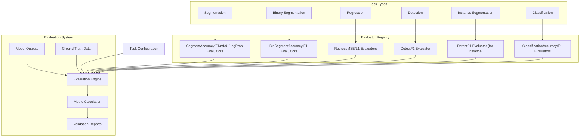
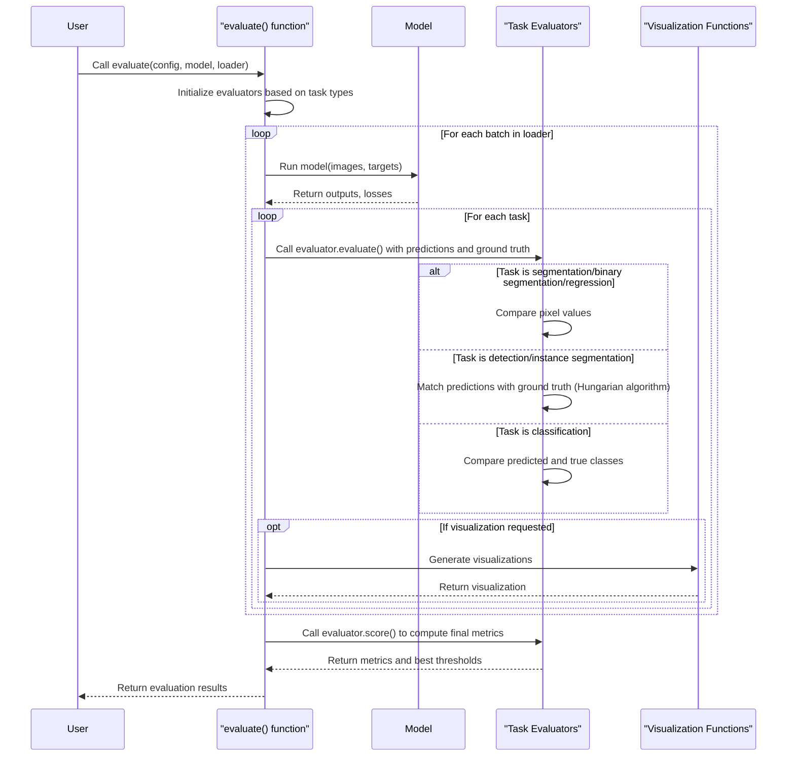
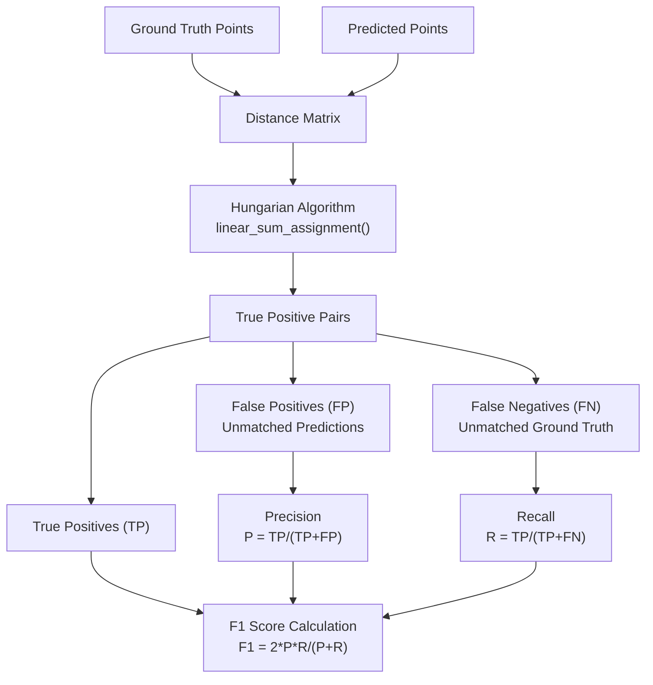
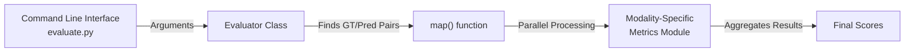
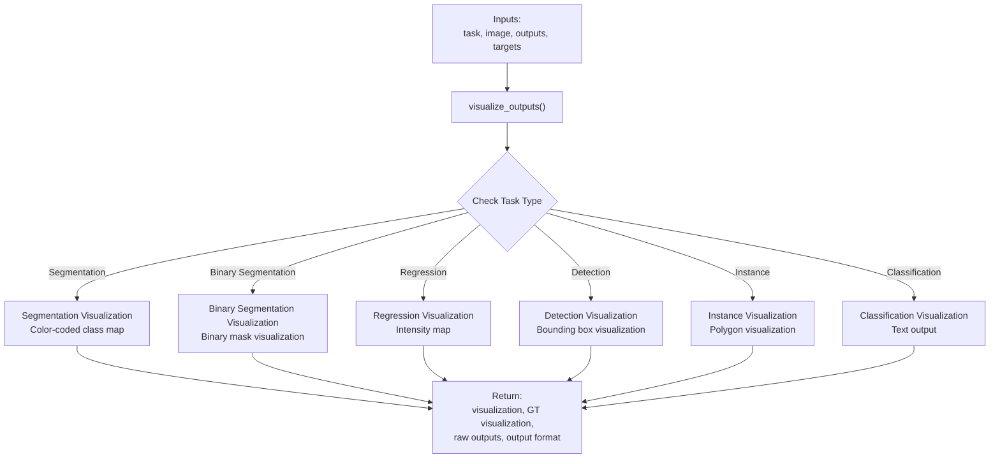

<!-- source: DeepWiki mcp.deepwiki.com · repo allenai/satlas · page 5 Data Validation and Evaluation · fetched 2026-10-26 -->

# Data Validation and Evaluation

Relevant source files

The following files were used as context for generating this wiki page:

- [DataValidationReport.md](DataValidationReport.md)
- [ModelArchitecture.md](ModelArchitecture.md)
- [images/satlasnet.svg](images/satlasnet.svg)
- [satlas/cmd/evaluate.py](satlas/cmd/evaluate.py)
- [satlas/metrics/evaluator.py](satlas/metrics/evaluator.py)
- [satlas/model/evaluate.py](satlas/model/evaluate.py)

## Purpose and Scope

This document describes the data validation and evaluation framework in Satlas, which is responsible for assessing the quality and accuracy of model outputs against ground truth data. The Satlas evaluation system supports multiple task types (segmentation, detection, regression, classification) with various metrics appropriate for each task. This page focuses on the technical implementation of the evaluation system including the evaluator classes, metrics calculation, and validation workflow.

For information about the metrics used for specific tasks, see [Metrics](#5.1).

Sources: [satlas/model/evaluate.py:1-825](), [DataValidationReport.md:1-84]()

## Evaluation Framework Overview

The evaluation framework in Satlas consists of multiple components that work together to measure model performance across different geospatial tasks. The framework supports evaluation for various task types, each with appropriate metrics to quantify performance.

Sources: [satlas/model/evaluate.py:74-565]()

### Task Types and Evaluators

The Satlas evaluation system supports the following task types, each with specific evaluator implementations:

| Task Type | Evaluator Classes | Metrics |
|-----------|------------------|---------|
| Segmentation | SegmentAccuracyEvaluator SegmentLogProbEvaluator SegmentF1Evaluator SegmentMIOUEvaluator | Accuracy Log Probability F1 Score Mean IoU |
| Binary Segmentation | BinSegmentAccuracyEvaluator BinSegmentF1Evaluator | Accuracy F1 Score |
| Regression | RegressMseEvaluator RegressL1Evaluator | MSE L1 (MAE) |
| Detection | DetectF1Evaluator | F1 Score |
| Instance Segmentation | DetectF1Evaluator | F1 Score |
| Classification | ClassificationAccuracyEvaluator ClassificationF1Evaluator | Accuracy F1 Score |

All evaluators are registered in the `evaluator_registry` dictionary, which maps task types and metric names to evaluator classes.

Sources: [satlas/model/evaluate.py:74-565](), [satlas/model/evaluate.py:537-564]()

## Evaluation Workflow

The evaluation process in Satlas follows a well-defined workflow from model inference to metric calculation and reporting.

Sources: [satlas/model/evaluate.py:825-880](), [satlas/model/evaluate.py:634-823]()

### Key Components

1. **Main Evaluation Function**:
   The `evaluate()` function in [satlas/model/evaluate.py:825-880]() serves as the main entry point for evaluation. It takes a configuration, model, data loader, and additional parameters.

2. **Evaluator Initialization**:
   For each task in the configuration, an appropriate evaluator is initialized based on the task type and specified metric.

3. **Model Inference**:
   The model is run on each batch of data from the loader to generate predictions.

4. **Metric Calculation**:
   For each task, the corresponding evaluator compares predictions with ground truth to calculate metrics.

5. **Visualization** (optional):
   If requested, visualizations of model outputs and ground truth are generated.

6. **Result Aggregation**:
   Final metrics are computed by aggregating results across all batches.

Sources: [satlas/model/evaluate.py:825-880](), [satlas/model/evaluate.py:634-823]()

## Metrics Calculation

The Satlas evaluation system implements various metrics for different task types. Here's a closer look at how some key metrics are calculated:

### Location-Based Performance Metrics

For detection tasks, the system uses the Hungarian algorithm to match predicted points with ground truth points and compute precision and recall:

The location-based performance metrics use either:
- Center-based evaluation: Uses Euclidean distance between points
- IoU-based evaluation: Uses Intersection over Union for bounding boxes

Sources: [satlas/model/evaluate.py:19-71](), [satlas/model/evaluate.py:313-431]()

### Segmentation Metrics

Segmentation tasks support multiple metrics including accuracy, F1 score, and mean IoU:

1. **Accuracy**: Percentage of correctly classified pixels
2. **F1 Score**: Harmonic mean of precision and recall, calculated per class
3. **Mean IoU**: Mean Intersection over Union across all classes

For binary segmentation (e.g., solar farm detection), the system tries multiple thresholds to find the optimal F1 score.

Sources: [satlas/model/evaluate.py:74-106](), [satlas/model/evaluate.py:126-168](), [satlas/model/evaluate.py:170-267]()

### Regression Metrics

Regression tasks (e.g., tree cover density) typically use Mean Squared Error (MSE) or Mean Absolute Error (L1 norm):

- **MSE**: Average of squared differences between predicted and true values
- **L1**: Average of absolute differences between predicted and true values

Sources: [satlas/model/evaluate.py:269-311]()

## Validation Reports

The Satlas team generates validation reports for their geospatial data products, which provide estimates of precision and recall on a per-continent basis. These reports help users understand the reliability of the data products.

### Validation Methodology

The validation method varies by the type of data product:

1. **Precision Estimation**:
   - 100 objects are uniformly sampled from each continent
   - Each sampled object is manually checked for correctness
   - Precision is calculated as the percentage of correct objects

2. **Recall Estimation**:
   - Uses hand-labeled validation sets
   - Calculated as the percentage of ground truth objects detected by the model

Sources: [DataValidationReport.md:1-22]()

### Sample Validation Results

The validation reports include detailed tables showing precision and recall by continent for each data product. For example:

| Data Product | Metrics | 
|--------------|---------|
| Solar Farms | Precision ranges from 57% (Africa) to 97% (Asia) Recall ranges from 57.4% (Oceania) to 89.1% (North America) |
| Onshore Wind Turbines | Precision ranges from 94% (Oceania) to 100% (several regions) Recall is 93.2% globally |
| Offshore Wind Turbines | Precision is 99% or higher where available Recall ranges from 91.1% (Asia) to 97% (Europe) |
| Offshore Platforms | Precision ranges from 81% (Oceania) to 96% (Asia/South America) Recall ranges from 48.3% (Asia) to 90.6% (Africa) |

These validation reports provide users with transparent information about the reliability of the data products across different geographic regions.

Sources: [DataValidationReport.md:24-80]()

## Command-Line Evaluation Tools

Satlas provides command-line tools for running evaluations on datasets. The main entry point is the `evaluate.py` script.

The command-line tool supports:

1. **Path Specification**: Paths to ground truth and prediction directories
2. **Modality Selection**: Specify which modality to evaluate (e.g., solar, wind_turbine)
3. **Format Selection**: Either 'static' or 'dynamic' evaluation format
4. **Split Selection**: Which dataset split to evaluate on

Sources: [satlas/cmd/evaluate.py:1-23](), [satlas/metrics/evaluator.py:1-75]()

### Parallel Evaluation

The Evaluator class in Satlas uses multiprocessing to run evaluations in parallel across multiple tiles:

1. The `map()` method finds all relevant tiles in the ground truth and prediction directories
2. For each tile, it runs the provided evaluation function in parallel
3. Results are collected and returned as a list

This parallel approach significantly speeds up evaluation on large datasets.

Sources: [satlas/metrics/evaluator.py:27-75]()

## Visualization

The evaluation system includes built-in visualization capabilities for different task types. The `visualize_outputs()` function generates visualizations of model outputs and ground truth:

The visualization function handles different task types appropriately:
- For segmentation tasks, it generates color-coded class maps
- For detection tasks, it draws bounding boxes
- For instance segmentation, it visualizes polygons
- For regression tasks, it produces intensity maps

Sources: [satlas/model/evaluate.py:634-823]()

---

