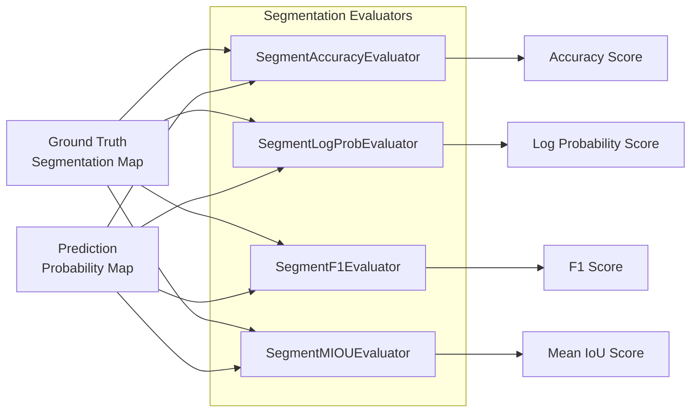
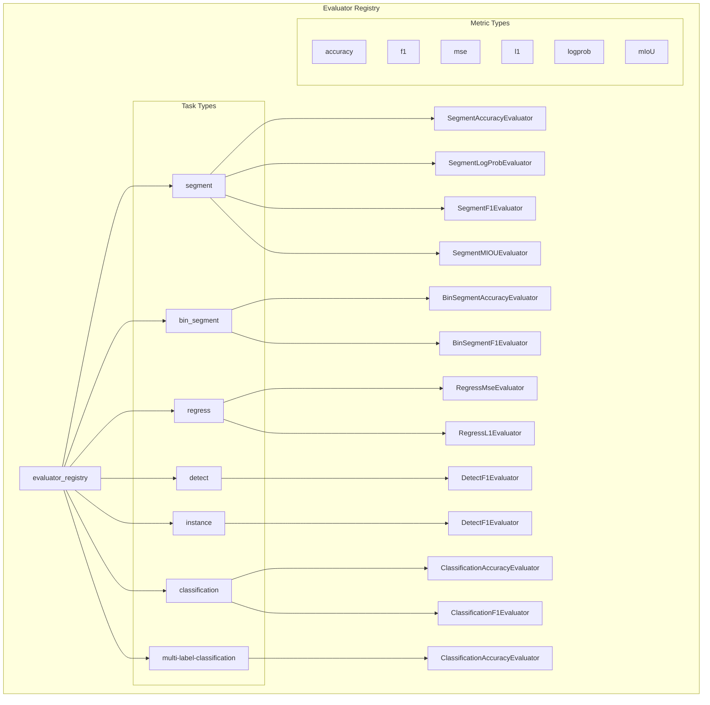
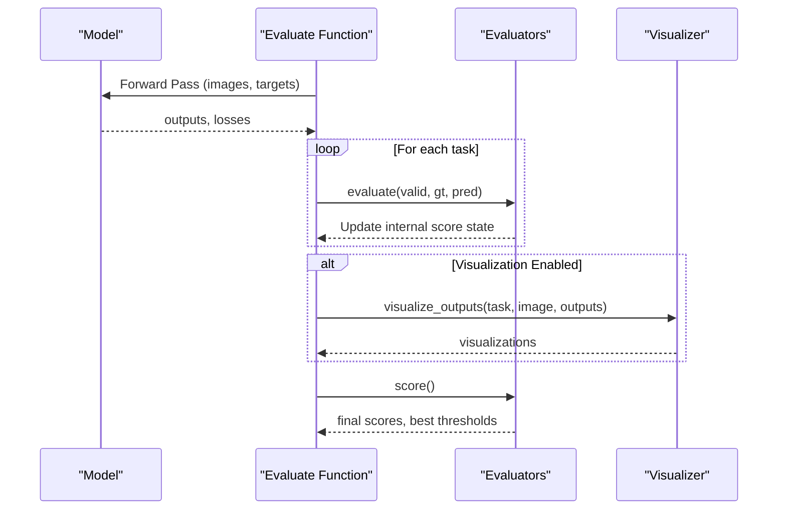
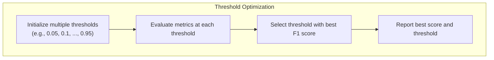
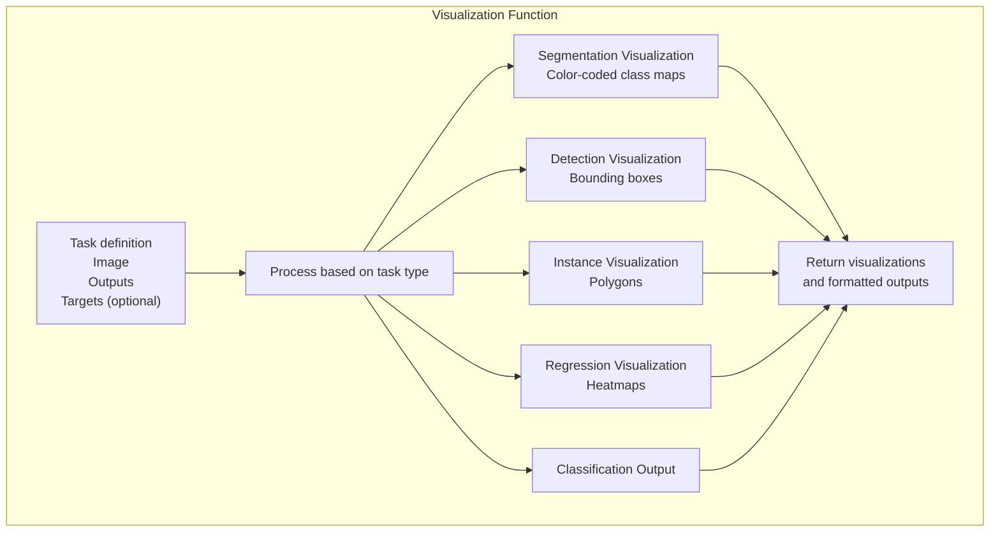

<!-- source: DeepWiki mcp.deepwiki.com · repo allenai/satlas · page 5.1 Metrics · fetched 2026-10-26 -->

# Metrics

Relevant source files

The following files were used as context for generating this wiki page:

- [satlas/metrics/point.py](satlas/metrics/point.py)
- [satlas/metrics/polygon.py](satlas/metrics/polygon.py)
- [satlas/metrics/polyline.py](satlas/metrics/polyline.py)
- [satlas/metrics/property.py](satlas/metrics/property.py)
- [satlas/metrics/raster.py](satlas/metrics/raster.py)
- [satlas/model/evaluate.py](satlas/model/evaluate.py)

This document provides a detailed overview of the evaluation metrics system in Satlas. The metrics system is responsible for quantitatively assessing model performance across various task types and data formats. Understanding these metrics is essential for evaluating model performance, comparing different model architectures, and making informed decisions during the training process.

For information about the validation process itself, see [Data Validation and Evaluation](#5).

## Evaluation Metrics Overview

The Satlas metrics system provides multiple specialized evaluators for different task types, including segmentation, detection, regression, and classification. The metrics system is designed to handle the diverse geospatial task requirements of the Satlas model and provide standardized performance measurements.

```mermaid
flowchart TD
    subgraph "Evaluation Metrics System"
        EvalSystem[Evaluator System]
        
        subgraph "Task-specific Evaluators"
            SegmentEval["Segmentation Evaluators"]
            BinSegmentEval["Binary Segmentation Evaluators"]
            RegressEval["Regression Evaluators"]
            DetectEval["Detection Evaluators"]
            InstanceEval["Instance Segmentation Evaluators"]
            ClassEval["Classification Evaluators"]
        end
        
        subgraph "Data-specific Metrics"
            PointMetrics["Point Metrics"]
            PolygonMetrics["Polygon Metrics"]
            PolylineMetrics["Polyline Metrics"]
            RasterMetrics["Raster Metrics"]
            PropertyMetrics["Property Metrics"]
        end
        
        EvalSystem --> SegmentEval
        EvalSystem --> BinSegmentEval
        EvalSystem --> RegressEval
        EvalSystem --> DetectEval
        EvalSystem --> InstanceEval
        EvalSystem --> ClassEval
        
        EvalSystem --> PointMetrics
        EvalSystem --> PolygonMetrics
        EvalSystem --> PolylineMetrics
        EvalSystem --> RasterMetrics
        EvalSystem --> PropertyMetrics
    end
    
    ModelOutputs[Model Predictions] --> EvalSystem
    GroundTruth[Ground Truth Labels] --> EvalSystem
    EvalSystem --> PerformanceMetrics["Performance Metrics"]
```

Sources: [satlas/model/evaluate.py:537-565](), [satlas/metrics/point.py](), [satlas/metrics/polygon.py](), [satlas/metrics/polyline.py](), [satlas/metrics/raster.py](), [satlas/metrics/property.py]()

## Task-specific Evaluators

Satlas supports a diverse set of tasks, each requiring specialized evaluation metrics. The evaluator system is organized based on task types and metric categories.

### Segmentation Evaluators

Segmentation tasks involve pixel-wise classification of satellite imagery. Four primary metrics are provided:

1. **Accuracy** (`SegmentAccuracyEvaluator`): Measures the percentage of correctly classified pixels
2. **Log Probability** (`SegmentLogProbEvaluator`): Evaluates the log probability of the ground truth classes
3. **F1 Score** (`SegmentF1Evaluator`): Harmonic mean of precision and recall
4. **Mean IoU** (`SegmentMIOUEvaluator`): Mean Intersection over Union across classes

Sources: [satlas/model/evaluate.py:74-169]()

### Binary Segmentation Evaluators

Binary segmentation evaluates presence/absence predictions for each class independently:

1. **Accuracy** (`BinSegmentAccuracyEvaluator`): Percentage of correctly classified pixels
2. **F1 Score** (`BinSegmentF1Evaluator`): Computes F1 score at multiple thresholds and selects the best

The `BinSegmentF1Evaluator` is particularly important as it automatically finds the optimal threshold for each class by testing multiple thresholds (0.05 to 0.95 by default).

Sources: [satlas/model/evaluate.py:170-267]()

### Regression Evaluators

For regression tasks that predict continuous values:

1. **Mean Squared Error** (`RegressMseEvaluator`): Measures average squared difference between predictions and ground truth
2. **L1 Error** (`RegressL1Evaluator`): Measures average absolute difference

Sources: [satlas/model/evaluate.py:269-311]()

### Detection Evaluators

For object detection tasks that predict bounding boxes:

1. **F1 Score** (`DetectF1Evaluator`): Computes F1 score by matching predicted and ground truth boxes using either center-based distances or IoU metrics

The detection evaluator supports two evaluation types:
- `center`: Matches predictions to ground truth based on center point distance
- `iou`: Matches predictions to ground truth based on box IoU

The evaluator tries multiple score thresholds (0.05 to 0.95 by default) and reports the best F1 score for each class.

Sources: [satlas/model/evaluate.py:313-431]()

### Classification Evaluators

For classification tasks:

1. **Accuracy** (`ClassificationAccuracyEvaluator`): Percentage of correctly classified examples
2. **F1 Score** (`ClassificationF1Evaluator`): Computes F1 score across multiple thresholds

Sources: [satlas/model/evaluate.py:433-565]()

## Evaluator Registry and Configuration

The Satlas evaluation system uses an evaluator registry to map task types and metric names to the corresponding evaluator classes. This registry allows for flexible configuration of metrics in the training and validation processes.

Sources: [satlas/model/evaluate.py:537-565]()

## Data-specific Metrics

In addition to task-specific evaluators, Satlas implements specialized metrics for different geospatial data types:

### Point Metrics

Point metrics evaluate the detection of point features such as wind turbines, lighthouses, and other discrete objects. The main metric is the F1 score, which is computed by:

1. Matching predicted points to ground truth points using spatial proximity
2. Computing precision and recall based on these matches
3. Calculating the F1 score as the harmonic mean of precision and recall

Sources: [satlas/metrics/point.py]()

### Polygon Metrics

Polygon metrics evaluate the detection and delineation of polygon features like solar farms, airports, and buildings. Two primary metrics are used:

1. **F1 Score**: Measures the ability to detect polygons
2. **IoU (Intersection over Union)**: Evaluates the quality of polygon delineation

The polygon evaluation process includes:
- Converting features to Shapely geometries
- Spatial indexing for efficient matching
- Computing IoU between matched polygons
- Determining matches using a minimum IoU threshold (0.1)

Sources: [satlas/metrics/polygon.py]()

### Polyline Metrics

Polyline metrics evaluate the detection of linear features such as roads, railways, and rivers. The polyline evaluation:

1. Converts polylines to rasterized masks
2. Applies dilation to allow for small spatial differences
3. Computes pixel-wise true positives, false positives, and false negatives
4. Calculates the F1 score based on these counts

Sources: [satlas/metrics/polyline.py]()

### Raster Metrics

Raster metrics evaluate pixel-based predictions:

1. **Regression Error**: For continuous value prediction tasks
2. **Segmentation F1**: For segmentation tasks

The raster evaluation process:
- Loads ground truth and prediction PNG files
- Computes task-appropriate metrics (error for regression, F1 for segmentation)
- Aggregates scores across all evaluated tiles

Sources: [satlas/metrics/raster.py]()

### Property Metrics

Property metrics evaluate the prediction of feature properties:

1. **Category Accuracy**: For categorical properties
2. **Numeric Accuracy**: For numerical properties
3. **Classification Accuracy**: For classification tasks

Sources: [satlas/metrics/property.py]()

## Evaluation Process

The evaluation process follows a structured workflow to compute metrics across different task types and data formats:

The main evaluation function (`evaluate`) in [satlas/model/evaluate.py:825-932]() orchestrates this process:

1. Initializes evaluators based on the configuration
2. Processes each batch from the data loader
3. Passes predictions and ground truth to the appropriate evaluators
4. Optionally generates visualizations
5. Computes and returns final scores

Sources: [satlas/model/evaluate.py:825-932]()

## Threshold Optimization

A key feature of many Satlas evaluators is automatic threshold optimization. For classification, detection, and segmentation tasks, multiple probability thresholds are tested to find the optimal value for each class:

This process:
1. Tests a range of thresholds for each class
2. Computes precision, recall, and F1 score at each threshold
3. Selects the threshold that maximizes the F1 score
4. Reports both the best score and the corresponding threshold

This automatic optimization is implemented in `BinSegmentF1Evaluator`, `DetectF1Evaluator`, and `ClassificationF1Evaluator`.

Sources: [satlas/model/evaluate.py:186-267](), [satlas/model/evaluate.py:313-431](), [satlas/model/evaluate.py:454-535]()

## Output Visualization

The metrics system also provides visualization capabilities to help interpret model predictions and performance:

The `visualize_outputs` function ([satlas/model/evaluate.py:634-823]()) handles:
1. Creating visual representations of model predictions
2. Generating corresponding ground truth visualizations
3. Formatting raw outputs for export
4. Supporting all Satlas task types

Sources: [satlas/model/evaluate.py:634-823]()

## Practical Usage

The metrics system is used in several key workflows:

### During Training

During training, metrics are computed on validation data after each epoch to:
1. Track model improvement
2. Guide hyperparameter tuning
3. Implement early stopping based on validation performance

### For Model Evaluation

For comprehensive model evaluation:
1. The `evaluate` function is called on a test dataset
2. Results are aggregated across all samples
3. Detailed metrics are reported for each task and class

### For Data Product Validation

When generating data products:
1. Predictions are compared against held-out validation data
2. Task-appropriate metrics are computed (F1 for detection, IoU for segmentation, etc.)
3. Results determine whether the data product meets quality standards

Sources: [satlas/model/evaluate.py:825-932]()

## Performance Considerations

Evaluating large geospatial datasets requires efficient implementation:

1. **Spatial Indexing**: Used in polygon and point evaluation to reduce computational complexity
2. **Parallel Processing**: The metrics modules support parallel evaluation through map functions
3. **Adaptive Evaluation**: Different metrics are used based on data availability and task types

Sources: [satlas/metrics/polygon.py:53-60](), [satlas/metrics/point.py:35-42]()

---

