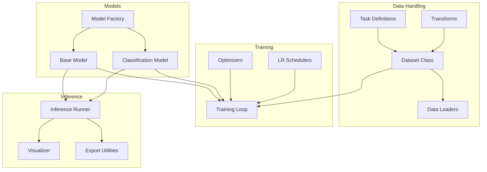
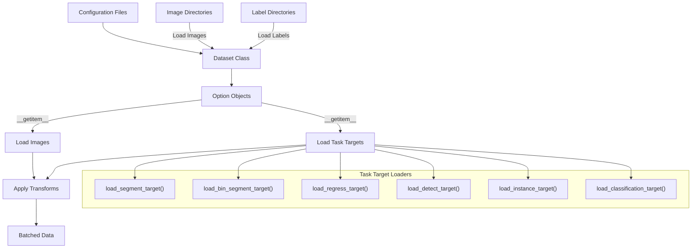
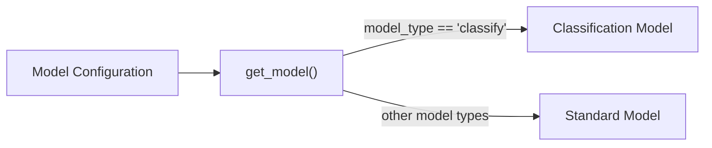
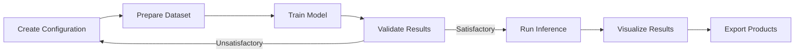

<!-- source: DeepWiki mcp.deepwiki.com · repo allenai/satlas · page 6 Developer Guide · fetched 2026-10-26 -->

# Developer Guide

<details>
<summary>Relevant source files</summary>

The following files were used as context for generating this wiki page:

- [.gitignore](.gitignore)
- [LICENSE](LICENSE)
- [requirements.txt](requirements.txt)
- [satlas/model/classify.py](satlas/model/classify.py)
- [satlas/model/dataset.py](satlas/model/dataset.py)
- [satlas/model/models.py](satlas/model/models.py)

</details>


## Purpose and Scope

This guide provides technical information for developers working with the Satlas codebase. It covers the repository structure, core components, integration points, and development practices. This document focuses on implementation details rather than high-level concepts. For an overview of the Satlas system, see [Overview](#1). For specific information about data normalization, configuration examples, and utilities, see [Image Normalization](#6.1), [Configuration Examples](#6.2), and [Utilities](#6.3) respectively.

## Repository Structure and Environment Setup

### Dependencies

Satlas requires several Python libraries for processing geospatial data and deep learning:

```
scipy
numpy
rasterio
scikit-image
shapely
tqdm
torch
torchvision
torchaudio
vit_pytorch
```

Sources: [requirements.txt:1-11]()

### Environment Setup

To set up your development environment:

1. Clone the repository
2. Install the required dependencies using pip:
   ```bash
   pip install -r requirements.txt
   ```
3. Set up your configuration files for training or inference

## Core Components

Satlas organizes its functionality into several key modules. Below is a diagram showing the main components and their relationships:



Sources: [satlas/model/dataset.py:1-836](), [satlas/model/models.py:1-9](), [satlas/model/classify.py:1-128]()

## Working with Datasets

### Task Definitions and Data Format

Satlas supports a variety of task types for geospatial analysis:

| Task Type | Description | Example Categories |
|-----------|-------------|-------------------|
| `bin_segment` | Binary segmentation | 'road', 'railway', 'river' |
| `segment` | Multi-class segmentation | 'water', 'developed', 'tree' |
| `regress` | Regression | 'tree_cover', 'dem' |
| `detect` | Object detection | 'wind_turbine', 'offshore_platform' |
| `instance` | Instance segmentation | 'solar_farm', 'airport' |
| `classification` | Image classification | 'smoke', 'snow' |
| `multi-label-classification` | Multi-label classification | Various types |

Tasks are defined in `dataset.py` with categories, colors for visualization, and other properties.

Sources: [satlas/model/dataset.py:16-331]()

### Dataset Class

The `Dataset` class is the primary interface for loading and processing satellite imagery and associated labels. Here's a diagram showing how the Dataset class works:



The Dataset class initializes with task specifications, transforms, and channels. It loads examples from directories and creates Option objects for each valid example. When fetching an item, it loads images and targets based on the task type.

Sources: [satlas/model/dataset.py:631-836]()

### Loading Target Data

Different task types have specialized loading functions:

1. For segmentation tasks: `load_segment_target()` loads PNG masks
2. For binary segmentation: `load_bin_segment_target()` loads multi-class binary masks
3. For detection tasks: `load_detect_target()` loads JSON files with bounding boxes
4. For instance segmentation: `load_instance_target()` loads polygon data
5. For classification: `load_classification_target()` loads text labels

All loading functions handle invalid cases gracefully and return properly formatted tensors.

Sources: [satlas/model/dataset.py:372-614]()

## Model System

### Model Factory

Satlas uses a factory pattern to create the appropriate model based on the configuration:



The `get_model()` function selects between the classification model and the standard multi-head model based on the configuration.

Sources: [satlas/model/models.py:1-9]()

### Classification Model

The classification model supports various backbone architectures:

| Backbone | Variants | Description |
|----------|----------|-------------|
| ResNet | 18, 34, 50, 101, 152 | Standard ResNet architectures |
| Swin Transformer | T, S, B | Standard Swin Transformer |
| Swin Transformer V2 | T, S, B | Version 2 of Swin Transformer |
| ViT | - | Vision Transformer |

The model handles single-label and multi-label classification tasks with appropriate loss functions:
- Single-label: Cross-entropy loss
- Multi-label: Binary cross-entropy with logits

Sources: [satlas/model/classify.py:1-128]()

## Development Workflow

### Typical Development Cycle



1. Create a configuration file defining tasks, datasets, and model parameters
2. Prepare your dataset in the expected format
3. Train the model
4. Validate the results
5. Run inference on new data
6. Visualize and export results

### Working with Task Specifications

When creating new tasks or modifying existing ones, you'll need to define a task specification in your configuration file:

```json
{
  "Name": "my_task",
  "Task": {
    "type": "detect",
    "categories": ["background", "my_object"],
    "colors": [[0, 0, 0], [255, 0, 0]]
  },
  "LabelDir": "/path/to/labels",
  "TrainSplit": "/path/to/train_split.json",
  "ValSplit": "/path/to/val_split.json",
  "TestSplit": "/path/to/test_split.json"
}
```

The task specification defines the task type, categories, visualization colors, and paths to data.

## Extending Satlas

### Adding New Tasks

To add a new task:

1. Define the task specification in `dataset.py` or in your configuration file
2. Ensure you have an appropriate target loading function for the task type
3. If needed, implement a new task type by adding a loading function and modifying the Dataset class

### Custom Models

To create a custom model:

1. Create a new model class that follows the interface of the existing models
2. Update the `get_model()` function in `models.py` to return your custom model
3. Define appropriate loss functions and output handling for your model

## Best Practices

1. **Configuration Files**: Keep configuration files for different experiments separately versioned
2. **Data Organization**: Follow the expected directory structure for datasets
3. **Memory Management**: Be mindful of image sizes and batch sizes, especially with large satellite images
4. **Validation**: Always validate models on a separate validation set before running inference
5. **Task Design**: Carefully consider how to represent your geospatial problems as supported task types

## License Information

Satlas is released under the Apache License, Version 2.0. When modifying the code or creating derivative works, ensure you comply with the license terms.

Sources: [LICENSE:1-202]()

---

