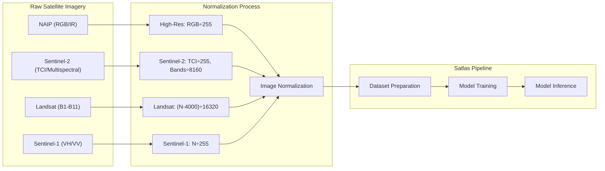
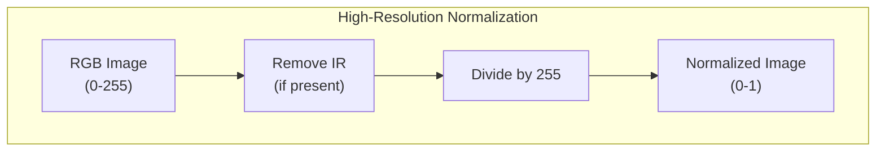
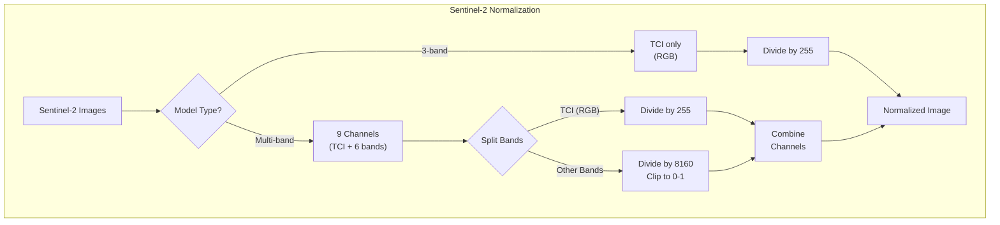
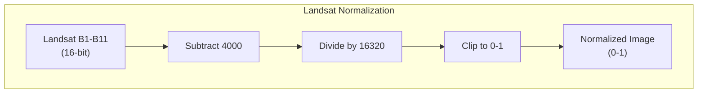
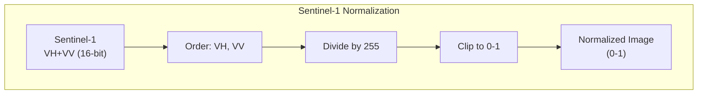
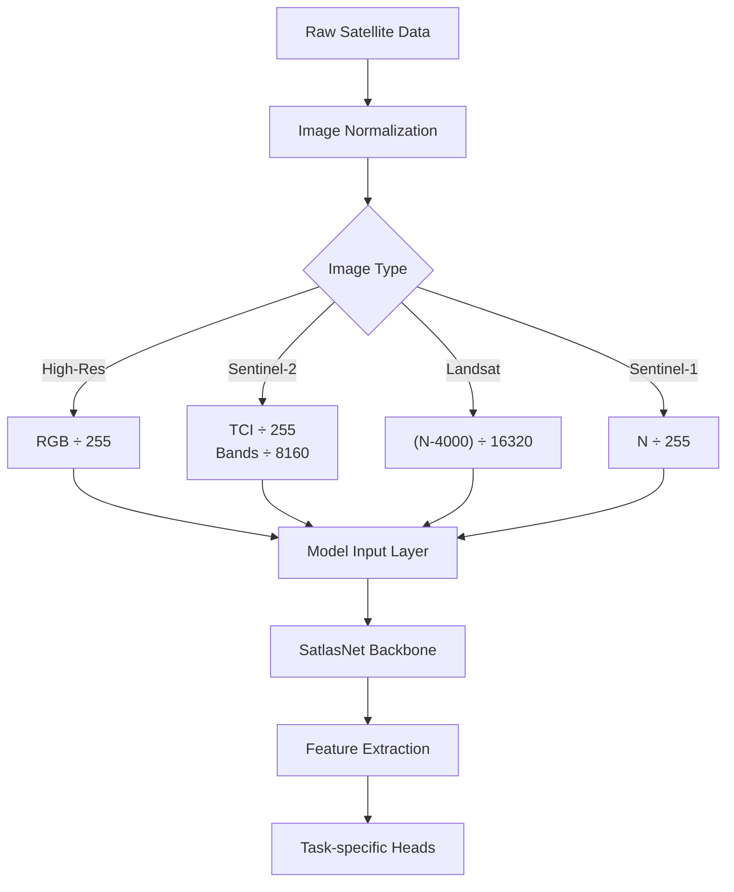

<!-- source: DeepWiki mcp.deepwiki.com · repo allenai/satlas · page 6.1 Image Normalization · fetched 2026-10-26 -->

# Image Normalization

<details>
<summary>Relevant source files</summary>

The following files were used as context for generating this wiki page:

- [Normalization.md](Normalization.md)

</details>


## Purpose and Scope

This document explains how satellite imagery is normalized for input into Satlas models. Image normalization is a critical preprocessing step that standardizes pixel values from different satellite sensors and image sources to a consistent range (0-1), making them suitable for model training and inference. This standardization ensures that models can process diverse imagery consistently, regardless of the original value ranges or acquisition parameters.

The page covers normalization procedures for all satellite image types supported by Satlas: high-resolution imagery (NAIP, Google Earth), Sentinel-2, Landsat, and Sentinel-1.

For information about using normalized images in the training pipeline, see [Training Pipeline](#3.2).

## Normalization in the Satlas Pipeline

Image normalization is a key step in the Satlas data processing workflow, positioned between raw image acquisition and dataset preparation for model training or inference.



**Normalization in Model Architecture**

Normalization is explicitly integrated into the SatlasNet model architecture, serving as the first processing step before features are extracted by the backbone network.

```mermaid
flowchart LR
    Input["Raw Satellite Images"] --> LoadImg["Load Images"]
    LoadImg --> GetBands["Extract Bands"]
    GetBands --> ImgNorm["Image Normalization"]
    ImgNorm --> Backbone["Swin-v2-Base Backbone"]
    Backbone --> TemporalPool["Temporal Max Pooling"]
    TemporalPool --> FPN["Feature Pyramid Network"]
    FPN --> TaskHeads["Task-specific Heads"]
```



Sources: [Normalization.md:1-4]()

## Normalization Methods by Image Type

All Satlas models expect input imagery to be normalized to the 0-1 range, but the specific normalization procedure varies by imagery type. The following table summarizes the normalization approaches:

| Image Type | Bands | Source Range | Normalization Formula | Clipping |
|------------|-------|--------------|------------------------|----------|
| High-Resolution (NAIP, Google Earth) | RGB | 0-255 | value ÷ 255 | None |
| Sentinel-2 TCI | RGB | 0-255 | value ÷ 255 | None |
| Sentinel-2 Multispectral | B05, B06, B07, B08, B11, B12 | 0-65535 | value ÷ 8160 | 0-1 |
| Landsat | B1-B11 | 0-65535 | (value - 4000) ÷ 16320 | 0-1 |
| Sentinel-1 | VH, VV | 0-65535 | value ÷ 255 | 0-1 |

Sources: [Normalization.md:3-124]()

### High-Resolution Images

For high-resolution imagery like NAIP and Google Earth:
- Remove the infrared (IR) channel if present (NAIP often has a 4th IR channel)
- Divide the 0-255 RGB values by 255 to normalize to 0-1 range



Sources: [Normalization.md:6-12]()

### Sentinel-2 Images

Satlas supports two types of Sentinel-2 models:

1. **3-band models**:
   - Input only the TCI (True Color Image) file
   - Divide the 0-255 RGB values by 255

2. **Multi-band models** (9 channels):
   - TCI (RGB): Divide by 255
   - Additional bands (B05, B06, B07, B08, B11, B12): Divide by 8160 and clip to 0-1
   - Expected channel order: TCI (3 channels), B05, B06, B07, B08, B11, B12



Sources: [Normalization.md:42-53]()

### Landsat Images

For Landsat-8 and Landsat-9 imagery:
- Input all 11 bands (B1-B11) in order
- For each band, normalize using: (pixel_value - 4000) ÷ 16320
- Clip the result to 0-1 range



Sources: [Normalization.md:110-115]()

### Sentinel-1 Images

For Sentinel-1 SAR imagery:
- Input 2 bands (VH polarization followed by VV polarization)
- Only Level-1 GRD IW vh+vv products with 10m pixel spacing are supported
- Normalize by dividing by 255 and clipping to 0-1



Sources: [Normalization.md:118-123]()

## Implementation Examples

### High-Resolution Image Normalization

For high-resolution images, the normalization process involves:

1. Identifying the coordinates of interest
2. Obtaining imagery (e.g., from Google Maps or NAIP)
3. Loading the image using a library like torchvision
4. Normalizing by dividing by 255

```python
# Load high-resolution image
import torchvision
im = torchvision.io.read_image(image_path)
# Normalize to 0-1 range
im = im.float() / 255
# Now the image is ready for model input
```

Sources: [Normalization.md:15-39]()

### Sentinel-2 Image Normalization

For Sentinel-2 imagery, the process is more complex, especially for multi-band models:

1. Download scenes from Copernicus SciHub
2. Extract and merge relevant bands using GDAL
3. Rearrange bands into the expected order
4. Apply appropriate normalization to each band type

The code example in the documentation shows how to:
- Merge bands across scenes using GDAL
- Reorder bands to match model expectations
- Normalize TCI and multispectral bands differently
- Save the normalized stack for model input

Sources: [Normalization.md:57-107]()

## Integration with the Satlas System

The normalization process is a critical link between raw satellite data and the model system. Different Satlas models expect different types of normalized inputs:



Sources: [Normalization.md:1-124]()

## Best Practices

1. **Verify Image Type**: Ensure you're applying the correct normalization procedure for your specific imagery type.
2. **Channel Order**: Pay close attention to the expected channel order, especially for multi-band Sentinel-2 models.
3. **Clipping Values**: After normalization, confirm that all values are properly clipped to the 0-1 range.
4. **Configuration Files**: Check the model configuration file to verify the expected input channels (e.g., `configs/satlas_explorer_solar_farm.txt` for Sentinel-2 multi-band models).
5. **Batch Processing**: For multiple images, maintain consistent normalization across the batch.

Sources: [Normalization.md:45-54]()

---

