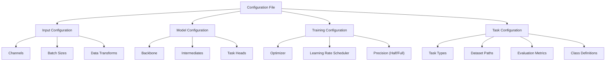
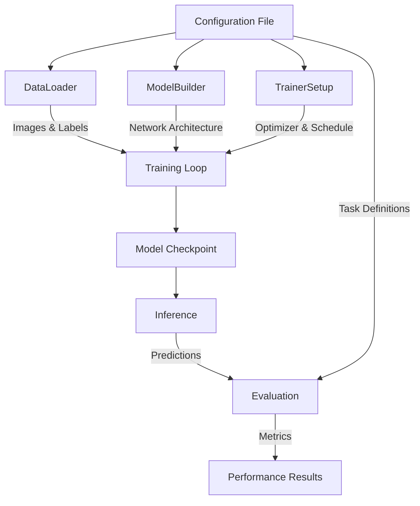
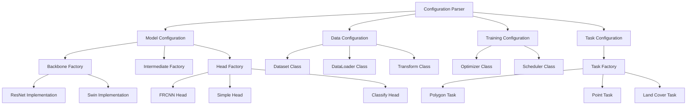

<!-- source: DeepWiki mcp.deepwiki.com · repo allenai/satlas · page 6.2 Configuration Examples · fetched 2026-10-26 -->

# Configuration Examples

<details>
<summary>Relevant source files</summary>

The following files were used as context for generating this wiki page:

- [DataLicense](DataLicense)
- [DatasetSpec.md](DatasetSpec.md)
- [configs/satlas_explorer_solar_farm.txt](configs/satlas_explorer_solar_farm.txt)
- [configs/sentinel2/resnet152_mi_ms.txt](configs/sentinel2/resnet152_mi_ms.txt)
- [configs/sentinel2/resnet50_mi_ms.txt](configs/sentinel2/resnet50_mi_ms.txt)
- [configs/sentinel2/swint_mi_ms.txt](configs/sentinel2/swint_mi_ms.txt)

</details>


## Purpose and Scope

This document provides detailed explanations and examples of configuration files used in the Satlas system. Configuration files define every aspect of model training and inference, including input data specifications, model architecture, training parameters, and task definitions. For information about the actual training process, see [Training Pipeline](#3.2), and for information about normalization of input data, see [Image Normalization](#6.1).

## Configuration File Structure

Satlas configuration files are JSON documents that contain several major sections:



Sources: [configs/sentinel2/resnet152_mi_ms.txt:1-276](), [configs/sentinel2/swint_mi_ms.txt:1-276](), [configs/sentinel2/resnet50_mi_ms.txt:1-276]()

## Input Configuration

This section defines the input data channels and preprocessing operations:

```json
{
    "Channels": ["tci", "fake", "fake", "b05", "b06", "b07", "b08", "b11", "b12"],
    "BatchSize": 16,
    "ValBatchSize": 2,
    "TrainTransforms": [{
        "Name": "CropFlip",
        "HorizontalFlip": true,
        "VerticalFlip": true,
        "CropMin": 416,
        "CropMax": 512
    }, {
        "Name": "Resize",
        "ResizeMin": 512,
        "ResizeMax": 512
    }],
    "NumImages": 8
}
```

Key components:

| Component | Description |
|-----------|-------------|
| `Channels` | Satellite bands to use as input (e.g., TCI, B05-B12) |
| `BatchSize` | Number of samples per training batch |
| `ValBatchSize` | Number of samples per validation batch |
| `TrainTransforms` | Data augmentation applied during training |
| `ValTransforms` | Preprocessing applied during validation |
| `NumImages` | Number of temporal images per location |

The `Channels` array specifies which spectral bands will be loaded for each image. In the example above:
- `"tci"` is the True Color Image (RGB composite)
- `"fake"` channels are placeholders for alignment/padding
- `"b05"` through `"b12"` are specific Sentinel-2 bands

Sources: [configs/sentinel2/resnet152_mi_ms.txt:1-33](), [configs/sentinel2/swint_mi_ms.txt:1-33](), [configs/sentinel2/resnet50_mi_ms.txt:1-33]()

## Model Configuration

The model section defines the neural network architecture:

```json
"Model": {
    "Name": "multihead4",
    "Backbone": {
        "Name": "aggregation",
        "ImageChannels": 9,
        "Groups": [[0, 1, 2, 3, 4, 5, 6, 7]],
        "AggregationOp": "max",
        "Backbone": {
            "Name": "resnet",
            "Arch": "resnet152",
            "Pretrained": true
        }
    },
    "Intermediates": [{
        "Name": "fpn"
    }, {
        "Name": "upsample"
    }],
    "Heads": [{
        "Name": "frcnn",
        "UseLayers": [1, 2, 3, 4],
        "AnchorSizes": [[32], [64], [128], [256]]
    }]
}
```

The model architecture consists of three main components:

1. **Backbone**: Core feature extractor
   - Can be `"resnet"` with different depths (ResNet-50, ResNet-152)
   - Can be `"swin"` (Swin Transformer) with different variants
   - Includes temporal aggregation across multiple images

2. **Intermediates**: Additional processing layers
   - `"fpn"` (Feature Pyramid Network) for multi-scale feature extraction
   - `"upsample"` to restore spatial resolution for segmentation tasks

3. **Heads**: Task-specific output layers
   - `"frcnn"` (Faster R-CNN) for object detection
   - `"simple"` for segmentation or regression tasks
   - `"classify"` for classification tasks

Sources: [configs/sentinel2/resnet152_mi_ms.txt:36-105](), [configs/sentinel2/swint_mi_ms.txt:36-105](), [configs/sentinel2/resnet50_mi_ms.txt:36-105]()

## Training Configuration

The training section controls the optimization process:

```json
"Optimizer": {
    "Name": "adam",
    "InitialLR": 0.00001
},
"WarmupExamples": 8192,
"Scheduler": {
    "Name": "plateau",
    "Factor": 0.5,
    "Patience": 1,
    "Cooldown": 5,
    "MinLR": 1e-6
},
"Half": true,
"SummaryExamples": 32768
```

Key settings:

| Setting | Description |
|---------|-------------|
| `Optimizer` | Algorithm for updating model weights (e.g., Adam) |
| `InitialLR` | Starting learning rate |
| `WarmupExamples` | Number of samples before using full learning rate |
| `Scheduler` | Learning rate adjustment strategy |
| `Half` | Whether to use half-precision (FP16) training |
| `SummaryExamples` | Logging frequency (in number of samples) |

The scheduler parameters control how the learning rate changes during training:
- `"plateau"` reduces the learning rate when performance plateaus
- `"Factor"` determines by how much to reduce the learning rate
- `"Patience"` sets how many epochs to wait before reducing the learning rate

Sources: [configs/sentinel2/resnet152_mi_ms.txt:106-123](), [configs/sentinel2/swint_mi_ms.txt:106-123](), [configs/sentinel2/resnet50_mi_ms.txt:106-123]()

## Task Configuration

The tasks section defines the specific machine learning tasks to perform:

```json
"Tasks": [{
    "Name": "polygon",
    "Metric": "f1",
    "LabelDir": "satlas_root/datasets/lowres/",
    "TrainSplit": "satlas_root/metadata/train_lowres_train.json",
    "ValSplit": "satlas_root/metadata/train_lowres_val.json",
    "TestSplit": "satlas_root/metadata/test_lowres.json",
    "ClassMask": ["aquafarm", "lock", "dam", "solar_farm", "power_plant", "park", "parking_garage", "parking_lot", "landfill", "quarry", "stadium", "airport", "airport_apron", "airport_terminal", "ski_resort", "theme_park", "track", "wastewater_plant", "water_park", "crop"]
}]
```

Each task definition includes:

| Component | Description |
|-----------|-------------|
| `Name` | Task type (e.g., polygon, point, land_cover) |
| `Metric` | Evaluation metric (e.g., f1, accuracy, l1) |
| `LabelDir` | Path to the dataset directory |
| `TrainSplit`, `ValSplit`, `TestSplit` | JSON files defining data splits |
| `ClassMask` | List of classes to include in this task |
| `TrainTransforms` (optional) | Task-specific data transformations |

A single model can have multiple tasks, each with its own definition and corresponding output head.

Sources: [configs/sentinel2/resnet152_mi_ms.txt:124-275](), [configs/sentinel2/swint_mi_ms.txt:124-275](), [configs/sentinel2/resnet50_mi_ms.txt:124-275]()

## Configuration File and Training Pipeline Relationship

This diagram illustrates how configuration files integrate with the Satlas training and inference pipeline:



Sources: [configs/sentinel2/resnet152_mi_ms.txt](), [configs/sentinel2/swint_mi_ms.txt](), [configs/sentinel2/resnet50_mi_ms.txt]()

## Configuration Examples

### Multi-task Model with ResNet Backbone

This configuration uses a ResNet-152 backbone for multiple tasks including infrastructure detection, land cover mapping, and more:

```json
{
    "Channels": ["tci", "fake", "fake", "b05", "b06", "b07", "b08", "b11", "b12"],
    "Model": {
        "Name": "multihead4",
        "Backbone": {
            "Name": "aggregation",
            "ImageChannels": 9,
            "Groups": [[0, 1, 2, 3, 4, 5, 6, 7]],
            "AggregationOp": "max",
            "Backbone": {
                "Name": "resnet",
                "Arch": "resnet152",
                "Pretrained": true
            }
        }
    },
    "Tasks": [
        {"Name": "polygon", "Metric": "f1", /* polygon detection for facilities */},
        {"Name": "point", "Metric": "f1", /* point detection for infrastructure */},
        {"Name": "land_cover", "Metric": "f1", /* land cover segmentation */},
        {"Name": "dem", "Metric": "l1", /* digital elevation model regression */},
        {"Name": "tree_cover", "Metric": "l1", /* tree cover percentage regression */}
        // Additional classification tasks...
    ]
}
```

Sources: [configs/sentinel2/resnet152_mi_ms.txt:1-276]()

### Multi-task Model with Swin Transformer Backbone

This configuration is similar to the ResNet example but uses a Swin Transformer backbone instead:

```json
{
    "Model": {
        "Name": "multihead4",
        "Backbone": {
            "Name": "aggregation",
            "ImageChannels": 9,
            "Groups": [[0, 1, 2, 3, 4, 5, 6, 7]],
            "AggregationOp": "max",
            "Backbone": {
                "Name": "swin",
                "Arch": "swin_v2_t",
                "Pretrained": true
            }
        }
    }
    // Same tasks as ResNet example
}
```

Sources: [configs/sentinel2/swint_mi_ms.txt:36-48]()

### Single-task Solar Farm Detection

This configuration focuses on detecting solar farms using a pre-trained model:

```json
{
    "Channels": ["tci", "fake", "fake", "b05", "b06", "b07", "b08", "b11", "b12"],
    "RestorePath": "satlas_explorer_datasets/base_models/lowres_joint_multi_bands.pth",
    "Freeze": ["module.backbone.", "module.intermediates."],
    "Model": {
        "Name": "multihead4",
        "Backbone": {
            "Name": "aggregation",
            "ImageChannels": 9,
            "AggregationOp": "max",
            "Groups": [[0, 1, 2, 3]],
            "Backbone": {
                "Name": "swin",
                "Arch": "swin_v2_b",
                "Pretrained": true
            }
        },
        "Heads": [{
            "Name": "simple"
        }]
    },
    "Tasks": [{
        "Name": "solar_farm",
        "Task": {
            "mode": "space",
            "type": "bin_segment",
            "categories": ["solar_farm"]
        },
        "Metric": "f1"
    }]
}
```

Key features of this configuration:
- Loads a pre-trained model (`RestorePath`)
- Freezes the backbone and intermediate layers (`Freeze`)
- Uses a single segmentation head for solar farm detection
- Defines a binary segmentation task

Sources: [configs/satlas_explorer_solar_farm.txt:1-84]()

## Configuration Components and Code Integration

This diagram shows how configuration components map to Satlas code structures:



Sources: [configs/sentinel2/resnet152_mi_ms.txt](), [configs/sentinel2/swint_mi_ms.txt](), [configs/sentinel2/resnet50_mi_ms.txt]()

## Configuration Modification Guidelines

When adapting existing configurations for new tasks, consider these recommendations:

1. **Input Channels**: Modify based on available satellite bands for your data source
2. **Backbone**: Choose based on computational resources and dataset size
   - ResNet-50 for faster training, smaller datasets
   - ResNet-152 for more capacity, larger datasets
   - Swin Transformer for better performance, more computational resources
3. **Heads**: Match to your specific tasks
   - FRCNN heads for object detection
   - Simple heads for segmentation/regression
   - Classify heads for classification tasks
4. **Tasks**: Define only the tasks needed for your application
5. **Training Parameters**: Start with the provided values and adjust based on training progress
   - Reduce learning rate if training is unstable
   - Increase batch size if memory allows
   - Enable half-precision (`"Half": true`) to save memory

Sources: [configs/sentinel2/resnet152_mi_ms.txt](), [configs/sentinel2/swint_mi_ms.txt](), [configs/sentinel2/resnet50_mi_ms.txt](), [configs/satlas_explorer_solar_farm.txt]()

---

