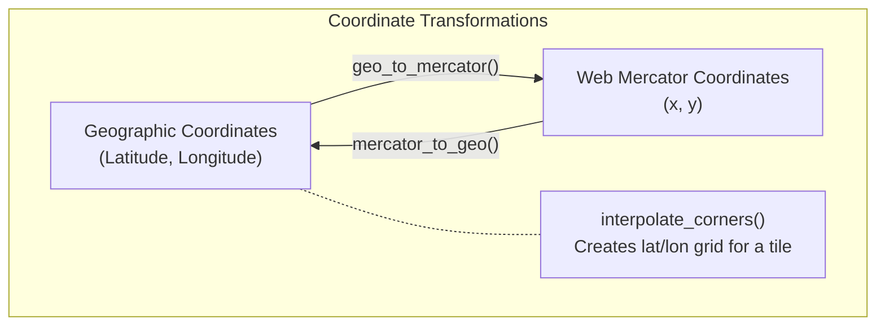
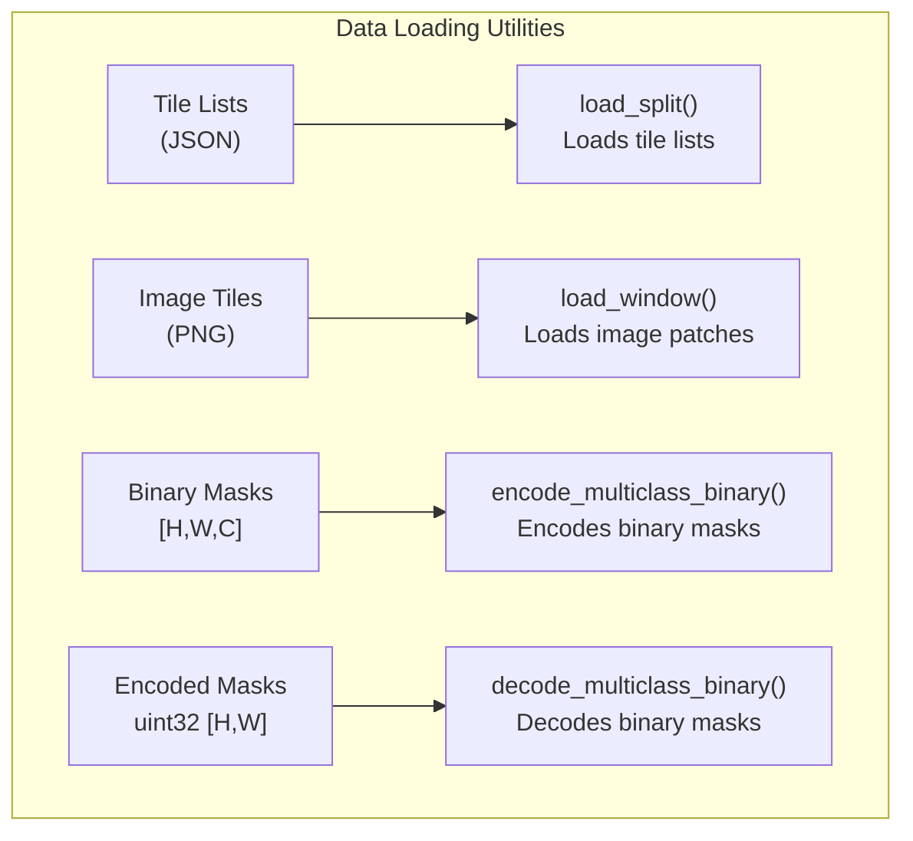
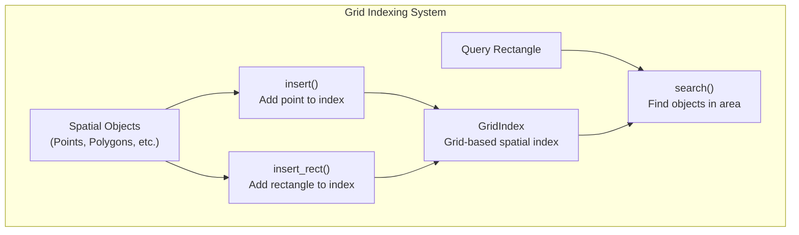
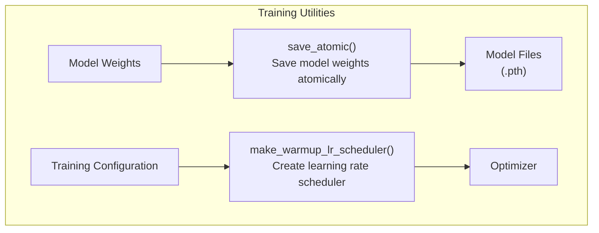
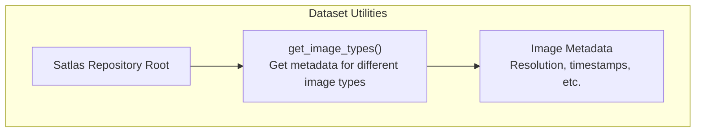
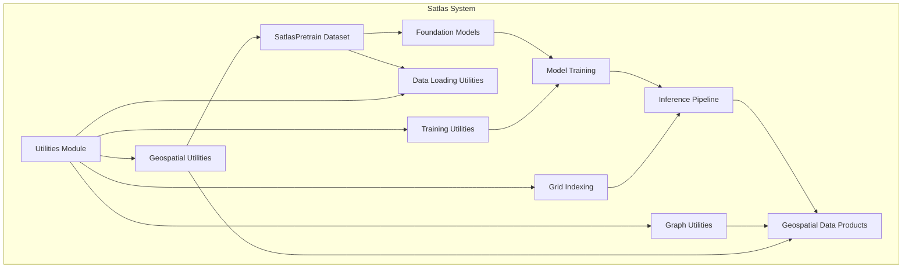

<!-- source: DeepWiki mcp.deepwiki.com · repo allenai/satlas · page 6.3 Utilities · fetched 2026-10-26 -->

# Utilities

<details>
<summary>Relevant source files</summary>

The following files were used as context for generating this wiki page:

- [satlas/cmd/model/train.py](satlas/cmd/model/train.py)
- [satlas/cmd/to_dataset/common.py](satlas/cmd/to_dataset/common.py)
- [satlas/util/__init__.py](satlas/util/__init__.py)
- [satlas/util/graph.py](satlas/util/graph.py)
- [satlas/util/grid_index.py](satlas/util/grid_index.py)

</details>


## Introduction

The Satlas utilities module provides a collection of essential helper functions and data structures that support core operations throughout the codebase. These utilities include geospatial coordinate transformations, data loading functions, graph processing algorithms, spatial indexing, and training helpers.

This page documents the key utility functions available in the Satlas codebase. For information about model configuration, see [Configuration Examples](#6.2), and for image preprocessing information, see [Image Normalization](#6.1).

## Geospatial Coordinate Utilities

Satlas provides several utility functions for handling geospatial coordinates, particularly for converting between geographical coordinates (latitude/longitude) and web Mercator projection coordinates used in tile-based mapping systems.



Sources: [satlas/util/__init__.py:14-27](), [satlas/util/__init__.py:41-49]()

### Key Functions

- **geo_to_mercator**: Converts geographic coordinates (latitude, longitude) to web Mercator pixel coordinates at a given zoom level.
  ```python
  def geo_to_mercator(p, zoom=13, pixels=512):
      # Converts (lon, lat) to (x, y) pixels
  ```

- **mercator_to_geo**: Converts web Mercator pixel coordinates back to geographic coordinates.
  ```python
  def mercator_to_geo(p, zoom=13, pixels=512):
      # Converts (x, y) pixels to (lon, lat)
  ```

- **interpolate_corners**: Creates a grid of latitude/longitude coordinates for a tile, useful for georeferencing image data.
  ```python
  def interpolate_corners(tile, pixels=512, zoom=13):
      # Returns longitude and latitude grids for a tile
  ```

These functions are essential for converting between coordinate systems when dealing with satellite imagery and when generating geospatial data products.

Sources: [satlas/util/__init__.py:14-27](), [satlas/util/__init__.py:41-49]()

## Data Loading Utilities

The Satlas codebase includes several utility functions for loading and processing data in various formats.



Sources: [satlas/util/__init__.py:29-94]()

### Key Functions

- **load_split**: Loads a list of tiles from a JSON file, which can be either a simple list of coordinates or a list with additional metadata.
  ```python
  def load_split(fname, image_list_ok=False):
      # Loads a list of tile coordinates (col, row)
  ```

- **load_window**: Loads a window of imagery data that may span multiple tiles, handling tile boundaries and missing data.
  ```python
  def load_window(base_dir, column, row, width, height, chip_size=512, bands=3):
      # Loads a rectangular window from a tiled dataset
  ```

- **encode_multiclass_binary/decode_multiclass_binary**: Functions to efficiently encode and decode multi-class binary masks, useful for handling segmentation data.
  ```python
  def encode_multiclass_binary(arr):
      # Converts binary [H, W, C] to uint32 [H, W]
  
  def decode_multiclass_binary(enc, num_classes):
      # Converts uint32 [H, W] to binary [H, W, C]
  ```

These functions provide a foundation for efficiently working with the tiled imagery and label data used in the Satlas system.

Sources: [satlas/util/__init__.py:29-94](), [satlas/util/__init__.py:51-62]()

## Spatial Indexing with GridIndex

The `GridIndex` class provides a simple but efficient spatial indexing system to accelerate spatial queries on large datasets. It divides space into a grid of cells and indexes objects based on the cells they intersect.



Sources: [satlas/util/grid_index.py:1-34]()

### GridIndex Class Methods

- **insert**: Inserts a point with associated data into the index.
  ```python
  def insert(self, p, data):
      # Add a point to the spatial index
  ```

- **insert_rect**: Inserts a rectangle with associated data into the index.
  ```python
  def insert_rect(self, rect, data):
      # Add a rectangle to the spatial index
  ```

- **search**: Searches for objects that intersect with a given rectangle.
  ```python
  def search(self, rect):
      # Find objects that intersect with the rectangle
  ```

The `GridIndex` is used by various components in Satlas, particularly for efficient spatial queries on vector data, such as road networks or building footprints.

Sources: [satlas/util/grid_index.py:1-34]()

## Graph Utilities

The graph utilities in Satlas provide a comprehensive toolkit for working with graph data structures, particularly useful for analyzing road networks and other vector data. The module implements classes and algorithms for graph representation, path finding, and road segment processing.

```mermaid
flowchart TD
    subgraph "Graph System Components"
        graph["Graph<br>Basic graph structure"]
        vertex["Vertex<br>Node in graph"]
        edge["Edge<br>Connection between vertices"]
        
        road_segment["RoadSegment<br>Sequence of connected edges"]
        edge_pos["EdgePos<br>Position along an edge"]
        
        vertex --> graph
        edge --> graph
        edge --> edge_pos
        edge --> road_segment
        
        algorithms["Graph Algorithms"]
        algorithms --> dijkstra["dijkstra_helper()<br>Path finding"]
        algorithms --> closest["closest_reachable_edge()<br>Proximity search"]
        algorithms --> follow["follow_graph()<br>Network traversal"]
        algorithms --> mapmatch["mapmatch()<br>Map matching"]
    end
```

Sources: [satlas/util/graph.py:1-675]()

### Key Classes

- **Graph**: The main class for representing a graph structure with vertices and edges.
  ```python
  class Graph(object):
      # Methods: add_vertex, add_edge, find_edge, make_bidirectional, etc.
  ```

- **Vertex**: Represents a node in the graph with a position and connections.
  ```python
  class Vertex(object):
      # Properties: id, point, in_edges, out_edges
  ```

- **Edge**: Represents a directed connection between two vertices.
  ```python
  class Edge(object):
      # Properties: id, src, dst
      # Methods: segment, closest_pos, is_opposite, etc.
  ```

- **RoadSegment**: Represents a sequence of connected edges, typically corresponding to a continuous road segment.
  ```python
  class RoadSegment(object):
      # Properties: id, edges
      # Methods: length, closest_pos, src, dst, etc.
  ```

### Key Algorithms

The graph module implements several important algorithms:

- **Shortest Path Finding**: Using Dijkstra's algorithm to find the shortest path between vertices.
  ```python
  def shortest_path(src, dst, max_distance=None):
      # Finds shortest path between two vertices
  ```

- **Map Matching**: Algorithms to match a sequence of points to a road network.
  ```python
  def mapmatch(index, road_segments, edge_to_rs, points, segment_length):
      # Matches points to road segments
  ```

- **Graph Traversal**: Functions to follow a graph from a given position.
  ```python
  def follow_graph(edge_pos, distance, explored_node_pairs=None):
      # Follows the graph from a position for a specified distance
  ```

These graph utilities are primarily used for analyzing and processing vector data, particularly for tasks like road network analysis and map matching.

Sources: [satlas/util/graph.py:1-675]()

## Model Training Utilities

Satlas includes several utility functions specifically designed to support model training processes.



Sources: [satlas/cmd/model/train.py:17-31]()

### Key Functions

- **save_atomic**: Provides an atomic way to save model weights, ensuring that files are not corrupted if the saving process is interrupted.
  ```python
  def save_atomic(state_dict, dir_name, fname):
      # Saves model state_dict atomically
  ```

- **make_warmup_lr_scheduler**: Creates a learning rate scheduler that gradually warms up the learning rate over a specified number of iterations.
  ```python
  def make_warmup_lr_scheduler(optimizer, warmup_iters, warmup_factor, warmup_delay=0):
      # Creates a learning rate scheduler with warmup
  ```

These utilities help ensure reliable and effective model training, particularly for the distributed training scenarios supported by Satlas.

Sources: [satlas/cmd/model/train.py:17-31]()

## Dataset Preparation Utilities

The `to_dataset` module provides utilities to prepare and preprocess data for use in the Satlas system.



Sources: [satlas/cmd/to_dataset/common.py:1-40]()

### Key Functions

- **get_image_types**: Loads and processes metadata for different image types (e.g., low-resolution Sentinel-2 and high-resolution NAIP imagery).
  ```python
  def get_image_types(satlas_root):
      # Returns metadata for different image types
  ```

This function helps organize and manage the different types of satellite imagery used in the Satlas system, making it easier to access and process data at different resolutions.

Sources: [satlas/cmd/to_dataset/common.py:16-40]()

## Utilities in the Satlas Ecosystem

To understand how these utilities fit into the broader Satlas ecosystem, the following diagram illustrates their relationships with other components:



Sources: [satlas/util/__init__.py:1-95](), [satlas/util/grid_index.py:1-34](), [satlas/util/graph.py:1-675](), [satlas/cmd/model/train.py:17-31]()

The utilities module provides essential functionality used throughout the Satlas pipeline, from data preparation and model training to inference and data product generation. These reusable components ensure consistency and efficiency across the system.

---

