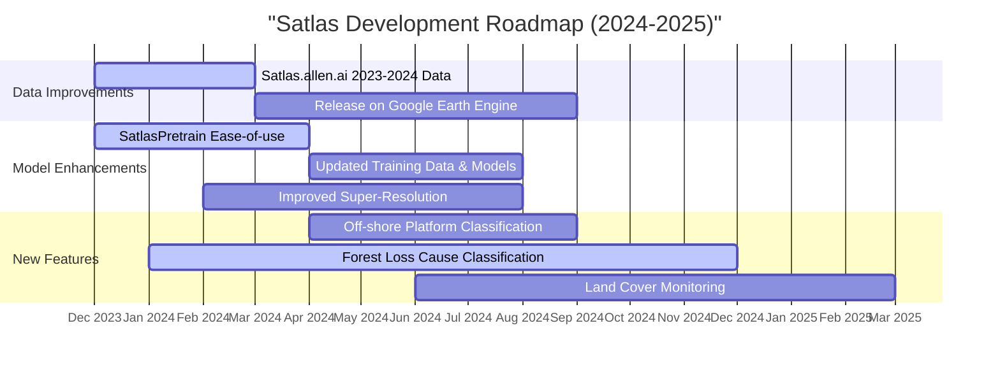
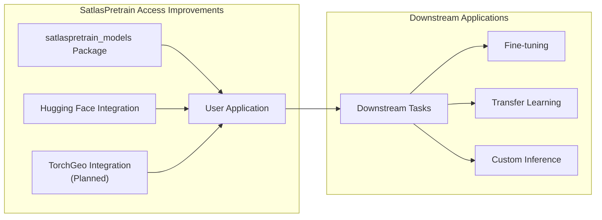
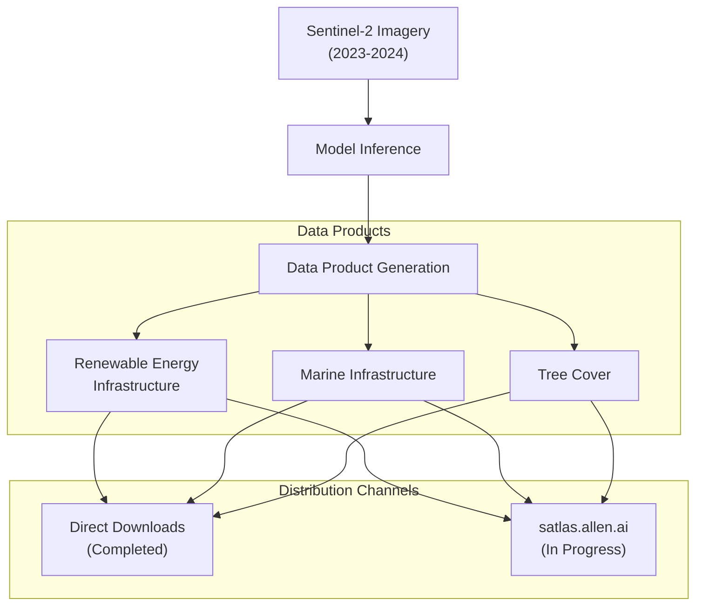
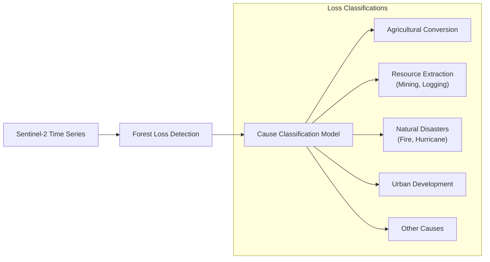
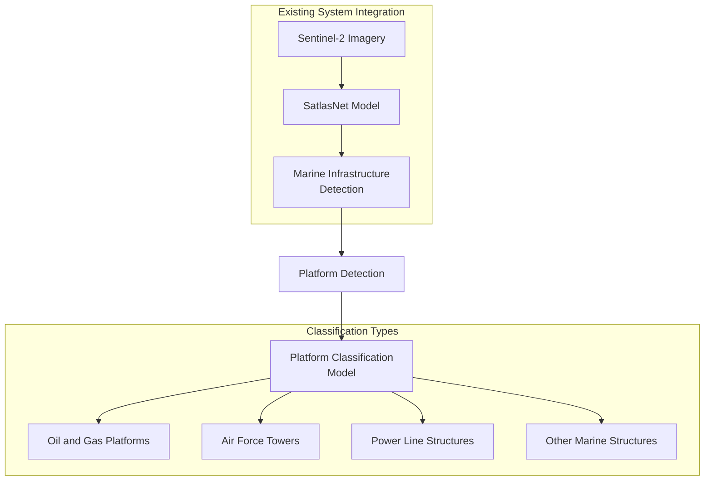
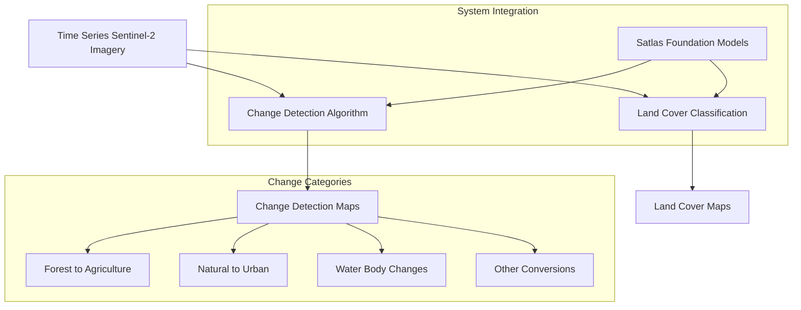
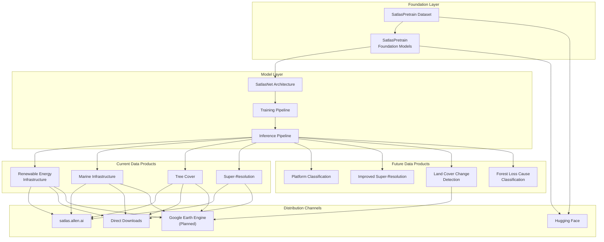

<!-- source: DeepWiki mcp.deepwiki.com · repo allenai/satlas · page 7 Future Development · fetched 2026-10-26 -->

# Future Development

Relevant source files

The following files were used as context for generating this wiki page:

- [OngoingProjects.md](OngoingProjects.md)
- [README.md](README.md)
- [satlaspretrain_urls.txt](satlaspretrain_urls.txt)
- [satlaspretrain_urls_small.txt](satlaspretrain_urls_small.txt)

This document outlines ongoing and planned development initiatives for the Satlas project. It provides an overview of the roadmap, current projects in progress, and future planned features. For information about the current system architecture and components, see [Overview](#1) and [Model System](#3).

## Development Roadmap Overview

Satlas is continually evolving with several parallel development streams focused on enhancing accessibility, expanding data offerings, and improving model capabilities. The following diagram illustrates the high-level roadmap of development initiatives.

Sources: [OngoingProjects.md:6-66]()

## Ongoing Projects

The following projects are currently in active development by the Satlas team:

### SatlasPretrain Ease-of-use (75% Complete)

This initiative focuses on making SatlasPretrain foundation models more accessible for downstream tasks.

**Key accomplishments:**
- Released the `satlaspretrain_models` package for simplified model application
- Made the SatlasPretrain dataset available on Hugging Face
- Created accompanying tutorials for model usage

**Remaining work:**
- Integration with TorchGeo platform (expected March 2024)

Sources: [OngoingProjects.md:14-21](), [README.md:9-11]()

### Data Updates for satlas.allen.ai (75% Complete)

This project involves updating the Satlas website with more recent data products.

**Key accomplishments:**
- Released renewable energy and marine infrastructure data through 2024-01
- Fixed shapefile downloads

**Remaining work:**
- Website integration of new data (expected March 2024)

Sources: [OngoingProjects.md:23-31](), [README.md:19-21]()

### Forest Loss Cause Classification (25% Complete)

This project focuses on developing a model that can classify the causes of detected forest loss from Sentinel-2 imagery.

**Key features:**
- Classification of forest loss into categories like mining, agriculture, and natural disasters
- Integration with existing tree cover monitoring capabilities
- Targeted release in Q4 2024

Sources: [OngoingProjects.md:64-66]()

## Planned Future Projects

### Release Updated Training Data and Fine-tuned Models

Currently, the training data and models were last released in July 2023. This initiative aims to establish a more efficient system for automatically sharing updated training data and models.

**Objectives:**
- Create a streamlined release pipeline for training data
- Implement automated model publishing
- Provide more frequent updates to fine-tuned models

Sources: [OngoingProjects.md:33-38](), [README.md:43-55]()

### Off-shore Platform Classification (Q3 2024)

This exploratory project aims to enhance the existing marine infrastructure detection by adding classification capabilities.

**Planned features:**
- Classification of detected offshore platforms into categories:
  - Oil and gas platforms
  - Air force towers
  - Power line structures
  - Other marine infrastructure

Sources: [OngoingProjects.md:40-43]()

### Improved Super-Resolution (Q3 2024)

This project focuses on enhancing the accuracy and quality of the super-resolution capabilities in Satlas.

**Planned improvements:**
- Enhanced model architecture for better detail preservation
- Updated dataset for training
- Refreshed super-resolution layer in the Satlas web interface

Sources: [OngoingProjects.md:46-49](), [README.md:12]()

### Release on Google Earth Engine (Q3 2024)

This initiative aims to make all Satlas geospatial data products available on Google Earth Engine.

**Benefits:**
- Broader accessibility of Satlas data
- Integration with other geospatial datasets
- Enhanced analysis capabilities through Google Earth Engine's computing platform

Sources: [OngoingProjects.md:52-54]()

### Land Cover Monitoring and Change Detection (Q1 2025)

This long-term exploratory project is investigating the feasibility of global monitoring of land cover and the detection of land cover changes using Sentinel-2 imagery.

**Planned capabilities:**
- Continuous monitoring of land cover changes
- Detection of urban expansion
- Identification of forest conversion to agriculture
- Time series analysis for change tracking

Sources: [OngoingProjects.md:57-60]()

## Technical Integration with Existing Systems

The following diagram illustrates how the planned future developments integrate with the existing Satlas architecture:

Sources: [README.md:27-33](), [OngoingProjects.md:14-66]()

## Development Timeline

The table below summarizes the development timeline for current and planned projects:

| Project | Status | Progress | Expected Completion |
|---------|--------|----------|---------------------|
| SatlasPretrain Ease-of-use | Active | 75% | March 2024 |
| satlas.allen.ai 2023 Data | Active | 75% | March 2024 |
| Release Updated Training Data and Models | Not Started | 0% | Q3 2024 |
| Off-shore Platform Classification | Exploratory | Planning | Q3 2024 |
| Improved Super-Resolution | Exploratory | Research | Q3 2024 |
| Release on Google Earth Engine | Not Started | 0% | Q3 2024 |
| Forest Loss Cause Classification | Active | 25% | Q4 2024 |
| Land Cover Monitoring and Change Detection | Exploratory | Research | Q1 2025 |

Sources: [OngoingProjects.md:14-66]()

## Update Frequency

As noted in the OngoingProjects.md file, the Satlas team updates this roadmap approximately monthly. All timelines are estimates and subject to change as projects develop, encounter challenges, or priorities shift.

Sources: [OngoingProjects.md:1-5]()