# Page: Overview

# Overview

<details>
<summary>Relevant source files</summary>

The following files were used as context for generating this wiki page:

- [OngoingProjects.md](OngoingProjects.md)
- [README.md](README.md)
- [satlaspretrain_urls.txt](satlaspretrain_urls.txt)
- [satlaspretrain_urls_small.txt](satlaspretrain_urls_small.txt)

</details>


## Purpose and Scope

This document provides an introduction to the Satlas repository, explaining its purpose, core components, and high-level architecture. Satlas is an open-source project developed by Allen AI that provides AI-generated geospatial data products and foundation models for satellite imagery analysis.

For detailed information about specific components, please refer to the corresponding wiki pages:
- For the SatlasPretrain dataset, see [SatlasPretrain Dataset](#2)
- For model architecture and implementation, see [Model System](#3)
- For geospatial data products, see [Geospatial Data Products](#4)
- For validation methodologies, see [Data Validation and Evaluation](#5)
- For developer resources, see [Developer Guide](#6)

Sources: [README.md:1-15]()

## What is Satlas?

Satlas aims to provide open AI-generated geospatial data that is highly accurate, available globally, and updated on a monthly basis. The AI-generated geospatial data in Satlas is computed by applying deep learning models on Sentinel-2 satellite imagery, which is open imagery released by the European Space Agency. While Sentinel-2 images are relatively low-resolution (10 m/pixel), they cover the bulk of Earth's land mass weekly, enabling frequent updates to geospatial data products.

Current capabilities include:
- Foundation models pre-trained on a large-scale remote sensing dataset
- Detection of renewable energy infrastructure (wind turbines, solar farms)
- Detection of marine infrastructure (offshore platforms)
- Tree cover analysis
- Super-resolution imagery processing

Sources: [README.md:16-22](), [README.md:66-72](), [OngoingProjects.md:24-31]()

## System Architecture Overview

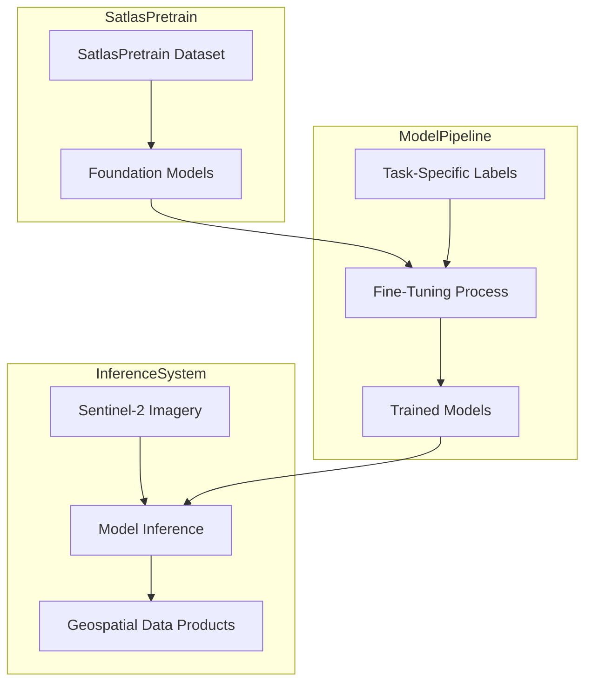

**Satlas System Architecture Diagram**

The Satlas system follows a multi-stage process:
1. **Pre-training**: Foundation models are pre-trained on the comprehensive SatlasPretrain dataset
2. **Fine-tuning**: Models are fine-tuned on task-specific datasets (renewable energy, marine infrastructure, etc.)
3. **Inference**: Fine-tuned models are applied to current Sentinel-2 imagery
4. **Distribution**: Resulting geospatial data products are validated and distributed

Sources: [README.md:24-40](), [README.md:78-100]()

## Core Components

### SatlasPretrain Dataset

The SatlasPretrain dataset is a large-scale remote sensing image understanding dataset containing 302 million labels across 137 categories. It integrates multiple satellite imagery sources:
- Sentinel-2 (low-resolution mode)
- NAIP (high-resolution mode)
- Landsat
- Sentinel-1

The dataset structure includes both static labels (slow-changing features) and dynamic labels (time-specific features).

Sources: [README.md:34-41](), [satlaspretrain_urls.txt:1-18]()

### Model Architecture

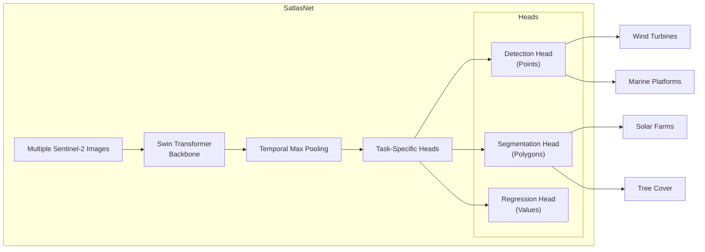

**SatlasNet Architecture and Task Outputs**

The models are trained to make predictions from multiple Sentinel-2 images using a multi-stage architecture:
1. Extract features from each image independently through a Swin Transformer backbone
2. Apply temporal max pooling on corresponding feature maps at multiple resolutions
3. Pass the pooled feature maps to task-specific heads for different prediction types

Sources: [README.md:58-63]()

### Development Process

Satlas models are developed in four phases:
1. **Pre-training**: Train foundational models on the SatlasPretrain dataset
2. **Annotation**: Create high-quality task-specific training labels
3. **Fine-tuning**: Fine-tune models on task-specific labels
4. **Validation**: Test models globally and iterate on training data

This iterative process ensures the models achieve high accuracy across diverse geographical regions.

Sources: [README.md:24-33]()

## Data Flow Pipeline

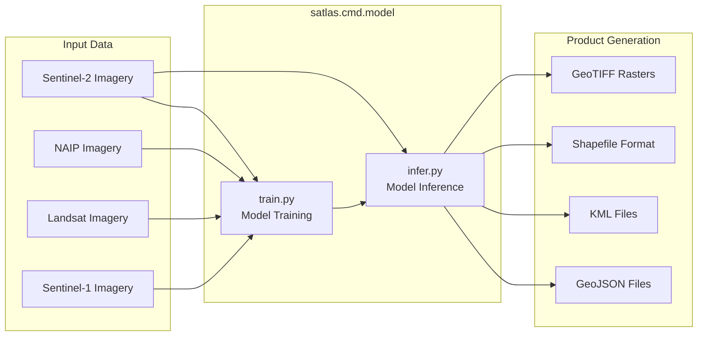

**End-to-End Data Processing Pipeline**

The data flow begins with satellite imagery from various sources, which is processed through the training and inference pipeline to generate geospatial data products in multiple formats:
- Training: `python -m satlas.cmd.model.train --config_path configs/satlas_explorer_*.txt`
- Inference: `python -m satlas.cmd.model.infer --config_path configs/satlas_explorer_*.txt`

Sources: [README.md:78-100]()

## Current Geospatial Data Products

Satlas currently offers several AI-generated geospatial data products:

| Data Product | Description | Format | Update Frequency |
|--------------|-------------|--------|------------------|
| Renewable Energy Infrastructure | Wind turbines and solar farms | GeoJSON, KML, Shapefile | Monthly |
| Marine Infrastructure | Offshore platforms and structures | GeoJSON, KML, Shapefile | Monthly |
| Tree Cover | Forest and tree density | GeoTIFF | Monthly |
| Super-Resolution | Enhanced Sentinel-2 imagery | GeoTIFF | Varies |

All data products are available for download and offline analysis, with updates published monthly based on recent Sentinel-2 imagery.

Sources: [README.md:66-72](), [OngoingProjects.md:24-31]()

## Repository Structure

The repository is organized into several key components:

- **Configuration files**: Located in `configs/` directory, define model parameters and training settings
- **Training module**: Located in `satlas.cmd.model.train`, handles model training on datasets
- **Inference module**: Located in `satlas.cmd.model.infer`, handles applying models to new imagery
- **Model architecture**: Defines the SatlasNet architecture with Swin Transformer backbone
- **Utility functions**: Support for data loading, coordinate transformations, and visualization

The repository also includes documentation for accessing the SatlasPretrain dataset, downloading model weights, and obtaining pre-computed geospatial data products.

Sources: [README.md:78-104]()

## Ongoing Development

The Satlas team actively develops new capabilities and improves existing ones. Recent and upcoming developments include:

- Improved ease-of-use for SatlasPretrain foundation models
- Data updates through 2024
- Offshore platform classification
- Enhanced super-resolution
- Land cover monitoring and change detection
- Forest loss cause classification

For the latest updates on ongoing projects, see the [Ongoing Projects page](https://github.com/allenai/satlas/blob/main/OngoingProjects.md).

Sources: [OngoingProjects.md:6-66]()

---

# Page: SatlasPretrain Dataset

# SatlasPretrain Dataset

<details>
<summary>Relevant source files</summary>

The following files were used as context for generating this wiki page:

- [OngoingProjects.md](OngoingProjects.md)
- [SatlasPretrain.md](SatlasPretrain.md)
- [satlaspretrain_urls.txt](satlaspretrain_urls.txt)
- [satlaspretrain_urls_small.txt](satlaspretrain_urls_small.txt)

</details>


## Purpose and Scope

The SatlasPretrain dataset is a large-scale pre-training dataset for remote sensing image understanding created by Allen AI. This document describes the dataset's structure, content, and access methods. SatlasPretrain forms the foundation of the Satlas system, providing the data used to train the foundation models that power various geospatial data products.

The dataset consists of 302 million labels across 137 categories and seven label types (points, polygons, polylines, properties, segmentation labels, regression labels, and classification labels). Pre-training on SatlasPretrain increases average performance on downstream tasks by 18% over ImageNet and 6% over DOTA and iSAID.

For information about the model architecture that utilizes this dataset, see [Model System](#3).

Sources: [SatlasPretrain.md:6-10]()

## Dataset Organization and Structure

SatlasPretrain is organized into two main resolution modes with different images and coordinate systems, but sharing the same label categories and types.

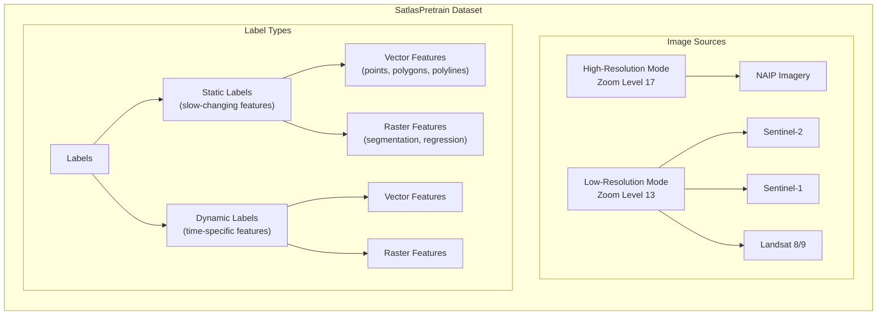

The dataset is divided into train and test splits for each resolution mode. The splits are defined by JSON files that contain lists of (col, row) tile coordinates:
- satlas/metadata/train_lowres.json
- satlas/metadata/test_lowres.json
- satlas/metadata/train_highres.json
- satlas/metadata/test_highres.json
- satlas/metadata/train_event.json 
- satlas/metadata/test_event.json

Dynamic labels (which represent time-varying phenomena) use the "_event" splits while static labels use the regular splits.

Sources: [SatlasPretrain.md:56-67](), [SatlasPretrain.md:128-130]()

### Tile System

All data in SatlasPretrain is projected to the Web-Mercator projection and organized into a global tile grid:

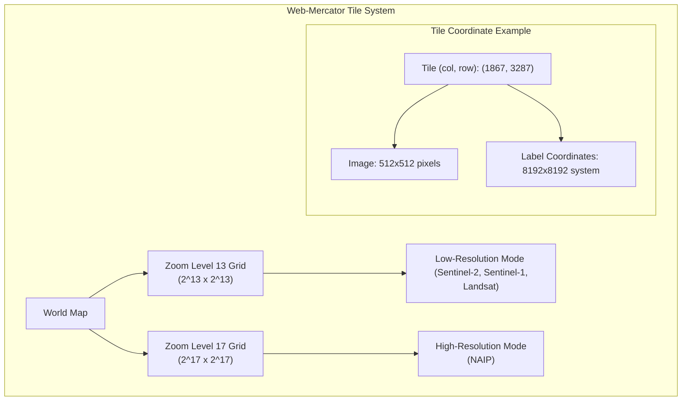

- Low-resolution images are stored at zoom level 13, with the world divided into a grid of 2^13 × 2^13 tiles
- High-resolution images (NAIP) are stored at zoom level 17 to maintain 512×512 pixel image size
- Within each tile, an 8192×8192 coordinate system is used for label geometries
- Tile coordinates can be converted to geographic coordinates (longitude, latitude) using utility functions

Sources: [SatlasPretrain.md:70-74](), [SatlasPretrain.md:119-123]()

## Images

The dataset contains satellite and aerial imagery from multiple sources:

| Image Source | Resolution Mode | Directory | Bands |
|--------------|-----------------|-----------|-------|
| Sentinel-2 | Low-resolution | satlas/sentinel2/ | tci (RGB), b01-b12 (various spectral bands) |
| Sentinel-1 | Low-resolution | satlas/sentinel1/ | SAR bands |
| Landsat 8/9 | Low-resolution | satlas/landsat/ | Various spectral bands |
| NAIP | High-resolution | satlas/naip/ | tci (RGB), ir (near-infrared) |

The imagery is organized with the following directory structure:

```
satlas/sentinel2/
    S2A_MSIL1C_20160808T181452_N0204_R041_T12SVC_20160808T181447/
        tci/
            1867_3287.png
            1867_3288.png
            ...
        b05/
        b06/
        ...
    S2B_MSIL1C_20221230T180749_N0509_R041_T13UCR_20221230T195817/
        ...
    ...
satlas/naip/
    m_2508008_nw_17_1_20151013/
        tci/
            36368_55726.png
            ...
        ir/
            36368_55726.png
            ...
    ...
```

Each image is stored as a collection of 512×512 PNG files, organized by band and tile coordinates. The tci (true-color image) folder contains standard RGB imagery, while other folders contain additional spectral bands.

Sources: [SatlasPretrain.md:78-116]()

## Labels

SatlasPretrain contains two categories of labels:

1. **Static labels** - Representing slow-changing features that should correspond to the most recent image at each tile
2. **Dynamic labels** - Time-specific features that reference a particular image/timestamp

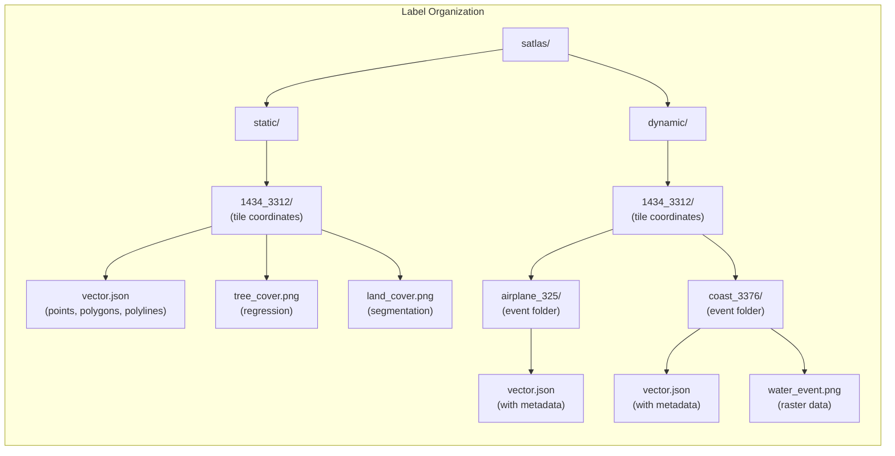

The directory structure for labels is organized by tile coordinates and then by label type:

```
satlas/static/
    1434_3312/
        vector.json
        tree_cover.png
        land_cover.png
    1434_3313/
    ...
satlas/dynamic/
    1434_3312/
        airplane_325/
            vector.json
        coast_3376/
            vector.json
            water_event.png
        ...
    ...
```

Dynamic labels include metadata specifying the corresponding source image and timestamp:

```json
{
    "metadata": {
        "Start": "2014-08-04T23:59:59+00:00",
        "End": "2014-08-05T00:00:01+00:00",
        "ImageUUID": "996e6f0f4f3f42838211caf73c4692f2",
        "ImageName": "m_3211625_sw_11_1_20140805"
    },
    "airplane": [
        ...
    ]
}
```

Sources: [SatlasPretrain.md:130-167]()

### Label Types

SatlasPretrain includes seven types of labels:

1. **Points** - Single coordinate locations (e.g., airplane positions)
2. **Polygons** - Closed shapes with boundaries (e.g., building footprints)
3. **Polylines** - Connected line segments (e.g., roads, rivers)
4. **Properties** - Attributes associated with geometries (e.g., road type)
5. **Segmentation labels** - Pixel-wise classification (e.g., land cover)
6. **Regression labels** - Continuous values (e.g., tree cover percentage)
7. **Classification labels** - Whole-tile categorization

Vector features (points, polygons, polylines, properties, and classification) are stored in vector.json files with this structure:

```json
{
    "airplane": [{
        "Geometry": {
            "Type": "point",
            "Point": [454, 401]
        },
        "Properties": {}
    }],

    "power_plant": [{
        "Geometry": {
            "Type": "polygon",
            "Polygon": [[[6197, 6210], [6151, 6284], [6242, 6341], [6260, 6312], [6288, 6268], [6197, 6210]]]
        },
        "Properties": {"plant_type": "gas"}
    }],

    "road": [{
        "Geometry": {
            "Type": "polyline",
            "Polyline": [[7287, 789], [7281, 729], [7280, 716], [7277, 690], [7267, 581], [7256, 466], [7242, 312], [7206, -45], [7149, -628]]
        },
        "Properties": {"road_type": "residential"}
    }]
}
```

Segmentation and regression labels are stored as 512×512 PNG files with task-specific naming conventions (e.g., land_cover.png, tree_cover.png).

Sources: [SatlasPretrain.md:6-8](), [SatlasPretrain.md:169-231]()

## Accessing the Dataset

The SatlasPretrain dataset can be downloaded from:

1. **S3 bucket** - URLs provided in satlaspretrain_urls.txt
2. **Hugging Face** - Available at huggingface.co/allenai/satlas-pretrain/tree/main/dataset

The complete dataset is large, but small versions of the NAIP and Sentinel-2 images are available for testing purposes.

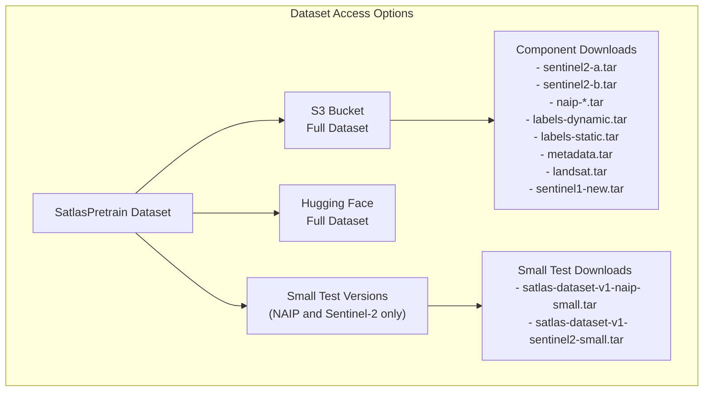

Sources: [SatlasPretrain.md:32-41](), [satlaspretrain_urls.txt:1-18](), [satlaspretrain_urls_small.txt:1-6](), [OngoingProjects.md:8]()

## Using the Dataset

To use SatlasPretrain for model training, the data must first be converted to a format compatible with the training pipeline:

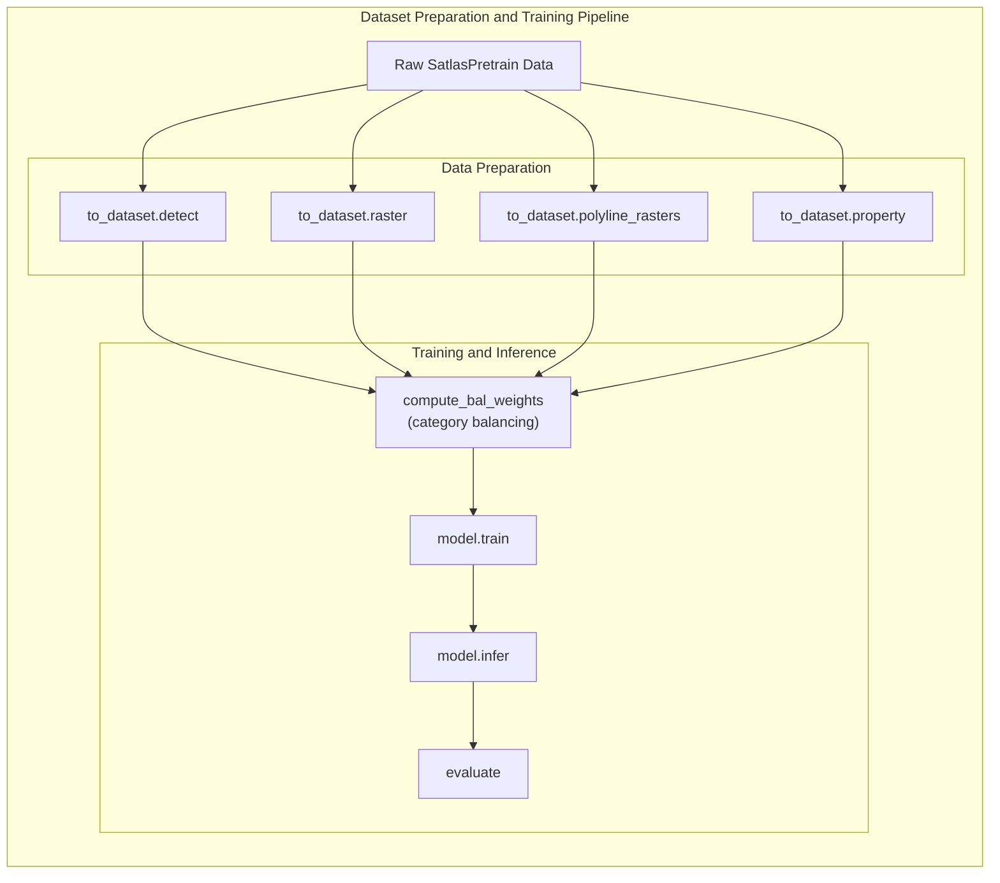

The preparation process involves:

1. Converting raw data to task-specific formats using `satlas.cmd.to_dataset.*` scripts
2. Computing class-balancing weights with `satlas.cmd.model.compute_bal_weights`
3. Training models with `satlas.cmd.model.train`
4. Running inference with `satlas.cmd.model.infer`
5. Evaluating results with `satlas.cmd.evaluate`

### Converting Dataset Format

```bash
python -m satlas.cmd.to_dataset.detect --satlas_root satlas_root/ --out_path satlas_root/datasets/
python -m satlas.cmd.to_dataset.raster --satlas_root satlas_root/ --out_path satlas_root/datasets/
python -m satlas.cmd.to_dataset.polyline_rasters --dataset_root satlas_root/datasets/
python -m satlas.cmd.to_dataset.property --satlas_root satlas_root/ --out_path satlas_root/datasets/ --ids satlas_root/metadata/train_lowres_property_100k.json
```

### Computing Balance Weights

```bash
python -m satlas.cmd.model.compute_bal_weights --dataset_path satlas_root/datasets/highres/ --out_path satlas_root/bal_weights/highres.json
python -m satlas.cmd.model.compute_bal_weights --dataset_path satlas_root/datasets/lowres/ --out_path satlas_root/bal_weights/lowres.json
```

### Training Models

```bash
python -m torch.distributed.launch --nproc_per_node=8 --master_port 29500 -m satlas.cmd.model.train --config_path configs/aerial/swinb_si_pretrain.txt --world_size 8
```

### Running Inference and Evaluation

```bash
python -m satlas.cmd.model.infer --config_path configs/aerial/swinb_si_pretrain.txt --details
python -m satlas.cmd.evaluate --gt_path path/to/satlas/static/ --pred_path path/to/outputs/ --modality point --split path/to/satlas/metadata/test_highres.json --format static
```

Sources: [SatlasPretrain.md:279-323]()

## Foundation Models

Foundation models pre-trained on SatlasPretrain are available for download for each of these image modalities:

- Sentinel-2
- Sentinel-1
- Landsat 8/9
- 0.5 - 2 m/pixel aerial imagery

These models provide a starting point for fine-tuning on downstream applications. The models are released under the ODC-BY license.

The companion `satlaspretrain_models` package provides an easy way to download and initialize these models for fine-tuning.

Sources: [SatlasPretrain.md:13-27](), [OngoingProjects.md:14-20]()

## Data Sources and Licensing

SatlasPretrain includes images and labels from multiple sources:

| Data Source | License |
|-------------|---------|
| Sentinel-1, Sentinel-2 (ESA) | Copernicus Sentinel Data License |
| NAIP (USGS) | Public domain |
| OpenStreetMap | ODbL |
| C2S | CC-BY-4.0 |
| Microsoft Buildings | ODbL |
| WorldCover | CC-BY-4.0 |
| NOAA Lidar Scans | Public domain |
| New annotation for SatlasPretrain | ODC-BY |

For a complete breakdown of sources, see the supplementary material for the paper.

Sources: [SatlasPretrain.md:43-53]()

---

# Page: Dataset Structure

# Dataset Structure

<details>
<summary>Relevant source files</summary>

The following files were used as context for generating this wiki page:

- [DataLicense](DataLicense)
- [DatasetSpec.md](DatasetSpec.md)
- [SatlasPretrain.md](SatlasPretrain.md)

</details>


## Purpose and Overview

This document details the organization and structure of the SatlasPretrain dataset, explaining how data is arranged into different resolution modes, the tile system used, and the file formats for images and labels. For information about the specific label types and tasks covered by the dataset, see [Labels and Tasks](#2.2).

SatlasPretrain is a large-scale remote sensing dataset containing 302 million labels across 137 categories. The dataset is designed to provide a comprehensive foundation for training and evaluating machine learning models for satellite imagery analysis.

## Dataset Organization

SatlasPretrain is organized into two primary modes based on resolution:

1. **High-Resolution Mode**: Uses NAIP (National Agriculture Imagery Program) imagery at zoom level 17
2. **Low-Resolution Mode**: Uses Sentinel-2, Sentinel-1, and Landsat imagery at zoom level 13

Both modes share a common labeling structure but differ in their image sources and resolution.

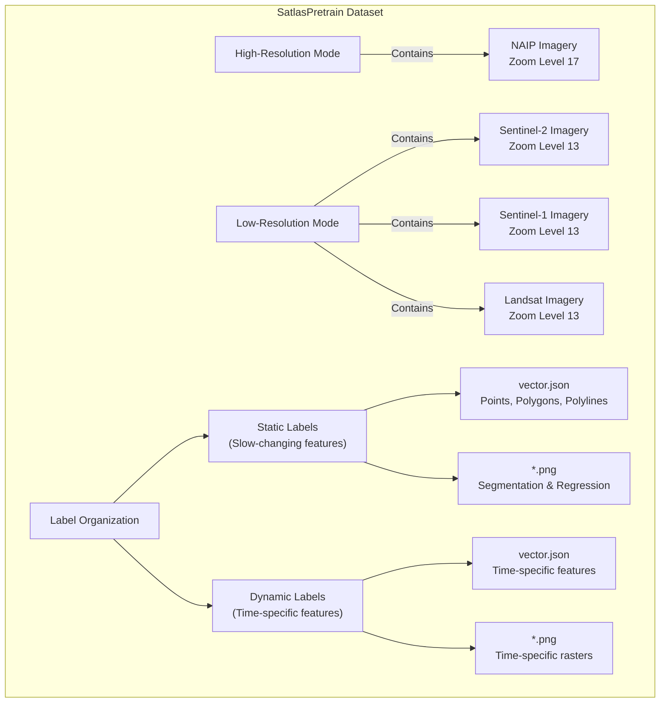

Sources: [SatlasPretrain.md:56-152]()

## Train and Test Splits

Each image mode (high-resolution and low-resolution) has its own train and test split. The splits are defined in JSON files that contain lists of (col, row) pairs which identify specific tiles:

- `satlas/metadata/train_lowres.json`
- `satlas/metadata/test_lowres.json`
- `satlas/metadata/train_highres.json`
- `satlas/metadata/test_highres.json`

Dynamic labels (time-specific features) have separate split files:

- `satlas/metadata/train_event.json`
- `satlas/metadata/test_event.json`

Sources: [SatlasPretrain.md:56-68]()

## Tile System

The SatlasPretrain dataset uses the Web Mercator projection to organize all its data in a grid-based tile system.

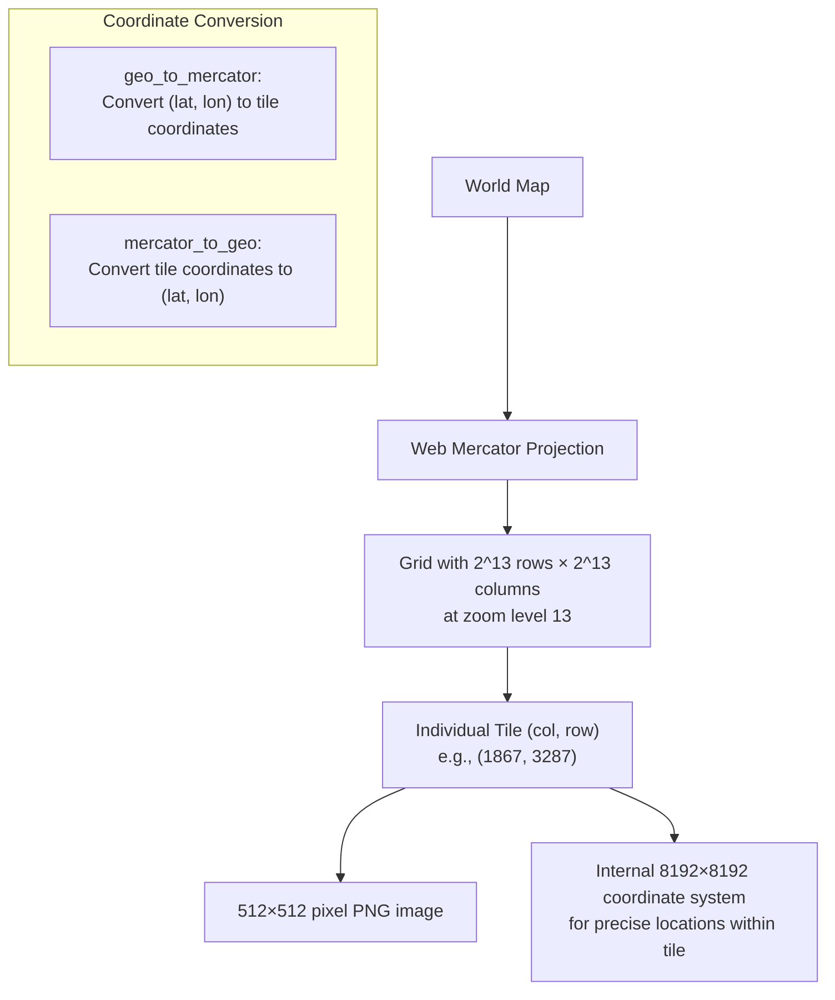

Sources: [SatlasPretrain.md:70-76](), [SatlasPretrain.md:119-125]()

### Key Aspects of the Tile System

1. **Projection**: All images and labels are projected to Web Mercator
2. **Resolution Levels**:
   - Low-resolution mode: Zoom level 13
   - High-resolution mode: Zoom level 17
3. **Tile Size**: Each image tile is 512×512 pixels
4. **Intra-Tile Coordinates**: An 8192×8192 coordinate system is used within each tile for precise positioning of features

The `satlas.util` module provides functions to convert between geographic coordinates (latitude, longitude) and tile coordinates:

```python
import satlas.util
# Convert tile coordinates to geographic coordinates (latitude, longitude)
satlas.util.mercator_to_geo((1867, 3287), pixels=1, zoom=13)

# For coordinates within a tile
tile = (1234, 5678)
point = (454, 401)
satlas.util.mercator_to_geo(
    (tile[0]*8192 + point[0], tile[1]*8192 + point[1]), 
    pixels=8192, 
    zoom=13
)
```

Sources: [SatlasPretrain.md:70-76](), [SatlasPretrain.md:119-125](), [SatlasPretrain.md:208-213]()

## Image Directory Structure

Images are organized by their source and type in the following directory structure:

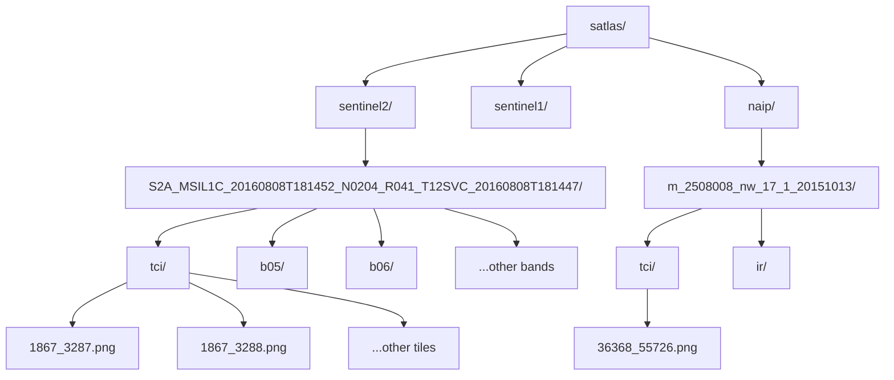

Sources: [SatlasPretrain.md:77-108]()

### Image Organization Details

1. **Sentinel-2 and Sentinel-1 (Low-Resolution)**:
   - Located in `satlas/sentinel2/` and `satlas/sentinel1/`
   - Each source image has its own directory named by the image ID
   - Within each image directory, subdirectories contain different bands:
     - `tci/`: True-color image (RGB)
     - Other band directories like `b05/`, `b06/`, etc. for Sentinel-2
   - Each PNG file is named by its column and row in the tile grid, e.g., `1867_3287.png`

2. **NAIP (High-Resolution)**:
   - Located in `satlas/naip/`
   - Stored at zoom level 17 instead of 13
   - Similar organization with image ID directories
   - Contains bands like `tci/` (true color) and `ir/` (infrared)

Sources: [SatlasPretrain.md:77-108]()

## Label Directory Structure

Labels are organized into static (slow-changing) and dynamic (time-specific) categories:

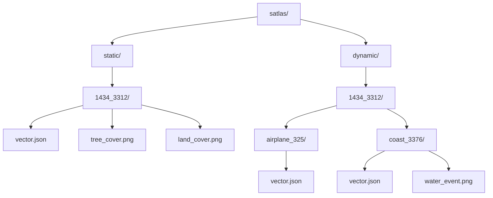

Sources: [SatlasPretrain.md:127-149]()

### Label Organization Details

1. **Static Labels** (`satlas/static/`):
   - Represent slow-changing features that generally correspond to the most recent image
   - Organized by tile coordinates, e.g., `1434_3312/`
   - Each tile directory contains:
     - `vector.json`: Contains point, polygon, polyline, and classification labels
     - Additional PNG files for segmentation and regression tasks (e.g., `tree_cover.png`, `land_cover.png`)

2. **Dynamic Labels** (`satlas/dynamic/`):
   - Represent time-specific features that reference a specific image/time
   - First organized by tile coordinates, then by category and an identifier
   - Example: `dynamic/1434_3312/airplane_325/`
   - Each category directory contains:
     - `vector.json`: Contains feature labels with metadata linking to a specific image
     - Optional PNG files for time-specific raster data (e.g., `water_event.png`)

Sources: [SatlasPretrain.md:127-149]()

## Label Data Formats

The dataset uses two primary formats for labels:

1. **Vector JSON Format** (`vector.json`): Used for geometric features
2. **Raster PNG Format** (various `.png` files): Used for segmentation and regression tasks

### Vector JSON Structure

The `vector.json` files contain structured data for points, polygons, polylines, properties, and classification labels. Here's the general structure:

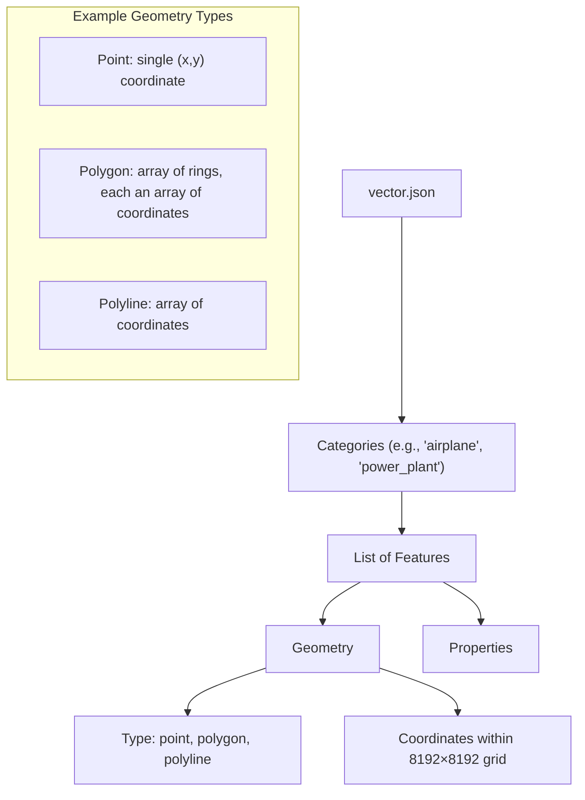

Sample structure for dynamic labels:

```json
{
    "metadata": {
        "Start": "2014-08-04T23:59:59+00:00",
        "End": "2014-08-05T00:00:01+00:00",
        "ImageUUID": "996e6f0f4f3f42838211caf73c4692f2",
        "ImageName": "m_3211625_sw_11_1_20140805"
    },
    "airplane": [
        {
            "Geometry": {
                "Type": "point",
                "Point": [454, 401]
            },
            "Properties": {}
        }
    ]
}
```

Sources: [SatlasPretrain.md:150-204]()

### Raster PNG Format

For segmentation and regression tasks, labels are stored as 512×512 pixel grayscale PNG images:

| Task Type | Filename Example | Pixel Value Interpretation |
|-----------|------------------|----------------------------|
| Regression | `tree_cover.png` | Proportional to quantity (e.g., 0-200 for tree cover) |
| Segmentation | `land_cover.png` | Pixel value indicates class ID (0 = invalid, 1+ = class) |
| Binary Segmentation | `water_event.png` | Bit flags (rightmost bit = first category) |

The meaning of each raster file is defined by its filename, and the tasks and categories are defined in `satlas/tasks.py`.

Sources: [SatlasPretrain.md:217-231]()

## Additional Metadata Files

The dataset includes several metadata files in the `satlas/metadata/` directory:

| Filename | Purpose |
|----------|---------|
| `train_highres.json`, `test_highres.json` | List of tiles in high-resolution train/test splits |
| `train_lowres.json`, `test_lowres.json` | List of tiles in low-resolution train/test splits |
| `train_event.json`, `test_event.json` | List of tiles for dynamic event train/test splits |
| `image_times.json` | Timestamps for each image based on its name |
| `test_highres_property.json`, `test_lowres_property.json` | Subsets for evaluating properties |
| `good_images_X.json` | Lists of images with few cloudy or missing pixels |

Sources: [SatlasPretrain.md:239-247]()

## Usage Guidelines for Prediction Tasks

The dataset includes specific guidelines on what data can be used for different prediction tasks:

### For Non-Property Labels

When predicting non-property labels, models may use:
- Tile position (e.g., `1434_3312`)
- Image name (from `vector.json`)
- The subset of categories annotated in the label folder (only for optimizing inference)
- Label folder name (only for creating identically named output folders)

### For Property and Classification Labels

When predicting property and classification labels, models may additionally use:
- The entirety of `vector.json` except the property values themselves
- This allows using the coordinates of points, polygons, and polylines to inform property prediction

Sources: [SatlasPretrain.md:249-266]()

## Evaluation Format

For evaluation, predictions should mirror the organization of the ground truth labels:

- For each label folder like `static/1434_3312/` or `dynamic/1434_3312/airplane_325/`, a corresponding output folder should be created
- The evaluation command uses the `satlas.cmd.evaluate` module with appropriate parameters for different label types

Example evaluation command:
```bash
python -m satlas.cmd.evaluate --gt_path path/to/satlas/static/ --pred_path path/to/outputs/ --modality point --split path/to/satlas/metadata/test_highres.json --format static
```

Sources: [SatlasPretrain.md:269-277]()

---

# Page: Labels and Tasks

# Labels and Tasks

<details>
<summary>Relevant source files</summary>

The following files were used as context for generating this wiki page:

- [SatlasPretrain.md](SatlasPretrain.md)
- [requirements.txt](requirements.txt)
- [satlas/cmd/vis.py](satlas/cmd/vis.py)
- [satlas/model/classify.py](satlas/model/classify.py)
- [satlas/model/dataset.py](satlas/model/dataset.py)
- [satlas/model/models.py](satlas/model/models.py)
- [satlas/tasks.py](satlas/tasks.py)

</details>


This page documents the labels available in the SatlasPretrain dataset and their corresponding tasks. It explains the different label types, formats, and how they are organized in the dataset. For information about the overall dataset structure, see [Dataset Structure](#2.1).

## Label Types Overview

The SatlasPretrain dataset contains 302 million labels across 137 categories with seven distinct label types:

1. **Points** - Single coordinate locations (e.g., wind turbines, lighthouses)
2. **Polygons** - Closed shapes with vertices (e.g., buildings, parks, airports)
3. **Polylines** - Connected line segments (e.g., roads, rivers, railways)
4. **Properties** - Attributes associated with geometric features
5. **Segmentation** - Pixel-level categorical masks
6. **Regression** - Pixel-level continuous value maps
7. **Classification** - Tile-level categorical labels

These labels are divided into two major categories:
- **Static (slow-changing) labels** - Features that change infrequently over time
- **Dynamic (time-specific) labels** - Features associated with specific images/timestamps

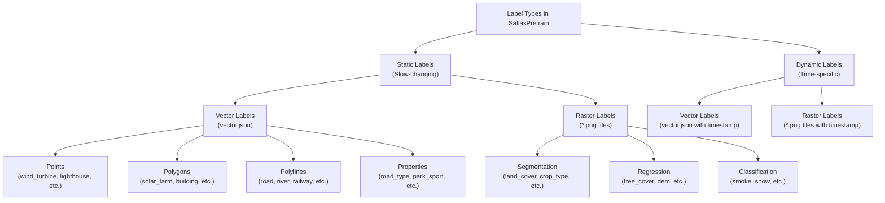

Sources: [SatlasPretrain.md:7-8](), [SatlasPretrain.md:130-149]()

## Label Storage Format

### Vector Label Format (vector.json)

Points, polygons, polylines, and properties are stored in `vector.json` files. The file structure uses a JSON format where each category is a key, and the value is a list of features with their geometry and properties.

```
{
    "category1": [
        {
            "Geometry": {
                "Type": "point|polygon|polyline",
                "Point|Polygon|Polyline": [coordinates]
            },
            "Properties": {
                "property1": value1,
                "property2": value2
            }
        },
        ...
    ],
    "category2": [
        ...
    ]
}
```

For example, a `vector.json` file might contain entries for airplanes (points), power plants (polygons), and roads (polylines):

```
{
    "airplane": [{
        "Geometry": {
            "Type": "point",
            "Point": [454, 401]
        },
        "Properties": {}
    }],
    
    "power_plant": [{
        "Geometry": {
            "Type": "polygon",
            "Polygon": [[[6197, 6210], [6151, 6284], [6242, 6341], [6260, 6312], [6288, 6268], [6197, 6210]]]
        },
        "Properties": {"plant_type": "gas"}
    }],
    
    "road": [{
        "Geometry": {
            "Type": "polyline",
            "Polyline": [[7287, 789], [7281, 729], [7280, 716], [7277, 690], [7267, 581], [7256, 466], [7242, 312], [7206, -45], [7149, -628]]
        },
        "Properties": {"road_type": "residential"}
    }]
}
```

For dynamic labels, the `vector.json` files include metadata specifying the timestamp and corresponding image:

```
{
    "metadata": {
        "Start": "2014-08-04T23:59:59+00:00",
        "End": "2014-08-05T00:00:01+00:00",
        "ImageUUID": "996e6f0f4f3f42838211caf73c4692f2",
        "ImageName": "m_3211625_sw_11_1_20140805"
    },
    "category1": [
        ...
    ]
}
```

### Raster Label Format (PNG files)

Segmentation, regression, and classification tasks use PNG files to represent their labels:

1. **Segmentation Labels**: Each pixel value corresponds to a category index (e.g., 1 for water, 2 for developed, etc.)
2. **Binary Segmentation Labels**: Each bit in the pixel value corresponds to a boolean flag for a category
3. **Regression Labels**: Pixel values are proportional to the quantity (e.g., 0-200 for tree cover percentage)

Sources: [SatlasPretrain.md:170-231](), [satlas/model/dataset.py:372-452]()

## Task Types

The SatlasPretrain dataset supports seven primary task types, each with its own data format and processing approach:

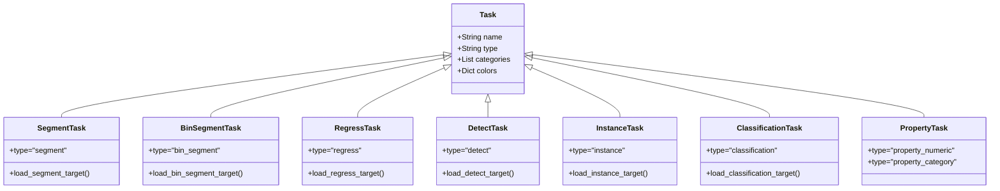

Sources: [satlas/model/dataset.py:333-371](), [satlas/tasks.py:1-241]()

### 1. Segmentation (`segment`)

Pixel-level classification where each pixel belongs to a single category. Used for tasks like land cover classification.

Example tasks:
- `land_cover`: Classify each pixel as water, developed, tree, etc.
- `crop_type`: Identify different crop types in agricultural areas
- `water_event`: Detect water events like flooding

### 2. Binary Segmentation (`bin_segment`)

Multi-label segmentation where each pixel can belong to multiple categories. Each bit in the pixel value represents a different category.

Example tasks:
- `polyline_bin_segment`: Identify multiple linear features (roads, rivers, railways)
- `wildfire`: Detect fire retardant areas and burned areas
- `cloud`: Identify clouds and their shadows

### 3. Regression (`regress`)

Pixel-level prediction of continuous values.

Example tasks:
- `tree_cover`: Percentage of tree cover (0-200 scale)
- `dem`: Digital elevation model (height information)

### 4. Detection (`detect`)

Identify and localize objects with bounding boxes.

Example tasks:
- `point`: Detect point objects like wind turbines, lighthouses
- `airplane`: Detect airplanes
- `vessel`: Detect vessels in water bodies

### 5. Instance Segmentation (`instance`)

Pixel-level masks for individual object instances.

Example tasks:
- `polygon`: Identify individual instances of areas like solar farms, parks
- `building`: Identify individual building footprints

### 6. Classification (`classify`)

Image-level labels for an entire tile.

Example tasks:
- `smoke`: Determine if an image contains smoke (no/partial/yes)
- `snow`: Determine if an image contains snow (no/partial/yes)

### 7. Property Prediction

Predicting attributes of geometric features:
- `property_numeric`: Numerical properties (e.g., road lanes, turbine diameter)
- `property_category`: Categorical properties (e.g., road type, park sport)

Sources: [satlas/model/dataset.py:95-331](), [satlas/tasks.py:22-241]()

## Task Categories

The SatlasPretrain dataset covers 137 categories distributed across different task types. The main category groups include:

| Task Type | Example Categories |
|-----------|-------------------|
| Point | wind_turbine, lighthouse, offshore_platform, helipad, chimney |
| Polygon | solar_farm, power_plant, airport, stadium, parking_lot |
| Polyline | road, river, railway, airport_runway, raceway |
| Land Cover | water, developed, tree, grass, crop, bare, snow |
| Crop Type | rice, grape, corn, sugarcane, wheat, soy, potato |
| Property | road_type, park_sport, track_sport, power_plant_type |

The full list of categories is defined in the `satlas/model/dataset.py` and `satlas/tasks.py` files.

Sources: [satlas/model/dataset.py:16-331](), [satlas/tasks.py:2-241]()

## Code Implementation

The task and label systems are implemented primarily through the following components:

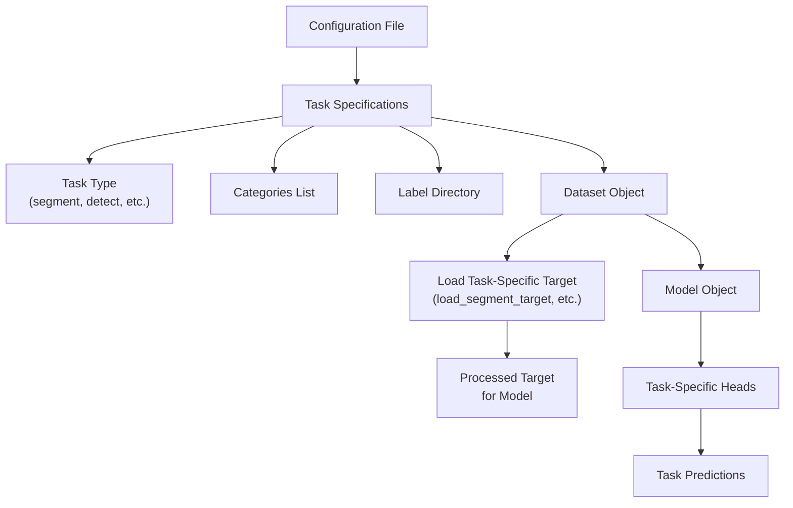

### Task Definitions

Tasks are defined in `satlas/tasks.py` and organized into groups:

1. `detect_tasks`: For point and polygon detection
2. `polyline_tasks`: For polyline features
3. `raster_tasks`: For segmentation and regression tasks
4. `property_tasks`: For properties and classification tasks

Each task definition includes:
- `name`: Task identifier
- `type`: Task type (point, polygon, segment, etc.)
- `categories`: List of categories for the task
- `image_type`: Type of imagery the task applies to (highres, lowres, all)

### Dataset Loading

The `Dataset` class in `satlas/model/dataset.py` handles loading and processing labels:

1. It takes a list of task specifications from a configuration file
2. For each task, it finds the relevant examples 
3. When accessing an example, it loads the corresponding images and labels
4. Labels are processed into a standardized format based on the task type

### Task-Specific Target Loading

Each task type has a specific loading function:

- `load_segment_target`: Loads segmentation masks
- `load_bin_segment_target`: Loads binary segmentation masks
- `load_regress_target`: Loads regression values
- `load_detect_target`: Loads detection boxes
- `load_instance_target`: Loads instance masks
- `load_classification_target`: Loads classification labels

These functions convert the raw label data (from JSON or PNG files) into PyTorch tensors suitable for model training.

Sources: [satlas/model/dataset.py:615-825](), [satlas/tasks.py:22-241]()

## Working with Labels and Tasks

### Visualizing Examples

The repository includes visualization utilities to help inspect labels:

```bash
python -m satlas.cmd.vis --path dataset_path/highres/polygon/ --task polygon --out_path ~/vis/
```

This generates visualizations of images and their corresponding labels for the specified task.

### Specifying Tasks in Model Configuration

To use specific tasks in model training, you specify them in the configuration file:

```
TaskSpecs:
- Name: land_cover
  Task: land_cover
  LabelDir: /path/to/datasets/lowres/
  TrainSplit: /path/to/metadata/train_lowres.json
  ValSplit: /path/to/metadata/val_lowres.json
  TestSplit: /path/to/metadata/test_lowres.json
```

This system allows for flexible combination of different tasks during model training and evaluation.

Sources: [satlas/cmd/vis.py:19-28](), [satlas/model/dataset.py:632-647]()

---

# Page: Model System

# Model System

<details>
<summary>Relevant source files</summary>

The following files were used as context for generating this wiki page:

- [DataValidationReport.md](DataValidationReport.md)
- [ModelArchitecture.md](ModelArchitecture.md)
- [images/satlasnet.svg](images/satlasnet.svg)
- [requirements.txt](requirements.txt)
- [satlas/model/classify.py](satlas/model/classify.py)
- [satlas/model/dataset.py](satlas/model/dataset.py)
- [satlas/model/model.py](satlas/model/model.py)
- [satlas/model/models.py](satlas/model/models.py)
- [satlas/transforms/augment.py](satlas/transforms/augment.py)

</details>


This page provides an overview of the SatlasNet model system, its architecture, components, and how they work together to process satellite imagery for various tasks. For details on model training, see [Training Pipeline](#3.2), and for information about using trained models for inference, see [Inference Pipeline](#3.3).

## Overview

The Model System in Satlas is built around SatlasNet, a flexible neural network architecture designed specifically for satellite imagery analysis. The system provides a modular framework where different components can be combined to create models for various geospatial tasks, such as object detection, segmentation, and regression.

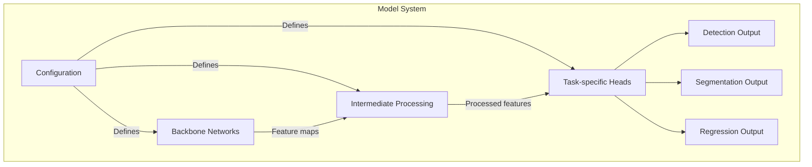

Sources: [satlas/model/model.py:1-26](). [satlas/model/models.py:1-9]().

## Key Components

The SatlasNet model architecture consists of three main component types:

1. **Backbone** - Extracts feature maps from input images at different resolutions
2. **Intermediates** - Process feature maps from the backbone (optional)
3. **Heads** - Task-specific components that produce the final outputs

These components are configured through a configuration system that allows for flexible model creation.

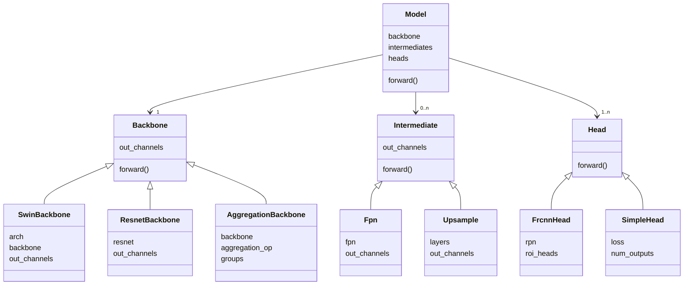

Sources: [satlas/model/model.py:27-31](). [ModelArchitecture.md:1-23]().

## Model Architecture

The Model System uses a flexible architecture that processes satellite imagery through several stages:

1. Multiple aligned images are input to a backbone network
2. Features are extracted at different resolutions
3. Intermediate layers can process and refine these features
4. Task-specific heads produce various outputs for different purposes

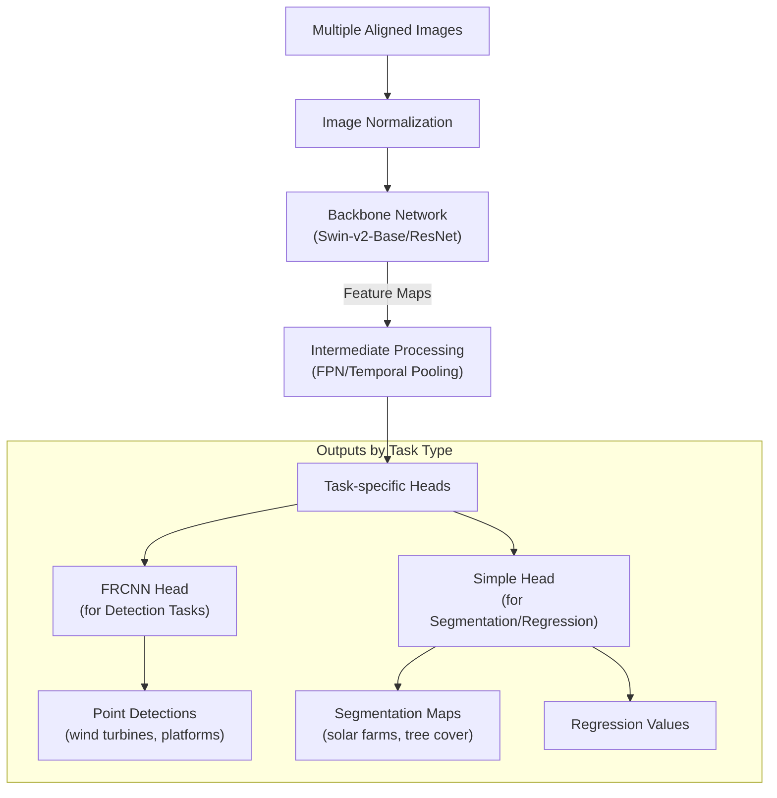

Sources: [satlas/model/model.py:10-26](). [ModelArchitecture.md:1-16]().

## Backbone Networks

The backbone is responsible for extracting features from input images. Satlas supports several backbone architectures:

### Swin Transformer Backbone

The Swin Transformer backbone is the default backbone used in SatlasNet. It's a hierarchical vision transformer that uses shifted windows to process images efficiently.

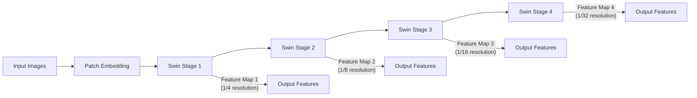

Sources: [satlas/model/model.py:32-118](). [ModelArchitecture.md:2-11]().

### ResNet Backbone

The ResNet backbone provides an alternative feature extraction approach using residual connections.

```mermaid
flowchart LR
    Input["Input Images"] --> Conv1["Conv1 + BN + ReLU"]
    Conv1 --> MaxPool["MaxPool"]
    MaxPool --> Layer1["Layer1"]
    Layer1 --> Layer2["Layer2"]
    Layer2 --> Layer3["Layer3"]
    Layer3 --> Layer4["Layer4"]
    
    Layer1 --> |"Feature Map 1\n(1/4 resolution)"| Output1["Output Features"]
    Layer2 --> |"Feature Map 2\n(1/8 resolution)"| Output2["Output Features"]
    Layer3 --> |"Feature Map 3\n(1/16 resolution)"| Output3["Output Features"]
    Layer4 --> |"Feature Map 4\n(1/32 resolution)"| Output4["Output Features"]
```

Sources: [satlas/model/model.py:120-191]().

### Aggregation Backbone

The Aggregation Backbone is a special backbone that processes multiple aligned images and combines their features using various operations (max pooling, mean, convolutional RNN, etc.).

```mermaid
flowchart TD
    Inputs["Multiple Aligned Images"] --> Split["Split by Channels"]
    
    Split --> BB1["Underlying Backbone\nInstance 1"]
    Split --> BB2["Underlying Backbone\nInstance 2"]
    Split --> BBN["Underlying Backbone\nInstance N"]
    
    BB1 --> |"Feature Maps"| Agg["Aggregation Layer\n(max, mean, convrnn, conv3d, conv1d)"]
    BB2 --> |"Feature Maps"| Agg
    BBN --> |"Feature Maps"| Agg
    
    Agg --> Output["Aggregated Feature Maps"]
```

Sources: [satlas/model/model.py:193-322]().

## Intermediate Processing

Intermediates are optional components that process feature maps from the backbone before they're sent to the heads.

### Feature Pyramid Network (FPN)

The FPN combines high-level semantically strong features with low-level spatially accurate features to improve performance on tasks requiring multi-scale predictions.

```mermaid
flowchart TD
    FM1["Feature Map 1\n(1/4 resolution)"] --> FPN["Feature Pyramid Network"]
    FM2["Feature Map 2\n(1/8 resolution)"] --> FPN
    FM3["Feature Map 3\n(1/16 resolution)"] --> FPN
    FM4["Feature Map 4\n(1/32 resolution)"] --> FPN
    
    FPN --> OFMS["Output Feature Maps\nwith Unified Channel Count"]
```

Sources: [satlas/model/model.py:324-348](). [ModelArchitecture.md:12]().

### Upsample

The Upsample intermediate creates a feature map at the input resolution, which can be useful for high-resolution tasks like segmentation.

```mermaid
flowchart LR
    FM["Input Feature Maps"] --> USM["Upsample Module"]
    
    subgraph "Upsample Processing"
        USM --> Conv["Conv2D"]
        Conv --> ReLU["ReLU"]
        ReLU --> TransConv["Transpose Conv2D"]
        TransConv --> OutReLU["ReLU"]
    end
    
    OutReLU --> Output["Higher Resolution Feature Map"]
```

Sources: [satlas/model/model.py:350-425]().

## Task-Specific Heads

The heads are responsible for transforming feature maps into task-specific outputs.

### Faster R-CNN Head (Detection Tasks)

Used for object detection tasks like identifying wind turbines or offshore platforms. It consists of a Region Proposal Network (RPN) and ROI Heads.

```mermaid
flowchart TD
    FM["Feature Maps"] --> RPN["Region Proposal Network"]
    FM --> ROI["ROI Heads"]
    RPN --> |"Proposals"| ROI
    
    ROI --> BoxHead["Box Head"]
    ROI --> MaskHead["Mask Head\n(for Instance Segmentation)"]
    
    BoxHead --> BoxOutput["Bounding Boxes\nand Class Labels"]
    MaskHead --> MaskOutput["Instance Masks"]
```

Sources: [satlas/model/model.py:447-546]().

### Simple Head (Segmentation and Regression Tasks)

Used for segmentation tasks (like solar farm identification) and regression tasks (like tree cover measurement).

```mermaid
flowchart LR
    FM["Feature Maps"] --> Conv["Conv Layers"]
    Conv --> Output["Task Output\n(Segmentation Masks\nor Regression Values)"]
```

Sources: [satlas/model/model.py:548-786]().

## Data Flow

The following diagram illustrates how data flows through the model system during inference:

```mermaid
sequenceDiagram
    participant I as Input Images
    participant B as Backbone
    participant Int as Intermediates
    participant H as Heads
    participant O as Outputs
    
    I->>B: Multiple aligned images
    B->>Int: Feature maps at different resolutions
    Int->>H: Processed feature maps
    H->>O: Task-specific outputs
    
    Note over B,Int: Temporal max pooling for multi-image input
    Note over Int,H: Feature pyramid network combines multi-scale features
    Note over H,O: Faster R-CNN for detection<br>Simple Head for segmentation/regression
```

Sources: [satlas/model/model.py](). [ModelArchitecture.md]().

## Dataset and Tasks

The model system supports various geospatial tasks defined in the dataset configuration:

| Task Type | Description | Examples |
|-----------|-------------|----------|
| `detect` | Object detection with bounding boxes | Wind turbines, offshore platforms |
| `instance` | Instance segmentation with masks | Buildings, solar farms |
| `segment` | Semantic segmentation | Land cover types |
| `bin_segment` | Binary segmentation for multiple categories | Roads, rivers, runways |
| `regress` | Regression values | Tree cover percentage |
| `classification` | Image-level classification | Sport type, park type |

Sources: [satlas/model/dataset.py:16-331]().

## Model Creation Process

The model system creates models based on a configuration object that specifies the backbone, intermediates, and heads to use:

```mermaid
flowchart TD
    Config["Configuration File"] --> ModelInfo["Model Information"]
    
    ModelInfo --> CreateModel["get_model()"]
    
    CreateModel --> Model["Model Instance"]
    
    Model --> InitBackbone["Initialize Backbone"]
    Model --> InitIntermediates["Initialize Intermediates"]
    Model --> InitHeads["Initialize Heads for Tasks"]
    
    InitBackbone --> ForwardPass["Forward Pass"]
    InitIntermediates --> ForwardPass
    InitHeads --> ForwardPass
    
    ForwardPass --> Output["Task Outputs"]
```

Sources: [satlas/model/models.py:1-9](). [satlas/model/model.py]().

## Integration with Data Augmentation

The model system integrates with data augmentation techniques to improve training:

| Augmentation | Description |
|--------------|-------------|
| CropFlip | Randomly crops and flips images |
| Pad | Pads images to a specified size |
| MixChannels | Mixes channels in specified groups |
| Noise | Adds random noise to images |
| Brightness | Adjusts brightness randomly |
| Resize | Resizes images to random sizes |

Sources: [satlas/transforms/augment.py:8-366]().

## Key Operations in Multi-temporal Processing

When processing multiple temporal images, the model can use various aggregation operations:

| Aggregation | Description |
|-------------|-------------|
| max | Maximum value across temporal dimension |
| mean | Average value across temporal dimension |
| convrnn | Convolutional recurrent neural network |
| conv3d | 3D convolution across temporal dimension |
| conv1d | 1D convolution across temporal dimension |

Sources: [satlas/model/model.py:193-322]().

## Summary

The Model System in Satlas provides a flexible architecture for processing satellite imagery for various geospatial tasks. It combines state-of-the-art backbones like Swin Transformers with task-specific heads to create models that can detect objects, segment regions, and perform regression tasks on satellite imagery.

The modular design allows for easy customization and extension to support new tasks and model architectures while maintaining compatibility with the overall Satlas framework.

---

# Page: Model Architecture

# Model Architecture

<details>
<summary>Relevant source files</summary>

The following files were used as context for generating this wiki page:

- [DataValidationReport.md](DataValidationReport.md)
- [ModelArchitecture.md](ModelArchitecture.md)
- [configs/sentinel2/resnet152_mi_ms.txt](configs/sentinel2/resnet152_mi_ms.txt)
- [configs/sentinel2/resnet50_mi_ms.txt](configs/sentinel2/resnet50_mi_ms.txt)
- [configs/sentinel2/swint_mi_ms.txt](configs/sentinel2/swint_mi_ms.txt)
- [images/satlasnet.svg](images/satlasnet.svg)
- [satlas/model/model.py](satlas/model/model.py)
- [satlas/transforms/augment.py](satlas/transforms/augment.py)

</details>


This page describes the SatlasNet architecture, the primary neural network model used in the Satlas project. This document covers the core components, data flow, and implementation details of the model. For information about training the model, see [Training Pipeline](#3.2). For information about running inference, see [Inference Pipeline](#3.3).

## Overview

SatlasNet processes multiple temporally aligned satellite images to perform various geospatial analysis tasks, including point detection (e.g., wind turbines), polygon segmentation (e.g., solar farms), and regression (e.g., tree cover). The architecture is modular, consisting of a backbone for feature extraction, intermediates for feature processing, and task-specific heads for predictions.

```mermaid
flowchart TD
    subgraph "Input Processing"
        Input["Multiple Aligned Images"] --> Normalize["Image Normalization"]
    end
    
    subgraph "Feature Extraction"
        Normalize --> Backbone["Backbone Network<br>(Swin-v2-Base/ResNet)"]
        Backbone --> TempPool["Temporal Max Pooling"]
    end
    
    subgraph "Feature Processing"
        TempPool --> FPN["Feature Pyramid Network"]
        FPN --> Upsampling["Optional Upsampling"]
    end
    
    subgraph "Task Heads"
        Upsampling --> FRCNN["Faster R-CNN<br>for Points"]
        Upsampling --> Simple["Simple Head<br>for Segmentation/Regression"]
        Upsampling --> Classify["Classification Head"]
    end
    
    FRCNN --> Points["Point Detections<br>(Wind Turbines, Platforms)"]
    Simple --> SegReg["Segmentation/Regression<br>(Solar Farms, Tree Cover)"]
    Classify --> Classes["Classifications"]
```

Sources: [ModelArchitecture.md:1-16](). [satlas/model/model.py:10-26]().

## Architecture Components

The SatlasNet model follows a modular design with three main component types:

1. **Backbone**: Extracts features from input images
2. **Intermediates**: Process features from the backbone
3. **Heads**: Generate task-specific outputs

The model is implemented using a configuration-driven approach, allowing for customization of each component.

```mermaid
classDiagram
    class Model {
        backbone
        intermediates
        heads
        forward(image_list, targets, selected_task)
    }
    
    class Backbone {
        <<interface>>
        forward(x)
        out_channels
    }
    
    class Intermediate {
        <<interface>>
        forward(x)
        out_channels
    }
    
    class Head {
        <<interface>>
        forward(image_list, features, targets)
    }
    
    Model *-- Backbone
    Model *-- Intermediate
    Model *-- Head
    
    Backbone <|-- SwinBackbone
    Backbone <|-- ResnetBackbone
    Backbone <|-- AggregationBackbone
    
    Intermediate <|-- Fpn
    Intermediate <|-- Upsample
    
    Head <|-- FrcnnHead
    Head <|-- SimpleHead
    Head <|-- ClassifyHead
```

Sources: [satlas/model/model.py:776-804]().

### Input Processing

SatlasNet processes multiple aligned satellite images (typically 3-4) of the same geographic area captured at different times. The input is organized as a batch of image sequences, where each sequence contains images from different time points for the same location.

The images are normalized to have values between 0-1 before being passed to the backbone. This normalization process varies by satellite source and is documented in the Normalization page.

Sources: [ModelArchitecture.md:7-8]().

### Backbone Architecture

The backbone is responsible for extracting features from the input images. SatlasNet supports multiple backbone architectures:

1. **Swin Transformer**: The primary backbone is Swin-v2-Base, which processes images through a hierarchical transformer architecture
2. **ResNet**: ResNet50/101/152 backbones are also supported
3. **Aggregation Backbone**: A wrapper that applies one of the above backbones to each image and then aggregates features

Each backbone outputs a list of feature maps at different spatial resolutions (typically 1/4, 1/8, 1/16, and 1/32 of the input resolution).

```mermaid
flowchart TD
    subgraph "Swin Transformer Backbone"
        Input["Input Image"] --> PatchEmbed["Patch Embedding<br>(4×4 patches)"]
        PatchEmbed --> SwinBlock1["Swin Block 1"]
        SwinBlock1 --> PatchMerge1["Patch Merging"]
        PatchMerge1 --> SwinBlock2["Swin Block 2"]
        SwinBlock2 --> PatchMerge2["Patch Merging"]
        PatchMerge2 --> SwinBlock3["Swin Block 3"]
        SwinBlock3 --> PatchMerge3["Patch Merging"]
        PatchMerge3 --> SwinBlock4["Swin Block 4"]
        
        SwinBlock1 -.-> Feat1["Feature Map 1<br>(1/4 resolution)"]
        SwinBlock2 -.-> Feat2["Feature Map 2<br>(1/8 resolution)"]
        SwinBlock3 -.-> Feat3["Feature Map 3<br>(1/16 resolution)"]
        SwinBlock4 -.-> Feat4["Feature Map 4<br>(1/32 resolution)"]
    end
```

Sources: [satlas/model/model.py:32-118](). [ModelArchitecture.md:9]().

### Temporal Aggregation

For multi-temporal image sequences, SatlasNet applies the backbone to each image separately and then aggregates the features across the temporal dimension. The default aggregation operation is max pooling, which selects the maximum value at each spatial position across all time points. This helps the model focus on features that are most prominent in any of the images, making it robust to temporal variations.

Other supported aggregation operations include:
- Mean pooling
- Convolutional RNN
- 3D convolution
- 1D convolution

```mermaid
flowchart LR
    subgraph "Temporal Max Pooling"
        Feat1["Feature Map<br>Time 1"] --> MaxPool{{"Max Pool"}}
        Feat2["Feature Map<br>Time 2"] --> MaxPool
        Feat3["Feature Map<br>Time 3"] --> MaxPool
        Feat4["Feature Map<br>Time 4"] --> MaxPool
        MaxPool --> AggFeat["Aggregated<br>Feature Map"]
    end
```

Sources: [satlas/model/model.py:193-322](). [ModelArchitecture.md:10]().

### Feature Processing Intermediates

After the backbone and temporal aggregation, SatlasNet applies "intermediates" to process the feature maps:

1. **Feature Pyramid Network (FPN)**: Combines features across different resolutions to create a feature pyramid. This helps the model handle objects at different scales.

2. **Upsampling**: Optionally adds a UNet-style decoder to generate high-resolution feature maps (1x the input resolution) for tasks requiring detailed spatial information.

```mermaid
flowchart TD
    subgraph "Feature Pyramid Network"
        F1["Feature Map 1<br>(1/4 resolution)"] --> FPN1["FPN Layer 1"]
        F2["Feature Map 2<br>(1/8 resolution)"] --> FPN2["FPN Layer 2"]
        F3["Feature Map 3<br>(1/16 resolution)"] --> FPN3["FPN Layer 3"]
        F4["Feature Map 4<br>(1/32 resolution)"] --> FPN4["FPN Layer 4"]
        
        FPN4 --> TopDown4["Top-Down<br>Feature 4"]
        TopDown4 --> TopDown3["Top-Down<br>Feature 3"]
        F3 --"Lateral Connection"--> TopDown3
        TopDown3 --> TopDown2["Top-Down<br>Feature 2"]
        F2 --"Lateral Connection"--> TopDown2
        TopDown2 --> TopDown1["Top-Down<br>Feature 1"]
        F1 --"Lateral Connection"--> TopDown1
        
        TopDown1 --> P1["Output P1"]
        TopDown2 --> P2["Output P2"]
        TopDown3 --> P3["Output P3"]
        TopDown4 --> P4["Output P4"]
    end
```

Sources: [satlas/model/model.py:324-425](). [ModelArchitecture.md:11-12]().

### Task-specific Heads

SatlasNet employs different prediction heads for different tasks:

1. **Faster R-CNN Head (`FrcnnHead`)**: Used for object detection tasks like identifying wind turbines or offshore platforms. It consists of a Region Proposal Network (RPN) and ROI heads.

2. **Simple Head (`SimpleHead`)**: A versatile head that can be configured for:
   - Segmentation tasks (e.g., solar farm detection)
   - Binary segmentation
   - Regression tasks (e.g., tree cover estimation)
   - Classification tasks

3. **Classification Head (`ClassifyHead`)**: Specialized for image-level classification tasks.

```mermaid
flowchart TD
    subgraph "FrcnnHead"
        FeatsFRCNN["Feature Maps"] --> RPN["Region Proposal Network"]
        RPN --> Proposals["Region Proposals"]
        Proposals --> ROIPool["ROI Pooling"]
        FeatsFRCNN --> ROIPool
        ROIPool --> BoxHead["Box Head"]
        BoxHead --> BoxPred["Box Predictor"]
        BoxPred --> Detections["Detections<br>(boxes, scores, classes)"]
    end
    
    subgraph "SimpleHead"
        FeatsSimple["Feature Maps"] --> Conv["Convolutional Layers"]
        Conv --> TaskType{"Task Type"}
        TaskType -->|"Segmentation"| SegOutput["Segmentation Map"]
        TaskType -->|"Regression"| RegOutput["Regression Values"]
        TaskType -->|"Classification"| ClsOutput["Class Probabilities"]
    end
    
    subgraph "ClassifyHead"
        FeatsClassify["Feature Maps"] --> AvgPool["Global Average Pooling"]
        AvgPool --> Linear["Linear Layer"]
        Linear --> ClassProbs["Class Probabilities"]
    end
```

Sources: [satlas/model/model.py:447-774](). [ModelArchitecture.md:12]().

## Model Configuration

SatlasNet is highly configurable through JSON configuration files. These files define:

1. The backbone architecture and parameters
2. The intermediate layers (FPN, Upsampling)
3. The task-specific heads for each task
4. Training parameters like batch size, learning rate, etc.

Here's a simplified example of the configuration structure:

```
Model: {
    Name: "multihead4",
    Backbone: {
        Name: "aggregation",
        ImageChannels: 9,
        Groups: [[0, 1, 2, 3, 4, 5, 6, 7]],
        AggregationOp: "max",
        Backbone: {
            Name: "swin",
            Arch: "swin_v2_b",
            Pretrained: true
        }
    },
    Intermediates: [{
        Name: "fpn"
    }, {
        Name: "upsample"
    }],
    Heads: [{
        Name: "frcnn",
        UseLayers: [1, 2, 3, 4],
        AnchorSizes: [[32], [64], [128], [256]]
    }, {
        Name: "simple"
    }, {
        Name: "classify",
        Loss: "cross_entropy"
    }]
}
```

The configuration allows for customizing:
- Number of input channels
- Backbone type and parameters
- Temporal aggregation method
- Feature processing steps
- Task-specific head configurations
- Loss functions

Sources: [configs/sentinel2/swint_mi_ms.txt:36-104](). [configs/sentinel2/resnet50_mi_ms.txt:36-104]().

## Module Registry System

SatlasNet uses a registry pattern to manage different implementations of backbones, intermediates, and heads. This allows for easy extension with new components.

```mermaid
flowchart TD
    subgraph "Registry System"
        backbones["backbones dictionary"] --> SwinBackbone["SwinBackbone"]
        backbones --> ResnetBackbone["ResnetBackbone"]
        backbones --> AggregationBackbone["AggregationBackbone"]
        
        intermediates["intermediates dictionary"] --> Fpn["Fpn"]
        intermediates --> Upsample["Upsample"]
        
        heads["heads dictionary"] --> FrcnnHead["FrcnnHead"]
        heads --> SimpleHead["SimpleHead"]
        heads --> ClassifyHead["ClassifyHead"]
    end
    
    Config["Configuration File"] --> Model["Model Constructor"]
    Model --> backbones
    Model --> intermediates
    Model --> heads
```

The Model class instantiates components based on the configuration using these registries:

```python
backbone_config = self.model_config['Backbone']
self.backbone = backbones[backbone_config['Name']](self.num_channels, backbone_config)
```

Sources: [satlas/model/model.py:28-31](). [satlas/model/model.py:776-804]().

## Data Flow

The forward pass through SatlasNet follows these steps:

1. Input images are stacked into a batch
2. The backbone processes each image to extract features
3. Temporal aggregation combines features across time
4. Intermediates process the feature maps
5. Task-specific heads generate predictions
6. During training, losses are computed and returned

```mermaid
sequenceDiagram
    participant Input as Input Images
    participant Model as SatlasNet Model
    participant Backbone as Backbone
    participant Intermediates as Intermediates
    participant Heads as Task Heads
    participant Output as Predictions
    
    Input->>Model: image_list, targets (optional)
    Model->>Backbone: images
    Backbone->>Model: feature maps
    Model->>Intermediates: feature maps
    Intermediates->>Model: processed feature maps
    Model->>Heads: image_list, feature maps, targets
    Heads->>Model: predictions, losses
    Model->>Output: predictions, losses
```

Sources: [satlas/model/model.py:805-821]().

## Data Augmentation

During training, SatlasNet applies various data augmentation techniques to improve model robustness:

1. **CropFlip**: Random cropping and flipping of images and corresponding labels
2. **Pad**: Padding images to a specific size
3. **Resize**: Resizing images and corresponding labels
4. **MixChannels**: Mixing spectral channels
5. **Noise**: Adding random noise
6. **Brightness**: Adjusting brightness

These transformations are applied consistently to both input images and target labels to maintain alignment.

Sources: [satlas/transforms/augment.py:8-366]().

## Model File Structure

The model implementation is organized into these main components:

- `satlas/model/model.py`: Core model implementation
  - Backbone implementations (`SwinBackbone`, `ResnetBackbone`, `AggregationBackbone`)
  - Intermediate layers (`Fpn`, `Upsample`)
  - Task heads (`FrcnnHead`, `SimpleHead`, `ClassifyHead`)
  - Model class that assembles all components

The model weights in `.pth` files have these component prefixes:
- `backbone.backbone.backbone.`: The backbone network
- `intermediates.0.fpn.`: The FPN component
- `heads.0.`: The prediction heads

Sources: [ModelArchitecture.md:17-23]().

## Conclusion

SatlasNet is a flexible and powerful architecture for satellite imagery analysis. Its modular design allows for easy customization for different tasks and datasets. The combination of advanced backbone networks, temporal aggregation, and task-specific heads enables SatlasNet to effectively process multi-temporal satellite imagery for a wide range of geospatial applications, from renewable energy infrastructure mapping to tree cover estimation.

---

# Page: Training Pipeline

# Training Pipeline

<details>
<summary>Relevant source files</summary>

The following files were used as context for generating this wiki page:

- [configs/satlas_explorer_solar_farm.txt](configs/satlas_explorer_solar_farm.txt)
- [configs/sentinel2/resnet152_mi_ms.txt](configs/sentinel2/resnet152_mi_ms.txt)
- [configs/sentinel2/resnet50_mi_ms.txt](configs/sentinel2/resnet50_mi_ms.txt)
- [configs/sentinel2/swint_mi_ms.txt](configs/sentinel2/swint_mi_ms.txt)
- [satlas/cmd/model/train.py](satlas/cmd/model/train.py)
- [satlas/cmd/to_dataset/common.py](satlas/cmd/to_dataset/common.py)

</details>


The Satlas Training Pipeline provides a comprehensive system for training satellite imagery analysis models on the SatlasPretrain dataset. This page explains how to configure and execute model training using the provided command-line tools and configuration files. For information about the model architecture itself, see [Model Architecture](#3.1), and for running inference with trained models, refer to [Inference Pipeline](#3.3).

## Overview

The training pipeline enables training of SatlasNet models on multiple satellite imagery tasks simultaneously, with support for distributed training, mixed precision, learning rate scheduling, and a variety of data augmentation techniques.

```mermaid
flowchart TD
    subgraph "Configuration"
        config["JSON Configuration"]
        config --> channels["Input Channels"]
        config --> tasks["Task Definitions"]
        config --> model_config["Model Configuration"]
        config --> train_params["Training Parameters"]
    end
    
    subgraph "Data Processing"
        dataset["Dataset Creation<br>satlas.model.dataset.Dataset"]
        transforms["Data Transforms<br>satlas.transforms"]
        sampler["Data Sampling<br>RandomSampler/TileWeightSampler"]
        loader["DataLoader<br>torch.utils.data.DataLoader"]
        
        dataset --> sampler
        transforms --> dataset
        sampler --> loader
    end
    
    subgraph "Model Setup"
        model_init["Model Initialization<br>satlas.model.models.get_model"]
        pretrained["Load Pretrained Weights"]
        freeze["Freeze Parameters"]
        model_device["Move Model to Device"]
        
        model_init --> pretrained
        pretrained --> freeze
        freeze --> model_device
    end
    
    subgraph "Training Loop"
        epoch_loop["Epoch Iteration"]
        batch_loop["Batch Processing"]
        forward["Forward Pass"]
        loss["Loss Calculation"]
        backward["Backward Pass"]
        optimizer["Optimizer Step"]
        
        epoch_loop --> batch_loop
        batch_loop --> forward
        forward --> loss
        loss --> backward
        backward --> optimizer
        optimizer --> batch_loop
    end
    
    subgraph "Evaluation & Saving"
        evaluate["Model Evaluation<br>satlas.model.evaluate.evaluate"]
        save_model["Save Model Checkpoint<br>save_atomic()"]
        evaluate --> save_model
    end
    
    config --> dataset
    config --> model_init
    model_config --> model_init
    train_params --> optimizer
    loader --> batch_loop
    model_device --> forward
    batch_loop --> evaluate
```

Sources: [satlas/cmd/model/train.py:33-393]()

## Configuration System

The training pipeline is driven by JSON configuration files that define all aspects of the training process. These files specify input data channels, model architecture, optimization parameters, and tasks to be trained on.

### Key Configuration Elements

| Section | Purpose | Example Values |
|---------|---------|---------------|
| Channels | Input data channels | `["tci", "b05", "b06", "b07", "b08", "b11", "b12"]` |
| BatchSize | Training batch size | `16` |
| TrainTransforms | Data augmentation for training | `CropFlip`, `Resize` |
| Model | Model architecture definition | Backbone, Intermediates, Heads |
| Optimizer | Optimization algorithm and parameters | `adam`, `0.00001` |
| Tasks | Tasks to train on | `polygon`, `point`, `land_cover` |
| Half | Enable mixed precision training | `true`/`false` |
| SavePath | Where to save model checkpoints | `"models/sentinel2/LABEL/"` |

Here's a diagram showing the configuration hierarchy:

```mermaid
classDiagram
    class TrainingConfig {
        Channels: string[]
        BatchSize: int
        ValBatchSize: int
        TrainTransforms: Transform[]
        ValTransforms: Transform[]
        NumImages: int
        SavePath: string
        NumEpochs: int
        Model: ModelConfig
        Optimizer: OptimizerConfig
        Scheduler: SchedulerConfig
        Half: boolean
        Tasks: TaskConfig[]
    }
    
    class Transform {
        Name: string
        Parameters: any
    }
    
    class ModelConfig {
        Name: string
        Backbone: BackboneConfig
        Intermediates: IntermediateConfig[]
        Heads: HeadConfig[]
    }
    
    class OptimizerConfig {
        Name: string
        InitialLR: float
    }
    
    class SchedulerConfig {
        Name: string
        Factor: float
        Patience: int
        MinLR: float
    }
    
    class TaskConfig {
        Name: string
        Metric: string
        LabelDir: string
        TrainSplit: string
        ValSplit: string
        TestSplit: string
    }
    
    TrainingConfig --> Transform
    TrainingConfig --> ModelConfig
    TrainingConfig --> OptimizerConfig
    TrainingConfig --> SchedulerConfig
    TrainingConfig --> TaskConfig
```

Sources: [configs/sentinel2/resnet50_mi_ms.txt:1-276](), [configs/sentinel2/swint_mi_ms.txt:1-276](), [configs/sentinel2/resnet152_mi_ms.txt:1-276]()

## Dataset Preparation and Loading

The training pipeline loads data using the `satlas.model.dataset.Dataset` class, which handles the extraction of satellite imagery and corresponding labels for each specified task.

### Dataset Loading Process

```mermaid
flowchart TD
    config["Training Config"] --> task_specs["Task Specifications"]
    config --> channel_specs["Channel Specifications"]
    config --> transform_specs["Transform Specifications"]
    
    task_specs --> dataset["Dataset Creation<br>satlas.model.dataset.Dataset"]
    channel_specs --> dataset
    transform_specs --> transforms["Data Transforms<br>satlas.transforms"]
    transforms --> dataset
    
    dataset --> train_dataset["Training Dataset"]
    dataset --> val_dataset["Validation Dataset"]
    
    train_dataset --> train_sampler["Training Sampler<br>RandomSampler/TileWeightSampler"]
    val_dataset --> val_sampler["Validation Sampler<br>SequentialSampler"]
    
    train_sampler --> train_loader["Training DataLoader"]
    val_sampler --> val_loader["Validation DataLoader"]
```

The pipeline supports two types of samplers for training data:
1. `RandomSampler` - Standard random sampling for balanced datasets
2. `TileWeightSampler` - Weighted sampling that adjusts sampling frequency based on tile contents

Sources: [satlas/cmd/model/train.py:68-118]()

## Model Initialization

Models in Satlas are built according to the configuration specification. The system supports loading pre-trained weights and selectively freezing parts of the model.

### Model Creation Process

```mermaid
flowchart TD
    model_config["Model Configuration"] --> get_model["satlas.model.models.get_model()"]
    channels["Channel Configuration"] --> get_model
    tasks["Task Configuration"] --> get_model
    
    get_model --> model["SatlasNet Model"]
    
    restore_path["RestorePath (if specified)"] -->|"Load weights"| model
    
    model --> freeze["Freeze Parameters (if specified)"]
    freeze --> to_device["Move Model to Device"]
    
    to_device --> is_distributed{"Distributed Training?"}
    is_distributed -->|"Yes"| ddp["DistributedDataParallel Wrapper"]
    is_distributed -->|"No"| ready_model["Model Ready for Training"]
    ddp --> ready_model
```

The model initialization process supports several advanced features:
- Loading pre-trained weights from checkpoint files
- Selectively restoring weights using prefixes
- Parameter freezing for transfer learning
- Configurable unfreezing during training

Sources: [satlas/cmd/model/train.py:125-184](), [satlas/cmd/model/train.py:200-221]()

## Training Loop and Optimization

The training loop processes batches of data, computes losses, and updates model weights. It supports learning rate scheduling, gradient accumulation, and mixed precision training.

### Training Loop Components

```mermaid
flowchart TD
    start["Begin Training"] --> epoch_loop["For Each Epoch"]
    
    epoch_loop --> batch_loop["For Each Batch"]
    
    batch_loop --> to_device["Move Data to Device"]
    to_device --> batch_transform["Apply Batch Transforms (if any)"]
    
    batch_transform --> half_precision{"Half Precision?"}
    half_precision -->|"Yes"| autocast["torch.cuda.amp.autocast"]
    half_precision -->|"No"| forward["Model Forward Pass"]
    autocast --> forward
    
    forward --> loss["Calculate Loss"]
    loss --> scale_loss["Scale Loss (if half precision)"]
    scale_loss --> backward["Backward Pass"]
    
    backward --> accumulate{"Accumulate Gradients?"}
    accumulate -->|"No"| optimizer_step["Optimizer Step"]
    accumulate -->|"Yes, not ready"| next_batch["Next Batch"]
    accumulate -->|"Yes, ready"| optimizer_step
    
    optimizer_step --> zero_grad["Zero Gradients"]
    zero_grad --> next_batch
    
    next_batch --> batch_loop
    
    batch_loop --> summary_iter{"Summary Iteration?"}
    summary_iter -->|"No"| continue_training["Continue Training"]
    summary_iter -->|"Yes"| evaluate["Evaluate Model"]
    
    evaluate --> update_lr["Update Learning Rate"]
    update_lr --> save_model["Save Model Checkpoint"]
    save_model --> continue_training
    
    continue_training --> epoch_loop
```

Key optimization features:
- Support for Adam and SGD optimizers
- Learning rate warm-up periods
- Plateau-based learning rate scheduling
- Mixed precision training with automatic gradient scaling
- Gradient accumulation for larger effective batch sizes
- Parameter freezing/unfreezing during training

Sources: [satlas/cmd/model/train.py:193-198](), [satlas/cmd/model/train.py:223-246](), [satlas/cmd/model/train.py:248-249](), [satlas/cmd/model/train.py:269-381]()

## Distributed Training Support

The training pipeline supports distributed training across multiple GPUs using PyTorch's DistributedDataParallel wrapper.

```mermaid
flowchart TD
    start["Start Training Script"] --> rank_check{"Local Rank Specified?"}
    
    rank_check -->|"Yes"| distributed["Distributed Training"]
    rank_check -->|"No"| single["Single-GPU Training"]
    
    distributed --> set_device["Set CUDA Device"]
    set_device --> init_process["Initialize Process Group<br>backend='nccl'"]
    
    init_process --> adjust_batch["Adjust Batch Size<br>BatchSize / world_size"]
    single --> keep_batch["Use Original Batch Size"]
    
    adjust_batch --> common_flow["Rest of Training Pipeline"]
    keep_batch --> common_flow
    
    common_flow --> model_creation["Create Model"]
    model_creation --> is_distributed{"Distributed?"}
    
    is_distributed -->|"Yes"| wrap["Wrap Model with DistributedDataParallel"]
    is_distributed -->|"No"| skip_wrap["Use Model Directly"]
    
    wrap --> continue_train["Continue Training"]
    skip_wrap --> continue_train
```

When running in distributed mode, the pipeline automatically:
- Adjusts batch sizes based on the number of processes
- Coordinates learning rate scheduling across nodes
- Synchronizes evaluation metrics

Sources: [satlas/cmd/model/train.py:33-36](), [satlas/cmd/model/train.py:121-124](), [satlas/cmd/model/train.py:183-184](), [satlas/cmd/model/train.py:328-336]()

## Evaluation and Model Saving

Models are evaluated periodically during training, with checkpoints saved based on validation performance.

```mermaid
flowchart TD
    summary_iter["Summary Iteration"] --> evaluate["Evaluate Model<br>satlas.model.evaluate.evaluate()"]
    
    evaluate --> val_loss["Validation Loss"]
    evaluate --> task_losses["Task-specific Losses"]
    evaluate --> val_scores["Validation Scores"]
    
    val_scores --> is_primary{"Primary Process?"}
    is_primary -->|"No"| continue_train["Continue Training"]
    is_primary -->|"Yes"| print_summary["Print Summary"]
    
    print_summary --> save_model["Save Latest Model<br>save_atomic()"]
    
    save_model --> is_best{"Best Performance?"}
    is_best -->|"No"| continue_train
    is_best -->|"Yes"| save_best["Save Best Model<br>save_atomic()"]
    
    save_best --> continue_train
```

The evaluation process:
1. Runs the model on validation data
2. Calculates losses and task-specific metrics
3. Saves the current model state as "last.pth"
4. If the model achieves the best validation score so far, also saves it as "best.pth"

Sources: [satlas/cmd/model/train.py:339-380]()

## Command-line Usage

The training pipeline is invoked through a command-line interface that requires a path to a configuration file:

```
python -m satlas.cmd.model.train --config_path configs/sentinel2/swint_mi_ms.txt [--local-rank RANK] [--world_size SIZE]
```

Command-line arguments:
- `--config_path`: Path to the JSON configuration file
- `--local-rank`: Local rank for distributed training (set by PyTorch distributed launcher)
- `--world_size`: Total number of processes for distributed training

For distributed training, the recommended approach is to use PyTorch's distributed launcher:

```
python -m torch.distributed.launch --nproc_per_node=NUM_GPUS satlas/cmd/model/train.py --config_path CONFIG_PATH --world_size NUM_GPUS
```

Sources: [satlas/cmd/model/train.py:382-392]()

## Example Configuration File

Here's an annotated example of a configuration file for training a multi-task model on Sentinel-2 imagery:

```json
{
    "Channels": ["tci", "fake", "fake", "b05", "b06", "b07", "b08", "b11", "b12"],
    "BatchSize": 16,
    "ValBatchSize": 2,
    
    "TrainTransforms": [{
        "Name": "CropFlip",
        "HorizontalFlip": true,
        "VerticalFlip": true,
        "CropMin": 416,
        "CropMax": 512
    }, {
        "Name": "Resize",
        "ResizeMin": 512,
        "ResizeMax": 512
    }],
    
    "ValTransforms": [{
        "Name": "Pad",
        "PadTo": 512,
        "Mode": "center"
    }],
    
    "NumImages": 8,
    "SavePath": "models/sentinel2/LABEL/",
    "NumEpochs": 10000,
    
    "Model": {
        "Name": "multihead4",
        "Backbone": {
            "Name": "aggregation",
            "ImageChannels": 9,
            "Groups": [[0, 1, 2, 3, 4, 5, 6, 7]],
            "AggregationOp": "max",
            "Backbone": {
                "Name": "swin",
                "Arch": "swin_v2_t",
                "Pretrained": true
            }
        },
        "Intermediates": [{
            "Name": "fpn"
        }, {
            "Name": "upsample"
        }],
        "Heads": [
            // Task-specific heads...
        ]
    },
    
    "Optimizer": {
        "Name": "adam",
        "InitialLR": 0.00001
    },
    
    "WarmupExamples": 8192,
    "Scheduler": {
        "Name": "plateau",
        "Factor": 0.5,
        "Patience": 1,
        "Cooldown": 5,
        "MinLR": 1e-6
    },
    
    "Half": true,
    "SummaryExamples": 32768,
    
    "Tasks": [
        // Task definitions...
    ]
}
```

Sources: [configs/sentinel2/swint_mi_ms.txt:1-276]()

---

# Page: Inference Pipeline

# Inference Pipeline

<details>
<summary>Relevant source files</summary>

The following files were used as context for generating this wiki page:

- [satlas/cmd/evaluate.py](satlas/cmd/evaluate.py)
- [satlas/cmd/model/infer.py](satlas/cmd/model/infer.py)
- [satlas/metrics/evaluator.py](satlas/metrics/evaluator.py)
- [satlas/model/evaluate.py](satlas/model/evaluate.py)

</details>


The Satlas Inference Pipeline provides a systematic approach for applying trained models to satellite imagery data and evaluating their performance. This document explains how to run inference with trained Satlas models, configure the inference process, and interpret the outputs.

For information about training new models, see [Training Pipeline](#3.2). For custom inference with your own imagery, see [Custom Inference](#3.4).

## 1. Pipeline Overview

The inference pipeline takes a trained model and runs it on a set of images, producing predictions that can be evaluated against ground truth data and/or saved for further use.

```mermaid
flowchart LR
    subgraph "Inputs"
        config["Configuration File"]
        weights["Model Weights"]
        images["Test Images"]
    end
    
    subgraph "Pipeline"
        load_config["Load Configuration"]
        load_data["Load Test Data"]
        load_model["Initialize Model"]
        inference["Run Inference"]
        evaluate["Evaluate Results"]
    end
    
    subgraph "Outputs"
        vis["Visualizations"]
        metrics["Performance Metrics"]
        predictions["Raw Predictions"]
        probs["Probability Maps"]
    end
    
    config --> load_config
    load_config --> load_data
    load_config --> load_model
    weights --> load_model
    images --> load_data
    
    load_data --> inference
    load_model --> inference
    
    inference --> evaluate
    evaluate --> vis
    evaluate --> metrics
    evaluate --> predictions
    evaluate --> probs
```

Sources: [satlas/cmd/model/infer.py:17-149]()

## 2. Configuration

The inference pipeline is driven by a JSON configuration file that specifies:

- Model architecture
- Input channels
- Tasks to perform
- Data paths and splits
- Batch size and other processing parameters
- Output directories

Here are the key configuration parameters:

| Parameter | Description | Default |
|-----------|-------------|---------|
| `Channels` | List of input channels (e.g., "tci", "s1") | `["tci", "fake", "fake"]` |
| `BatchSize` | Number of samples per batch | Required |
| `VisDir` | Directory for saving visualizations | None |
| `ProbsDir` | Directory for saving probability maps | None |
| `OutDir` | Directory for saving raw outputs | None |
| `SavePath` | Path for model weights | Required |
| `EvaluateTask` | Specific task to evaluate (if only one needed) | None |
| `Half` | Enable half-precision inference | False |
| `TestMaxTiles` | Maximum number of tiles to process | None |
| `NumImages` | Number of images per tile to use | 1 |

Sources: [satlas/cmd/model/infer.py:18-41]()

## 3. Data Loading

The inference pipeline loads test data using the Satlas Dataset class, which supports various image sources and task types.

```mermaid
flowchart TD
    config["Configuration"]
    dataset["Dataset Class"]
    dataloader["DataLoader"]
    
    config --> |"Task specs,\nTransforms,\nChannels"| dataset
    dataset --> |"Batch size,\nCollate function"| dataloader
    
    subgraph "Dataset Options"
        tasks["Task Specifications"]
        transforms["Image Transforms"]
        channels["Input Channels"]
        max_tiles["Maximum Tiles"]
        phase["'Test' Phase"]
    end
    
    tasks --> dataset
    transforms --> dataset
    channels --> dataset
    max_tiles --> dataset
    phase --> dataset
```

Sources: [satlas/cmd/model/infer.py:57-77]()

## 4. Model Loading

The pipeline initializes the model according to the configuration and loads pre-trained weights.

```mermaid
flowchart LR
    config["Model Configuration"]
    channels["Input Channels"]
    tasks["Task Specifications"]
    
    weights["Model Weights"]
    model["SatlasNet Model"]
    
    config --> model
    channels --> model
    tasks --> model
    
    weights --> |"load_state_dict()"| model
    
    model --> |"model.to(device)"| gpu["GPU Device"]
    model --> |"model.eval()"| eval["Evaluation Mode"]
```

Sources: [satlas/cmd/model/infer.py:79-100]()

## 5. Inference and Evaluation Process

The core of the inference pipeline is the `evaluate()` function from the `satlas.model.evaluate` module, which:

1. Initializes appropriate evaluators for each task
2. Processes input images through the model
3. Computes task-specific metrics
4. Optionally generates visualizations and saves outputs

```mermaid
flowchart TD
    subgraph "Input Processing"
        image["Input Images"]
        targets["Ground Truth"]
        normalize["Normalize Images"]
        gpu["Move to GPU"]
    end
    
    subgraph "Model Inference"
        model["Forward Pass"]
        outputs["Model Outputs"]
        losses["Loss Values"]
    end
    
    subgraph "Evaluation by Task Type"
        segment["Segmentation Evaluation"]
        detect["Detection Evaluation"]
        regress["Regression Evaluation"]
        classify["Classification Evaluation"]
    end
    
    subgraph "Output Generation"
        vis["Visualizations"]
        probs["Probability Maps"]
        raw["Raw Predictions"]
        metrics["Performance Metrics"]
    end
    
    image --> normalize
    normalize --> gpu
    targets --> gpu
    gpu --> model
    
    model --> outputs
    model --> losses
    
    outputs --> segment
    outputs --> detect
    outputs --> regress
    outputs --> classify
    
    segment --> vis
    detect --> vis
    regress --> vis
    classify --> vis
    
    segment --> probs
    detect --> raw
    regress --> raw
    classify --> raw
    
    segment --> metrics
    detect --> metrics
    regress --> metrics
    classify --> metrics
```

Sources: [satlas/model/evaluate.py:825-993]()

## 6. Task-Specific Evaluators

The inference pipeline uses different evaluators based on the task type. Each evaluator computes appropriate metrics for that task.

| Task Type | Available Metrics | Description |
|-----------|-------------------|-------------|
| `segment` | accuracy, logprob, f1, mIou | Semantic segmentation (multi-class) |
| `bin_segment` | accuracy, f1 | Binary segmentation (foreground/background) |
| `regress` | mse, l1 | Regression (continuous values) |
| `detect` | f1 | Object detection (bounding boxes) |
| `instance` | f1 | Instance segmentation (masks) |
| `classification` | accuracy, f1 | Image classification |

The task-specific evaluators manage:
- Comparing predictions to ground truth
- Computing appropriate metrics
- Handling threshold tuning for probabilistic outputs
- Generating visualization outputs

Sources: [satlas/model/evaluate.py:74-561]()

## 7. Visualization and Output Formats

The inference pipeline can generate several types of outputs:

```mermaid
flowchart LR
    model["Model Outputs"]
    
    subgraph "Visualization Outputs"
        direction TB
        pred_vis["Prediction Visualizations (.png)"]
        gt_vis["Ground Truth Visualizations (.png)"]
        input_vis["Input Image Visualizations (.png)"]
    end
    
    subgraph "Raw Outputs"
        direction TB
        segmap["Segmentation Maps (.png)"]
        probmaps["Probability Maps (.npy)"]
        detections["Detections (.json)"]
        regress["Regression Values (.png)"]
        class_out["Classification Results (.txt)"]
    end
    
    model --> visualize["visualize_outputs()"]
    visualize --> |"return_vis=True"| pred_vis
    visualize --> |"return_vis=True"| gt_vis
    visualize --> |"return_vis=True"| input_vis
    
    visualize --> |"return_out=True"| segmap
    visualize --> |"return_out=True"| probmaps
    visualize --> |"return_out=True"| detections
    visualize --> |"return_out=True"| regress
    visualize --> |"return_out=True"| class_out
```

The `visualize_outputs()` function generates these visualizations and raw outputs based on the task type:

- **Segmentation tasks**: Color-coded segmentation maps and class probability maps
- **Detection tasks**: Bounding boxes with class labels and confidence scores
- **Instance tasks**: Polygonized instance masks with class labels
- **Regression tasks**: Continuous value maps
- **Classification tasks**: Class labels

Sources: [satlas/model/evaluate.py:634-823]()

## 8. Command-line Usage

The inference pipeline can be run from the command line using the `infer.py` script:

```
python -m satlas.cmd.model.infer --config_path CONFIG_PATH [options]
```

Key command-line options:

| Option | Description |
|--------|-------------|
| `--config_path` | Path to configuration file (required) |
| `--vis_dir` | Override visualization directory |
| `--probs_dir` | Override probability maps directory |
| `--out_dir` | Override output directory |
| `--task` | Only evaluate a specific task |
| `--weights` | Path to model weights (overrides SavePath) |
| `--batch_size` | Override batch size from config |
| `--details` | Print detailed scores |
| `--pick_threshold` | Tune thresholds on validation set |

Sources: [satlas/cmd/model/infer.py:151-169]()

## 9. Score Thresholds and Evaluation

For tasks with probabilistic outputs (e.g., detection, segmentation), the pipeline can automatically find optimal score thresholds for evaluation:

```mermaid
flowchart TD
    subgraph "Threshold Tuning"
        val_data["Validation Set"]
        thresholds["Multiple Thresholds"]
        metrics["Compute Metrics"]
        best["Select Best Threshold"]
    end
    
    subgraph "Test Evaluation"
        test_data["Test Set"]
        apply["Apply Best Thresholds"]
        evaluate["Compute Final Metrics"]
    end
    
    thresholds --> metrics
    val_data --> metrics
    metrics --> best
    
    best --> apply
    test_data --> apply
    apply --> evaluate
```

The pipeline can automatically tune thresholds for tasks like detection and segmentation by:
1. Testing multiple threshold values on a validation set (0.05, 0.1, 0.2, ..., 0.95)
2. Computing metrics (e.g., F1 score) at each threshold
3. Selecting the threshold that maximizes the metric
4. Applying the selected threshold to the test set

Sources: [satlas/cmd/model/infer.py:102-134](), [satlas/model/evaluate.py:385-431]()

## 10. Integration with Metrics System

For more comprehensive evaluation beyond the basic metrics included in the inference pipeline, Satlas provides a separate metrics system that can be used to evaluate saved outputs:

```mermaid
flowchart TD
    subgraph "Inference Pipeline"
        infer["Run Inference"]
        save["Save Outputs"]
    end
    
    subgraph "Metrics System"
        evaluator["Evaluator Class"]
        metrics_module["Metrics Module"]
        compute["Compute Metrics"]
    end
    
    infer --> save
    save --> |"pred_path"| evaluator
    gt["Ground Truth Data"] --> |"gt_path"| evaluator
    split["Test Split"] --> |"split_fname"| evaluator
    
    evaluator --> compute
    metrics_module --> compute
    compute --> scores["Final Scores"]
```

The metrics system supports parallel evaluation across multiple tiles and can compute more specialized metrics for different data products.

Sources: [satlas/metrics/evaluator.py:6-74](), [satlas/cmd/evaluate.py:1-23]()

---

# Page: Custom Inference

# Custom Inference

<details>
<summary>Relevant source files</summary>

The following files were used as context for generating this wiki page:

- [CustomInference.md](CustomInference.md)
- [Normalization.md](Normalization.md)

</details>


## Purpose and Scope

This document explains how to use Satlas models with custom satellite imagery that is not part of the standard inference pipeline. It covers extracting features from pre-trained models, applying high-resolution models to custom high-resolution imagery, and applying multi-band models to Sentinel-2 data. For standard inference execution on pre-packaged datasets, refer to the [Inference Pipeline](#3.3).

## Overview of Custom Inference Workflows

The Satlas system supports several approaches to work with custom imagery:

```mermaid
flowchart TD
    subgraph "Input Options"
        CustomImg["Custom Imagery"]
        HR["High-Resolution RGB Images"]
        S2["Sentinel-2 Multi-band Imagery"]
    end

    subgraph "Processing Paths"
        ExtractRep["Extract Representations"]
        HighResInf["High-Resolution Inference"]
        S2Inf["Sentinel-2 Inference"]
    end

    subgraph "Model Options"
        SingleImg["Single-Image Models"]
        MultiImg["Multi-Image Models"]
    end

    subgraph "Output Options"
        Features["Feature Maps"]
        TaskOutputs["Task Outputs"]
        Visualizations["Visualizations"]
    end

    CustomImg --> ExtractRep
    HR --> HighResInf
    S2 --> S2Inf

    ExtractRep --> Features
    HighResInf --> TaskOutputs
    HighResInf --> Visualizations
    S2Inf --> TaskOutputs
    S2Inf --> Visualizations

    SingleImg --> HighResInf
    SingleImg --> ExtractRep
    MultiImg --> S2Inf
    MultiImg --> ExtractRep
```

Sources: [CustomInference.md:1-6]()

## Extracting Representations for Downstream Tasks

Satlas models can be used to extract powerful feature representations from satellite imagery for downstream tasks without using the full Satlas codebase.

### Single-Image Model Backbone Extraction

To extract the Swin-v2-Base backbone from a single-image model:

```mermaid
sequenceDiagram
    participant User
    participant Model as "torchvision.models.swin_v2_b"
    participant Weights as "satlas-model-v1-highres.pth"
    participant Image as "Normalized Image"
    participant Features as "Feature Maps"
    
    User->>Model: Initialize Swin-v2-Base model
    User->>Weights: Load full state dict
    User->>Model: Extract and load backbone parameters<br>("backbone.backbone." prefix)
    User->>Image: Normalize RGB image (divide by 255)
    User->>Model: Pass normalized image
    Model->>Features: Extract feature maps
    Features->>User: Return feature maps for downstream tasks
```

The backbone parameters are extracted from the full model state dictionary using the prefix `backbone.backbone.`.

Sources: [CustomInference.md:7-37]()

### Multi-Image Model Backbone Extraction

For multi-image models, the process is similar but includes temporal max pooling of features:

```mermaid
sequenceDiagram
    participant User
    participant Model as "torchvision.models.swin_v2_b"
    participant Weights as "satlas-model-v1-lowres-multi.pth"
    participant Images as "Multiple Normalized Images"
    participant Features as "Individual Feature Maps"
    participant PooledFeatures as "Max Pooled Feature Maps"
    
    User->>Model: Initialize Swin-v2-Base model
    User->>Weights: Load full state dict
    User->>Model: Extract and load backbone parameters<br>("backbone.backbone.backbone." prefix)
    User->>Images: Normalize multiple RGB images
    User->>Model: Pass normalized images
    Model->>Features: Extract feature maps for each image
    Features->>PooledFeatures: Apply max temporal pooling
    PooledFeatures->>User: Return pooled features for downstream tasks
```

The backbone parameters have a slightly different prefix: `backbone.backbone.backbone.`. After obtaining feature maps for each image, max temporal pooling is applied to aggregate information across time.

Sources: [CustomInference.md:39-67]()

## High-Resolution Inference on Custom Images

This section explains how to apply high-resolution Satlas models to custom high-resolution imagery.

### Image Preparation and Model Application

The process involves:

```mermaid
flowchart LR
    subgraph "Image Preparation"
        A["Custom RGB Image"]
        B["Normalize<br>(divide by 255)"]
    end
    
    subgraph "Model Setup"
        C["Load Config"]
        D["Initialize Model"]
        E["Load Weights"]
    end
    
    subgraph "Inference"
        F["Apply Model"]
        G["Extract Outputs"]
        H["Visualize Results"]
    end
    
    A --> B
    B --> F
    C --> D
    D --> E
    E --> F
    F --> G
    G --> H
```

1. Read and normalize the RGB image (divide by 255)
2. Load the model configuration and weights
3. Initialize the model with the configuration
4. Apply the model to the normalized image
5. Extract and visualize the outputs

The model is configured using a JSON configuration file that defines the input channels and tasks. The outputs can be visualized using the `satlas.model.evaluate.visualize_outputs` utility.

Sources: [CustomInference.md:69-133](), [Normalization.md:6-39]()

## Multi-band Satellite Imagery Inference

This section covers applying multi-band, multi-image Satlas models to custom Sentinel-2 imagery.

### Sentinel-2 Image Processing and Model Application

```mermaid
flowchart TD
    subgraph "Image Acquisition and Preparation"
        A["Download Sentinel-2 Scenes"]
        B["Extract Required Bands"]
        C["Merge Bands with gdal_merge"]
        D["Normalize Bands<br>TCI: divide by 255<br>Others: divide by 8160, clip to 0-1"]
    end
    
    subgraph "Model Setup and Application"
        E["Load Config"]
        F["Initialize Model"]
        G["Load Weights"]
        H["Process Image in Windows"]
    end
    
    subgraph "Output Processing"
        I["Collect Task Outputs"]
        J["Visualize Results"]
    end
    
    A --> B
    B --> C
    C --> D
    D --> H
    E --> F
    F --> G
    G --> H
    H --> I
    I --> J
```

The process for Sentinel-2 imagery involves:

1. Acquiring multiple Sentinel-2 scenes covering the same geographic area
2. Extracting and merging the required bands (TCI, B05, B06, B07, B08, B11, B12)
3. Normalizing the bands appropriately
4. Processing the image in windows (for large images)
5. Collecting and visualizing the model outputs

For multi-band models, the expected band order and normalization is critical:
- TCI (RGB): divide by 255
- Other bands (B05, B06, B07, B08, B11, B12): divide by 8160, clip to 0-1

Sources: [CustomInference.md:135-219](), [Normalization.md:42-107]()

## Image Normalization Requirements

Proper normalization is essential for Satlas models to work correctly with custom imagery.

| Image Type | Bands | Normalization Method |
|------------|-------|----------------------|
| High-Resolution (NAIP, Google Earth) | RGB | Divide by 255 |
| Sentinel-2 TCI | RGB | Divide by 255 |
| Sentinel-2 Other Bands | B05, B06, B07, B08, B11, B12 | Divide by 8160, clip to 0-1 |
| Landsat-8/9 | B1-B11 | Clip (N-4000)/16320 to 0-1 |
| Sentinel-1 | vh, vv | Clip N/255 to 0-1 |

Sources: [Normalization.md:1-124]()

## Code Structure and Components

The custom inference functionality relies on several key components in the Satlas codebase:

```mermaid
classDiagram
    class "Model" {
        +load_state_dict()
        +eval()
        +__call__()
    }
    
    class "Evaluate" {
        +visualize_outputs()
    }
    
    class "Dataset" {
        +tasks
    }
    
    class "Util" {
        +geo_to_mercator()
    }
    
    class "CustomInference" {
        +extract_features()
        +high_res_inference()
        +sentinel2_inference()
    }
    
    CustomInference --> Model: uses
    CustomInference --> Evaluate: uses for visualization
    Model --> Dataset: uses task definitions
    CustomInference --> Util: uses for coordinate conversion
```

The key files and functions involved in custom inference include:

1. `satlas.model.model.Model`: The main model class that handles loading model weights and running inference
2. `satlas.model.evaluate.visualize_outputs`: Utility for visualizing model outputs
3. `satlas.model.dataset.tasks`: Dictionary of task definitions
4. `satlas.util.geo_to_mercator`: Utility for geographic coordinate conversion

Sources: [CustomInference.md:87-219]()

## Best Practices and Tips

When using Satlas models for custom inference:

1. **Ensure correct normalization**: Different image types and bands require specific normalization techniques
2. **Check model configuration**: The number of expected input images varies by model and is specified by `NumImages` in the configuration file
3. **Process large images in windows**: For large images, process them in windows to avoid memory issues
4. **Verify band order**: Make sure bands are in the correct order as specified in the model configuration
5. **Consider hardware requirements**: For faster inference, use GPU if available

Sources: [CustomInference.md:69-219](), [Normalization.md:1-124]()

---

# Page: Geospatial Data Products

# Geospatial Data Products

<details>
<summary>Relevant source files</summary>

The following files were used as context for generating this wiki page:

- [GeospatialDataProducts.md](GeospatialDataProducts.md)
- [README.md](README.md)

</details>


## Purpose and Scope

This document provides a comprehensive overview of the AI-generated geospatial data products available through Satlas. These products are derived from applying deep learning models to Sentinel-2 satellite imagery and are designed to provide highly accurate, globally available data that is updated on a monthly basis. This page details the various data products, their formats, access methods, and update policies.

For information about the models used to generate these products, see [Model System](#3) and [Model Architecture](#3.1). For details on validating these data products, see [Data Validation and Evaluation](#5).

Sources: [README.md:16-22](), [GeospatialDataProducts.md:1-10]()

## Data Generation Process

The geospatial data products in Satlas are produced through a multi-stage process that involves data collection, model training, inference, and post-processing. The diagram below illustrates this pipeline:

```mermaid
flowchart LR
    subgraph "Input"
        Sentinel2["Sentinel-2 Imagery\n(10m/pixel, weekly)"]
    end

    subgraph "Processing"
        Models["SatlasNet Models"]
        TemporalSmoothing["Temporal Smoothing"]
        PostProcessing["Post-Processing\n(Filtering & Formatting)"]
    end

    subgraph "Output"
        Marine["Marine Infrastructure\n(Points)"]
        Renewable["Renewable Energy\n(Points & Polygons)"]
        TreeCover["Tree Cover\n(Raster)"]
        SuperRes["Super-Resolution\n(Imagery)"]
    end

    Sentinel2 --> Models
    Models --> TemporalSmoothing
    TemporalSmoothing --> PostProcessing
    PostProcessing --> Marine
    PostProcessing --> Renewable
    PostProcessing --> TreeCover
    PostProcessing --> SuperRes
```

The process begins with Sentinel-2 satellite imagery, which is relatively low-resolution (10m/pixel) but captured frequently, with most of Earth's land mass imaged weekly. This imagery is processed by SatlasNet models that have been pre-trained on the SatlasPretrain dataset and fine-tuned on task-specific datasets. The raw model outputs then undergo temporal smoothing to ensure consistency across time and reduce noise. Finally, post-processing steps are applied to filter false positives and convert the data into standard geospatial formats.

Sources: [README.md:16-40](), [GeospatialDataProducts.md:1-10]()

## Data Products Overview

Satlas currently offers four main geospatial data products, each available in different formats and temporal resolutions:

```mermaid
graph TD
    SatlasProducts["Satlas Geospatial\nData Products"]

    SatlasProducts --> Marine["Marine Infrastructure"]
    SatlasProducts --> Renewable["Renewable Energy\nInfrastructure"]
    SatlasProducts --> TreeCover["Tree Cover"]
    SatlasProducts --> SuperRes["Super-Resolution\nImagery"]

    Marine --> MarineFormats["Formats:\n- GeoJSON\n- KML\n- Shapefile"]
    Renewable --> RenewableFormats["Formats:\n- GeoJSON\n- KML\n- Shapefile"]
    TreeCover --> TreeFormats["Format:\n- GeoTIFF"]
    SuperRes --> SuperResAccess["Access:\n- Interactive Map\n- Code Repository"]

    Marine --> MarineFeatures["Features:\n- Offshore Wind Turbines\n- Offshore Platforms"]
    Renewable --> RenewableFeatures["Features:\n- Onshore Wind Turbines\n- Solar Farms"]
    TreeCover --> TreeFeatures["Features:\n- 5-level Tree Cover\n  Density Classification"]
    SuperRes --> SuperResFeatures["Features:\n- Enhanced Resolution\n  Satellite Imagery"]

    Marine --> MarineTemp["Temporal Availability:\n- Monthly Snapshots\n- Change Detection"]
    Renewable --> RenewableTemp["Temporal Availability:\n- Monthly Snapshots\n- Change Detection"]
    TreeCover --> TreeTemp["Temporal Availability:\n- Biannual (Jan/Jul)"]
    SuperRes --> SuperResTemp["Temporal Availability:\n- Latest Only"]
```

Sources: [GeospatialDataProducts.md:10-96]()

## Marine Infrastructure

The Marine Infrastructure dataset identifies offshore wind turbines and platforms from satellite imagery.

### Data Format and Structure

- **Format Options**: GeoJSON, KML, or Shapefile
- **Geometry Type**: Points
- **Attributes**: 
  - `category`: Either `offshore_wind_turbine` or `offshore_platform`
  - In the combined format: `start` and `end` indicating construction/removal dates (e.g., `start=2021-05,end=2022-01`)

### Access Methods

Monthly snapshots are available at:
- GeoJSON: `https://pub-956f3eb0f5974f37b9228e0a62f449bf.r2.dev/outputs/marine/latest.geojson`
- KML: `https://pub-956f3eb0f5974f37b9228e0a62f449bf.r2.dev/outputs/marine/latest.kml`
- Shapefile: `https://pub-956f3eb0f5974f37b9228e0a62f449bf.r2.dev/outputs/marine/latest.shp.zip`

Historical data can be accessed by replacing `latest` with a specific month in `YYYY-MM` format.

A combined file with temporal information is available at:
- `https://pub-956f3eb0f5974f37b9228e0a62f449bf.r2.dev/outputs/marine/marine.geojson`

An index file listing all available files with their hash and last modified time is available at:
- `https://pub-956f3eb0f5974f37b9228e0a62f449bf.r2.dev/outputs/marine/index.txt`

Sources: [GeospatialDataProducts.md:10-36]()

## Renewable Energy Infrastructure

The Renewable Energy Infrastructure dataset identifies onshore wind turbines (as points) and solar farms (as polygons).

### Data Format and Structure

- **Format Options**: GeoJSON, KML, or Shapefile
- **Geometry Types**: Points (wind turbines) and Polygons (solar farms)
- **Attributes**: 
  - `category`: Either `wind_turbine` or `solar_farm`
  - In the combined format: `start` and `end` indicating construction/removal dates

### Access Methods

Monthly snapshots are available at:
- GeoJSON: `https://pub-956f3eb0f5974f37b9228e0a62f449bf.r2.dev/outputs/renewable/latest.geojson`
- KML: `https://pub-956f3eb0f5974f37b9228e0a62f449bf.r2.dev/outputs/renewable/latest.kml`
- Shapefile (wind turbines): `https://pub-956f3eb0f5974f37b9228e0a62f449bf.r2.dev/outputs/renewable/latest_wind.shp.zip`
- Shapefile (solar farms): `https://pub-956f3eb0f5974f37b9228e0a62f449bf.r2.dev/outputs/renewable/latest_solar.shp.zip`

Historical data can be accessed by replacing `latest` with a specific month in `YYYY-MM` format.

A combined file with temporal information is available at:
- `https://pub-956f3eb0f5974f37b9228e0a62f449bf.r2.dev/outputs/renewable/renewable.geojson`

An index file listing all available files is available at:
- `https://pub-956f3eb0f5974f37b9228e0a62f449bf.r2.dev/outputs/renewable/index.txt`

Sources: [GeospatialDataProducts.md:62-90]()

## Tree Cover

The Tree Cover dataset provides classification of tree density across the globe.

### Data Format and Structure

- **Format**: GeoTIFF
- **Resolution**: 10 m/pixel
- **Classification Values**:
  - `0`: No data
  - `1`: No trees
  - `2`: Low tree cover
  - `3`: Medium tree cover
  - `4`: High tree cover
  - `5`: Full tree cover

### Data Organization

The tree cover data is organized by WebMercator tiles at zoom level 7, indexed from (0,0) at the top-left of the projection to (127,127).

```mermaid
graph TD
    WebMercator["WebMercator Grid\nZoom Level 7\n(0,0) to (127,127)"]
    
    WebMercator --> Tiles["Individual Tiles\nExample: 20_44.tif\n(Seattle)"]
    
    Tiles --> TimePoints["Temporal Points\nYYYY-MM format\nCurrently 2016-01 to 2023-01\nBiannual (01, 07)"]
    
    TimePoints --> GeoTIFF["GeoTIFF Format\n8-bit Single Band\nValue Range: 0-5"]
```

### Access Methods

GeoTIFF files for each tile and time point can be accessed at:
- `https://pub-956f3eb0f5974f37b9228e0a62f449bf.r2.dev/outputs/tree-cover/YYYY-MM/X_Y.tif`

Where:
- `YYYY-MM` is the year and month (e.g., `2022-07`)
- `X_Y` are the WebMercator tile coordinates (e.g., `20_44` for Seattle)

For example, tree cover for Seattle in July 2022:
- `https://pub-956f3eb0f5974f37b9228e0a62f449bf.r2.dev/outputs/tree-cover/2022-07/20_44.tif`

Currently, the data is available for 2016-01 to 2023-01, but only for January (01) and July (07) of each year.

Sources: [GeospatialDataProducts.md:37-61]()

## Super-Resolution

The Super-Resolution data product provides enhanced-resolution satellite imagery derived from Sentinel-2 data.

### Access Methods

Due to the large file sizes, super-resolved imagery is not currently available for bulk download. However, the imagery can be viewed through the interactive map at [satlas.allen.ai](https://satlas.allen.ai/).

For researchers and developers interested in the underlying technology, the training and inference code, along with pre-trained model weights, are available in a separate repository at:
- `https://github.com/allenai/satlas-super-resolution/`

Sources: [GeospatialDataProducts.md:92-96](), [README.md:12]()

## Data Updates and Versioning

```mermaid
sequenceDiagram
    participant Sentinel2 as "Sentinel-2 Imagery"
    participant Processing as "Satlas Processing"
    participant Products as "Data Products"
    participant Web as "Public Distribution"

    Note over Sentinel2,Web: Monthly Update Cycle

    Sentinel2->>Processing: Weekly imagery acquisition
    Processing->>Processing: Batch processing
    Processing->>Products: Generate monthly snapshots
    Products->>Web: Publish between 15th-20th

    Note over Products,Web: Update existing snapshots when:
    Note over Products,Web: 1. New imagery affects temporal smoothing
    Note over Products,Web: 2. Models are improved
    
    Web->>Web: Update index.txt with file hashes and timestamps
```

### Update Frequency

- New monthly snapshots are generally published between the 15th and 20th of each month
- Historical data may be updated when:
  1. Temporal smoothing that includes the latest images changes estimates for previous months
  2. Improved models are developed

### Version Tracking

Each data product includes an index file (`index.txt`) that lists all available files along with their hash and last modified time. This index can be queried programmatically to detect updates.

For Marine Infrastructure:
- `https://pub-956f3eb0f5974f37b9228e0a62f449bf.r2.dev/outputs/marine/index.txt`

For Renewable Energy Infrastructure:
- `https://pub-956f3eb0f5974f37b9228e0a62f449bf.r2.dev/outputs/renewable/index.txt`

Sources: [GeospatialDataProducts.md:25-31](), [GeospatialDataProducts.md:77-83]()

## Licensing

All Satlas geospatial data products are released under the ODC-BY license, which allows free use with attribution.

Sources: [GeospatialDataProducts.md:5-6]()

---

# Page: Marine Infrastructure

# Marine Infrastructure

<details>
<summary>Relevant source files</summary>

The following files were used as context for generating this wiki page:

- [GeospatialDataProducts.md](GeospatialDataProducts.md)
- [marine_infrastructure_dataset.md](marine_infrastructure_dataset.md)
- [satlas/cmd/to_dataset/get_good_images.py](satlas/cmd/to_dataset/get_good_images.py)

</details>


## Purpose and Scope

This document details the Marine Infrastructure data product within the Satlas ecosystem, specifically focusing on offshore wind turbines and offshore platforms detected from satellite imagery. This geospatial dataset provides point-based detections of marine infrastructure with temporal tracking. For information about other geospatial data products like on-shore renewable energy infrastructure, see [Renewable Energy Infrastructure](#4.2).

## Overview

The Marine Infrastructure dataset is an AI-generated geospatial product that identifies and tracks offshore wind turbines and platforms globally. It provides monthly snapshots of infrastructure locations derived from satellite imagery analysis using Satlas foundation models.

```mermaid
flowchart TD
    subgraph "Input Imagery"
        S2["Sentinel-2 Imagery"]
    end
    
    subgraph "SatlasNet Processing"
        Norm["Image Normalization"]
        Infer["Model Inference"]
        TS["Temporal Smoothing"]
    end
    
    subgraph "Marine Infrastructure Outputs"
        Mon["Monthly Snapshots"]
        Comb["Combined Temporal Dataset"]
        Ind["Index File"]
    end
    
    S2 --> Norm
    Norm --> Infer
    Infer --> TS
    TS --> Mon
    TS --> Comb
    Mon --> Ind
    
    classDef default stroke:#333,stroke-width:1px
```

Sources: [GeospatialDataProducts.md:10-36]()

## Data Structure

The Marine Infrastructure dataset consists of point geometries with the following attributes:

| Attribute | Description |
|-----------|-------------|
| `geometry` | Point geometry in WGS84 coordinates |
| `category` | Classification as either `offshore_wind_turbine` or `offshore_platform` |
| `start` | Month when structure was first detected (format: YYYY-MM) - only in combined file |
| `end` | Month when structure was removed (format: YYYY-MM) - only in combined file |

Data is available in two primary forms:
1. **Monthly snapshots** - Point data of structures present in a specific month
2. **Combined temporal dataset** - All structures with start/end dates indicating construction and removal periods

```mermaid
classDiagram
    class MarineInfrastructurePoint {
        +Point geometry
        +String category
        +String start
        +String end
    }
    
    class MonthlySnapshot {
        +String month
        +List~Point~ points
    }
    
    class CombinedDataset {
        +List~Point~ allPoints
    }
    
    MarineInfrastructurePoint <|-- MonthlySnapshot
    MarineInfrastructurePoint <|-- CombinedDataset
```

Sources: [GeospatialDataProducts.md:10-36](), [marine_infrastructure_dataset.md:3-8]()

## Data Access

The Marine Infrastructure data is freely available for download in multiple formats:

### Monthly Snapshots

Monthly snapshots represent marine infrastructure detected as of a specific month, available in three formats:

```
GeoJSON: https://pub-956f3eb0f5974f37b9228e0a62f449bf.r2.dev/outputs/marine/latest.geojson
KML: https://pub-956f3eb0f5974f37b9228e0a62f449bf.r2.dev/outputs/marine/latest.kml
Shapefile: https://pub-956f3eb0f5974f37b9228e0a62f449bf.r2.dev/outputs/marine/latest.shp.zip
```

To access a specific month's data, replace `latest` with the year and month in YYYY-MM format:

```
https://pub-956f3eb0f5974f37b9228e0a62f449bf.r2.dev/outputs/marine/2023-01.geojson
```

### Combined Temporal Dataset

The combined dataset contains all infrastructure points with temporal attributes:

```
GeoJSON: https://pub-956f3eb0f5974f37b9228e0a62f449bf.r2.dev/outputs/marine/marine.geojson
```

### Index File

An index file lists all available monthly snapshots with hash and modification time information:

```
Index: https://pub-956f3eb0f5974f37b9228e0a62f449bf.r2.dev/outputs/marine/index.txt
```

This file can be queried programmatically to detect updates, which are typically published between the 15th and 20th of each month.

Sources: [GeospatialDataProducts.md:10-36]()

## Generation Pipeline

The Marine Infrastructure dataset is generated through a multi-stage processing pipeline that leverages Satlas foundation models.

```mermaid
flowchart TD
    subgraph "Data Acquisition"
        S2["Sentinel-2 Imagery"]
        Filter["Image Quality Filtering"]
    end
    
    subgraph "Model Processing"
        SN["SatlasNet Model"]
        PD["Point Detection"]
        TC["Temporal Consistency"]
    end
    
    subgraph "Data Production"
        Format["Format Conversion"]
        Pub["Publication"]
    end
    
    S2 --> Filter
    Filter --> SN
    SN --> PD
    PD --> TC
    TC --> Format
    Format --> Pub
    
    classDef default stroke:#333,stroke-width:1px
```

Key steps in the pipeline:

1. **Data Acquisition**: Sentinel-2 satellite imagery is collected and filtered for quality (removing cloudy or incomplete images)
2. **Quality Filtering**: Images with excessive black (missing data) or white (cloud/snow) pixels are excluded
3. **Model Inference**: SatlasNet processes the imagery to detect marine infrastructure points
4. **Temporal Consistency**: Detections are smoothed across time to reduce false positives
5. **Publication**: Data is formatted and published in multiple formats

Sources: [satlas/cmd/to_dataset/get_good_images.py:15-25](), [GeospatialDataProducts.md:27-28]()

## Training Dataset

The model development for marine infrastructure detection used a specialized training dataset with the following characteristics:

- **Classes**: Vessels, Off-shore Wind Turbines, Off-shore Platforms
- **Data Format**: Point labels in bounding box format `[x1, y1, x2, y2, class_label]`
- **Imagery**: Temporally aligned Sentinel-2 images (1024x1024 windows) from different timestamps

The training dataset structure follows this pattern:

```
{tile_id}/
    gt.json  # ground truth labels
    images/
        {image_uuid}/
            tci.png  # primary image
            virtual:overlap_tci_0.png  # temporal image 1
            virtual:overlap_tci_1.png  # temporal image 2
            virtual:overlap_tci_2.png  # temporal image 3
            virtual:overlap_tci_3.png  # temporal image 4
```

Labels in `gt.json` follow this format:
```json
[
    [991, 190, 1031, 230, "vessel"],
    [822, 648, 862, 688, "turbine"],
    [993, 457, 1033, 497, "platform"]
]
```

Although represented as bounding boxes, the labels are actually point-based detections, with boxes of consistent size centered on points.

Sources: [marine_infrastructure_dataset.md:1-42]()

## Update Process

The Marine Infrastructure dataset follows a regular update schedule:

1. **Monthly Updates**: New data is published between the 15th and 20th of each month
2. **Retroactive Updates**: Previous months' data may be updated when:
   - New imagery provides information that changes previous detections
   - Improved models are developed that better identify structures

```mermaid
sequenceDiagram
    participant S2 as "Sentinel-2 Satellite"
    participant P as "Processing Pipeline"
    participant DB as "Data Storage"
    participant U as "Users"
    
    S2->>P: New monthly imagery
    P->>P: Detection & temporal smoothing
    P->>DB: Update current month
    P->>DB: Update previous months (if needed)
    DB->>U: Monthly data release (15th-20th)
    U->>DB: Query index.txt for updates
    
    Note over P,DB: Retroactive updates may occur<br>when temporal smoothing<br>affects previous detections
```

Sources: [GeospatialDataProducts.md:24-28]()

## Use Cases

The Marine Infrastructure dataset is particularly valuable for:

1. **Energy Sector Analysis**: Tracking the expansion of offshore wind energy infrastructure
2. **Environmental Monitoring**: Assessing the distribution and impact of offshore platforms
3. **Maritime Planning**: Supporting marine spatial planning efforts
4. **Change Detection**: Analyzing construction patterns and infrastructure removal over time
5. **Research**: Providing global data for studies on marine infrastructure development

## Data License

The Marine Infrastructure dataset is released under the [ODC-BY](DataLicense) license, which allows for free use with attribution.

Sources: [GeospatialDataProducts.md:6]()

## Related Resources

For additional information about other Satlas components:
- [SatlasPretrain Dataset](#2) - The foundation dataset used to train Satlas models
- [Model System](#3) - Information about the SatlasNet architecture and training
- [Renewable Energy Infrastructure](#4.2) - Similar dataset for on-shore wind turbines and solar farms
- [Data Validation and Evaluation](#5) - How model outputs are validated

---

# Page: Renewable Energy Infrastructure

# Renewable Energy Infrastructure

<details>
<summary>Relevant source files</summary>

The following files were used as context for generating this wiki page:

- [GeospatialDataProducts.md](GeospatialDataProducts.md)
- [configs/satlas_explorer_solar_farm.txt](configs/satlas_explorer_solar_farm.txt)

</details>


## Purpose and Scope

This document describes the Renewable Energy Infrastructure data product in the Satlas system, which consists of AI-detected on-shore wind turbines (as points) and solar farms (as polygons) derived from satellite imagery. This dataset tracks the global distribution and temporal evolution of renewable energy installations.

For information about offshore wind turbines, please see [Marine Infrastructure](#4.1).

## Overview

The Renewable Energy Infrastructure dataset is one of the core geospatial data products generated by the Satlas system. It provides comprehensive mapping of onshore wind turbines and solar farms with temporal tracking to monitor the growth of renewable energy capacity worldwide.

### System Context

Diagram: Renewable Energy Infrastructure in the Satlas System
```mermaid
flowchart TD
    subgraph "Satlas System"
        SatlasPretrain["SatlasPretrain Dataset"]
        FoundationModels["Foundation Models"]
        InferencePipeline["Inference Pipeline"]
        
        subgraph "Geospatial Data Products"
            RenewableEnergy["Renewable Energy Infrastructure"]
            MarineInfra["Marine Infrastructure"]
            TreeCover["Tree Cover"]
        end
        
        SatlasPretrain --> FoundationModels
        FoundationModels --> InferencePipeline
        InferencePipeline --> RenewableEnergy
        InferencePipeline --> MarineInfra
        InferencePipeline --> TreeCover
    end
    
    subgraph "Renewable Energy Data"
        WindTurbines["Wind Turbines (Points)"]
        SolarFarms["Solar Farms (Polygons)"]
        
        RenewableEnergy --> WindTurbines
        RenewableEnergy --> SolarFarms
    end
    
    subgraph "Data Access"
        GeoJSON["GeoJSON Files"]
        KML["KML Files"]
        Shapefile["Shapefile Format"]
        TimeSeriesData["Time Series with start/end"]
        
        RenewableEnergy --> GeoJSON
        RenewableEnergy --> KML
        RenewableEnergy --> Shapefile
        RenewableEnergy --> TimeSeriesData
    end
```

Sources: [GeospatialDataProducts.md:62-90]()

## Data Generation Process

The Renewable Energy Infrastructure data is generated through a specialized model pipeline that processes satellite imagery, primarily from Sentinel-2. The model architecture employs a Swin Transformer backbone with temporal max pooling to identify renewable energy infrastructure across multiple time periods.

Diagram: Data Generation Pipeline
```mermaid
flowchart LR
    subgraph "Input Imagery"
        Sentinel2["Sentinel-2 Imagery"]
        Bands["Bands: TCI, B05, B06, B07, B08, B11, B12"]
    end
    
    subgraph "Model Components"
        SwinBackbone["Swin-v2-Base Backbone"]
        FPN["Feature Pyramid Network"]
        TemporalPooling["Temporal Max Pooling"]
        BinarySegmentation["Binary Segmentation Head"]
    end
    
    subgraph "Output Products"
        WindPoints["Wind Turbine Points"]
        SolarPolygons["Solar Farm Polygons"]
        MonthlySnapshots["Monthly Snapshots (YYYY-MM)"]
    end
    
    Sentinel2 --> Bands
    Bands --> SwinBackbone
    SwinBackbone --> TemporalPooling
    TemporalPooling --> FPN
    FPN --> BinarySegmentation
    BinarySegmentation --> WindPoints
    BinarySegmentation --> SolarPolygons
    WindPoints --> MonthlySnapshots
    SolarPolygons --> MonthlySnapshots
```

Sources: [configs/satlas_explorer_solar_farm.txt:1-83]()

### Model Configuration to Code Entities Mapping

The solar farm detection model is configured through the `satlas_explorer_solar_farm.txt` configuration file, which defines the model architecture, training parameters, and task specifications.

Diagram: Solar Farm Model Configuration to Implementation
```mermaid
flowchart TB
    subgraph "Solar Farm Model Configuration"
        Config["configs/satlas_explorer_solar_farm.txt"]
        Channels["Channels: TCI, B05-B08, B11-B12"]
        BatchSize["BatchSize: 16"]
        ModelConfig["Model Configuration"]
    end
    
    subgraph "Model Architecture Implementation"
        Backbone["module.backbone: swin_v2_b"]
        Aggregation["AggregationOp: max"]
        Intermediates["module.intermediates: FPN, Upsample"]
        Head["Heads: simple"]
        Task["Task: bin_segment (solar_farm)"]
    end
    
    Config --> Channels
    Config --> BatchSize
    Config --> ModelConfig
    ModelConfig --> Backbone
    ModelConfig --> Aggregation
    ModelConfig --> Intermediates
    ModelConfig --> Head
    ModelConfig --> Task
```

Sources: [configs/satlas_explorer_solar_farm.txt:2-83]()

The model uses the following key components:
- Input channels from Sentinel-2 imagery (lines 2-3)
- A Swin-v2-Base backbone pre-trained on the SatlasPretrain dataset (lines 34-44)
- Temporal max pooling for feature aggregation (line 38)
- Feature Pyramid Network (FPN) for multi-scale feature processing (lines 46-50)
- Binary segmentation task specification for solar farms (lines 68-83)

Wind turbine detection follows a similar architecture but uses point detection instead of segmentation.

## Data Structure and Formats

Diagram: Renewable Energy Data Structure
```mermaid
graph TD
    RenewableData["Renewable Energy Data"]
    
    RenewableData --> MonthlySnapshots["Monthly Snapshots Files"]
    RenewableData --> TimeSeriesData["Time Series File (renewable.geojson)"]
    
    MonthlySnapshots --> MonthlyGeoJSON["YYYY-MM.geojson"]
    MonthlySnapshots --> MonthlyKML["YYYY-MM.kml"]
    MonthlySnapshots --> MonthlyWindShp["YYYY-MM_wind.shp.zip"]
    MonthlySnapshots --> MonthlySolarShp["YYYY-MM_solar.shp.zip"]
    
    MonthlyGeoJSON --> Features["Feature Collection"]
    TimeSeriesData --> TimeFeatures["Features with start/end attributes"]
    
    Features --> WindPoints["Wind Turbine Points<br>category='wind_turbine'"]
    Features --> SolarPolygons["Solar Farm Polygons<br>category='solar_farm'"]
    
    TimeFeatures --> TimeWindPoints["Wind Turbine Points<br>with start/end dates"]
    TimeFeatures --> TimeSolarPolygons["Solar Farm Polygons<br>with start/end dates"]
```

Sources: [GeospatialDataProducts.md:62-90]()

### Data Formats

The data is available in multiple formats to accommodate different GIS workflows:

| Format | Description | Wind Turbines | Solar Farms |
|--------|-------------|---------------|-------------|
| GeoJSON | Open format for geospatial data using JSON | Points with category="wind_turbine" | Polygons with category="solar_farm" |
| KML | XML-based format for visualization in Google Earth | Points with category="wind_turbine" | Polygons with category="solar_farm" |
| Shapefile | Common GIS format for spatial analytics | Separate file: YYYY-MM_wind.shp.zip | Separate file: YYYY-MM_solar.shp.zip |

Sources: [GeospatialDataProducts.md:67-70]()

### Feature Attributes

Each feature in the dataset contains the following attributes:

| Attribute | Description |
|-----------|-------------|
| category | Either "wind_turbine" or "solar_farm" |
| geometry | Point geometry for wind turbines, Polygon geometry for solar farms |
| start | (Time series only) The month when the feature was first detected (YYYY-MM) |
| end | (Time series only) The month when the feature was last detected (YYYY-MM) |

Sources: [GeospatialDataProducts.md:75-90]()

## Data Access

The Renewable Energy Infrastructure data can be accessed through direct download links:

### Monthly Snapshots

```
# GeoJSON format
https://pub-956f3eb0f5974f37b9228e0a62f449bf.r2.dev/outputs/renewable/YYYY-MM.geojson

# KML format
https://pub-956f3eb0f5974f37b9228e0a62f449bf.r2.dev/outputs/renewable/YYYY-MM.kml

# Shapefile format (wind turbines)
https://pub-956f3eb0f5974f37b9228e0a62f449bf.r2.dev/outputs/renewable/YYYY-MM_wind.shp.zip

# Shapefile format (solar farms)
https://pub-956f3eb0f5974f37b9228e0a62f449bf.r2.dev/outputs/renewable/YYYY-MM_solar.shp.zip
```

For the latest available data, replace `YYYY-MM` with `latest`:

```
https://pub-956f3eb0f5974f37b9228e0a62f449bf.r2.dev/outputs/renewable/latest.geojson
```

Sources: [GeospatialDataProducts.md:67-70]()

### Time Series Data

For tracking the temporal evolution of renewable energy infrastructure, a consolidated GeoJSON file is available:

```
https://pub-956f3eb0f5974f37b9228e0a62f449bf.r2.dev/outputs/renewable/renewable.geojson
```

This file includes additional `start` and `end` attributes that indicate when each feature was first and last detected.

Sources: [GeospatialDataProducts.md:85-90]()

### Data Index

An index file is available to track updates and changes to the dataset:

```
https://pub-956f3eb0f5974f37b9228e0a62f449bf.r2.dev/outputs/renewable/index.txt
```

This file lists all available files along with their hash and last modified time, making it possible to programmatically detect updates.

Sources: [GeospatialDataProducts.md:77-83]()

## Update Cycle and Data Maintenance

The Renewable Energy Infrastructure dataset follows a monthly update schedule:

1. New data is typically published between the 15th and 20th of each month
2. Updates include new detections from recent satellite imagery
3. Historical data (previous months) may be updated when:
   - Smoothing algorithms that incorporate the latest imagery change estimates for previous months
   - Improved models are developed and applied to the historical data

Users can monitor the index file to detect when updates are published.

Sources: [GeospatialDataProducts.md:77-83]()

## Limitations and Considerations

When working with the Renewable Energy Infrastructure data, consider the following:

1. **Temporal Accuracy**: The monthly snapshots represent the renewable energy infrastructure detected as of that month. However, construction or removal might have occurred earlier than the detected date due to image availability or cloud cover.

2. **Solar Farm Segmentation**: In the time series format, solar farms may be split into multiple polygons if different parts were built at different times, affecting the accuracy of temporal tracking.

3. **Coverage**: While the dataset aims for global coverage, detection quality may vary by region depending on imagery availability and environmental factors (cloud cover, seasonal changes).

4. **Validation**: The dataset is produced by AI models and, while extensively validated, may contain false positives or miss some installations, especially in challenging imaging conditions.

Sources: [GeospatialDataProducts.md:77-90]()

## Related Pages

- For information about offshore wind turbines, see [Marine Infrastructure](#4.1)
- For details on the model architecture, see [Model Architecture](#3.1)
- For information about the inference pipeline, see [Inference Pipeline](#3.3)

---

# Page: Tree Cover

# Tree Cover

<details>
<summary>Relevant source files</summary>

The following files were used as context for generating this wiki page:

- [GeospatialDataProducts.md](GeospatialDataProducts.md)
- [configs/satlas_explorer_solar_farm.txt](configs/satlas_explorer_solar_farm.txt)

</details>


## Purpose and Scope

This document describes the Tree Cover geospatial data product available through the Satlas platform. It covers the data structure, format, access methods, and applications of the Tree Cover dataset. This product offers global tree cover density classifications derived from satellite imagery, available as time series data. For information about other geospatial data products such as renewable energy infrastructure or marine infrastructure, see [Geospatial Data Products](#4).

## Overview

The Satlas Tree Cover dataset provides global tree cover density information at 10-meter resolution. This dataset is generated using the SatlasNet model trained to classify tree cover density from satellite imagery, primarily Sentinel-2 data. The output is provided as GeoTIFF files organized by WebMercator tiles and time periods, allowing for monitoring of tree cover changes over time.

```mermaid
flowchart TD
    subgraph "Data Sources"
        Sentinel2["Sentinel-2 Imagery"]
    end
    
    subgraph "Processing Pipeline"
        Preprocess["Image Preprocessing"]
        Model["SatlasNet Model\nTree Cover Classification"]
        PostProcess["Post-processing\nFiltering & Aggregation"]
    end
    
    subgraph "Data Product"
        GeoTIFF["Tree Cover GeoTIFF\n(5 density classes)"]
        WebMercator["WebMercator Tiles\nzoom level 7"]
        TimeSeries["Temporal Series\n(2016-2023, Jan/Jul)"]
    end
    
    Sentinel2 --> Preprocess
    Preprocess --> Model
    Model --> PostProcess
    PostProcess --> GeoTIFF
    WebMercator --> GeoTIFF
    TimeSeries --> GeoTIFF
```

Sources: [GeospatialDataProducts.md:37-61]()

## Data Structure

The Tree Cover dataset is organized as a collection of GeoTIFF files, each representing a specific WebMercator tile at a specific point in time. The data follows these organizational principles:

- **Spatial Organization**: Data is divided into WebMercator tiles at zoom level 7
- **Tile Indexing**: Tiles are indexed from the top-left of the projection coordinate system, from (0,0) to (127,127)
- **Resolution**: Each pixel represents 10 meters on the ground
- **Temporal Organization**: Data is available from January 2016 to January 2023, with biannual snapshots (January and July of each year)

```mermaid
graph TD
    subgraph "Tree Cover Dataset Structure"
        Root["Tree Cover Root"]
        Dates["Time Periods\n(YYYY-MM)"]
        Tiles["WebMercator Tiles\n(X_Y.tif)"]
        
        Root --> Dates
        Dates --> Tiles
    end
    
    subgraph "Example Hierarchy"
        Root2["tree-cover/"]
        Date1["2016-01/"]
        Date2["2016-07/"]
        Date3["..."]
        Date4["2023-01/"]
        
        Tile1["0_0.tif"]
        Tile2["0_1.tif"]
        Tile3["..."]
        Tile4["127_127.tif"]
        
        Root2 --> Date1
        Root2 --> Date2
        Root2 --> Date3
        Root2 --> Date4
        
        Date1 --> Tile1
        Date1 --> Tile2
        Date1 --> Tile3
        Date1 --> Tile4
    end
```

Sources: [GeospatialDataProducts.md:39-44]()

## Data Format

Each tile is provided as a GeoTIFF file containing a single 8-bit band. The pixel values represent tree cover density classifications as follows:

| Value | Classification | Description |
|-------|---------------|-------------|
| 0     | No data       | Areas where classification was not possible (e.g., clouds, shadows) |
| 1     | No trees      | Barren land, urban areas, water, etc. |
| 2     | Low           | Sparse tree cover (e.g., savanna, sparse woodland) |
| 3     | Medium        | Moderate tree cover (e.g., open forests, woodland) |
| 4     | High          | Dense tree cover (e.g., forests) |
| 5     | Full          | Complete canopy cover (e.g., dense tropical forests) |

```mermaid
flowchart LR
    subgraph "Tree Cover Classification"
        V0["0: No data"]
        V1["1: No trees"]
        V2["2: Low"]
        V3["3: Medium"]
        V4["4: High"]
        V5["5: Full"]
    end
    
    subgraph "GeoTIFF File"
        SingleBand["Single 8-bit band\n10m resolution"]
    end
    
    SingleBand --> V0
    SingleBand --> V1
    SingleBand --> V2
    SingleBand --> V3
    SingleBand --> V4
    SingleBand --> V5
```

Sources: [GeospatialDataProducts.md:53-60]()

## Data Access

The Tree Cover data can be accessed through direct URL downloads. The URL pattern follows a predictable structure that incorporates the time period and tile coordinates:

```
https://pub-956f3eb0f5974f37b9228e0a62f449bf.r2.dev/outputs/tree-cover/YYYY-MM/X_Y.tif
```

Where:
- `YYYY-MM` is the year and month (e.g., 2022-07)
- `X_Y` are the WebMercator tile coordinates (e.g., 20_44 for Seattle)

For example, to access the tree cover data for Seattle in July 2022:
```
https://pub-956f3eb0f5974f37b9228e0a62f449bf.r2.dev/outputs/tree-cover/2022-07/20_44.tif
```

```mermaid
sequenceDiagram
    participant User
    participant CDN as "Satlas CDN"
    participant GeoTIFF as "Tree Cover GeoTIFF"
    
    User->>CDN: Request URL (YYYY-MM/X_Y.tif)
    Note over User,CDN: Example: 2022-07/20_44.tif
    CDN->>GeoTIFF: Retrieve file
    GeoTIFF->>User: Download GeoTIFF
    User->>User: Process with GIS software
```

Sources: [GeospatialDataProducts.md:46-52]()

## WebMercator Tile System

The Tree Cover dataset uses the WebMercator tile system at zoom level 7, which divides the world into a 128×128 grid of tiles (from 0,0 to 127,127). This is a common tiling scheme used in web mapping applications.

```mermaid
graph TD
    subgraph "WebMercator Tile System (Zoom 7)"
        World["World Map"]
        Grid["128 x 128 Grid"]
        Tile["Single Tile\n(e.g., 20_44 for Seattle)"]
        
        World --> Grid
        Grid --> Tile
    end
    
    subgraph "Tile Coordinates"
        Origin["Origin (0,0)\nTop-Left"]
        XAxis["X increases eastward\n(0-127)"]
        YAxis["Y increases southward\n(0-127)"]
        
        Origin --> XAxis
        Origin --> YAxis
    end
```

Each tile at zoom level 7 covers approximately 1,400 square kilometers, with pixels at 10-meter resolution resulting in approximately 12,800×12,800 pixels per tile.

Sources: [GeospatialDataProducts.md:39-41]()

## Technical Implementation

The Tree Cover classification is generated using the SatlasNet model architecture with specialized training for tree cover density classification. While the specific model configuration for tree cover isn't provided in the available files, it likely follows a similar approach to other Satlas geospatial products, using:

1. Sentinel-2 multispectral imagery as input
2. A Swin Transformer backbone for feature extraction
3. Temporal aggregation to handle seasonal variations
4. Segmentation head to classify tree cover density at the pixel level

```mermaid
flowchart TD
    subgraph "Tree Cover Model Architecture"
        Input["Sentinel-2 Imagery\nMultitemporal"]
        Backbone["Swin Transformer\nBackbone"]
        Temporal["Temporal\nAggregation"]
        FPN["Feature Pyramid\nNetwork"]
        Segmentation["Segmentation Head\nTree Cover Classification"]
        Output["Tree Cover\nDensity Map"]
        
        Input --> Backbone
        Backbone --> Temporal
        Temporal --> FPN
        FPN --> Segmentation
        Segmentation --> Output
    end
```

The model is likely trained on labeled samples of different tree cover densities and validated against ground truth data. The 5-level classification system (excluding the "no data" value) provides a balance between simplicity and useful detail for various applications.

Sources: Based on the overall Satlas architecture described in the system diagrams.

## Applications

The Tree Cover dataset enables various applications in environmental monitoring, forestry, urban planning, and climate science:

1. **Deforestation Monitoring**: Track forest loss over time by comparing tree cover between different time periods
2. **Urban Forest Management**: Analyze tree canopy coverage in urban environments
3. **Carbon Sequestration Estimation**: Estimate carbon storage based on tree cover density
4. **Biodiversity Assessment**: Use as a proxy for habitat availability and connectivity
5. **Land Use Change Analysis**: Study the conversion of forested land to other uses
6. **Climate Resilience Planning**: Identify areas with low tree cover for targeted greening initiatives

## Limitations

When working with the Tree Cover dataset, be aware of these limitations:

1. **Temporal Resolution**: Only available for January and July of each year (2016-2023)
2. **Classification Granularity**: Uses a 5-level classification system rather than continuous percentage values
3. **Species Differentiation**: Does not distinguish between different types of trees or vegetation
4. **Cloud Interference**: Areas frequently covered by clouds may have more "no data" values
5. **Height Information**: Does not include tree height information, only coverage density

Sources: [GeospatialDataProducts.md:37-61]()

## Accessing and Processing Example

Here's a simple example of accessing and visualizing the Tree Cover data using Python with libraries like rasterio and matplotlib:

```python
import rasterio
import matplotlib.pyplot as plt
import numpy as np

# Example: Seattle area in July 2022
url = "https://pub-956f3eb0f5974f37b9228e0a62f449bf.r2.dev/outputs/tree-cover/2022-07/20_44.tif"

# Define a colormap for tree cover classifications
colors = {
    0: [0, 0, 0, 0],          # No data (transparent)
    1: [240, 240, 240, 255],  # No trees (light gray)
    2: [173, 221, 142, 255],  # Low (light green)
    3: [76, 174, 76, 255],    # Medium (medium green)
    4: [28, 120, 28, 255],    # High (dark green)
    5: [5, 73, 5, 255]        # Full (very dark green)
}

# Open the GeoTIFF
with rasterio.open(url) as src:
    tree_cover = src.read(1)  # Read the first (and only) band
    
    # Create RGB visualization
    rgb = np.zeros((tree_cover.shape[0], tree_cover.shape[1], 4), dtype=np.uint8)
    
    # Fill in colors based on classification
    for value, color in colors.items():
        mask = tree_cover == value
        rgb[mask] = color
    
    # Plot the result
    plt.figure(figsize=(10, 10))
    plt.imshow(rgb)
    plt.title("Tree Cover Classification - Seattle (July 2022)")
    plt.axis('off')
    plt.show()
```

---

# Page: Data Validation and Evaluation

# Data Validation and Evaluation

<details>
<summary>Relevant source files</summary>

The following files were used as context for generating this wiki page:

- [DataValidationReport.md](DataValidationReport.md)
- [ModelArchitecture.md](ModelArchitecture.md)
- [images/satlasnet.svg](images/satlasnet.svg)
- [satlas/cmd/evaluate.py](satlas/cmd/evaluate.py)
- [satlas/metrics/evaluator.py](satlas/metrics/evaluator.py)
- [satlas/model/evaluate.py](satlas/model/evaluate.py)

</details>


## Purpose and Scope

This document describes the data validation and evaluation framework in Satlas, which is responsible for assessing the quality and accuracy of model outputs against ground truth data. The Satlas evaluation system supports multiple task types (segmentation, detection, regression, classification) with various metrics appropriate for each task. This page focuses on the technical implementation of the evaluation system including the evaluator classes, metrics calculation, and validation workflow.

For information about the metrics used for specific tasks, see [Metrics](#5.1).

Sources: [satlas/model/evaluate.py:1-825](), [DataValidationReport.md:1-84]()

## Evaluation Framework Overview

The evaluation framework in Satlas consists of multiple components that work together to measure model performance across different geospatial tasks. The framework supports evaluation for various task types, each with appropriate metrics to quantify performance.

```mermaid
flowchart TD
    subgraph "Evaluation System"
        ModelOutputs["Model Outputs"]
        GroundTruth["Ground Truth Data"]
        EvalEngine["Evaluation Engine"]
        Reports["Validation Reports"]
        Metrics["Metric Calculation"]
        
        ModelOutputs --> EvalEngine
        GroundTruth --> EvalEngine
        EvalEngine --> Metrics
        Metrics --> Reports
    end
    
    subgraph "Task Types"
        Segmentation["Segmentation"]
        BinSegment["Binary Segmentation"]
        Regress["Regression"]
        Detect["Detection"]
        Instance["Instance Segmentation"]
        Classification["Classification"]
    end
    
    subgraph "Evaluator Registry"
        SegmentEval["SegmentAccuracy/F1/mIoU/LogProb Evaluators"]
        BinSegmentEval["BinSegmentAccuracy/F1 Evaluators"]
        RegressEval["RegressMSE/L1 Evaluators"]
        DetectEval["DetectF1 Evaluator"]
        InstanceEval["DetectF1 Evaluator (for Instance)"]
        ClassificationEval["ClassificationAccuracy/F1 Evaluators"]
    end
    
    Task["Task Configuration"] --> EvalEngine
    Segmentation --> SegmentEval
    BinSegment --> BinSegmentEval
    Regress --> RegressEval  
    Detect --> DetectEval
    Instance --> InstanceEval
    Classification --> ClassificationEval
    
    SegmentEval --> EvalEngine
    BinSegmentEval --> EvalEngine
    RegressEval --> EvalEngine
    DetectEval --> EvalEngine
    InstanceEval --> EvalEngine
    ClassificationEval --> EvalEngine
```

Sources: [satlas/model/evaluate.py:74-565]()

### Task Types and Evaluators

The Satlas evaluation system supports the following task types, each with specific evaluator implementations:

| Task Type | Evaluator Classes | Metrics |
|-----------|------------------|---------|
| Segmentation | SegmentAccuracyEvaluator<br>SegmentLogProbEvaluator<br>SegmentF1Evaluator<br>SegmentMIOUEvaluator | Accuracy<br>Log Probability<br>F1 Score<br>Mean IoU |
| Binary Segmentation | BinSegmentAccuracyEvaluator<br>BinSegmentF1Evaluator | Accuracy<br>F1 Score |
| Regression | RegressMseEvaluator<br>RegressL1Evaluator | MSE<br>L1 (MAE) |
| Detection | DetectF1Evaluator | F1 Score |
| Instance Segmentation | DetectF1Evaluator | F1 Score |
| Classification | ClassificationAccuracyEvaluator<br>ClassificationF1Evaluator | Accuracy<br>F1 Score |

All evaluators are registered in the `evaluator_registry` dictionary, which maps task types and metric names to evaluator classes.

Sources: [satlas/model/evaluate.py:74-565](), [satlas/model/evaluate.py:537-564]()

## Evaluation Workflow

The evaluation process in Satlas follows a well-defined workflow from model inference to metric calculation and reporting.

```mermaid
sequenceDiagram
    participant User
    participant EvaluateScript as "evaluate() function"
    participant Model
    participant Evaluators as "Task Evaluators"
    participant Visualization as "Visualization Functions"
    
    User->>EvaluateScript: Call evaluate(config, model, loader)
    EvaluateScript->>EvaluateScript: Initialize evaluators based on task types
    
    loop For each batch in loader
        EvaluateScript->>Model: Run model(images, targets)
        Model-->>EvaluateScript: Return outputs, losses
        
        loop For each task
            EvaluateScript->>Evaluators: Call evaluator.evaluate() with predictions and ground truth
            alt Task is segmentation/binary segmentation/regression
                Evaluators->>Evaluators: Compare pixel values
            else Task is detection/instance segmentation
                Evaluators->>Evaluators: Match predictions with ground truth (Hungarian algorithm)
            else Task is classification
                Evaluators->>Evaluators: Compare predicted and true classes
            end
            
            opt If visualization requested
                EvaluateScript->>Visualization: Generate visualizations
                Visualization-->>EvaluateScript: Return visualization
            end
        end
    end
    
    EvaluateScript->>Evaluators: Call evaluator.score() to compute final metrics
    Evaluators-->>EvaluateScript: Return metrics and best thresholds
    EvaluateScript-->>User: Return evaluation results
```

Sources: [satlas/model/evaluate.py:825-880](), [satlas/model/evaluate.py:634-823]()

### Key Components

1. **Main Evaluation Function**:
   The `evaluate()` function in [satlas/model/evaluate.py:825-880]() serves as the main entry point for evaluation. It takes a configuration, model, data loader, and additional parameters.

2. **Evaluator Initialization**:
   For each task in the configuration, an appropriate evaluator is initialized based on the task type and specified metric.

3. **Model Inference**:
   The model is run on each batch of data from the loader to generate predictions.

4. **Metric Calculation**:
   For each task, the corresponding evaluator compares predictions with ground truth to calculate metrics.

5. **Visualization** (optional):
   If requested, visualizations of model outputs and ground truth are generated.

6. **Result Aggregation**:
   Final metrics are computed by aggregating results across all batches.

Sources: [satlas/model/evaluate.py:825-880](), [satlas/model/evaluate.py:634-823]()

## Metrics Calculation

The Satlas evaluation system implements various metrics for different task types. Here's a closer look at how some key metrics are calculated:

### Location-Based Performance Metrics

For detection tasks, the system uses the Hungarian algorithm to match predicted points with ground truth points and compute precision and recall:

```mermaid
flowchart TD
    GT["Ground Truth Points"] --> DM["Distance Matrix"]
    Pred["Predicted Points"] --> DM
    DM --> HA["Hungarian Algorithm<br>linear_sum_assignment()"]
    HA --> TPairs["True Positive Pairs"]
    TPairs --> TP["True Positives (TP)"]
    TPairs --> FP["False Positives (FP)<br>Unmatched Predictions"]
    TPairs --> FN["False Negatives (FN)<br>Unmatched Ground Truth"]
    TP --> F1["F1 Score Calculation<br>F1 = 2*P*R/(P+R)"]
    FP --> Precision["Precision<br>P = TP/(TP+FP)"] 
    FN --> Recall["Recall<br>R = TP/(TP+FN)"]
    Precision --> F1
    Recall --> F1
```

The location-based performance metrics use either:
- Center-based evaluation: Uses Euclidean distance between points
- IoU-based evaluation: Uses Intersection over Union for bounding boxes

Sources: [satlas/model/evaluate.py:19-71](), [satlas/model/evaluate.py:313-431]()

### Segmentation Metrics

Segmentation tasks support multiple metrics including accuracy, F1 score, and mean IoU:

1. **Accuracy**: Percentage of correctly classified pixels
2. **F1 Score**: Harmonic mean of precision and recall, calculated per class
3. **Mean IoU**: Mean Intersection over Union across all classes

For binary segmentation (e.g., solar farm detection), the system tries multiple thresholds to find the optimal F1 score.

Sources: [satlas/model/evaluate.py:74-106](), [satlas/model/evaluate.py:126-168](), [satlas/model/evaluate.py:170-267]()

### Regression Metrics

Regression tasks (e.g., tree cover density) typically use Mean Squared Error (MSE) or Mean Absolute Error (L1 norm):

- **MSE**: Average of squared differences between predicted and true values
- **L1**: Average of absolute differences between predicted and true values

Sources: [satlas/model/evaluate.py:269-311]()

## Validation Reports

The Satlas team generates validation reports for their geospatial data products, which provide estimates of precision and recall on a per-continent basis. These reports help users understand the reliability of the data products.

### Validation Methodology

The validation method varies by the type of data product:

1. **Precision Estimation**:
   - 100 objects are uniformly sampled from each continent
   - Each sampled object is manually checked for correctness
   - Precision is calculated as the percentage of correct objects

2. **Recall Estimation**:
   - Uses hand-labeled validation sets
   - Calculated as the percentage of ground truth objects detected by the model

Sources: [DataValidationReport.md:1-22]()

### Sample Validation Results

The validation reports include detailed tables showing precision and recall by continent for each data product. For example:

| Data Product | Metrics | 
|--------------|---------|
| Solar Farms | Precision ranges from 57% (Africa) to 97% (Asia)<br>Recall ranges from 57.4% (Oceania) to 89.1% (North America) |
| Onshore Wind Turbines | Precision ranges from 94% (Oceania) to 100% (several regions)<br>Recall is 93.2% globally |
| Offshore Wind Turbines | Precision is 99% or higher where available<br>Recall ranges from 91.1% (Asia) to 97% (Europe) |
| Offshore Platforms | Precision ranges from 81% (Oceania) to 96% (Asia/South America)<br>Recall ranges from 48.3% (Asia) to 90.6% (Africa) |

These validation reports provide users with transparent information about the reliability of the data products across different geographic regions.

Sources: [DataValidationReport.md:24-80]()

## Command-Line Evaluation Tools

Satlas provides command-line tools for running evaluations on datasets. The main entry point is the `evaluate.py` script.

```mermaid
flowchart LR
    CLI["Command Line Interface<br>evaluate.py"] -->|"Arguments"| Evaluator["Evaluator Class"]
    Evaluator -->|"Finds GT/Pred Pairs"| Map["map() function"]
    Map -->|"Parallel Processing"| MetricsModule["Modality-Specific<br>Metrics Module"]
    MetricsModule -->|"Aggregates Results"| Scores["Final Scores"]
```

The command-line tool supports:

1. **Path Specification**: Paths to ground truth and prediction directories
2. **Modality Selection**: Specify which modality to evaluate (e.g., solar, wind_turbine)
3. **Format Selection**: Either 'static' or 'dynamic' evaluation format
4. **Split Selection**: Which dataset split to evaluate on

Sources: [satlas/cmd/evaluate.py:1-23](), [satlas/metrics/evaluator.py:1-75]()

### Parallel Evaluation

The Evaluator class in Satlas uses multiprocessing to run evaluations in parallel across multiple tiles:

1. The `map()` method finds all relevant tiles in the ground truth and prediction directories
2. For each tile, it runs the provided evaluation function in parallel
3. Results are collected and returned as a list

This parallel approach significantly speeds up evaluation on large datasets.

Sources: [satlas/metrics/evaluator.py:27-75]()

## Visualization

The evaluation system includes built-in visualization capabilities for different task types. The `visualize_outputs()` function generates visualizations of model outputs and ground truth:

```mermaid
flowchart TD
    Inputs["Inputs:<br>task, image, outputs, targets"] --> Visualize["visualize_outputs()"]
    
    Visualize --> TypeCheck{"Check Task Type"}
    
    TypeCheck -->|"Segmentation"| SegVis["Segmentation Visualization<br>Color-coded class map"]
    TypeCheck -->|"Binary Segmentation"| BinSegVis["Binary Segmentation Visualization<br>Binary mask visualization"]
    TypeCheck -->|"Regression"| RegVis["Regression Visualization<br>Intensity map"]
    TypeCheck -->|"Detection"| DetVis["Detection Visualization<br>Bounding box visualization"]
    TypeCheck -->|"Instance"| InstVis["Instance Visualization<br>Polygon visualization"]
    TypeCheck -->|"Classification"| ClassVis["Classification Visualization<br>Text output"]
    
    SegVis --> Output["Return:<br>visualization, GT visualization,<br>raw outputs, output format"]
    BinSegVis --> Output
    RegVis --> Output
    DetVis --> Output
    InstVis --> Output
    ClassVis --> Output
```

The visualization function handles different task types appropriately:
- For segmentation tasks, it generates color-coded class maps
- For detection tasks, it draws bounding boxes
- For instance segmentation, it visualizes polygons
- For regression tasks, it produces intensity maps

Sources: [satlas/model/evaluate.py:634-823]()

---

# Page: Metrics

# Metrics

<details>
<summary>Relevant source files</summary>

The following files were used as context for generating this wiki page:

- [satlas/metrics/point.py](satlas/metrics/point.py)
- [satlas/metrics/polygon.py](satlas/metrics/polygon.py)
- [satlas/metrics/polyline.py](satlas/metrics/polyline.py)
- [satlas/metrics/property.py](satlas/metrics/property.py)
- [satlas/metrics/raster.py](satlas/metrics/raster.py)
- [satlas/model/evaluate.py](satlas/model/evaluate.py)

</details>


This document provides a detailed overview of the evaluation metrics system in Satlas. The metrics system is responsible for quantitatively assessing model performance across various task types and data formats. Understanding these metrics is essential for evaluating model performance, comparing different model architectures, and making informed decisions during the training process.

For information about the validation process itself, see [Data Validation and Evaluation](#5).

## Evaluation Metrics Overview

The Satlas metrics system provides multiple specialized evaluators for different task types, including segmentation, detection, regression, and classification. The metrics system is designed to handle the diverse geospatial task requirements of the Satlas model and provide standardized performance measurements.

```mermaid
flowchart TD
    subgraph "Evaluation Metrics System"
        EvalSystem[Evaluator System]
        
        subgraph "Task-specific Evaluators"
            SegmentEval["Segmentation Evaluators"]
            BinSegmentEval["Binary Segmentation Evaluators"]
            RegressEval["Regression Evaluators"]
            DetectEval["Detection Evaluators"]
            InstanceEval["Instance Segmentation Evaluators"]
            ClassEval["Classification Evaluators"]
        end
        
        subgraph "Data-specific Metrics"
            PointMetrics["Point Metrics"]
            PolygonMetrics["Polygon Metrics"]
            PolylineMetrics["Polyline Metrics"]
            RasterMetrics["Raster Metrics"]
            PropertyMetrics["Property Metrics"]
        end
        
        EvalSystem --> SegmentEval
        EvalSystem --> BinSegmentEval
        EvalSystem --> RegressEval
        EvalSystem --> DetectEval
        EvalSystem --> InstanceEval
        EvalSystem --> ClassEval
        
        EvalSystem --> PointMetrics
        EvalSystem --> PolygonMetrics
        EvalSystem --> PolylineMetrics
        EvalSystem --> RasterMetrics
        EvalSystem --> PropertyMetrics
    end
    
    ModelOutputs[Model Predictions] --> EvalSystem
    GroundTruth[Ground Truth Labels] --> EvalSystem
    EvalSystem --> PerformanceMetrics["Performance Metrics"]
```

Sources: [satlas/model/evaluate.py:537-565](), [satlas/metrics/point.py](), [satlas/metrics/polygon.py](), [satlas/metrics/polyline.py](), [satlas/metrics/raster.py](), [satlas/metrics/property.py]()

## Task-specific Evaluators

Satlas supports a diverse set of tasks, each requiring specialized evaluation metrics. The evaluator system is organized based on task types and metric categories.

### Segmentation Evaluators

Segmentation tasks involve pixel-wise classification of satellite imagery. Four primary metrics are provided:

1. **Accuracy** (`SegmentAccuracyEvaluator`): Measures the percentage of correctly classified pixels
2. **Log Probability** (`SegmentLogProbEvaluator`): Evaluates the log probability of the ground truth classes
3. **F1 Score** (`SegmentF1Evaluator`): Harmonic mean of precision and recall
4. **Mean IoU** (`SegmentMIOUEvaluator`): Mean Intersection over Union across classes

```mermaid
flowchart LR
    subgraph "Segmentation Evaluators"
        SegAcc["SegmentAccuracyEvaluator"]
        SegLog["SegmentLogProbEvaluator"]
        SegF1["SegmentF1Evaluator"]
        SegIoU["SegmentMIOUEvaluator"]
    end
    
    GT["Ground Truth\nSegmentation Map"] --> SegAcc & SegLog & SegF1 & SegIoU
    Pred["Prediction\nProbability Map"] --> SegAcc & SegLog & SegF1 & SegIoU
    
    SegAcc --> AccScore["Accuracy Score"]
    SegLog --> LogScore["Log Probability Score"]
    SegF1 --> F1Score["F1 Score"]
    SegIoU --> IoUScore["Mean IoU Score"]
```

Sources: [satlas/model/evaluate.py:74-169]()

### Binary Segmentation Evaluators

Binary segmentation evaluates presence/absence predictions for each class independently:

1. **Accuracy** (`BinSegmentAccuracyEvaluator`): Percentage of correctly classified pixels
2. **F1 Score** (`BinSegmentF1Evaluator`): Computes F1 score at multiple thresholds and selects the best

The `BinSegmentF1Evaluator` is particularly important as it automatically finds the optimal threshold for each class by testing multiple thresholds (0.05 to 0.95 by default).

Sources: [satlas/model/evaluate.py:170-267]()

### Regression Evaluators

For regression tasks that predict continuous values:

1. **Mean Squared Error** (`RegressMseEvaluator`): Measures average squared difference between predictions and ground truth
2. **L1 Error** (`RegressL1Evaluator`): Measures average absolute difference

Sources: [satlas/model/evaluate.py:269-311]()

### Detection Evaluators

For object detection tasks that predict bounding boxes:

1. **F1 Score** (`DetectF1Evaluator`): Computes F1 score by matching predicted and ground truth boxes using either center-based distances or IoU metrics

The detection evaluator supports two evaluation types:
- `center`: Matches predictions to ground truth based on center point distance
- `iou`: Matches predictions to ground truth based on box IoU

The evaluator tries multiple score thresholds (0.05 to 0.95 by default) and reports the best F1 score for each class.

Sources: [satlas/model/evaluate.py:313-431]()

### Classification Evaluators

For classification tasks:

1. **Accuracy** (`ClassificationAccuracyEvaluator`): Percentage of correctly classified examples
2. **F1 Score** (`ClassificationF1Evaluator`): Computes F1 score across multiple thresholds

Sources: [satlas/model/evaluate.py:433-565]()

## Evaluator Registry and Configuration

The Satlas evaluation system uses an evaluator registry to map task types and metric names to the corresponding evaluator classes. This registry allows for flexible configuration of metrics in the training and validation processes.

```mermaid
flowchart TD
    subgraph "Evaluator Registry"
        ER["evaluator_registry"]
        
        subgraph "Task Types"
            Segment["segment"]
            BinSegment["bin_segment"]
            Regress["regress"]
            Detect["detect"]
            Instance["instance"]
            Classify["classification"]
            MultiLabel["multi-label-classification"]
        end
        
        subgraph "Metric Types"
            Accuracy["accuracy"]
            F1["f1"]
            MSE["mse"]
            L1["l1"]
            LogProb["logprob"]
            MIoU["mIoU"]
        end
        
        ER --> Segment & BinSegment & Regress & Detect & Instance & Classify & MultiLabel
        
        Segment --> SegmentAccuracy["SegmentAccuracyEvaluator"]
        Segment --> SegmentLogProb["SegmentLogProbEvaluator"]
        Segment --> SegmentF1["SegmentF1Evaluator"]
        Segment --> SegmentMIoU["SegmentMIOUEvaluator"]
        
        BinSegment --> BinAccuracy["BinSegmentAccuracyEvaluator"]
        BinSegment --> BinF1["BinSegmentF1Evaluator"]
        
        Regress --> RegressMSE["RegressMseEvaluator"]
        Regress --> RegressL1["RegressL1Evaluator"]
        
        Detect --> DetectF1["DetectF1Evaluator"]
        Instance --> InstanceF1["DetectF1Evaluator"]
        
        Classify --> ClassifyAccuracy["ClassificationAccuracyEvaluator"]
        Classify --> ClassifyF1["ClassificationF1Evaluator"]
        
        MultiLabel --> MultiLabelAccuracy["ClassificationAccuracyEvaluator"]
    end
```

Sources: [satlas/model/evaluate.py:537-565]()

## Data-specific Metrics

In addition to task-specific evaluators, Satlas implements specialized metrics for different geospatial data types:

### Point Metrics

Point metrics evaluate the detection of point features such as wind turbines, lighthouses, and other discrete objects. The main metric is the F1 score, which is computed by:

1. Matching predicted points to ground truth points using spatial proximity
2. Computing precision and recall based on these matches
3. Calculating the F1 score as the harmonic mean of precision and recall

Sources: [satlas/metrics/point.py]()

### Polygon Metrics

Polygon metrics evaluate the detection and delineation of polygon features like solar farms, airports, and buildings. Two primary metrics are used:

1. **F1 Score**: Measures the ability to detect polygons
2. **IoU (Intersection over Union)**: Evaluates the quality of polygon delineation

The polygon evaluation process includes:
- Converting features to Shapely geometries
- Spatial indexing for efficient matching
- Computing IoU between matched polygons
- Determining matches using a minimum IoU threshold (0.1)

Sources: [satlas/metrics/polygon.py]()

### Polyline Metrics

Polyline metrics evaluate the detection of linear features such as roads, railways, and rivers. The polyline evaluation:

1. Converts polylines to rasterized masks
2. Applies dilation to allow for small spatial differences
3. Computes pixel-wise true positives, false positives, and false negatives
4. Calculates the F1 score based on these counts

Sources: [satlas/metrics/polyline.py]()

### Raster Metrics

Raster metrics evaluate pixel-based predictions:

1. **Regression Error**: For continuous value prediction tasks
2. **Segmentation F1**: For segmentation tasks

The raster evaluation process:
- Loads ground truth and prediction PNG files
- Computes task-appropriate metrics (error for regression, F1 for segmentation)
- Aggregates scores across all evaluated tiles

Sources: [satlas/metrics/raster.py]()

### Property Metrics

Property metrics evaluate the prediction of feature properties:

1. **Category Accuracy**: For categorical properties
2. **Numeric Accuracy**: For numerical properties
3. **Classification Accuracy**: For classification tasks

Sources: [satlas/metrics/property.py]()

## Evaluation Process

The evaluation process follows a structured workflow to compute metrics across different task types and data formats:

```mermaid
sequenceDiagram
    participant M as "Model"
    participant EF as "Evaluate Function"
    participant EV as "Evaluators"
    participant VIZ as "Visualizer"
    
    EF->>M: Forward Pass (images, targets)
    M-->>EF: outputs, losses
    
    loop For each task
        EF->>EV: evaluate(valid, gt, pred)
        EV-->>EF: Update internal score state
    end
    
    alt Visualization Enabled
        EF->>VIZ: visualize_outputs(task, image, outputs)
        VIZ-->>EF: visualizations
    end
    
    EF->>EV: score()
    EV-->>EF: final scores, best thresholds
```

The main evaluation function (`evaluate`) in [satlas/model/evaluate.py:825-932]() orchestrates this process:

1. Initializes evaluators based on the configuration
2. Processes each batch from the data loader
3. Passes predictions and ground truth to the appropriate evaluators
4. Optionally generates visualizations
5. Computes and returns final scores

Sources: [satlas/model/evaluate.py:825-932]()

## Threshold Optimization

A key feature of many Satlas evaluators is automatic threshold optimization. For classification, detection, and segmentation tasks, multiple probability thresholds are tested to find the optimal value for each class:

```mermaid
flowchart TD
    subgraph "Threshold Optimization"
        Init["Initialize multiple thresholds\n(e.g., 0.05, 0.1, ..., 0.95)"]
        Eval["Evaluate metrics at each threshold"]
        Select["Select threshold with best F1 score"]
        Report["Report best score and threshold"]
        
        Init --> Eval
        Eval --> Select
        Select --> Report
    end
```

This process:
1. Tests a range of thresholds for each class
2. Computes precision, recall, and F1 score at each threshold
3. Selects the threshold that maximizes the F1 score
4. Reports both the best score and the corresponding threshold

This automatic optimization is implemented in `BinSegmentF1Evaluator`, `DetectF1Evaluator`, and `ClassificationF1Evaluator`.

Sources: [satlas/model/evaluate.py:186-267](), [satlas/model/evaluate.py:313-431](), [satlas/model/evaluate.py:454-535]()

## Output Visualization

The metrics system also provides visualization capabilities to help interpret model predictions and performance:

```mermaid
flowchart TD
    subgraph "Visualization Function"
        Inputs["Task definition\nImage\nOutputs\nTargets (optional)"]
        
        TaskProcess["Process based on task type"]
        
        SegViz["Segmentation Visualization\nColor-coded class maps"]
        DetViz["Detection Visualization\nBounding boxes"]
        InstViz["Instance Visualization\nPolygons"]
        RegViz["Regression Visualization\nHeatmaps"]
        ClassViz["Classification Output"]
        
        Inputs --> TaskProcess
        TaskProcess --> SegViz & DetViz & InstViz & RegViz & ClassViz
        
        SegViz & DetViz & InstViz & RegViz & ClassViz --> Return["Return visualizations\nand formatted outputs"]
    end
```

The `visualize_outputs` function ([satlas/model/evaluate.py:634-823]()) handles:
1. Creating visual representations of model predictions
2. Generating corresponding ground truth visualizations
3. Formatting raw outputs for export
4. Supporting all Satlas task types

Sources: [satlas/model/evaluate.py:634-823]()

## Practical Usage

The metrics system is used in several key workflows:

### During Training

During training, metrics are computed on validation data after each epoch to:
1. Track model improvement
2. Guide hyperparameter tuning
3. Implement early stopping based on validation performance

### For Model Evaluation

For comprehensive model evaluation:
1. The `evaluate` function is called on a test dataset
2. Results are aggregated across all samples
3. Detailed metrics are reported for each task and class

### For Data Product Validation

When generating data products:
1. Predictions are compared against held-out validation data
2. Task-appropriate metrics are computed (F1 for detection, IoU for segmentation, etc.)
3. Results determine whether the data product meets quality standards

Sources: [satlas/model/evaluate.py:825-932]()

## Performance Considerations

Evaluating large geospatial datasets requires efficient implementation:

1. **Spatial Indexing**: Used in polygon and point evaluation to reduce computational complexity
2. **Parallel Processing**: The metrics modules support parallel evaluation through map functions
3. **Adaptive Evaluation**: Different metrics are used based on data availability and task types

Sources: [satlas/metrics/polygon.py:53-60](), [satlas/metrics/point.py:35-42]()

---

# Page: Developer Guide

# Developer Guide

<details>
<summary>Relevant source files</summary>

The following files were used as context for generating this wiki page:

- [.gitignore](.gitignore)
- [LICENSE](LICENSE)
- [requirements.txt](requirements.txt)
- [satlas/model/classify.py](satlas/model/classify.py)
- [satlas/model/dataset.py](satlas/model/dataset.py)
- [satlas/model/models.py](satlas/model/models.py)

</details>


## Purpose and Scope

This guide provides technical information for developers working with the Satlas codebase. It covers the repository structure, core components, integration points, and development practices. This document focuses on implementation details rather than high-level concepts. For an overview of the Satlas system, see [Overview](#1). For specific information about data normalization, configuration examples, and utilities, see [Image Normalization](#6.1), [Configuration Examples](#6.2), and [Utilities](#6.3) respectively.

## Repository Structure and Environment Setup

### Dependencies

Satlas requires several Python libraries for processing geospatial data and deep learning:

```
scipy
numpy
rasterio
scikit-image
shapely
tqdm
torch
torchvision
torchaudio
vit_pytorch
```

Sources: [requirements.txt:1-11]()

### Environment Setup

To set up your development environment:

1. Clone the repository
2. Install the required dependencies using pip:
   ```bash
   pip install -r requirements.txt
   ```
3. Set up your configuration files for training or inference

## Core Components

Satlas organizes its functionality into several key modules. Below is a diagram showing the main components and their relationships:

```mermaid
flowchart TD
    subgraph "Data Handling"
        Dataset["Dataset Class"]
        TaskDefs["Task Definitions"]
        DataLoaders["Data Loaders"]
        Transforms["Transforms"]
    end

    subgraph "Models"
        ModelFactory["Model Factory"]
        BaseModel["Base Model"]
        ClassifyModel["Classification Model"]
    end

    subgraph "Training"
        TrainLoop["Training Loop"]
        Optimizer["Optimizers"]
        LRScheduler["LR Schedulers"]
    end

    subgraph "Inference"
        InferenceRunner["Inference Runner"]
        Visualizer["Visualizer"]
        Export["Export Utilities"]
    end

    Dataset --> DataLoaders
    TaskDefs --> Dataset
    Transforms --> Dataset
    ModelFactory --> BaseModel
    ModelFactory --> ClassifyModel
    Dataset --> TrainLoop
    BaseModel --> TrainLoop
    ClassifyModel --> TrainLoop
    Optimizer --> TrainLoop
    LRScheduler --> TrainLoop
    BaseModel --> InferenceRunner
    ClassifyModel --> InferenceRunner
    InferenceRunner --> Visualizer
    InferenceRunner --> Export
```

Sources: [satlas/model/dataset.py:1-836](), [satlas/model/models.py:1-9](), [satlas/model/classify.py:1-128]()

## Working with Datasets

### Task Definitions and Data Format

Satlas supports a variety of task types for geospatial analysis:

| Task Type | Description | Example Categories |
|-----------|-------------|-------------------|
| `bin_segment` | Binary segmentation | 'road', 'railway', 'river' |
| `segment` | Multi-class segmentation | 'water', 'developed', 'tree' |
| `regress` | Regression | 'tree_cover', 'dem' |
| `detect` | Object detection | 'wind_turbine', 'offshore_platform' |
| `instance` | Instance segmentation | 'solar_farm', 'airport' |
| `classification` | Image classification | 'smoke', 'snow' |
| `multi-label-classification` | Multi-label classification | Various types |

Tasks are defined in `dataset.py` with categories, colors for visualization, and other properties.

Sources: [satlas/model/dataset.py:16-331]()

### Dataset Class

The `Dataset` class is the primary interface for loading and processing satellite imagery and associated labels. Here's a diagram showing how the Dataset class works:

```mermaid
flowchart TD
    Config["Configuration Files"] --> Dataset["Dataset Class"]
    ImageDir["Image Directories"] --> |"Load Images"| Dataset
    LabelDir["Label Directories"] --> |"Load Labels"| Dataset
    
    Dataset --> Options["Option Objects"]
    Options --> |"__getitem__"| LoadImages["Load Images"]
    Options --> |"__getitem__"| LoadTargets["Load Task Targets"]
    
    LoadImages --> ApplyTransforms["Apply Transforms"]
    LoadTargets --> ApplyTransforms
    
    ApplyTransforms --> BatchedData["Batched Data"]
    
    subgraph "Task Target Loaders"
        LoadSegment["load_segment_target()"]
        LoadBinSegment["load_bin_segment_target()"]
        LoadRegress["load_regress_target()"]
        LoadDetect["load_detect_target()"]
        LoadInstance["load_instance_target()"]
        LoadClassification["load_classification_target()"]
    end
    
    LoadTargets --> LoadSegment
    LoadTargets --> LoadBinSegment
    LoadTargets --> LoadRegress
    LoadTargets --> LoadDetect
    LoadTargets --> LoadInstance
    LoadTargets --> LoadClassification
```

The Dataset class initializes with task specifications, transforms, and channels. It loads examples from directories and creates Option objects for each valid example. When fetching an item, it loads images and targets based on the task type.

Sources: [satlas/model/dataset.py:631-836]()

### Loading Target Data

Different task types have specialized loading functions:

1. For segmentation tasks: `load_segment_target()` loads PNG masks
2. For binary segmentation: `load_bin_segment_target()` loads multi-class binary masks
3. For detection tasks: `load_detect_target()` loads JSON files with bounding boxes
4. For instance segmentation: `load_instance_target()` loads polygon data
5. For classification: `load_classification_target()` loads text labels

All loading functions handle invalid cases gracefully and return properly formatted tensors.

Sources: [satlas/model/dataset.py:372-614]()

## Model System

### Model Factory

Satlas uses a factory pattern to create the appropriate model based on the configuration:

```mermaid
flowchart LR
    ModelConfig["Model Configuration"] --> ModelFactory["get_model()"]
    ModelFactory --> |"model_type == 'classify'"| ClassifyModel["Classification Model"]
    ModelFactory --> |"other model types"| StandardModel["Standard Model"]
```

The `get_model()` function selects between the classification model and the standard multi-head model based on the configuration.

Sources: [satlas/model/models.py:1-9]()

### Classification Model

The classification model supports various backbone architectures:

| Backbone | Variants | Description |
|----------|----------|-------------|
| ResNet | 18, 34, 50, 101, 152 | Standard ResNet architectures |
| Swin Transformer | T, S, B | Standard Swin Transformer |
| Swin Transformer V2 | T, S, B | Version 2 of Swin Transformer |
| ViT | - | Vision Transformer |

The model handles single-label and multi-label classification tasks with appropriate loss functions:
- Single-label: Cross-entropy loss
- Multi-label: Binary cross-entropy with logits

Sources: [satlas/model/classify.py:1-128]()

## Development Workflow

### Typical Development Cycle

```mermaid
flowchart LR
    Config["Create Configuration"] --> Dataset["Prepare Dataset"]
    Dataset --> Train["Train Model"]
    Train --> Validate["Validate Results"]
    Validate --> |"Unsatisfactory"| Config
    Validate --> |"Satisfactory"| Inference["Run Inference"]
    Inference --> Visualization["Visualize Results"]
    Visualization --> Export["Export Products"]
```

1. Create a configuration file defining tasks, datasets, and model parameters
2. Prepare your dataset in the expected format
3. Train the model
4. Validate the results
5. Run inference on new data
6. Visualize and export results

### Working with Task Specifications

When creating new tasks or modifying existing ones, you'll need to define a task specification in your configuration file:

```json
{
  "Name": "my_task",
  "Task": {
    "type": "detect",
    "categories": ["background", "my_object"],
    "colors": [[0, 0, 0], [255, 0, 0]]
  },
  "LabelDir": "/path/to/labels",
  "TrainSplit": "/path/to/train_split.json",
  "ValSplit": "/path/to/val_split.json",
  "TestSplit": "/path/to/test_split.json"
}
```

The task specification defines the task type, categories, visualization colors, and paths to data.

## Extending Satlas

### Adding New Tasks

To add a new task:

1. Define the task specification in `dataset.py` or in your configuration file
2. Ensure you have an appropriate target loading function for the task type
3. If needed, implement a new task type by adding a loading function and modifying the Dataset class

### Custom Models

To create a custom model:

1. Create a new model class that follows the interface of the existing models
2. Update the `get_model()` function in `models.py` to return your custom model
3. Define appropriate loss functions and output handling for your model

## Best Practices

1. **Configuration Files**: Keep configuration files for different experiments separately versioned
2. **Data Organization**: Follow the expected directory structure for datasets
3. **Memory Management**: Be mindful of image sizes and batch sizes, especially with large satellite images
4. **Validation**: Always validate models on a separate validation set before running inference
5. **Task Design**: Carefully consider how to represent your geospatial problems as supported task types

## License Information

Satlas is released under the Apache License, Version 2.0. When modifying the code or creating derivative works, ensure you comply with the license terms.

Sources: [LICENSE:1-202]()

---

# Page: Image Normalization

# Image Normalization

<details>
<summary>Relevant source files</summary>

The following files were used as context for generating this wiki page:

- [Normalization.md](Normalization.md)

</details>


## Purpose and Scope

This document explains how satellite imagery is normalized for input into Satlas models. Image normalization is a critical preprocessing step that standardizes pixel values from different satellite sensors and image sources to a consistent range (0-1), making them suitable for model training and inference. This standardization ensures that models can process diverse imagery consistently, regardless of the original value ranges or acquisition parameters.

The page covers normalization procedures for all satellite image types supported by Satlas: high-resolution imagery (NAIP, Google Earth), Sentinel-2, Landsat, and Sentinel-1.

For information about using normalized images in the training pipeline, see [Training Pipeline](#3.2).

## Normalization in the Satlas Pipeline

Image normalization is a key step in the Satlas data processing workflow, positioned between raw image acquisition and dataset preparation for model training or inference.

```mermaid
flowchart LR
    subgraph "Raw Satellite Imagery"
        NAIP["NAIP (RGB/IR)"]
        S2["Sentinel-2 (TCI/Multispectral)"]
        LS["Landsat (B1-B11)"]
        S1["Sentinel-1 (VH/VV)"]
    end
    
    subgraph "Normalization Process"
        Norm["Image Normalization"]
        NAIPNorm["High-Res: RGB÷255"]
        S2Norm["Sentinel-2: TCI÷255, Bands÷8160"]
        LSNorm["Landsat: (N-4000)÷16320"]
        S1Norm["Sentinel-1: N÷255"]
    end
    
    subgraph "Satlas Pipeline"
        Dataset["Dataset Preparation"]
        Training["Model Training"]
        Inference["Model Inference"]
    end
    
    NAIP --> NAIPNorm
    S2 --> S2Norm
    LS --> LSNorm
    S1 --> S1Norm
    
    NAIPNorm --> Norm
    S2Norm --> Norm
    LSNorm --> Norm
    S1Norm --> Norm
    
    Norm --> Dataset
    Dataset --> Training
    Training --> Inference
```

**Normalization in Model Architecture**

Normalization is explicitly integrated into the SatlasNet model architecture, serving as the first processing step before features are extracted by the backbone network.

```mermaid
flowchart LR
    Input["Raw Satellite Images"] --> LoadImg["Load Images"]
    LoadImg --> GetBands["Extract Bands"]
    GetBands --> ImgNorm["Image Normalization"]
    ImgNorm --> Backbone["Swin-v2-Base Backbone"]
    Backbone --> TemporalPool["Temporal Max Pooling"]
    TemporalPool --> FPN["Feature Pyramid Network"]
    FPN --> TaskHeads["Task-specific Heads"]
```

Sources: [Normalization.md:1-4]()

## Normalization Methods by Image Type

All Satlas models expect input imagery to be normalized to the 0-1 range, but the specific normalization procedure varies by imagery type. The following table summarizes the normalization approaches:

| Image Type | Bands | Source Range | Normalization Formula | Clipping |
|------------|-------|--------------|------------------------|----------|
| High-Resolution (NAIP, Google Earth) | RGB | 0-255 | value ÷ 255 | None |
| Sentinel-2 TCI | RGB | 0-255 | value ÷ 255 | None |
| Sentinel-2 Multispectral | B05, B06, B07, B08, B11, B12 | 0-65535 | value ÷ 8160 | 0-1 |
| Landsat | B1-B11 | 0-65535 | (value - 4000) ÷ 16320 | 0-1 |
| Sentinel-1 | VH, VV | 0-65535 | value ÷ 255 | 0-1 |

Sources: [Normalization.md:3-124]()

### High-Resolution Images

For high-resolution imagery like NAIP and Google Earth:
- Remove the infrared (IR) channel if present (NAIP often has a 4th IR channel)
- Divide the 0-255 RGB values by 255 to normalize to 0-1 range

```mermaid
flowchart LR
    subgraph "High-Resolution Normalization"
        direction LR
        Input["RGB Image\n(0-255)"] --> RemoveIR["Remove IR\n(if present)"]
        RemoveIR --> Divide["Divide by 255"]
        Divide --> Output["Normalized Image\n(0-1)"]
    end
```

Sources: [Normalization.md:6-12]()

### Sentinel-2 Images

Satlas supports two types of Sentinel-2 models:

1. **3-band models**:
   - Input only the TCI (True Color Image) file
   - Divide the 0-255 RGB values by 255

2. **Multi-band models** (9 channels):
   - TCI (RGB): Divide by 255
   - Additional bands (B05, B06, B07, B08, B11, B12): Divide by 8160 and clip to 0-1
   - Expected channel order: TCI (3 channels), B05, B06, B07, B08, B11, B12

```mermaid
flowchart LR
    subgraph "Sentinel-2 Normalization"
        direction LR
        Input["Sentinel-2 Images"] --> CheckModel{"Model Type?"}
        
        CheckModel -->|"3-band"| TCI["TCI only\n(RGB)"]
        TCI --> DivTCI["Divide by 255"]
        
        CheckModel -->|"Multi-band"| MultiBand["9 Channels\n(TCI + 6 bands)"]
        MultiBand --> SplitBands{"Split Bands"}
        
        SplitBands -->|"TCI (RGB)"| TCINorm["Divide by 255"]
        SplitBands -->|"Other Bands"| BandNorm["Divide by 8160\nClip to 0-1"]
        
        TCINorm --> Combine["Combine\nChannels"]
        BandNorm --> Combine
        DivTCI --> Output["Normalized Image"]
        Combine --> Output
    end
```

Sources: [Normalization.md:42-53]()

### Landsat Images

For Landsat-8 and Landsat-9 imagery:
- Input all 11 bands (B1-B11) in order
- For each band, normalize using: (pixel_value - 4000) ÷ 16320
- Clip the result to 0-1 range

```mermaid
flowchart LR
    subgraph "Landsat Normalization"
        direction LR
        Input["Landsat B1-B11\n(16-bit)"] --> Subtract["Subtract 4000"]
        Subtract --> Divide["Divide by 16320"]
        Divide --> Clip["Clip to 0-1"]
        Clip --> Output["Normalized Image\n(0-1)"]
    end
```

Sources: [Normalization.md:110-115]()

### Sentinel-1 Images

For Sentinel-1 SAR imagery:
- Input 2 bands (VH polarization followed by VV polarization)
- Only Level-1 GRD IW vh+vv products with 10m pixel spacing are supported
- Normalize by dividing by 255 and clipping to 0-1

```mermaid
flowchart LR
    subgraph "Sentinel-1 Normalization"
        direction LR
        Input["Sentinel-1\nVH+VV (16-bit)"] --> Order["Order: VH, VV"]
        Order --> Divide["Divide by 255"]
        Divide --> Clip["Clip to 0-1"]
        Clip --> Output["Normalized Image\n(0-1)"]
    end
```

Sources: [Normalization.md:118-123]()

## Implementation Examples

### High-Resolution Image Normalization

For high-resolution images, the normalization process involves:

1. Identifying the coordinates of interest
2. Obtaining imagery (e.g., from Google Maps or NAIP)
3. Loading the image using a library like torchvision
4. Normalizing by dividing by 255

```python
# Load high-resolution image
import torchvision
im = torchvision.io.read_image(image_path)
# Normalize to 0-1 range
im = im.float() / 255
# Now the image is ready for model input
```

Sources: [Normalization.md:15-39]()

### Sentinel-2 Image Normalization

For Sentinel-2 imagery, the process is more complex, especially for multi-band models:

1. Download scenes from Copernicus SciHub
2. Extract and merge relevant bands using GDAL
3. Rearrange bands into the expected order
4. Apply appropriate normalization to each band type

The code example in the documentation shows how to:
- Merge bands across scenes using GDAL
- Reorder bands to match model expectations
- Normalize TCI and multispectral bands differently
- Save the normalized stack for model input

Sources: [Normalization.md:57-107]()

## Integration with the Satlas System

The normalization process is a critical link between raw satellite data and the model system. Different Satlas models expect different types of normalized inputs:

```mermaid
flowchart TB
    RawData["Raw Satellite Data"] --> Norm["Image Normalization"]
    
    Norm --> NormTypes{"Image Type"}
    NormTypes -->|"High-Res"| HRNorm["RGB ÷ 255"]
    NormTypes -->|"Sentinel-2"| S2Norm["TCI ÷ 255\nBands ÷ 8160"]
    NormTypes -->|"Landsat"| LSNorm["(N-4000) ÷ 16320"]
    NormTypes -->|"Sentinel-1"| S1Norm["N ÷ 255"]
    
    HRNorm --> ModelInput["Model Input Layer"]
    S2Norm --> ModelInput
    LSNorm --> ModelInput
    S1Norm --> ModelInput
    
    ModelInput --> Backbone["SatlasNet Backbone"]
    Backbone --> FeatureExtraction["Feature Extraction"]
    FeatureExtraction --> TaskHeads["Task-specific Heads"]
```

Sources: [Normalization.md:1-124]()

## Best Practices

1. **Verify Image Type**: Ensure you're applying the correct normalization procedure for your specific imagery type.
2. **Channel Order**: Pay close attention to the expected channel order, especially for multi-band Sentinel-2 models.
3. **Clipping Values**: After normalization, confirm that all values are properly clipped to the 0-1 range.
4. **Configuration Files**: Check the model configuration file to verify the expected input channels (e.g., `configs/satlas_explorer_solar_farm.txt` for Sentinel-2 multi-band models).
5. **Batch Processing**: For multiple images, maintain consistent normalization across the batch.

Sources: [Normalization.md:45-54]()

---

# Page: Configuration Examples

# Configuration Examples

<details>
<summary>Relevant source files</summary>

The following files were used as context for generating this wiki page:

- [DataLicense](DataLicense)
- [DatasetSpec.md](DatasetSpec.md)
- [configs/satlas_explorer_solar_farm.txt](configs/satlas_explorer_solar_farm.txt)
- [configs/sentinel2/resnet152_mi_ms.txt](configs/sentinel2/resnet152_mi_ms.txt)
- [configs/sentinel2/resnet50_mi_ms.txt](configs/sentinel2/resnet50_mi_ms.txt)
- [configs/sentinel2/swint_mi_ms.txt](configs/sentinel2/swint_mi_ms.txt)

</details>


## Purpose and Scope

This document provides detailed explanations and examples of configuration files used in the Satlas system. Configuration files define every aspect of model training and inference, including input data specifications, model architecture, training parameters, and task definitions. For information about the actual training process, see [Training Pipeline](#3.2), and for information about normalization of input data, see [Image Normalization](#6.1).

## Configuration File Structure

Satlas configuration files are JSON documents that contain several major sections:

```mermaid
graph TD
    Config["Configuration File"]
    Config --> InputConfig["Input Configuration"]
    Config --> ModelConfig["Model Configuration"]
    Config --> TrainingConfig["Training Configuration"]
    Config --> TaskConfig["Task Configuration"]
    
    InputConfig --> Channels["Channels"]
    InputConfig --> BatchSizes["Batch Sizes"]
    InputConfig --> Transforms["Data Transforms"]
    
    ModelConfig --> Backbone["Backbone"]
    ModelConfig --> Intermediates["Intermediates"]
    ModelConfig --> Heads["Task Heads"]
    
    TrainingConfig --> Optimizer["Optimizer"]
    TrainingConfig --> Scheduler["Learning Rate Scheduler"]
    TrainingConfig --> Precision["Precision (Half/Full)"]
    
    TaskConfig --> TaskType["Task Types"]
    TaskConfig --> DataPaths["Dataset Paths"]
    TaskConfig --> Metrics["Evaluation Metrics"]
    TaskConfig --> Classes["Class Definitions"]
```

Sources: [configs/sentinel2/resnet152_mi_ms.txt:1-276](), [configs/sentinel2/swint_mi_ms.txt:1-276](), [configs/sentinel2/resnet50_mi_ms.txt:1-276]()

## Input Configuration

This section defines the input data channels and preprocessing operations:

```json
{
    "Channels": ["tci", "fake", "fake", "b05", "b06", "b07", "b08", "b11", "b12"],
    "BatchSize": 16,
    "ValBatchSize": 2,
    "TrainTransforms": [{
        "Name": "CropFlip",
        "HorizontalFlip": true,
        "VerticalFlip": true,
        "CropMin": 416,
        "CropMax": 512
    }, {
        "Name": "Resize",
        "ResizeMin": 512,
        "ResizeMax": 512
    }],
    "NumImages": 8
}
```

Key components:

| Component | Description |
|-----------|-------------|
| `Channels` | Satellite bands to use as input (e.g., TCI, B05-B12) |
| `BatchSize` | Number of samples per training batch |
| `ValBatchSize` | Number of samples per validation batch |
| `TrainTransforms` | Data augmentation applied during training |
| `ValTransforms` | Preprocessing applied during validation |
| `NumImages` | Number of temporal images per location |

The `Channels` array specifies which spectral bands will be loaded for each image. In the example above:
- `"tci"` is the True Color Image (RGB composite)
- `"fake"` channels are placeholders for alignment/padding
- `"b05"` through `"b12"` are specific Sentinel-2 bands

Sources: [configs/sentinel2/resnet152_mi_ms.txt:1-33](), [configs/sentinel2/swint_mi_ms.txt:1-33](), [configs/sentinel2/resnet50_mi_ms.txt:1-33]()

## Model Configuration

The model section defines the neural network architecture:

```json
"Model": {
    "Name": "multihead4",
    "Backbone": {
        "Name": "aggregation",
        "ImageChannels": 9,
        "Groups": [[0, 1, 2, 3, 4, 5, 6, 7]],
        "AggregationOp": "max",
        "Backbone": {
            "Name": "resnet",
            "Arch": "resnet152",
            "Pretrained": true
        }
    },
    "Intermediates": [{
        "Name": "fpn"
    }, {
        "Name": "upsample"
    }],
    "Heads": [{
        "Name": "frcnn",
        "UseLayers": [1, 2, 3, 4],
        "AnchorSizes": [[32], [64], [128], [256]]
    }]
}
```

The model architecture consists of three main components:

1. **Backbone**: Core feature extractor
   - Can be `"resnet"` with different depths (ResNet-50, ResNet-152)
   - Can be `"swin"` (Swin Transformer) with different variants
   - Includes temporal aggregation across multiple images

2. **Intermediates**: Additional processing layers
   - `"fpn"` (Feature Pyramid Network) for multi-scale feature extraction
   - `"upsample"` to restore spatial resolution for segmentation tasks

3. **Heads**: Task-specific output layers
   - `"frcnn"` (Faster R-CNN) for object detection
   - `"simple"` for segmentation or regression tasks
   - `"classify"` for classification tasks

Sources: [configs/sentinel2/resnet152_mi_ms.txt:36-105](), [configs/sentinel2/swint_mi_ms.txt:36-105](), [configs/sentinel2/resnet50_mi_ms.txt:36-105]()

## Training Configuration

The training section controls the optimization process:

```json
"Optimizer": {
    "Name": "adam",
    "InitialLR": 0.00001
},
"WarmupExamples": 8192,
"Scheduler": {
    "Name": "plateau",
    "Factor": 0.5,
    "Patience": 1,
    "Cooldown": 5,
    "MinLR": 1e-6
},
"Half": true,
"SummaryExamples": 32768
```

Key settings:

| Setting | Description |
|---------|-------------|
| `Optimizer` | Algorithm for updating model weights (e.g., Adam) |
| `InitialLR` | Starting learning rate |
| `WarmupExamples` | Number of samples before using full learning rate |
| `Scheduler` | Learning rate adjustment strategy |
| `Half` | Whether to use half-precision (FP16) training |
| `SummaryExamples` | Logging frequency (in number of samples) |

The scheduler parameters control how the learning rate changes during training:
- `"plateau"` reduces the learning rate when performance plateaus
- `"Factor"` determines by how much to reduce the learning rate
- `"Patience"` sets how many epochs to wait before reducing the learning rate

Sources: [configs/sentinel2/resnet152_mi_ms.txt:106-123](), [configs/sentinel2/swint_mi_ms.txt:106-123](), [configs/sentinel2/resnet50_mi_ms.txt:106-123]()

## Task Configuration

The tasks section defines the specific machine learning tasks to perform:

```json
"Tasks": [{
    "Name": "polygon",
    "Metric": "f1",
    "LabelDir": "satlas_root/datasets/lowres/",
    "TrainSplit": "satlas_root/metadata/train_lowres_train.json",
    "ValSplit": "satlas_root/metadata/train_lowres_val.json",
    "TestSplit": "satlas_root/metadata/test_lowres.json",
    "ClassMask": ["aquafarm", "lock", "dam", "solar_farm", "power_plant", "park", "parking_garage", "parking_lot", "landfill", "quarry", "stadium", "airport", "airport_apron", "airport_terminal", "ski_resort", "theme_park", "track", "wastewater_plant", "water_park", "crop"]
}]
```

Each task definition includes:

| Component | Description |
|-----------|-------------|
| `Name` | Task type (e.g., polygon, point, land_cover) |
| `Metric` | Evaluation metric (e.g., f1, accuracy, l1) |
| `LabelDir` | Path to the dataset directory |
| `TrainSplit`, `ValSplit`, `TestSplit` | JSON files defining data splits |
| `ClassMask` | List of classes to include in this task |
| `TrainTransforms` (optional) | Task-specific data transformations |

A single model can have multiple tasks, each with its own definition and corresponding output head.

Sources: [configs/sentinel2/resnet152_mi_ms.txt:124-275](), [configs/sentinel2/swint_mi_ms.txt:124-275](), [configs/sentinel2/resnet50_mi_ms.txt:124-275]()

## Configuration File and Training Pipeline Relationship

This diagram illustrates how configuration files integrate with the Satlas training and inference pipeline:

```mermaid
graph TD
    ConfigFile["Configuration File"] --> DataLoader["DataLoader"]
    ConfigFile --> ModelBuilder["ModelBuilder"]
    ConfigFile --> TrainerSetup["TrainerSetup"]
    
    DataLoader --> |"Images & Labels"| TrainLoop["Training Loop"]
    ModelBuilder --> |"Network Architecture"| TrainLoop
    TrainerSetup --> |"Optimizer & Schedule"| TrainLoop
    
    TrainLoop --> ModelCheckpoint["Model Checkpoint"]
    ModelCheckpoint --> Inference["Inference"]
    
    Inference --> |"Predictions"| Evaluation["Evaluation"]
    ConfigFile --> |"Task Definitions"| Evaluation
    Evaluation --> |"Metrics"| Results["Performance Results"]
```

Sources: [configs/sentinel2/resnet152_mi_ms.txt](), [configs/sentinel2/swint_mi_ms.txt](), [configs/sentinel2/resnet50_mi_ms.txt]()

## Configuration Examples

### Multi-task Model with ResNet Backbone

This configuration uses a ResNet-152 backbone for multiple tasks including infrastructure detection, land cover mapping, and more:

```json
{
    "Channels": ["tci", "fake", "fake", "b05", "b06", "b07", "b08", "b11", "b12"],
    "Model": {
        "Name": "multihead4",
        "Backbone": {
            "Name": "aggregation",
            "ImageChannels": 9,
            "Groups": [[0, 1, 2, 3, 4, 5, 6, 7]],
            "AggregationOp": "max",
            "Backbone": {
                "Name": "resnet",
                "Arch": "resnet152",
                "Pretrained": true
            }
        }
    },
    "Tasks": [
        {"Name": "polygon", "Metric": "f1", /* polygon detection for facilities */},
        {"Name": "point", "Metric": "f1", /* point detection for infrastructure */},
        {"Name": "land_cover", "Metric": "f1", /* land cover segmentation */},
        {"Name": "dem", "Metric": "l1", /* digital elevation model regression */},
        {"Name": "tree_cover", "Metric": "l1", /* tree cover percentage regression */}
        // Additional classification tasks...
    ]
}
```

Sources: [configs/sentinel2/resnet152_mi_ms.txt:1-276]()

### Multi-task Model with Swin Transformer Backbone

This configuration is similar to the ResNet example but uses a Swin Transformer backbone instead:

```json
{
    "Model": {
        "Name": "multihead4",
        "Backbone": {
            "Name": "aggregation",
            "ImageChannels": 9,
            "Groups": [[0, 1, 2, 3, 4, 5, 6, 7]],
            "AggregationOp": "max",
            "Backbone": {
                "Name": "swin",
                "Arch": "swin_v2_t",
                "Pretrained": true
            }
        }
    }
    // Same tasks as ResNet example
}
```

Sources: [configs/sentinel2/swint_mi_ms.txt:36-48]()

### Single-task Solar Farm Detection

This configuration focuses on detecting solar farms using a pre-trained model:

```json
{
    "Channels": ["tci", "fake", "fake", "b05", "b06", "b07", "b08", "b11", "b12"],
    "RestorePath": "satlas_explorer_datasets/base_models/lowres_joint_multi_bands.pth",
    "Freeze": ["module.backbone.", "module.intermediates."],
    "Model": {
        "Name": "multihead4",
        "Backbone": {
            "Name": "aggregation",
            "ImageChannels": 9,
            "AggregationOp": "max",
            "Groups": [[0, 1, 2, 3]],
            "Backbone": {
                "Name": "swin",
                "Arch": "swin_v2_b",
                "Pretrained": true
            }
        },
        "Heads": [{
            "Name": "simple"
        }]
    },
    "Tasks": [{
        "Name": "solar_farm",
        "Task": {
            "mode": "space",
            "type": "bin_segment",
            "categories": ["solar_farm"]
        },
        "Metric": "f1"
    }]
}
```

Key features of this configuration:
- Loads a pre-trained model (`RestorePath`)
- Freezes the backbone and intermediate layers (`Freeze`)
- Uses a single segmentation head for solar farm detection
- Defines a binary segmentation task

Sources: [configs/satlas_explorer_solar_farm.txt:1-84]()

## Configuration Components and Code Integration

This diagram shows how configuration components map to Satlas code structures:

```mermaid
graph TD
    ConfigParser["Configuration Parser"]
    ConfigParser --> ModelConfig["Model Configuration"]
    ConfigParser --> DataConfig["Data Configuration"]
    ConfigParser --> TrainConfig["Training Configuration"]
    ConfigParser --> TaskConfig["Task Configuration"]
    
    ModelConfig --> BackboneFactory["Backbone Factory"]
    ModelConfig --> IntermediateFactory["Intermediate Factory"]
    ModelConfig --> HeadFactory["Head Factory"]
    
    BackboneFactory --> ResNetImplementation["ResNet Implementation"]
    BackboneFactory --> SwinImplementation["Swin Implementation"]
    
    HeadFactory --> FRCNNHead["FRCNN Head"]
    HeadFactory --> SimpleHead["Simple Head"]
    HeadFactory --> ClassifyHead["Classify Head"]
    
    DataConfig --> DatasetClass["Dataset Class"]
    DataConfig --> DataLoaderClass["DataLoader Class"]
    DataConfig --> TransformClass["Transform Class"]
    
    TrainConfig --> OptimizerClass["Optimizer Class"]
    TrainConfig --> SchedulerClass["Scheduler Class"]
    
    TaskConfig --> TaskFactory["Task Factory"]
    TaskFactory --> PolygonTask["Polygon Task"]
    TaskFactory --> PointTask["Point Task"]
    TaskFactory --> LandCoverTask["Land Cover Task"]
```

Sources: [configs/sentinel2/resnet152_mi_ms.txt](), [configs/sentinel2/swint_mi_ms.txt](), [configs/sentinel2/resnet50_mi_ms.txt]()

## Configuration Modification Guidelines

When adapting existing configurations for new tasks, consider these recommendations:

1. **Input Channels**: Modify based on available satellite bands for your data source
2. **Backbone**: Choose based on computational resources and dataset size
   - ResNet-50 for faster training, smaller datasets
   - ResNet-152 for more capacity, larger datasets
   - Swin Transformer for better performance, more computational resources
3. **Heads**: Match to your specific tasks
   - FRCNN heads for object detection
   - Simple heads for segmentation/regression
   - Classify heads for classification tasks
4. **Tasks**: Define only the tasks needed for your application
5. **Training Parameters**: Start with the provided values and adjust based on training progress
   - Reduce learning rate if training is unstable
   - Increase batch size if memory allows
   - Enable half-precision (`"Half": true`) to save memory

Sources: [configs/sentinel2/resnet152_mi_ms.txt](), [configs/sentinel2/swint_mi_ms.txt](), [configs/sentinel2/resnet50_mi_ms.txt](), [configs/satlas_explorer_solar_farm.txt]()

---

# Page: Utilities

# Utilities

<details>
<summary>Relevant source files</summary>

The following files were used as context for generating this wiki page:

- [satlas/cmd/model/train.py](satlas/cmd/model/train.py)
- [satlas/cmd/to_dataset/common.py](satlas/cmd/to_dataset/common.py)
- [satlas/util/__init__.py](satlas/util/__init__.py)
- [satlas/util/graph.py](satlas/util/graph.py)
- [satlas/util/grid_index.py](satlas/util/grid_index.py)

</details>


## Introduction

The Satlas utilities module provides a collection of essential helper functions and data structures that support core operations throughout the codebase. These utilities include geospatial coordinate transformations, data loading functions, graph processing algorithms, spatial indexing, and training helpers.

This page documents the key utility functions available in the Satlas codebase. For information about model configuration, see [Configuration Examples](#6.2), and for image preprocessing information, see [Image Normalization](#6.1).

## Geospatial Coordinate Utilities

Satlas provides several utility functions for handling geospatial coordinates, particularly for converting between geographical coordinates (latitude/longitude) and web Mercator projection coordinates used in tile-based mapping systems.

```mermaid
flowchart TD
    subgraph "Coordinate Transformations"
        geo["Geographic Coordinates<br>(Latitude, Longitude)"]
        merc["Web Mercator Coordinates<br>(x, y)"]
        
        geo -- "geo_to_mercator()" --> merc
        merc -- "mercator_to_geo()" --> geo
        
        interpol["interpolate_corners()<br>Creates lat/lon grid for a tile"]
        geo -.- interpol
    end
```

Sources: [satlas/util/__init__.py:14-27](), [satlas/util/__init__.py:41-49]()

### Key Functions

- **geo_to_mercator**: Converts geographic coordinates (latitude, longitude) to web Mercator pixel coordinates at a given zoom level.
  ```python
  def geo_to_mercator(p, zoom=13, pixels=512):
      # Converts (lon, lat) to (x, y) pixels
  ```

- **mercator_to_geo**: Converts web Mercator pixel coordinates back to geographic coordinates.
  ```python
  def mercator_to_geo(p, zoom=13, pixels=512):
      # Converts (x, y) pixels to (lon, lat)
  ```

- **interpolate_corners**: Creates a grid of latitude/longitude coordinates for a tile, useful for georeferencing image data.
  ```python
  def interpolate_corners(tile, pixels=512, zoom=13):
      # Returns longitude and latitude grids for a tile
  ```

These functions are essential for converting between coordinate systems when dealing with satellite imagery and when generating geospatial data products.

Sources: [satlas/util/__init__.py:14-27](), [satlas/util/__init__.py:41-49]()

## Data Loading Utilities

The Satlas codebase includes several utility functions for loading and processing data in various formats.

```mermaid
flowchart TD
    subgraph "Data Loading Utilities"
        load_split["load_split()<br>Loads tile lists"]
        load_window["load_window()<br>Loads image patches"]
        encode["encode_multiclass_binary()<br>Encodes binary masks"]
        decode["decode_multiclass_binary()<br>Decodes binary masks"]
        
        tile_list["Tile Lists<br>(JSON)"] --> load_split
        image_tiles["Image Tiles<br>(PNG)"] --> load_window
        binary_masks["Binary Masks<br>[H,W,C]"] --> encode
        encoded_masks["Encoded Masks<br>uint32 [H,W]"] --> decode
    end
```

Sources: [satlas/util/__init__.py:29-94]()

### Key Functions

- **load_split**: Loads a list of tiles from a JSON file, which can be either a simple list of coordinates or a list with additional metadata.
  ```python
  def load_split(fname, image_list_ok=False):
      # Loads a list of tile coordinates (col, row)
  ```

- **load_window**: Loads a window of imagery data that may span multiple tiles, handling tile boundaries and missing data.
  ```python
  def load_window(base_dir, column, row, width, height, chip_size=512, bands=3):
      # Loads a rectangular window from a tiled dataset
  ```

- **encode_multiclass_binary/decode_multiclass_binary**: Functions to efficiently encode and decode multi-class binary masks, useful for handling segmentation data.
  ```python
  def encode_multiclass_binary(arr):
      # Converts binary [H, W, C] to uint32 [H, W]
  
  def decode_multiclass_binary(enc, num_classes):
      # Converts uint32 [H, W] to binary [H, W, C]
  ```

These functions provide a foundation for efficiently working with the tiled imagery and label data used in the Satlas system.

Sources: [satlas/util/__init__.py:29-94](), [satlas/util/__init__.py:51-62]()

## Spatial Indexing with GridIndex

The `GridIndex` class provides a simple but efficient spatial indexing system to accelerate spatial queries on large datasets. It divides space into a grid of cells and indexes objects based on the cells they intersect.

```mermaid
flowchart TD
    subgraph "Grid Indexing System"
        grid["GridIndex<br>Grid-based spatial index"]
        
        insert["insert()<br>Add point to index"]
        insert_rect["insert_rect()<br>Add rectangle to index"]
        search["search()<br>Find objects in area"]
        
        spatial_data["Spatial Objects<br>(Points, Polygons, etc.)"] --> insert
        spatial_data --> insert_rect
        query_rect["Query Rectangle"] --> search
        
        insert --> grid
        insert_rect --> grid
        grid --> search
    end
```

Sources: [satlas/util/grid_index.py:1-34]()

### GridIndex Class Methods

- **insert**: Inserts a point with associated data into the index.
  ```python
  def insert(self, p, data):
      # Add a point to the spatial index
  ```

- **insert_rect**: Inserts a rectangle with associated data into the index.
  ```python
  def insert_rect(self, rect, data):
      # Add a rectangle to the spatial index
  ```

- **search**: Searches for objects that intersect with a given rectangle.
  ```python
  def search(self, rect):
      # Find objects that intersect with the rectangle
  ```

The `GridIndex` is used by various components in Satlas, particularly for efficient spatial queries on vector data, such as road networks or building footprints.

Sources: [satlas/util/grid_index.py:1-34]()

## Graph Utilities

The graph utilities in Satlas provide a comprehensive toolkit for working with graph data structures, particularly useful for analyzing road networks and other vector data. The module implements classes and algorithms for graph representation, path finding, and road segment processing.

```mermaid
flowchart TD
    subgraph "Graph System Components"
        graph["Graph<br>Basic graph structure"]
        vertex["Vertex<br>Node in graph"]
        edge["Edge<br>Connection between vertices"]
        
        road_segment["RoadSegment<br>Sequence of connected edges"]
        edge_pos["EdgePos<br>Position along an edge"]
        
        vertex --> graph
        edge --> graph
        edge --> edge_pos
        edge --> road_segment
        
        algorithms["Graph Algorithms"]
        algorithms --> dijkstra["dijkstra_helper()<br>Path finding"]
        algorithms --> closest["closest_reachable_edge()<br>Proximity search"]
        algorithms --> follow["follow_graph()<br>Network traversal"]
        algorithms --> mapmatch["mapmatch()<br>Map matching"]
    end
```

Sources: [satlas/util/graph.py:1-675]()

### Key Classes

- **Graph**: The main class for representing a graph structure with vertices and edges.
  ```python
  class Graph(object):
      # Methods: add_vertex, add_edge, find_edge, make_bidirectional, etc.
  ```

- **Vertex**: Represents a node in the graph with a position and connections.
  ```python
  class Vertex(object):
      # Properties: id, point, in_edges, out_edges
  ```

- **Edge**: Represents a directed connection between two vertices.
  ```python
  class Edge(object):
      # Properties: id, src, dst
      # Methods: segment, closest_pos, is_opposite, etc.
  ```

- **RoadSegment**: Represents a sequence of connected edges, typically corresponding to a continuous road segment.
  ```python
  class RoadSegment(object):
      # Properties: id, edges
      # Methods: length, closest_pos, src, dst, etc.
  ```

### Key Algorithms

The graph module implements several important algorithms:

- **Shortest Path Finding**: Using Dijkstra's algorithm to find the shortest path between vertices.
  ```python
  def shortest_path(src, dst, max_distance=None):
      # Finds shortest path between two vertices
  ```

- **Map Matching**: Algorithms to match a sequence of points to a road network.
  ```python
  def mapmatch(index, road_segments, edge_to_rs, points, segment_length):
      # Matches points to road segments
  ```

- **Graph Traversal**: Functions to follow a graph from a given position.
  ```python
  def follow_graph(edge_pos, distance, explored_node_pairs=None):
      # Follows the graph from a position for a specified distance
  ```

These graph utilities are primarily used for analyzing and processing vector data, particularly for tasks like road network analysis and map matching.

Sources: [satlas/util/graph.py:1-675]()

## Model Training Utilities

Satlas includes several utility functions specifically designed to support model training processes.

```mermaid
flowchart TD
    subgraph "Training Utilities"
        save_atomic["save_atomic()<br>Save model weights atomically"]
        warmup_scheduler["make_warmup_lr_scheduler()<br>Create learning rate scheduler"]
        
        model["Model Weights"] --> save_atomic
        training_config["Training Configuration"] --> warmup_scheduler
        
        save_atomic --> model_file["Model Files<br>(.pth)"]
        warmup_scheduler --> optimizer["Optimizer"]
    end
```

Sources: [satlas/cmd/model/train.py:17-31]()

### Key Functions

- **save_atomic**: Provides an atomic way to save model weights, ensuring that files are not corrupted if the saving process is interrupted.
  ```python
  def save_atomic(state_dict, dir_name, fname):
      # Saves model state_dict atomically
  ```

- **make_warmup_lr_scheduler**: Creates a learning rate scheduler that gradually warms up the learning rate over a specified number of iterations.
  ```python
  def make_warmup_lr_scheduler(optimizer, warmup_iters, warmup_factor, warmup_delay=0):
      # Creates a learning rate scheduler with warmup
  ```

These utilities help ensure reliable and effective model training, particularly for the distributed training scenarios supported by Satlas.

Sources: [satlas/cmd/model/train.py:17-31]()

## Dataset Preparation Utilities

The `to_dataset` module provides utilities to prepare and preprocess data for use in the Satlas system.

```mermaid
flowchart TD
    subgraph "Dataset Utilities"
        get_image_types["get_image_types()<br>Get metadata for different image types"]
        
        satlas_root["Satlas Repository Root"] --> get_image_types
        get_image_types --> image_meta["Image Metadata<br>Resolution, timestamps, etc."]
    end
```

Sources: [satlas/cmd/to_dataset/common.py:1-40]()

### Key Functions

- **get_image_types**: Loads and processes metadata for different image types (e.g., low-resolution Sentinel-2 and high-resolution NAIP imagery).
  ```python
  def get_image_types(satlas_root):
      # Returns metadata for different image types
  ```

This function helps organize and manage the different types of satellite imagery used in the Satlas system, making it easier to access and process data at different resolutions.

Sources: [satlas/cmd/to_dataset/common.py:16-40]()

## Utilities in the Satlas Ecosystem

To understand how these utilities fit into the broader Satlas ecosystem, the following diagram illustrates their relationships with other components:

```mermaid
flowchart TD
    subgraph "Satlas System"
        foundation["Foundation Models"]
        dataset["SatlasPretrain Dataset"]
        training["Model Training"]
        inference["Inference Pipeline"]
        products["Geospatial Data Products"]
        
        utilities["Utilities Module"]
        utilities --> geo_utils["Geospatial Utilities"]
        utilities --> data_utils["Data Loading Utilities"]
        utilities --> graph_utils["Graph Utilities"]
        utilities --> grid_utils["Grid Indexing"]
        utilities --> train_utils["Training Utilities"]
        
        dataset --> data_utils
        geo_utils --> dataset
        geo_utils --> products
        graph_utils --> products
        grid_utils --> inference
        train_utils --> training
        
        dataset --> foundation
        foundation --> training
        training --> inference
        inference --> products
    end
```

Sources: [satlas/util/__init__.py:1-95](), [satlas/util/grid_index.py:1-34](), [satlas/util/graph.py:1-675](), [satlas/cmd/model/train.py:17-31]()

The utilities module provides essential functionality used throughout the Satlas pipeline, from data preparation and model training to inference and data product generation. These reusable components ensure consistency and efficiency across the system.

---

# Page: Future Development

# Future Development

<details>
<summary>Relevant source files</summary>

The following files were used as context for generating this wiki page:

- [OngoingProjects.md](OngoingProjects.md)
- [README.md](README.md)
- [satlaspretrain_urls.txt](satlaspretrain_urls.txt)
- [satlaspretrain_urls_small.txt](satlaspretrain_urls_small.txt)

</details>


This document outlines ongoing and planned development initiatives for the Satlas project. It provides an overview of the roadmap, current projects in progress, and future planned features. For information about the current system architecture and components, see [Overview](#1) and [Model System](#3).

## Development Roadmap Overview

Satlas is continually evolving with several parallel development streams focused on enhancing accessibility, expanding data offerings, and improving model capabilities. The following diagram illustrates the high-level roadmap of development initiatives.

```mermaid
gantt
    title "Satlas Development Roadmap (2024-2025)"
    dateFormat  YYYY-MM
    axisFormat  %b %Y
    
    section Data Improvements
    Satlas.allen.ai 2023-2024 Data          :active, data1, 2023-12, 2024-03
    Release on Google Earth Engine           :gee, 2024-03, 2024-09
    
    section Model Enhancements
    SatlasPretrain Ease-of-use              :active, ease, 2023-12, 2024-04
    Updated Training Data & Models           :models, 2024-04, 2024-08
    Improved Super-Resolution                :super, 2024-02, 2024-08
    
    section New Features
    Off-shore Platform Classification        :platform, 2024-04, 2024-09
    Forest Loss Cause Classification         :active, forest, 2024-01, 2024-12
    Land Cover Monitoring                    :landcover, 2024-06, 2025-03
```

Sources: [OngoingProjects.md:6-66]()

## Ongoing Projects

The following projects are currently in active development by the Satlas team:

### SatlasPretrain Ease-of-use (75% Complete)

This initiative focuses on making SatlasPretrain foundation models more accessible for downstream tasks.

**Key accomplishments:**
- Released the `satlaspretrain_models` package for simplified model application
- Made the SatlasPretrain dataset available on Hugging Face
- Created accompanying tutorials for model usage

**Remaining work:**
- Integration with TorchGeo platform (expected March 2024)

```mermaid
flowchart LR
    subgraph "SatlasPretrain Access Improvements"
        A["satlaspretrain_models Package"] --> D["User Application"]
        B["Hugging Face Integration"] --> D
        C["TorchGeo Integration\n(Planned)"] --> D
    end
    
    D --> E["Downstream Tasks"]
    
    subgraph "Downstream Applications"
        E --> F["Fine-tuning"]
        E --> G["Transfer Learning"]
        E --> H["Custom Inference"]
    end
```

Sources: [OngoingProjects.md:14-21](), [README.md:9-11]()

### Data Updates for satlas.allen.ai (75% Complete)

This project involves updating the Satlas website with more recent data products.

**Key accomplishments:**
- Released renewable energy and marine infrastructure data through 2024-01
- Fixed shapefile downloads

**Remaining work:**
- Website integration of new data (expected March 2024)

```mermaid
flowchart TD
    A["Sentinel-2 Imagery\n(2023-2024)"] --> B["Model Inference"]
    B --> C["Data Product Generation"]
    
    subgraph "Data Products"
        C --> D["Renewable Energy\nInfrastructure"]
        C --> E["Marine Infrastructure"]
        C --> F["Tree Cover"]
    end
    
    subgraph "Distribution Channels"
        D --> G["Direct Downloads\n(Completed)"]
        E --> G
        F --> G
        
        D --> H["satlas.allen.ai\n(In Progress)"]
        E --> H
        F --> H
    end
```

Sources: [OngoingProjects.md:23-31](), [README.md:19-21]()

### Forest Loss Cause Classification (25% Complete)

This project focuses on developing a model that can classify the causes of detected forest loss from Sentinel-2 imagery.

**Key features:**
- Classification of forest loss into categories like mining, agriculture, and natural disasters
- Integration with existing tree cover monitoring capabilities
- Targeted release in Q4 2024

```mermaid
flowchart LR
    A["Sentinel-2 Time Series"] --> B["Forest Loss Detection"]
    B --> C["Cause Classification Model"]
    
    subgraph "Loss Classifications"
        C --> D["Agricultural Conversion"]
        C --> E["Resource Extraction\n(Mining, Logging)"]
        C --> F["Natural Disasters\n(Fire, Hurricane)"]
        C --> G["Urban Development"]
        C --> H["Other Causes"]
    end
```

Sources: [OngoingProjects.md:64-66]()

## Planned Future Projects

### Release Updated Training Data and Fine-tuned Models

Currently, the training data and models were last released in July 2023. This initiative aims to establish a more efficient system for automatically sharing updated training data and models.

**Objectives:**
- Create a streamlined release pipeline for training data
- Implement automated model publishing
- Provide more frequent updates to fine-tuned models

Sources: [OngoingProjects.md:33-38](), [README.md:43-55]()

### Off-shore Platform Classification (Q3 2024)

This exploratory project aims to enhance the existing marine infrastructure detection by adding classification capabilities.

**Planned features:**
- Classification of detected offshore platforms into categories:
  - Oil and gas platforms
  - Air force towers
  - Power line structures
  - Other marine infrastructure

```mermaid
flowchart TD
    A["Marine Infrastructure\nDetection"] --> B["Platform Detection"]
    
    B --> C["Platform Classification\nModel"]
    
    subgraph "Classification Types"
        C --> D["Oil and Gas Platforms"]
        C --> E["Air Force Towers"]
        C --> F["Power Line Structures"]
        C --> G["Other Marine Structures"]
    end
    
    subgraph "Existing System Integration"
        H["SatlasNet Model"] --> A
        I["Sentinel-2 Imagery"] --> H
    end
```

Sources: [OngoingProjects.md:40-43]()

### Improved Super-Resolution (Q3 2024)

This project focuses on enhancing the accuracy and quality of the super-resolution capabilities in Satlas.

**Planned improvements:**
- Enhanced model architecture for better detail preservation
- Updated dataset for training
- Refreshed super-resolution layer in the Satlas web interface

Sources: [OngoingProjects.md:46-49](), [README.md:12]()

### Release on Google Earth Engine (Q3 2024)

This initiative aims to make all Satlas geospatial data products available on Google Earth Engine.

**Benefits:**
- Broader accessibility of Satlas data
- Integration with other geospatial datasets
- Enhanced analysis capabilities through Google Earth Engine's computing platform

Sources: [OngoingProjects.md:52-54]()

### Land Cover Monitoring and Change Detection (Q1 2025)

This long-term exploratory project is investigating the feasibility of global monitoring of land cover and the detection of land cover changes using Sentinel-2 imagery.

**Planned capabilities:**
- Continuous monitoring of land cover changes
- Detection of urban expansion
- Identification of forest conversion to agriculture
- Time series analysis for change tracking

```mermaid
flowchart TD
    A["Time Series Sentinel-2 Imagery"] --> B["Land Cover Classification"]
    A --> C["Change Detection Algorithm"]
    
    B --> D["Land Cover Maps"]
    C --> E["Change Detection Maps"]
    
    subgraph "Change Categories"
        E --> F["Forest to Agriculture"]
        E --> G["Natural to Urban"]
        E --> H["Water Body Changes"]
        E --> I["Other Conversions"]
    end
    
    subgraph "System Integration"
        J["Satlas Foundation Models"] --> B
        J --> C
    end
```

Sources: [OngoingProjects.md:57-60]()

## Technical Integration with Existing Systems

The following diagram illustrates how the planned future developments integrate with the existing Satlas architecture:

```mermaid
flowchart TD
    subgraph "Foundation Layer"
        FM["SatlasPretrain\nFoundation Models"]
        DS["SatlasPretrain Dataset"]
        DS --> FM
    end
    
    subgraph "Model Layer"
        SN["SatlasNet Architecture"]
        TP["Training Pipeline"]
        IP["Inference Pipeline"]
        
        FM --> SN
        SN --> TP
        TP --> IP
    end
    
    subgraph "Current Data Products"
        REI["Renewable Energy\nInfrastructure"]
        MI["Marine Infrastructure"]
        TC["Tree Cover"]
        SR["Super-Resolution"]
        
        IP --> REI
        IP --> MI
        IP --> TC
        IP --> SR
    end
    
    subgraph "Future Data Products"
        PC["Platform Classification"]
        ISR["Improved Super-Resolution"]
        LCCD["Land Cover Change\nDetection"]
        FLCC["Forest Loss Cause\nClassification"]
        
        IP --> PC
        IP --> ISR
        IP --> LCCD
        IP --> FLCC
    end
    
    subgraph "Distribution Channels"
        WS["satlas.allen.ai"]
        DD["Direct Downloads"]
        HF["Hugging Face"]
        GEE["Google Earth Engine\n(Planned)"]
        
        REI --> WS
        MI --> WS
        TC --> WS
        SR --> WS
        
        REI --> DD
        MI --> DD
        TC --> DD
        SR --> DD
        
        DS --> HF
        FM --> HF
        
        REI --> GEE
        MI --> GEE
        TC --> GEE
        LCCD --> GEE
    end
```

Sources: [README.md:27-33](), [OngoingProjects.md:14-66]()

## Development Timeline

The table below summarizes the development timeline for current and planned projects:

| Project | Status | Progress | Expected Completion |
|---------|--------|----------|---------------------|
| SatlasPretrain Ease-of-use | Active | 75% | March 2024 |
| satlas.allen.ai 2023 Data | Active | 75% | March 2024 |
| Release Updated Training Data and Models | Not Started | 0% | Q3 2024 |
| Off-shore Platform Classification | Exploratory | Planning | Q3 2024 |
| Improved Super-Resolution | Exploratory | Research | Q3 2024 |
| Release on Google Earth Engine | Not Started | 0% | Q3 2024 |
| Forest Loss Cause Classification | Active | 25% | Q4 2024 |
| Land Cover Monitoring and Change Detection | Exploratory | Research | Q1 2025 |

Sources: [OngoingProjects.md:14-66]()

## Update Frequency

As noted in the OngoingProjects.md file, the Satlas team updates this roadmap approximately monthly. All timelines are estimates and subject to change as projects develop, encounter challenges, or priorities shift.

Sources: [OngoingProjects.md:1-5]()