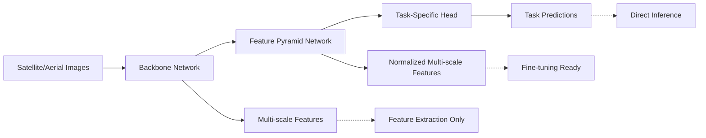
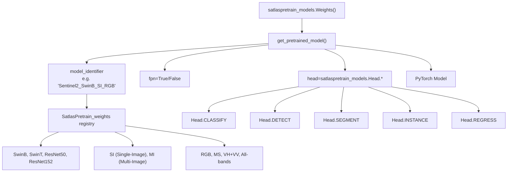
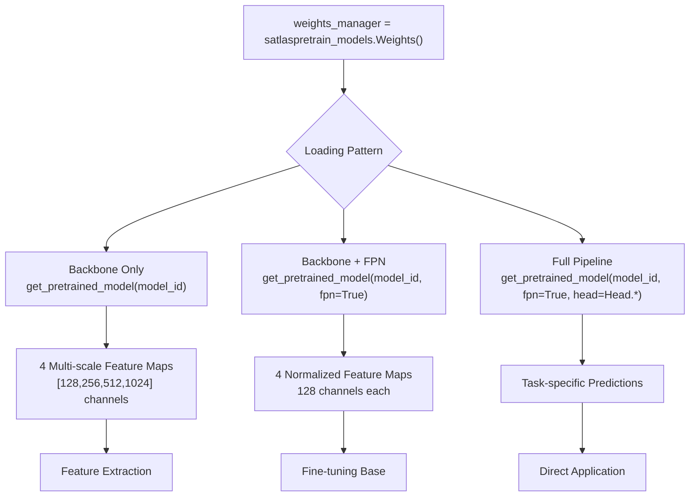

<!-- source: DeepWiki mcp.deepwiki.com · repo allenai/satlaspretrain_models · page 1 Overview · fetched 2026-10-26 -->

# Overview

Relevant source files

The following files were used as context for generating this wiki page:

- [README.md](README.md)

## Purpose and Scope

The `satlaspretrain_models` library provides access to pre-trained foundation models for satellite and aerial imagery analysis. This library serves as a lightweight interface for loading SatlasPretrain models that have been pre-trained on large-scale remote sensing datasets and published at ICCV 2023.

The library supports four primary satellite/aerial imagery types: Sentinel-2, Sentinel-1, Landsat 8/9, and high-resolution aerial imagery (0.5-2m/pixel). Users can load models with different architectural components (backbone only, backbone+FPN, or full pipeline with task heads) for feature extraction, fine-tuning, or direct inference.

For detailed installation instructions, see [Installation Guide](#2.1). For practical usage examples, see [Quick Start Guide](#2.2) and [Examples and Tutorials](#5). For comprehensive model specifications, see [Available Models Catalog](#7.1).

## System Architecture

The SatlasPretrain model architecture follows a modular design with three main components that can be loaded independently or together:

### Core Model Pipeline

Sources: [README.md:19-34]()

### Code Entity Architecture

Sources: [README.md:91-96](), [README.md:139-150]()

## Key Components

### Backbone Networks

The library supports multiple backbone architectures optimized for satellite imagery:

| Architecture | Variants | Input Support |
|--------------|----------|---------------|
| Swin Transformer v2 | Base, Tiny | Single/Multi-image |
| ResNet | 50, 152 | Single/Multi-image |

Multi-image models apply temporal max pooling across aligned image captures of the same location, enabling robust predictions for static objects.

### Feature Pyramid Network (FPN)

The FPN component provides multi-scale feature aggregation with 128 channels per scale level. When enabled via `fpn=True`, it normalizes backbone outputs to consistent channel dimensions across all feature map scales.

### Task-Specific Heads

Available prediction heads for downstream tasks:

- `Head.CLASSIFY`: Classification with pooling + linear layers
- `Head.DETECT`: Faster R-CNN decoder for object detection  
- `Head.SEGMENT`: U-Net decoder with cross-entropy loss
- `Head.INSTANCE`: Mask R-CNN decoder for instance segmentation
- `Head.REGRESS`: U-Net decoder with L1 loss
- Multi-label classification variant

Sources: [README.md:144-150]()

## Available Model Catalog

The library provides 22+ pre-trained models across satellite imagery types:

### Sentinel-2 Models
- **Input Types**: RGB (3 bands: B4,B3,B2) or Multispectral (9 bands)
- **Architectures**: SwinB, SwinT, ResNet50, ResNet152
- **Modes**: Single-image (SI) and Multi-image (MI)
- **Example ID**: `"Sentinel2_SwinB_SI_RGB"`

### Sentinel-1 Models  
- **Input**: VH+VV bands (2 channels)
- **Architecture**: SwinB only
- **Example ID**: `"Sentinel1_SwinB_SI"`

### Landsat 8/9 Models
- **Input**: All bands B1-B11 (11 channels) 
- **Architecture**: SwinB only
- **Example ID**: `"Landsat_SwinB_MI"`

### Aerial Imagery Models
- **Input**: RGB high-resolution imagery (0.5-2m/pixel)
- **Architecture**: SwinB only  
- **Example ID**: `"Aerial_SwinB_SI"`

Sources: [README.md:46-86]()

## Usage Patterns

### Model Loading Interface

Sources: [README.md:102-193]()

### Integration Ecosystem

The library integrates with standard PyTorch workflows and specialized geospatial libraries:

- **PyTorch Native**: Standard `torch.nn.Module` interface
- **TorchGeo Integration**: Seamless dataset and training workflows  
- **HuggingFace Hub**: Automatic checkpoint downloading
- **Multi-framework Support**: Compatible with various computer vision frameworks

For TorchGeo-specific integration patterns, see [TorchGeo Integration](#2.3). For complete fine-tuning examples, see [Fine-tuning Tutorial](#5.2).

Sources: [README.md:1-15](), [README.md:196-202]()

---

