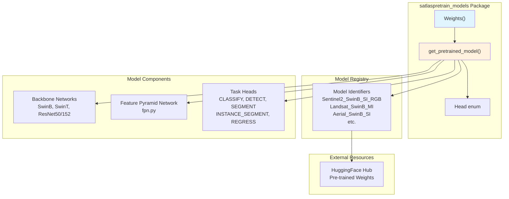
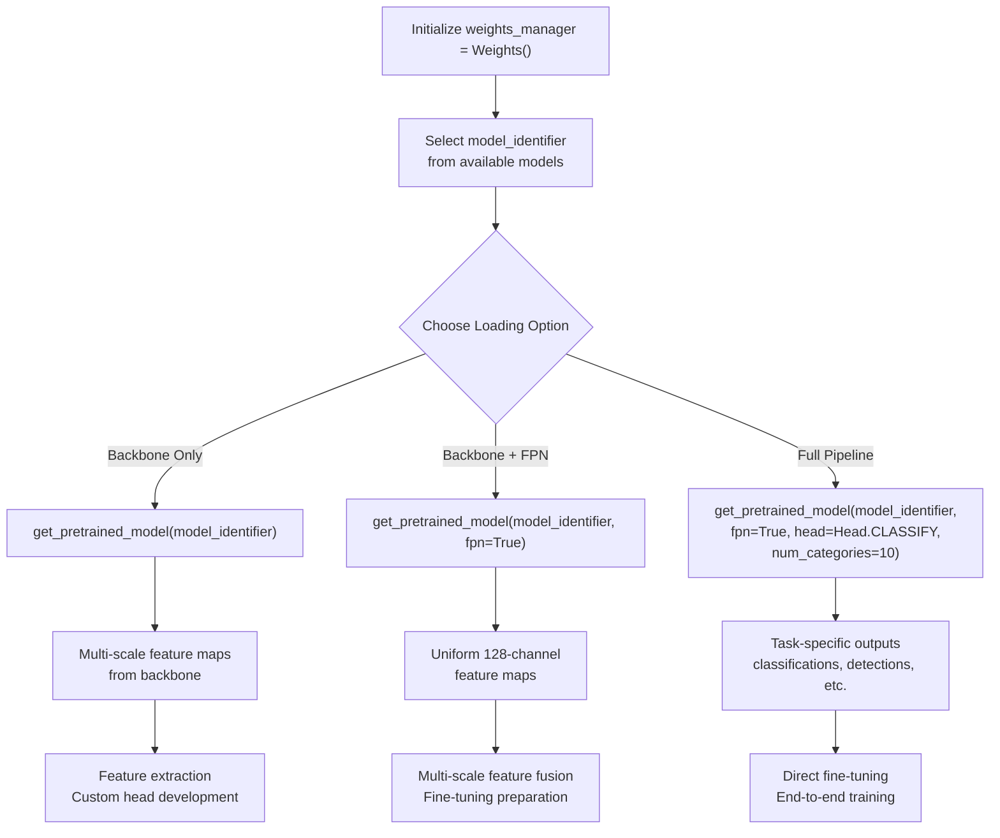
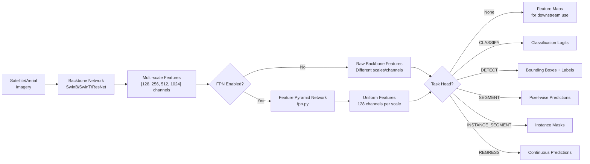

<!-- source: DeepWiki mcp.deepwiki.com · repo allenai/satlaspretrain_models · page 2 Getting Started · fetched 2026-10-26 -->

# Getting Started

Relevant source files

The following files were used as context for generating this wiki page:

- [README.md](README.md)
- [setup.py](setup.py)

This document provides an overview of the `satlaspretrain_models` library and guides you through the essential concepts needed to begin using pre-trained satellite imagery models. For detailed installation instructions, see [Installation](#2.1). For step-by-step usage examples, see [Quick Start Guide](#2.2). For integration with geospatial datasets, see [TorchGeo Integration](#2.3).

## Purpose and Scope

The `satlaspretrain_models` library provides easy access to 22+ foundation models pre-trained on satellite and aerial imagery data. These models serve as feature extractors or starting points for fine-tuning on downstream remote sensing tasks. The library handles model downloading, weight loading, and architecture assembly, allowing you to focus on your specific application rather than model management infrastructure.

The library supports models trained on four types of imagery:
- **Sentinel-2**: Multispectral satellite imagery (RGB and 9-band)
- **Sentinel-1**: SAR imagery (VH+VV polarizations) 
- **Landsat 8/9**: 11-band multispectral imagery
- **Aerial**: High-resolution RGB imagery (0.5-2m/pixel)

## Core API Overview

The library centers around the `Weights` class and its `get_pretrained_model()` method. This design provides a clean interface for loading different model configurations while abstracting the complexity of weight management and architecture assembly.

### Primary API Components

**Core API Workflow**

Sources: [README.md:28-32](), [README.md:91-97]()

## Model Architecture Structure

The library implements a modular three-component architecture that allows flexible model assembly. Each component serves a specific purpose in the feature extraction and prediction pipeline.

### Architecture Components

| Component | Purpose | Configurable | Parameters |
|-----------|---------|--------------|------------|
| **Backbone** | Feature extraction from raw imagery | ✓ | Pre-trained from SatlasPretrain |
| **FPN** | Multi-scale feature aggregation | ✓ | Pre-trained from SatlasPretrain |
| **Head** | Task-specific predictions | ✓ | Randomly initialized |

Sources: [README.md:17-26](), [README.md:144-151]()

## Available Model Types

The library provides models across different satellite data sources, each optimized for specific imagery characteristics and use cases. Models are identified by structured names that encode their specifications.

### Model Naming Convention

Model identifiers follow the pattern: `{DataSource}_{Architecture}_{ImageMode}_{Bands}`

- **DataSource**: `Sentinel2`, `Sentinel1`, `Landsat`, `Aerial`
- **Architecture**: `SwinB`, `SwinT`, `Resnet50`, `Resnet152`
- **ImageMode**: `SI` (single-image), `MI` (multi-image)
- **Bands**: `RGB`, `MS` (multispectral), or sensor-specific

### Model Categories Overview

| Data Source | Bands | Architectures | Single/Multi-Image | Total Models |
|-------------|-------|---------------|-------------------|--------------|
| **Sentinel-2** | RGB (3), MS (9) | SwinB, SwinT, ResNet50, ResNet152 | Both | 16 |
| **Sentinel-1** | VH+VV (2) | SwinB | Both | 2 |
| **Landsat** | All bands (11) | SwinB | Both | 2 |
| **Aerial** | RGB (3) | SwinB | Both | 2 |

**Multi-Image Processing**: Multi-image models apply temporal max pooling across multiple aligned images of the same location, enabling robust predictions for static objects while maintaining per-image backbone processing.

Sources: [README.md:46-86](), [README.md:84-86]()

## Getting Started Workflow

To begin using the library, follow this typical workflow:

1. **Install the package** - See [Installation](#2.1) for detailed setup instructions including Python version requirements and dependency management.

2. **Choose your model** - Select from 22+ available pre-trained models based on your imagery type and task requirements. See [Available Models Catalog](#7.1) for the complete model specifications.

3. **Load the model** - Use the `Weights` class and `get_pretrained_model()` method with appropriate configuration options. See [Quick Start Guide](#2.2) for step-by-step examples.

4. **Integrate with data** - Connect your model to satellite imagery datasets, particularly using TorchGeo integration. See [TorchGeo Integration](#2.3) for geospatial workflow examples.

5. **Fine-tune or extract features** - Either use the pre-trained features directly or fine-tune on your downstream task. See [Examples and Tutorials](#5) for complete implementation guides.

The library is designed to minimize setup complexity while providing maximum flexibility for different use cases, from simple feature extraction to full end-to-end model training.

Sources: [README.md:38-44](), [README.md:195-202]()

---

