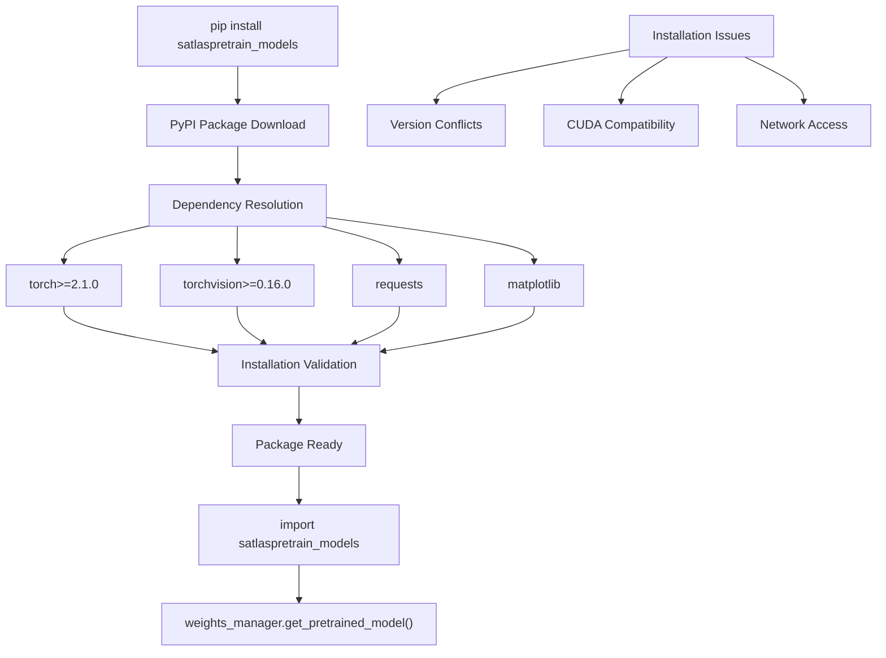
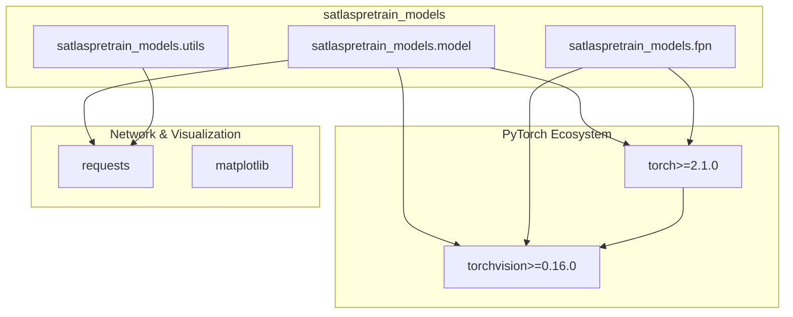
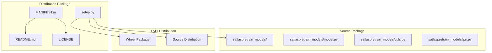

<!-- source: DeepWiki mcp.deepwiki.com · repo allenai/satlaspretrain_models · page 2.1 Installation · fetched 2026-10-26 -->

# Installation

<details>
<summary>Relevant source files</summary>

The following files were used as context for generating this wiki page:

- [MANIFEST.in](MANIFEST.in)
- [setup.py](setup.py)

</details>


This document provides comprehensive installation instructions for the `satlaspretrain_models` library, including system requirements, dependency management, and installation verification procedures. For basic usage examples after installation, see [Quick Start Guide](#2.2). For development environment setup, see [Development Setup](#6.2).

## System Requirements

The `satlaspretrain_models` library requires specific system configurations to ensure proper functionality with satellite imagery processing and deep learning model operations.

### Python Version Requirements

The library requires Python 3.9 or higher as specified in [setup.py:18](). This minimum version ensures compatibility with modern PyTorch features and type hinting used throughout the codebase.

### Hardware Considerations

| Component | Minimum | Recommended |
|-----------|---------|-------------|
| RAM | 8 GB | 16+ GB |
| Storage | 2 GB free | 10+ GB free |
| GPU | Optional | CUDA-compatible GPU |
| CPU | Multi-core | 8+ cores |

**Sources:** [setup.py:18-24]()

## Installation Methods

### Standard Installation via PyPI

The primary installation method uses the Python Package Index (PyPI) distribution:

```bash
pip install satlaspretrain_models
```

This installs the package along with all required dependencies as defined in the `install_requires` section of [setup.py:19-24]().

### Installation Flow Diagram



**Sources:** [setup.py:19-24]()

## Dependency Analysis

The library maintains a minimal dependency footprint while ensuring compatibility with the PyTorch ecosystem and remote model loading capabilities.

### Core Dependencies

#### PyTorch Framework Dependencies
- **torch>=2.1.0**: Core tensor operations and neural network functionality
- **torchvision>=0.16.0**: Computer vision utilities and pre-trained model components

#### Utility Dependencies  
- **requests**: HTTP client for downloading model weights from HuggingFace Hub
- **matplotlib**: Visualization support for demos and examples

### Dependency Architecture



**Sources:** [setup.py:19-24]()

## Installation Verification

### Basic Import Test

Verify successful installation by importing the main module:

```python
import satlaspretrain_models
from satlaspretrain_models import get_pretrained_model
```

### Functional Verification

Test core functionality by loading a lightweight model:

```python
# Verify model loading capability
model = get_pretrained_model(
    model_identifier="Sentinel2_RGB_SwinB_SI_MS", 
    load_backbone=True
)
print(f"Model loaded successfully: {type(model)}")
```

### Version Information

Check installed version and dependencies:

```python
import satlaspretrain_models
import torch
import torchvision

print(f"satlaspretrain_models version: {satlaspretrain_models.__version__}")
print(f"PyTorch version: {torch.__version__}")
print(f"TorchVision version: {torchvision.__version__}")
```

**Sources:** [setup.py:5]()

## Package Metadata and Distribution

The package configuration defines key metadata for proper distribution and dependency management:

| Attribute | Value |
|-----------|-------|
| Package Name | `satlaspretrain_models` |
| Current Version | `0.3.1` |
| License | Apache Software License |
| Author | Satlas @ AI2 |
| Repository | https://github.com/allenai/satlaspretrain_models |

### Package Structure



**Sources:** [setup.py:1-25](), [MANIFEST.in:1-3]()

## Troubleshooting Common Issues

### PyTorch Version Conflicts

If encountering PyTorch version incompatibilities:

```bash
# Upgrade PyTorch to minimum required version
pip install --upgrade torch>=2.1.0 torchvision>=0.16.0
```

### CUDA Compatibility Issues

For GPU support, ensure CUDA toolkit compatibility:

```bash
# Check CUDA availability
python -c "import torch; print(torch.cuda.is_available())"
```

### Network Access for Model Downloads

The library requires internet access to download pre-trained weights from HuggingFace Hub. Ensure network connectivity and firewall permissions for HTTPS requests.

### Dependency Resolution Conflicts

For complex environments with existing package conflicts:

```bash
# Install in isolated environment
python -m venv satlas_env
source satlas_env/bin/activate  # On Windows: satlas_env\Scripts\activate
pip install satlaspretrain_models
```

**Sources:** [setup.py:19-24]()

---

