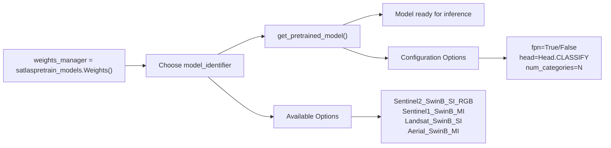
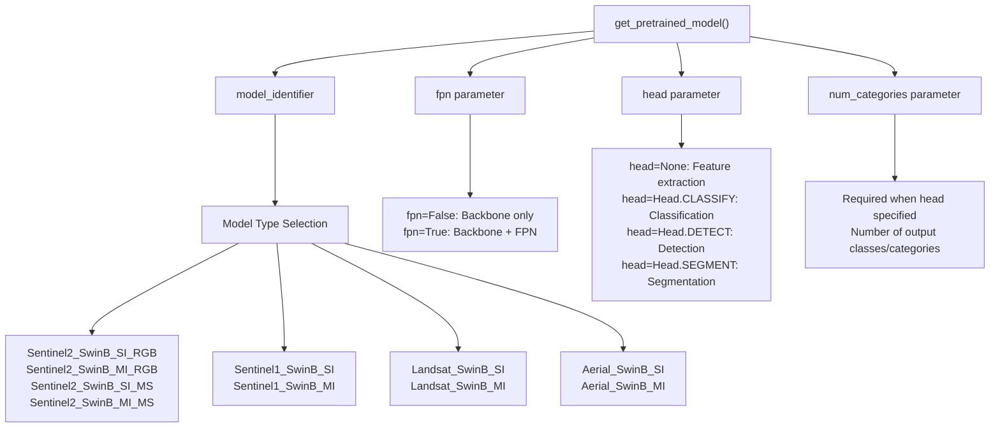
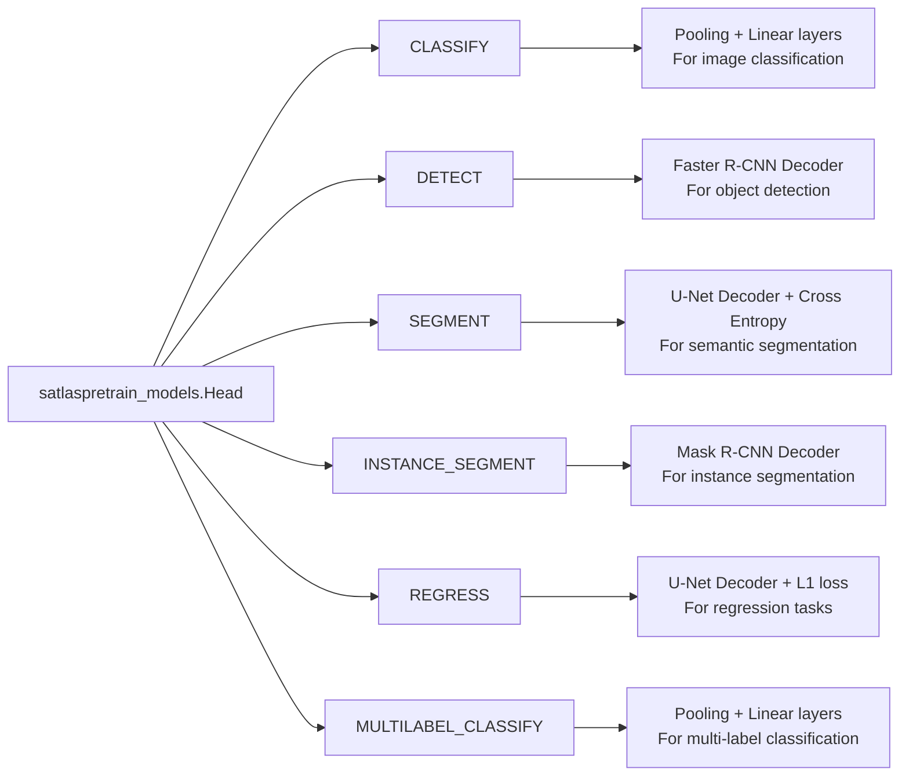

<!-- source: DeepWiki mcp.deepwiki.com · repo allenai/satlaspretrain_models · page 2.2 Quick Start Guide · fetched 2026-10-26 -->

# Quick Start Guide

<details>
<summary>Relevant source files</summary>

The following files were used as context for generating this wiki page:

- [README.md](README.md)
- [demo.ipynb](demo.ipynb)

</details>


This guide provides essential examples for loading pre-trained satellite imagery models and performing basic inference. It covers the core workflow from initialization to model output, demonstrating the most common usage patterns.

For detailed installation instructions, see [Installation](#2.1). For integration with geospatial datasets, see [TorchGeo Integration](#2.3). For comprehensive usage examples and tutorials, see [Basic Usage Examples](#5.1) and [Fine-tuning Tutorial](#5.2).

## Basic Workflow

The typical workflow involves three steps: initializing the weights manager, selecting a model identifier, and loading the model with desired components.



Sources: [README.md:91-97](), [README.md:28-32]()

## Essential Concepts

### Model Architecture Components

The library supports loading models with different component combinations:

| Component | Purpose | When to Use |
|-----------|---------|-------------|
| **Backbone Only** | Feature extraction | Transfer learning, custom heads |
| **Backbone + FPN** | Multi-scale features | Object detection, segmentation |
| **Backbone + FPN + Head** | End-to-end models | Fine-tuning, quick prototyping |

### Image Processing Types

| Type | Description | Input Format |
|------|-------------|--------------|
| **Single-image (SI)** | Processes individual images | `(batch, channels, height, width)` |
| **Multi-image (MI)** | Temporal max pooling across images | `(batch, num_images, channels, height, width)` |

Sources: [README.md:19-26](), [README.md:84-87]()

## Core API Usage

### Initialize Weights Manager

```python
import satlaspretrain_models
import torch

weights_manager = satlaspretrain_models.Weights()
```

### Load Backbone Only

```python
model = weights_manager.get_pretrained_model("Sentinel2_SwinB_SI_RGB")

# Input: Sentinel-2 RGB image (0-1 normalized)
tensor = torch.zeros((1, 3, 512, 512), dtype=torch.float32)
output = model(tensor)

# Output: Multi-scale feature maps from Swin-v2-Base
# [torch.Size([1, 128, 128, 128]), torch.Size([1, 256, 64, 64]), 
#  torch.Size([1, 512, 32, 32]), torch.Size([1, 1024, 16, 16])]
```

### Load Backbone + FPN

```python
model = weights_manager.get_pretrained_model("Sentinel1_SwinB_SI", fpn=True)

# Input: Sentinel-1 VH+VV channels (0-1 normalized, clipped)
tensor = torch.zeros((1, 2, 512, 512), dtype=torch.float32)
output = model(tensor)

# Output: Uniform 128-channel feature maps at multiple scales
# [torch.Size([1, 128, 128, 128]), torch.Size([1, 128, 64, 64]),
#  torch.Size([1, 128, 32, 32]), torch.Size([1, 128, 16, 16])]
```

Sources: [README.md:102-115](), [README.md:117-130]()

## Model Loading Patterns



Sources: [README.md:139-142](), [README.md:144-151]()

## Common Use Cases

### Feature Extraction for Transfer Learning

```python
# Load backbone for feature extraction
model = weights_manager.get_pretrained_model("Sentinel2_SwinB_SI_RGB")

# Extract features at multiple scales
features = model(input_tensor)
# Use features as input to custom downstream models
```

### Multi-Image Processing

```python
# Multi-image aerial model with classification head
model = weights_manager.get_pretrained_model(
    "Aerial_SwinB_MI", 
    fpn=True, 
    head=satlaspretrain_models.Head.CLASSIFY, 
    num_categories=2
)

# Input: 4 RGB images stacked (reshape for model input)
tensor = torch.zeros((1, 4, 3, 512, 512), dtype=torch.float32)
output = model(tensor.reshape(1, 4*3, 512, 512))
# Output: Classification probabilities [batch_size, num_categories]
```

### Object Detection Setup

```python
# Landsat model with detection head
model = weights_manager.get_pretrained_model(
    "Landsat_SwinB_MI", 
    fpn=True, 
    head=satlaspretrain_models.Head.DETECT, 
    num_categories=5
)

# Input: 8 Landsat images with 11 bands each
tensor = torch.zeros((1, 8, 11, 512, 512), dtype=torch.float32)
output = model(tensor.reshape(1, 8*11, 512, 512))
# Output: List of detection dictionaries with 'boxes', 'labels', 'scores'
```

Sources: [README.md:152-170](), [README.md:172-193]()

## Model Configuration Reference

### Available Heads



### Input Normalization Requirements

| Model Type | Input Format | Normalization |
|------------|--------------|---------------|
| **Sentinel-2 RGB** | B4, B3, B2 bands | Divide by 255 (0-1) |
| **Sentinel-2 MS** | 9 bands | Divide by 255 (0-1) |
| **Sentinel-1** | VH, VV bands | Divide by 255, clip to 0-1 |
| **Landsat** | B1-B11 bands | `(pixel_value - 4000) / 16320`, clip to 0-1 |
| **Aerial** | RGB bands | Divide by 255 (0-1) |

Sources: [README.md:144-151](), [README.md:86-87](), [README.md:106-109](), [README.md:121-124](), [README.md:158-161](), [README.md:180-183]()

---

