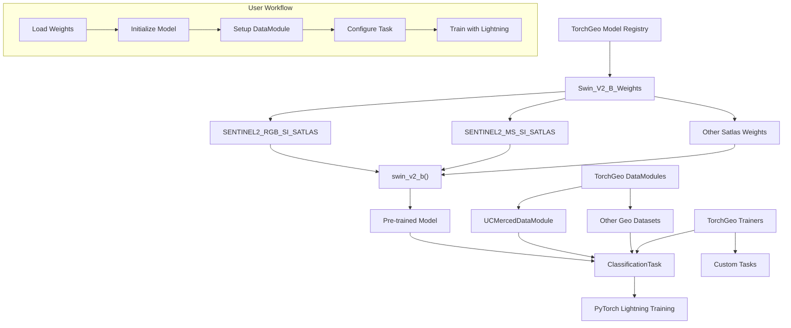
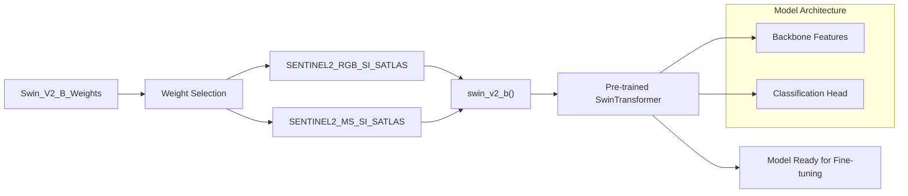
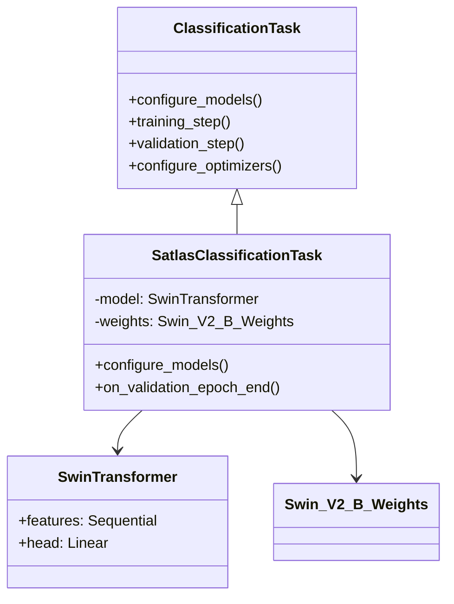
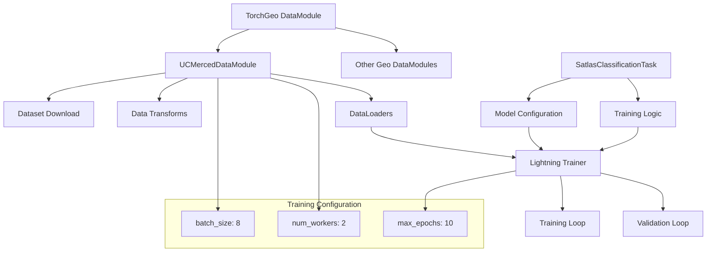
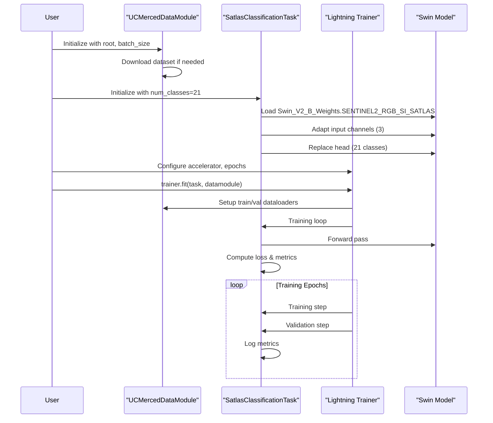

<!-- source: DeepWiki mcp.deepwiki.com · repo allenai/satlaspretrain_models · page 2.3 TorchGeo Integration · fetched 2026-10-26 -->

# TorchGeo Integration

<details>
<summary>Relevant source files</summary>

The following files were used as context for generating this wiki page:

- [torchgeo_demo.ipynb](torchgeo_demo.ipynb)

</details>


This document explains how to use satlaspretrain_models with the TorchGeo ecosystem for geospatial deep learning workflows. TorchGeo provides a comprehensive framework for working with geospatial datasets, and the satlaspretrain models are integrated as first-class citizens in TorchGeo's model registry.

For basic model loading without TorchGeo, see [Quick Start Guide](#2.2). For detailed information about available models and configurations, see [Model Configuration](#3.2).

## Integration Overview

The satlaspretrain_models are accessible through TorchGeo's standardized model interface, enabling seamless integration with TorchGeo's data modules, trainers, and PyTorch Lightning workflows. This integration allows users to leverage both the pre-trained satellite imagery models and TorchGeo's extensive geospatial dataset ecosystem.



Sources: [torchgeo_demo.ipynb:42-44]()

## Model Loading Through TorchGeo

TorchGeo provides a standardized weights enumeration system that includes Satlas pre-trained models. Models are loaded using TorchGeo's model functions with specific weight configurations.

### Available Weight Configurations

| Weight Enum | Data Source | Channels | Model Type |
|-------------|-------------|----------|------------|
| `SENTINEL2_RGB_SI_SATLAS` | Sentinel-2 RGB | 3 | Single Image |
| `SENTINEL2_MS_SI_SATLAS` | Sentinel-2 Multispectral | 10+ | Single Image |
| Additional Satlas weights | Various satellite sources | Variable | Single/Multi Image |

### Loading Models

```python
from torchgeo.models import Swin_V2_B_Weights, swin_v2_b

# Load pre-trained weights
weights = Swin_V2_B_Weights.SENTINEL2_RGB_SI_SATLAS
model = swin_v2_b(weights)
```



Sources: [torchgeo_demo.ipynb:85-86]()

## Custom Task Implementation

TorchGeo's training framework uses PyTorch Lightning tasks that can be customized to work with Satlas models. The key integration points are model configuration and architecture adaptation.

### SatlasClassificationTask Example

The integration requires extending TorchGeo's base task classes and implementing custom model configuration:



### Model Configuration Process

The custom task handles model initialization and architecture adaptation:

1. **Weight Loading**: Uses TorchGeo's weight enumeration system
2. **Architecture Adaptation**: Modifies input/output layers for task-specific requirements
3. **Head Replacement**: Replaces classification head for target number of classes

Key implementation details from the demo:

- Input channel adaptation: [torchgeo_demo.ipynb:89-95]()
- Output layer replacement: [torchgeo_demo.ipynb:98]()
- Model loading through TorchGeo: [torchgeo_demo.ipynb:85-86]()

Sources: [torchgeo_demo.ipynb:83-111]()

## Data Integration Workflow

TorchGeo provides standardized data modules that work seamlessly with Satlas models through the Lightning framework.



### DataModule Setup

The integration uses TorchGeo's data modules with standard PyTorch Lightning configuration:

- Dataset initialization: [torchgeo_demo.ipynb:69-72]()
- Training parameters: [torchgeo_demo.ipynb:54-58]()
- Trainer configuration: [torchgeo_demo.ipynb:146-153]()

Sources: [torchgeo_demo.ipynb:68-73](), [torchgeo_demo.ipynb:146-153]()

## Complete Training Pipeline

The full integration combines TorchGeo's data handling, model loading, and Lightning training infrastructure.

### Training Setup Flow



### Environment Setup

The TorchGeo integration requires specific dependencies and setup:

```bash
# Create environment
conda create --name torchgeodemo python=3.12
conda activate torchgeodemo

# Install TorchGeo (development version for Satlas support)
pip install git+https://github.com/microsoft/torchgeo
```

### Key Integration Components

| Component | Purpose | Configuration |
|-----------|---------|---------------|
| `UCMercedDataModule` | Dataset handling | Root directory, batch size, workers |
| `SatlasClassificationTask` | Training logic | Number of classes, model weights |
| `Lightning Trainer` | Training orchestration | Accelerator, epochs, logging |
| `Swin_V2_B_Weights` | Model weights | Satellite data source, architecture |

Sources: [torchgeo_demo.ipynb:13-17](), [torchgeo_demo.ipynb:121](), [torchgeo_demo.ipynb:213]()

## Validation and Monitoring

The integration includes built-in validation monitoring through TorchGeo's metric collection system:

- Validation metrics: Loss and accuracy tracking
- Epoch-level reporting: [torchgeo_demo.ipynb:100-110]()
- Lightning callback integration for metrics access

The training process automatically handles validation loops and metric computation through TorchGeo's standardized trainer interface.

Sources: [torchgeo_demo.ipynb:100-110](), [torchgeo_demo.ipynb:212-214]()

---

