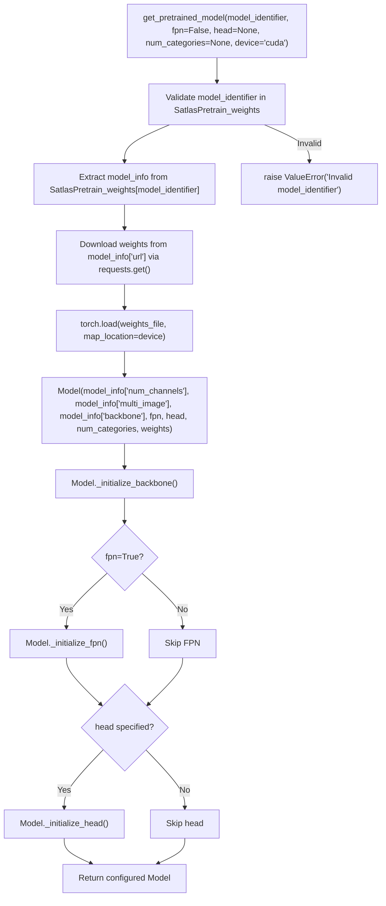

<!-- source: DeepWiki mcp.deepwiki.com · repo allenai/satlaspretrain_models · page 3 Core API Reference · fetched 2026-10-26 -->

# Core API Reference

<details>
<summary>Relevant source files</summary>

The following files were used as context for generating this wiki page:

- [satlaspretrain_models/__init__.py](satlaspretrain_models/__init__.py)
- [satlaspretrain_models/model.py](satlaspretrain_models/model.py)
- [satlaspretrain_models/utils.py](satlaspretrain_models/utils.py)

</details>


This page documents the primary classes and functions that form the core API of the satlaspretrain_models library. This includes the main entry points for loading pre-trained models, configuring model architectures, and managing model components.

For detailed documentation of the weights management system, see [Weights Manager](#3.1). For comprehensive information about available models and configuration options, see [Model Configuration](#3.2).

## API Overview

The core API consists of two primary classes that work together to provide model loading and configuration capabilities:

| Class | Purpose | Primary Methods |
|-------|---------|----------------|
| `Weights` | Manages downloading and loading pre-trained models | `get_pretrained_model()` |
| `Model` | Represents the actual model architecture | `forward()`, `_initialize_backbone()`, `_initialize_fpn()`, `_initialize_head()` |

## Core Components Architecture

**Core API Class Relationships**
```mermaid
classDiagram
    class Weights {
        +get_pretrained_model(model_identifier, fpn, head, num_categories, device) Model
    }
    
    class Model {
        +backbone
        +fpn
        +head
        +forward(imgs, targets)
        +_initialize_backbone(num_channels, backbone_arch, multi_image, weights)
        +_initialize_fpn(backbone_channels, weights)
        +_initialize_head(head, backbone_channels, num_categories)
    }
    
    class Backbone {
        <<enumeration>>
        SWINB
        SWINT
        RESNET50
        RESNET152
    }
    
    class Head {
        <<enumeration>>
        CLASSIFY
        MULTICLASSIFY
        DETECT
        INSTANCE
        SEGMENT
        BINSEGMENT
        REGRESS
    }
    
    class SatlasPretrain_weights {
        <<dictionary>>
        +22_model_configurations
    }
    
    Weights --> Model : creates
    Model --> Backbone : uses
    Model --> Head : uses
    Weights --> SatlasPretrain_weights : queries
    Model --> "adjust_state_dict_prefix()" : calls
```

Sources: [satlaspretrain_models/model.py:9-54](), [satlaspretrain_models/model.py:56-95](), [satlaspretrain_models/utils.py:3-17](), [satlaspretrain_models/utils.py:19-152]()

## Model Loading Flow

**get_pretrained_model() Execution Flow**


Sources: [satlaspretrain_models/model.py:16-53](), [satlaspretrain_models/model.py:56-95]()

## Primary Method Signatures

### Weights Class

The `Weights` class provides the main entry point for loading pre-trained models:

```python
class Weights:
    def get_pretrained_model(self, model_identifier, fpn=False, head=None, num_categories=None, device='cuda')
```

**Parameters:**
- `model_identifier` (str): Key from `SatlasPretrain_weights` dictionary
- `fpn` (bool): Whether to include pre-trained Feature Pyramid Network
- `head` (Head enum): Type of task-specific head to attach
- `num_categories` (int): Number of output categories for the head
- `device` (str): Target device ('cuda' or 'cpu')

**Returns:** Configured `Model` instance with loaded weights

Sources: [satlaspretrain_models/model.py:16-27]()

### Model Class

The `Model` class represents the actual neural network architecture:

```python
class Model(torch.nn.Module):
    def __init__(self, num_channels=3, multi_image=False, backbone=Backbone.SWINB, 
                 fpn=False, head=None, num_categories=None, weights=None)
    
    def forward(self, imgs, targets=None)
```

**Constructor Parameters:**
- `num_channels` (int): Input channel count
- `multi_image` (bool): Whether model expects multi-image input
- `backbone` (Backbone enum): Architecture type
- `fpn` (bool): Include Feature Pyramid Network
- `head` (Head enum): Task-specific head type
- `num_categories` (int): Output category count
- `weights` (dict): Pre-trained weights to load

**Forward Method:**
- `imgs` (torch.Tensor): Input image tensor
- `targets` (optional): Ground truth targets for training
- **Returns:** Feature maps or (predictions, loss) tuple

Sources: [satlaspretrain_models/model.py:57-72](), [satlaspretrain_models/model.py:153-162]()

## Configuration Enumerations

### Backbone Types

The `Backbone` enum defines available architecture options:

| Value | Description |
|-------|-------------|
| `Backbone.SWINB` | Swin Transformer Base |
| `Backbone.SWINT` | Swin Transformer Tiny |
| `Backbone.RESNET50` | ResNet-50 |
| `Backbone.RESNET152` | ResNet-152 |

### Head Types

The `Head` enum defines available task-specific heads:

| Value | Task Type |
|-------|-----------|
| `Head.CLASSIFY` | Single-label classification |
| `Head.MULTICLASSIFY` | Multi-label classification |
| `Head.DETECT` | Object detection (Faster R-CNN) |
| `Head.INSTANCE` | Instance segmentation (Mask R-CNN) |
| `Head.SEGMENT` | Semantic segmentation |
| `Head.BINSEGMENT` | Binary segmentation |
| `Head.REGRESS` | Regression |

Sources: [satlaspretrain_models/utils.py:3-16]()

## Error Handling

The API implements several validation checks:

- **Invalid model identifier:** Raises `ValueError` if `model_identifier` not in `SatlasPretrain_weights`
- **Missing num_categories:** Raises `ValueError` if `head` specified without `num_categories`
- **Invalid backbone/head types:** Raises `ValueError` for non-enum values
- **Download failures:** Raises `Exception` for HTTP request failures

Sources: [satlaspretrain_models/model.py:28-33](), [satlaspretrain_models/model.py:75-81](), [satlaspretrain_models/model.py:42-43]()

## Utility Functions

### adjust_state_dict_prefix()

Processes state dictionaries to match expected model component prefixes:

```python
def adjust_state_dict_prefix(state_dict, needed, prefix=None, prefix_allowed_count=None)
```

This function filters state dictionary keys and adjusts prefixes to match the target model component's expected naming convention.

Sources: [satlaspretrain_models/utils.py:155-177]()

## Import Structure

The core API components are exposed through the main package import:

```python
from satlaspretrain_models import Weights, Model, Head, Backbone
```

Sources: [satlaspretrain_models/__init__.py:1-2]()

---

