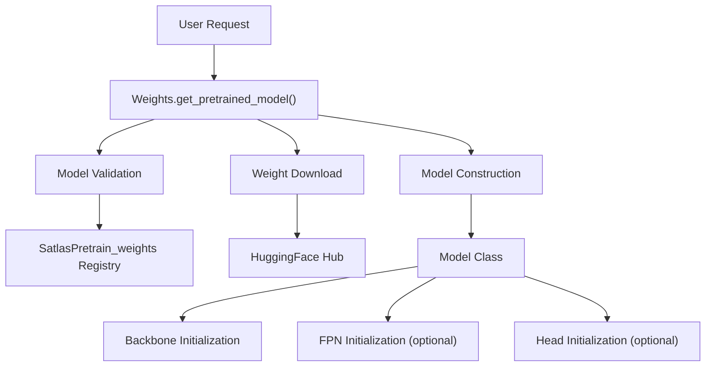
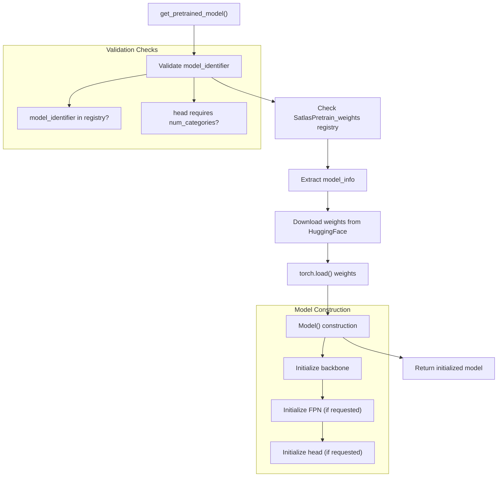
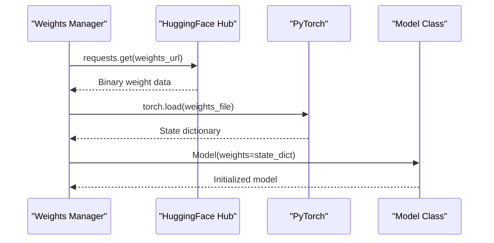
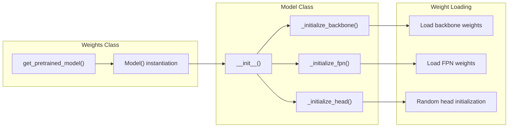

<!-- source: DeepWiki mcp.deepwiki.com · repo allenai/satlaspretrain_models · page 3.1 Weights Manager · fetched 2026-10-26 -->

# Weights Manager

<details>
<summary>Relevant source files</summary>

The following files were used as context for generating this wiki page:

- [satlaspretrain_models/model.py](satlaspretrain_models/model.py)

</details>


The Weights Manager provides the primary interface for loading pre-trained SatlasPretrain models from HuggingFace Hub. It handles model validation, weight downloading, and model construction with configurable components including backbones, Feature Pyramid Networks (FPN), and task-specific heads.

This page covers the `Weights` class and its integration with the `Model` class for constructing complete neural network architectures. For information about available model configurations, see [Model Configuration](#3.2). For details about individual model components, see [Model Architecture](#4).

## Weights Class Overview

The `Weights` class serves as the main entry point for accessing pre-trained models. It provides a single public method `get_pretrained_model()` that orchestrates the entire model loading process.



**Weights Manager Workflow**

The class constructor [satlaspretrain_models/model.py:10-14]() is minimal, with all functionality contained in the `get_pretrained_model()` method.

Sources: [satlaspretrain_models/model.py:9-14]()

## Model Loading Process

The `get_pretrained_model()` method implements a multi-step process for constructing pre-trained models:



**Model Loading Pipeline**

### Key Parameters

| Parameter | Type | Required | Description |
|-----------|------|----------|-------------|
| `model_identifier` | str | Yes | Key from `SatlasPretrain_weights` registry |
| `fpn` | bool | No | Whether to include pre-trained FPN |
| `head` | Head enum | No | Task-specific head type |
| `num_categories` | int | Conditional | Required when `head` is specified |
| `device` | str | No | Target device ('cuda' or 'cpu') |

The method performs validation at [satlaspretrain_models/model.py:28-33]() to ensure the model identifier exists and required parameters are provided.

Sources: [satlaspretrain_models/model.py:16-53]()

## Weight Download and Loading

The system downloads pre-trained weights directly from HuggingFace Hub using HTTP requests:



**Weight Download Sequence**

The download process [satlaspretrain_models/model.py:37-48]() uses the URL from the model registry and handles device placement for CPU or GPU loading. Error handling ensures failed downloads raise appropriate exceptions.

Sources: [satlaspretrain_models/model.py:37-48]()

## Model Class Integration

The `Weights` class delegates model construction to the `Model` class, passing the downloaded weights and configuration parameters:



**Model Construction Architecture**

The `Model` class constructor [satlaspretrain_models/model.py:57-95]() accepts the same parameters as `get_pretrained_model()` plus additional low-level configuration options.

### Component Initialization

Each model component is initialized through dedicated methods:

- **Backbone**: `_initialize_backbone()` [satlaspretrain_models/model.py:96-124]() supports Swin Transformer and ResNet architectures
- **FPN**: `_initialize_fpn()` [satlaspretrain_models/model.py:126-133]() adds multi-scale feature processing
- **Head**: `_initialize_head()` [satlaspretrain_models/model.py:135-151]() creates task-specific output layers

Sources: [satlaspretrain_models/model.py:56-95](), [satlaspretrain_models/model.py:96-151]()

## State Dictionary Processing

The system uses `adjust_state_dict_prefix()` to handle weight loading for different model components:

| Component | Prefix Pattern | Allowed Count |
|-----------|----------------|---------------|
| Backbone (single-image) | `backbone.` | 1 |
| Backbone (multi-image) | `backbone.` | 2 |
| Backbone (ResNet) | `backbone.` | 0 |
| FPN | `intermediates.0.` | 0 |

The prefix adjustment ensures compatibility between saved weights and model architecture, particularly for multi-image models that wrap backbones with aggregation layers [satlaspretrain_models/model.py:109-117]().

Sources: [satlaspretrain_models/model.py:109-124](), [satlaspretrain_models/model.py:130-132]()

## Usage Patterns

The Weights Manager supports three primary usage patterns:

### Feature Extraction Only
```python
model = weights_manager.get_pretrained_model('sentinel2_rgb_swinb_si')
features = model(images)  # Returns backbone features
```

### Feature Extraction with FPN
```python
model = weights_manager.get_pretrained_model('sentinel2_rgb_swinb_si', fpn=True)
features = model(images)  # Returns multi-scale FPN features
```

### Task-Specific Models
```python
model = weights_manager.get_pretrained_model(
    'sentinel2_rgb_swinb_si', 
    fpn=True, 
    head=Head.CLASSIFY, 
    num_categories=10
)
predictions, loss = model(images, targets)
```

The comprehensive test suite [satlaspretrain_models/model.py:165-214]() demonstrates all supported combinations of backbones, FPN, and heads across all available pre-trained models.

Sources: [satlaspretrain_models/model.py:165-214]()

---

