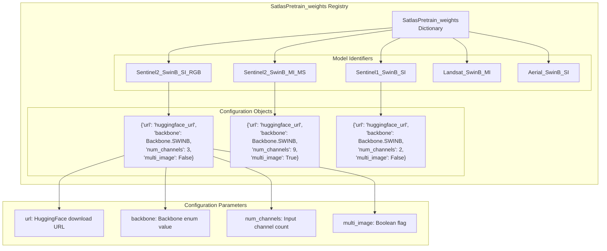
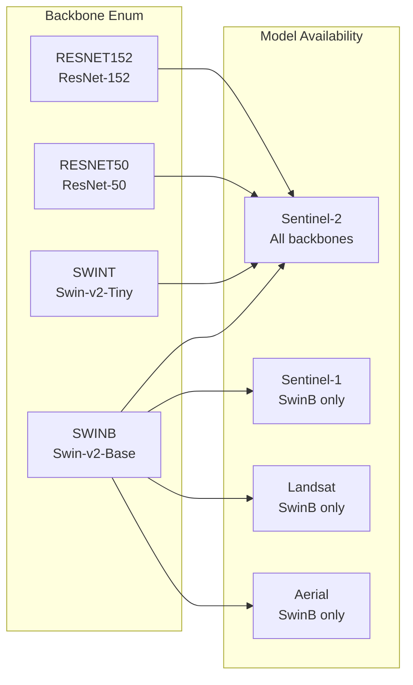
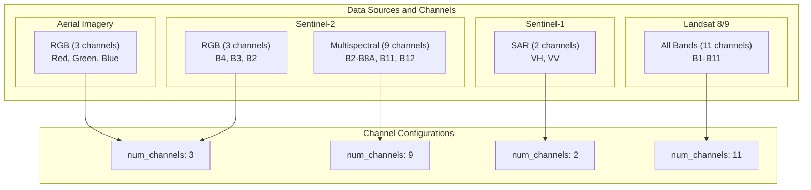
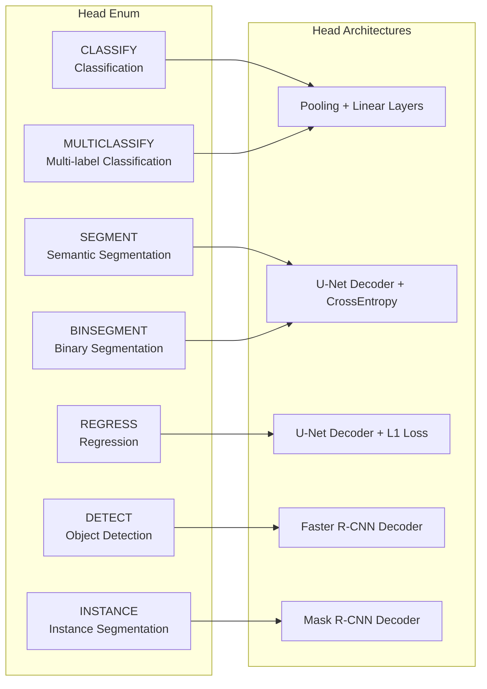

<!-- source: DeepWiki mcp.deepwiki.com · repo allenai/satlaspretrain_models · page 3.2 Model Configuration · fetched 2026-10-26 -->

# Model Configuration

<details>
<summary>Relevant source files</summary>

The following files were used as context for generating this wiki page:

- [README.md](README.md)
- [satlaspretrain_models/__init__.py](satlaspretrain_models/__init__.py)
- [satlaspretrain_models/utils.py](satlaspretrain_models/utils.py)

</details>


This page documents the model configuration system in satlaspretrain_models, including available pre-trained models, backbone architectures, input channel configurations, and task-specific head options. The configuration system provides a declarative way to specify model architectures and load appropriate pre-trained weights.

For information about loading configured models, see [Weights Manager](#3.1). For detailed architectural information about the configured components, see [Model Architecture](#4).

## Model Registry System

The library uses a centralized registry system to manage available pre-trained models and their configurations. Each model is identified by a unique string identifier that encodes key characteristics of the model.



The registry maps model identifiers to configuration dictionaries containing four key parameters:

| Parameter | Type | Description |
|-----------|------|-------------|
| `url` | string | HuggingFace Hub download URL for pre-trained weights |
| `backbone` | `Backbone` enum | Backbone architecture type |
| `num_channels` | integer | Number of input channels expected by the model |
| `multi_image` | boolean | Whether model processes multiple temporal images |

Sources: [satlaspretrain_models/utils.py:18-152]()

## Backbone Configuration

The library supports four backbone architectures, defined in the `Backbone` enum:



### Backbone Characteristics

| Backbone | Parameters | Input Resolution | Feature Scales |
|----------|------------|------------------|----------------|
| Swin-v2-Base | ~88M | 512×512 | 4 scales (128×128 to 16×16) |
| Swin-v2-Tiny | ~28M | 512×512 | 4 scales (128×128 to 16×16) |
| ResNet-50 | ~26M | 512×512 | 4 scales (128×128 to 16×16) |
| ResNet-152 | ~60M | 512×512 | 4 scales (128×128 to 16×16) |

Sources: [satlaspretrain_models/utils.py:3-8]()

## Input Channel Configuration

Different satellite and aerial imagery sources require different input channel configurations:



### Channel Configuration Details

| Data Source | Channels | Description | Normalization |
|-------------|----------|-------------|---------------|
| Sentinel-2 RGB | 3 | B4 (Red), B3 (Green), B2 (Blue) | Divide by 255 |
| Sentinel-2 MS | 9 | B2, B3, B4, B5, B6, B7, B8, B8A, B11, B12 | Divide by 255 |
| Sentinel-1 | 2 | VH, VV polarizations | Divide by 255, clip to [0,1] |
| Landsat | 11 | B1-B11 bands | (pixel - 4000) / 16320, clip to [0,1] |
| Aerial | 3 | RGB from high-resolution imagery | Divide by 255 |

Sources: [README.md:86-87](), [satlaspretrain_models/utils.py:20-152]()

## Multi-Image vs Single-Image Models

The configuration system supports two temporal processing modes:

```mermaid
graph TB
    subgraph "Single-Image Models (multi_image: False)"
        SI_Input["Single Image Input<br/>(B, C, H, W)"]
        SI_Process["Direct Backbone Processing"]
        SI_Output["Feature Maps<br/>4 scales"]
    end
    
    subgraph "Multi-Image Models (multi_image: True)"
        MI_Input["Multi-Image Input<br/>(B, T, C, H, W)"]
        MI_Reshape["Reshape to<br/>(B*T, C, H, W)"]
        MI_Backbone["Backbone Processing<br/>per image"]
        MI_Pool["Temporal Max Pooling<br/>across T dimension"]
        MI_Output["Aggregated Features<br/>4 scales"]
    end
    
    SI_Input --> SI_Process
    SI_Process --> SI_Output
    
    MI_Input --> MI_Reshape
    MI_Reshape --> MI_Backbone
    MI_Backbone --> MI_Pool
    MI_Pool --> MI_Output
```



### Model Type Characteristics

| Model Type | Input Shape | Processing | Use Case |
|------------|-------------|------------|----------|
| Single-Image | `(batch, channels, height, width)` | Direct processing | Individual image analysis |
| Multi-Image | `(batch, time, channels, height, width)` | Temporal max pooling | Time-series analysis, change detection |

Multi-image models are trained to handle temporal sequences but can accept variable numbers of images at inference time.

Sources: [README.md:23-24](), [README.md:84]()

## Task Head Configuration

The library provides task-specific heads that can be attached to backbone+FPN configurations:



### Head Configuration Parameters

| Head Type | Architecture | Loss Function | Output Format |
|-----------|--------------|---------------|---------------|
| CLASSIFY | Pooling + Linear | Cross-Entropy | Class probabilities |
| MULTICLASSIFY | Pooling + Linear | Binary Cross-Entropy | Multi-label probabilities |
| DETECT | Faster R-CNN | RPN + Classification | Bounding boxes + labels |
| INSTANCE | Mask R-CNN | Detection + Segmentation | Boxes + masks + labels |
| SEGMENT | U-Net Decoder | Cross-Entropy | Pixel-wise classifications |
| BINSEGMENT | U-Net Decoder | Binary Cross-Entropy | Binary pixel classifications |
| REGRESS | U-Net Decoder | L1 Loss | Continuous pixel values |

All task heads are initialized with random weights and must be fine-tuned for specific tasks.

Sources: [satlaspretrain_models/utils.py:9-17](), [README.md:144-151]()

## Complete Model Catalog

The registry contains 22 pre-trained models covering different combinations of data sources, architectures, and temporal modes:

| Data Source | Backbone | Channels | Single-Image | Multi-Image |
|-------------|----------|----------|--------------|-------------|
| Sentinel-2 | SwinB | 3 (RGB) | ✓ | ✓ |
| Sentinel-2 | SwinB | 9 (MS) | ✓ | ✓ |
| Sentinel-2 | SwinT | 3 (RGB) | ✓ | ✓ |
| Sentinel-2 | SwinT | 9 (MS) | ✓ | ✓ |
| Sentinel-2 | ResNet50 | 3 (RGB) | ✓ | ✓ |
| Sentinel-2 | ResNet50 | 9 (MS) | ✓ | ✓ |
| Sentinel-2 | ResNet152 | 3 (RGB) | ✓ | ✓ |
| Sentinel-2 | ResNet152 | 9 (MS) | ✓ | ✓ |
| Sentinel-1 | SwinB | 2 (VH+VV) | ✓ | ✓ |
| Landsat | SwinB | 11 (All bands) | ✓ | ✓ |
| Aerial | SwinB | 3 (RGB) | ✓ | ✓ |

### Model Identifier Format

Model identifiers follow a consistent naming convention:
```
{DataSource}_{Backbone}_{ImageMode}_{ChannelType}
```

Examples:
- `Sentinel2_SwinB_SI_RGB`: Sentinel-2, Swin-Base, Single-Image, RGB
- `Landsat_SwinB_MI`: Landsat, Swin-Base, Multi-Image, All bands
- `Aerial_SwinB_SI`: Aerial, Swin-Base, Single-Image, RGB

Sources: [satlaspretrain_models/utils.py:19-152](), [README.md:53-82]()

---

