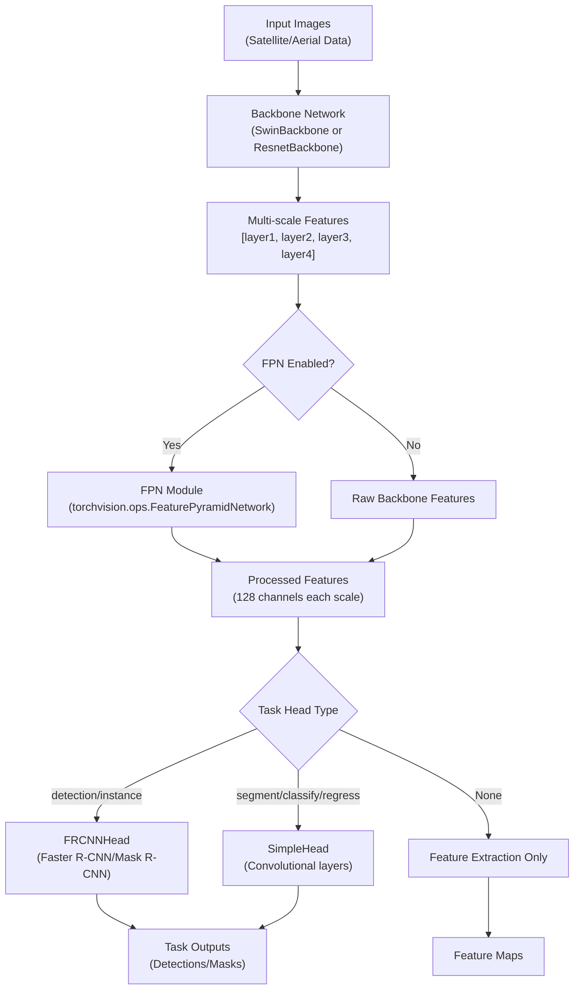
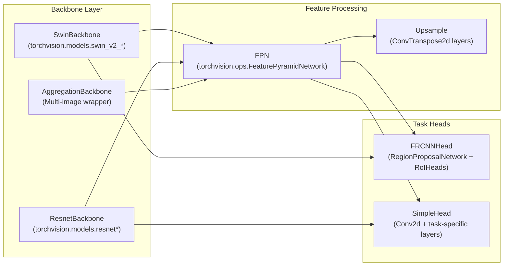

<!-- source: DeepWiki mcp.deepwiki.com · repo allenai/satlaspretrain_models · page 4 Model Architecture · fetched 2026-10-26 -->

# Model Architecture

Relevant source files

The following files were used as context for generating this wiki page:

- [satlaspretrain_models/models/backbones.py](satlaspretrain_models/models/backbones.py)
- [satlaspretrain_models/models/fpn.py](satlaspretrain_models/models/fpn.py)
- [satlaspretrain_models/models/heads.py](satlaspretrain_models/models/heads.py)

This document describes the modular architecture design of the satlaspretrain_models library. The architecture follows a three-tier approach: backbone networks for feature extraction, optional Feature Pyramid Networks (FPN) for multi-scale feature aggregation, and task-specific heads for final predictions. This modular design enables flexible model assembly for different satellite imagery tasks while maintaining compatibility with pre-trained weights.

For detailed information about individual backbone types, see [Backbone Networks](#4.1). For FPN implementation details, see [Feature Pyramid Networks](#4.2). For task-specific prediction heads, see [Task-Specific Heads](#4.3). For model assembly patterns, see [Model Assembly](#4.4).

## Architecture Overview

The model architecture consists of three primary components that can be combined in various configurations:

Sources: [satlaspretrain_models/models/backbones.py:1-130](), [satlaspretrain_models/models/fpn.py:1-55](), [satlaspretrain_models/models/heads.py:1-222]()

## Component Interaction Diagram

The following diagram shows the specific classes and their interactions within the codebase:

Sources: [satlaspretrain_models/models/backbones.py:4-130](), [satlaspretrain_models/models/fpn.py:6-55](), [satlaspretrain_models/models/heads.py:30-222]()

## Modular Design Principles

### Backbone Independence
Each backbone network (`SwinBackbone`, `ResnetBackbone`, `AggregationBackbone`) implements a consistent interface that outputs multi-scale features with standardized channel specifications. All backbones return four feature maps with progressively lower spatial resolution and higher channel count.

| Backbone Type | Feature Scales | Channel Configurations |
|---------------|----------------|----------------------|
| `SwinBackbone` | 4x, 8x, 16x, 32x | [128,256,512,1024] or [96,192,384,768] |
| `ResnetBackbone` | 4x, 8x, 16x, 32x | [256,512,1024,2048] |
| `AggregationBackbone` | 4x, 8x, 16x, 32x | Concatenated group features |

Sources: [satlaspretrain_models/models/backbones.py:10-23](), [satlaspretrain_models/models/backbones.py:41-56](), [satlaspretrain_models/models/backbones.py:91-92]()

### Feature Processing Layer
The FPN and Upsample modules provide optional feature processing between backbone and heads:

- **FPN**: Standardizes all feature maps to 128 channels while preserving spatial hierarchies
- **Upsample**: Generates higher resolution features through transpose convolutions

Sources: [satlaspretrain_models/models/fpn.py:10-14](), [satlaspretrain_models/models/fpn.py:33-34]()

### Task-Specific Heads
Two main head types handle different task categories:

**FRCNNHead** supports object detection and instance segmentation through:
- `RegionProposalNetwork` for proposal generation
- `RoIHeads` for detection/classification
- Optional mask prediction for instance segmentation

**SimpleHead** supports pixel-level and image-level tasks:
- Segmentation (`segment`, `bin_segment`)
- Regression (`regress`)
- Classification (`classification`, `multi-label-classification`)

Sources: [satlaspretrain_models/models/heads.py:30-121](), [satlaspretrain_models/models/heads.py:123-221]()

## Multi-Image Processing

The `AggregationBackbone` enables processing of temporal or multi-spectral image sequences by:

1. Processing each image independently through the underlying backbone
2. Aggregating features across images using max pooling operations
3. Concatenating results across predefined groups

This design supports temporal analysis and multi-image comparison tasks common in satellite imagery applications.

Sources: [satlaspretrain_models/models/backbones.py:75-129]()

## Channel Adaptation

All backbone networks adapt their input layers to handle variable channel counts for different satellite imagery types:

- **Swin Transformers**: Modify the patch embedding layer (`features[0][0]`)
- **ResNet**: Replace the initial convolution layer (`conv1`)
- **Aggregation**: Wraps underlying backbones with multi-image processing

This enables the same architecture to work with RGB (3 channels), multispectral (4+ channels), or SAR data (2 channels).

Sources: [satlaspretrain_models/models/backbones.py:27-27](), [satlaspretrain_models/models/backbones.py:50-50](), [satlaspretrain_models/models/backbones.py:80-83]()

---

