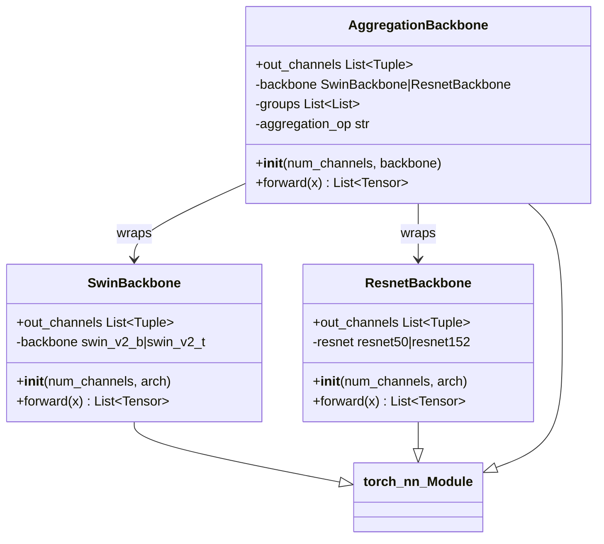
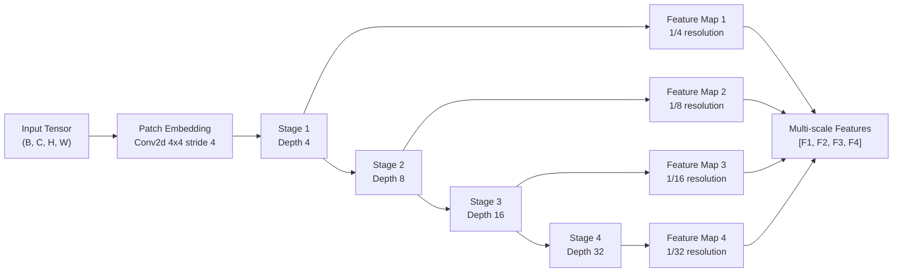
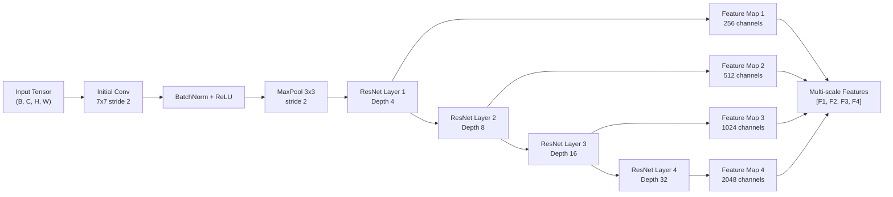
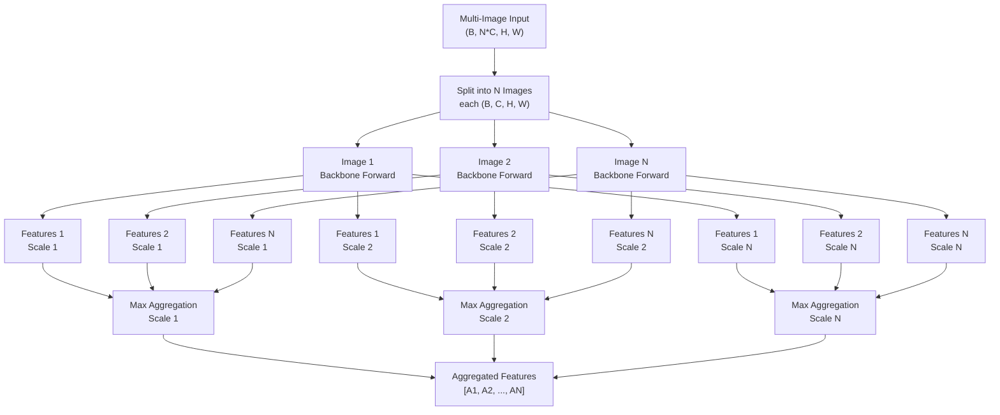

<!-- source: DeepWiki mcp.deepwiki.com · repo allenai/satlaspretrain_models · page 4.1 Backbone Networks · fetched 2026-10-26 -->

# Backbone Networks

<details>
<summary>Relevant source files</summary>

The following files were used as context for generating this wiki page:

- [satlaspretrain_models/models/backbones.py](satlaspretrain_models/models/backbones.py)

</details>


This page documents the backbone network architectures available in the satlaspretrain_models library. Backbone networks serve as the feature extraction foundation for satellite imagery analysis tasks, providing multi-scale feature representations that can be used with Feature Pyramid Networks (see [4.2](#4.2)) and task-specific heads (see [4.3](#4.3)).

The library supports two primary backbone architectures: Swin Vision Transformer v2 and ResNet, both with modifications for satellite imagery channels. Additionally, a multi-image aggregation wrapper enables processing temporal sequences or multi-spectral image stacks.

## Backbone Architecture Overview

The backbone system is implemented through three main classes that provide consistent multi-scale feature extraction interfaces for downstream tasks.

### Backbone Class Hierarchy



Sources: [satlaspretrain_models/models/backbones.py:4-130]()

## Swin Transformer Backbone

The `SwinBackbone` class implements Swin Vision Transformer v2 architectures optimized for satellite imagery. It supports both Base (`swinb`) and Tiny (`swint`) variants with customizable input channels.

### Swin Architecture Specifications

| Architecture | Patch Size | Channel Progression | Output Channels |
|--------------|------------|-------------------|------------------|
| `swinb` | 4×4 | 128→256→512→1024 | [128, 256, 512, 1024] |
| `swint` | 4×4 | 96→192→384→768 | [96, 192, 384, 768] |

The first convolutional layer is modified to accept arbitrary input channels for satellite data:

```python
# Modified from the original 3-channel RGB input
self.backbone.features[0][0] = torch.nn.Conv2d(
    num_channels, 
    self.backbone.features[0][0].out_channels, 
    kernel_size=(4, 4), 
    stride=(4, 4)
)
```

### Swin Feature Extraction Pipeline



The forward pass extracts features at four different scales, with spatial dimensions reduced by factors of 4, 8, 16, and 32 respectively.

Sources: [satlaspretrain_models/models/backbones.py:4-34]()

## ResNet Backbone  

The `ResnetBackbone` class provides ResNet-50 and ResNet-152 architectures with modified input layers for satellite imagery channels.

### ResNet Architecture Specifications

Both ResNet variants use the same channel progression but differ in the number of residual blocks:

| Architecture | Layers | Channel Progression | Output Channels |
|--------------|--------|-------------------|------------------|
| `resnet50` | [3,4,6,3] | 256→512→1024→2048 | [256, 512, 1024, 2048] |
| `resnet152` | [3,8,36,3] | 256→512→1024→2048 | [256, 512, 1024, 2048] |

The initial 7×7 convolution is modified for satellite imagery:

```python
self.resnet.conv1 = torch.nn.Conv2d(
    num_channels, 
    self.resnet.conv1.out_channels, 
    kernel_size=7, 
    stride=2, 
    padding=3, 
    bias=False
)
```

### ResNet Feature Extraction Pipeline



Sources: [satlaspretrain_models/models/backbones.py:37-72]()

## Multi-Image Aggregation

The `AggregationBackbone` class enables processing multiple related images (temporal sequences, multi-spectral stacks) by wrapping any base backbone with aggregation operations.

### Aggregation Architecture



### Aggregation Configuration

The aggregation system uses configurable groupings to determine which images are processed together:

```python
# Default: all images in one group for max aggregation
self.groups = [[0, 1, 2, 3, 4, 5, 6, 7]]
```

The `max` aggregation operation computes element-wise maximum across the temporal/spectral dimension, producing robust features for downstream tasks.

Sources: [satlaspretrain_models/models/backbones.py:75-129]()

## Output Channel Specifications

All backbone classes provide consistent `out_channels` specifications that indicate the spatial downsampling factor and channel count at each scale:

### Channel Configuration Format

```python
# Format: [(downsampling_factor, channel_count), ...]
# Example for SwinB:
out_channels = [
    [4, 128],   # 1/4 resolution, 128 channels
    [8, 256],   # 1/8 resolution, 256 channels  
    [16, 512],  # 1/16 resolution, 512 channels
    [32, 1024], # 1/32 resolution, 1024 channels
]
```

### Multi-Scale Feature Comparison

| Backbone | Scale 1 | Scale 2 | Scale 3 | Scale 4 |
|----------|---------|---------|---------|---------|
| **SwinB** | 4×, 128ch | 8×, 256ch | 16×, 512ch | 32×, 1024ch |
| **SwinT** | 4×, 96ch | 8×, 192ch | 16×, 384ch | 32×, 768ch |
| **ResNet50/152** | 4×, 256ch | 8×, 512ch | 16×, 1024ch | 32×, 2048ch |

The `AggregationBackbone` multiplies channel counts by the number of groups, typically resulting in the same channel counts when using a single group.

Sources: [satlaspretrain_models/models/backbones.py:10-15](), [satlaspretrain_models/models/backbones.py:18-23](), [satlaspretrain_models/models/backbones.py:51-56](), [satlaspretrain_models/models/backbones.py:91]()

## Usage Integration

Backbone networks are typically not instantiated directly but loaded through the weights manager system (see [3.1](#3.1)) and integrated with Feature Pyramid Networks (see [4.2](#4.2)) and task heads (see [4.3](#4.3)) via the model assembly process (see [4.4](#4.4)).

The backbone architectures support satellite imagery with various channel configurations including RGB (3 channels), multi-spectral Sentinel-2 (12 channels), Sentinel-1 SAR (2 channels), and Landsat (11 channels).

Sources: [satlaspretrain_models/models/backbones.py:1-130]()

---

