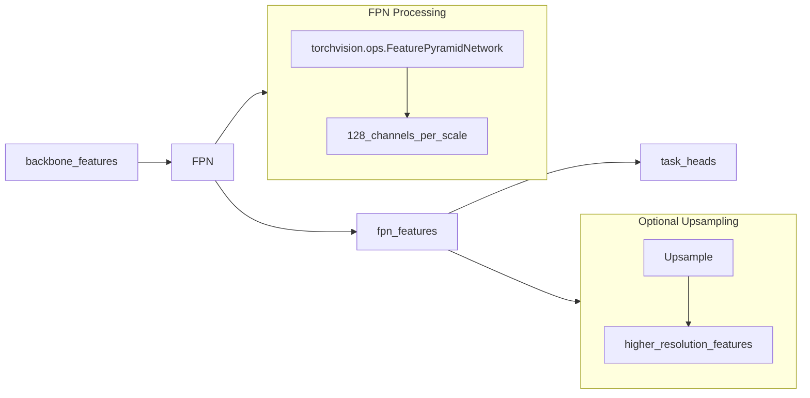
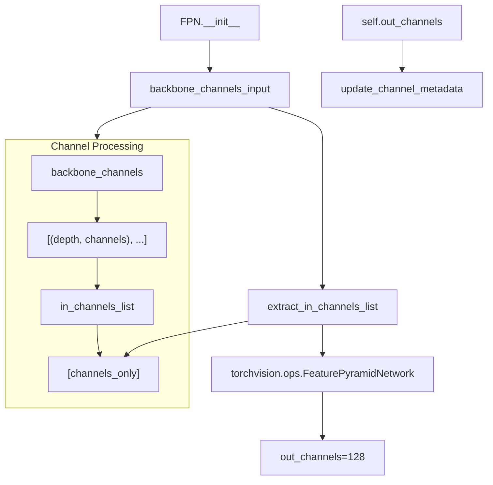
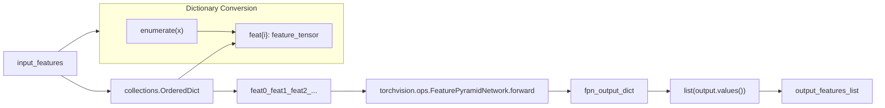
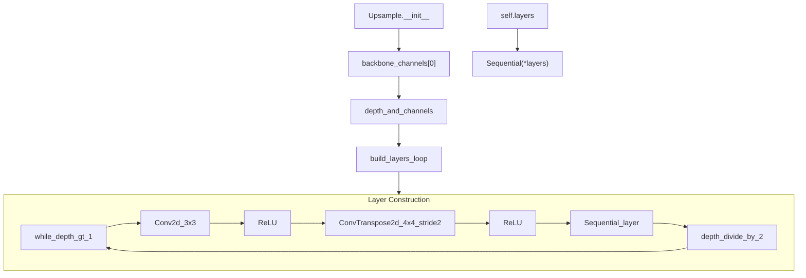
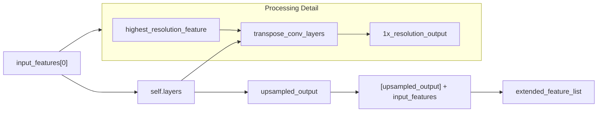

<!-- source: DeepWiki mcp.deepwiki.com · repo allenai/satlaspretrain_models · page 4.2 Feature Pyramid Networks · fetched 2026-10-26 -->

# Feature Pyramid Networks

Relevant source files

The following files were used as context for generating this wiki page:

- [satlaspretrain_models/models/fpn.py](satlaspretrain_models/models/fpn.py)

This document covers the Feature Pyramid Network (FPN) implementation in the satlaspretrain_models library, which provides multi-scale feature aggregation between backbone networks and task-specific heads. The FPN module enables models to process features at multiple spatial resolutions, improving performance on tasks that require detection or analysis of objects at different scales.

For information about backbone architectures that feed into FPN, see page [4.1](#4.1). For documentation of task-specific heads that consume FPN outputs, see page [4.3](#4.3).

## Architecture Overview

The FPN system consists of two main components that work together to provide multi-scale feature processing: the `FPN` class for lateral connections and top-down feature fusion, and the `Upsample` class for generating higher-resolution feature maps.

### FPN in the Model Pipeline

Sources: [satlaspretrain_models/models/fpn.py:6-21]()

## FPN Class Implementation

The `FPN` class provides a wrapper around torchvision's `FeaturePyramidNetwork` that standardizes multi-scale feature processing for satellite imagery models.

### Class Structure and Initialization

The FPN constructor takes `backbone_channels` as input and processes it to extract channel dimensions. The implementation standardizes output channels to 128 across all scales, as defined in [satlaspretrain_models/models/fpn.py:10]().

| Parameter | Type | Description |
|-----------|------|-------------|
| `backbone_channels` | List of tuples | Format: `[(depth_scale, num_channels), ...]` |
| `out_channels` | int | Fixed at 128 for all output scales |
| `in_channels_list` | List of ints | Extracted from backbone_channels for torchvision FPN |

Sources: [satlaspretrain_models/models/fpn.py:7-14]()

### Forward Pass Processing

The forward pass converts input features to the expected OrderedDict format required by torchvision's FPN, then converts the output back to a list format, as implemented in [satlaspretrain_models/models/fpn.py:16-21]().

Sources: [satlaspretrain_models/models/fpn.py:16-21]()

## Upsample Class Implementation

The `Upsample` class generates feature maps at higher spatial resolutions through transpose convolution layers, enabling full-resolution output for dense prediction tasks.

### Upsample Architecture

The upsampling process constructs a series of transpose convolution blocks, with each block halving the depth scale while maintaining or reducing channel dimensions, as defined in [satlaspretrain_models/models/fpn.py:36-50]().

### Channel Dimension Management

| Component | Input Channels | Output Channels | Spatial Scale |
|-----------|----------------|-----------------|---------------|
| Conv2d | `ch` | `ch` | Same |
| ConvTranspose2d | `ch` | `max(ch//2, out_channels)` | 2x upsampled |
| Final output | Variable | `backbone_channels[0][1]` | 1x resolution |

The channel reduction strategy ensures computational efficiency while preserving sufficient representational capacity, implemented in [satlaspretrain_models/models/fpn.py:39]().

Sources: [satlaspretrain_models/models/fpn.py:24-54]()

### Forward Pass Flow

The forward pass processes only the highest resolution feature from the input list (index 0), applies the upsampling layers, and prepends the result to the original feature list, as implemented in [satlaspretrain_models/models/fpn.py:52-54]().

Sources: [satlaspretrain_models/models/fpn.py:52-54]()

## Integration with Model Architecture

The FPN components integrate seamlessly with the broader model architecture through standardized channel metadata and feature list formats.

### Channel Metadata Format

Both `FPN` and `Upsample` classes maintain `out_channels` attributes that follow the standard format: `[(depth_scale, num_channels), ...]`. This enables downstream components to understand the spatial and channel dimensions of output features.

- **FPN output**: Maintains original depth scales with 128 channels each
- **Upsample output**: Adds 1x resolution scale while preserving all original scales

Sources: [satlaspretrain_models/models/fpn.py:14](), [satlaspretrain_models/models/fpn.py:34]()

---

