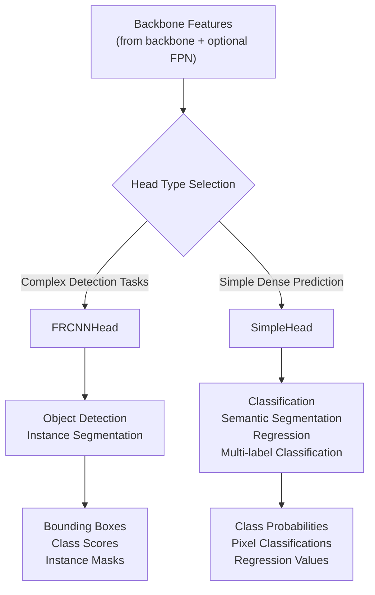
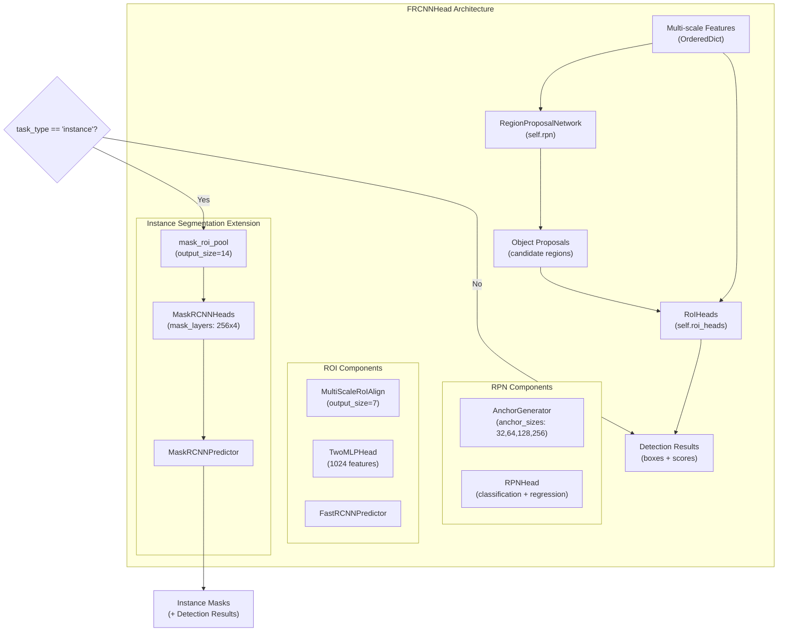
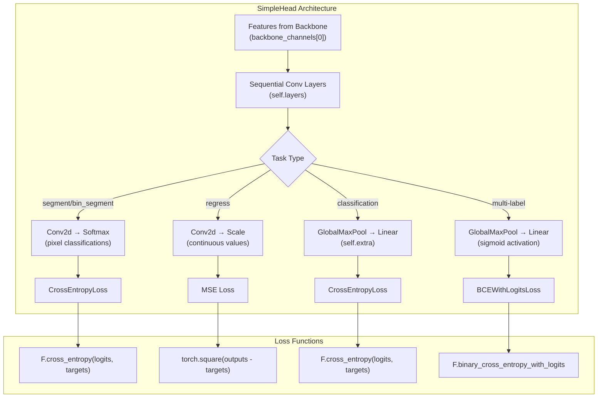
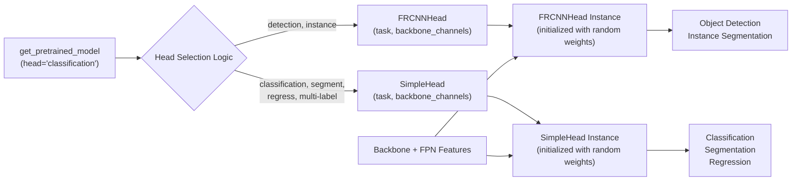

<!-- source: DeepWiki mcp.deepwiki.com · repo allenai/satlaspretrain_models · page 4.3 Task-Specific Heads · fetched 2026-10-26 -->

# Task-Specific Heads

<details>
<summary>Relevant source files</summary>

The following files were used as context for generating this wiki page:

- [satlaspretrain_models/models/heads.py](satlaspretrain_models/models/heads.py)

</details>


This document covers the task-specific prediction heads that are applied on top of backbone features to perform various computer vision tasks. These heads convert the rich feature representations from backbone networks into task-specific outputs like object detection boxes, segmentation masks, or classification scores.

For information about backbone networks that generate the input features, see [Backbone Networks](#4.1). For details on feature pyramid networks that may process features before the heads, see [Feature Pyramid Networks](#4.2).

## Overview

The satlaspretrain_models library provides two main types of task-specific heads that handle different categories of computer vision tasks:

- **FRCNNHead**: Complex detection head for object detection and instance segmentation
- **SimpleHead**: Lightweight head for classification, semantic segmentation, and regression tasks



**Task Type to Head Class Mapping**

| Task Type | Head Class | Output Format |
|-----------|------------|---------------|
| `detection` | `FRCNNHead` | Bounding boxes + class scores |
| `instance` | `FRCNNHead` | Bounding boxes + class scores + masks |
| `classification` | `SimpleHead` | Class probabilities |
| `multi-label-classification` | `SimpleHead` | Multi-label probabilities |
| `segment` | `SimpleHead` | Pixel-wise class probabilities |
| `bin_segment` | `SimpleHead` | Binary segmentation masks |
| `regress` | `SimpleHead` | Continuous values |

Sources: [satlaspretrain_models/models/heads.py:30-221]()

## FRCNNHead Architecture

The `FRCNNHead` class implements a full Faster R-CNN detection pipeline for object detection and instance segmentation tasks. It consists of two main components: a Region Proposal Network (RPN) and ROI heads for final predictions.



### Key Implementation Details

The `FRCNNHead` constructor [satlaspretrain_models/models/heads.py:31-103]() configures the detection pipeline with the following parameters:

**RPN Configuration**:
- Anchor sizes: `[32], [64], [128], [256]` pixels
- Aspect ratios: `(0.5, 1.0, 2.0)` for each scale
- IoU thresholds: foreground=0.7, background=0.3
- NMS threshold: 0.7

**ROI Head Configuration**:
- ROI pooling output size: 7×7
- Box head hidden size: 1024 features  
- IoU thresholds: foreground=0.5, background=0.5
- Detection score threshold: 0.05
- Maximum detections per image: 100

For instance segmentation tasks, additional mask components are added:
- Mask ROI pooling: 14×14 output size
- Mask head: 4 layers of 256 channels each
- Mask predictor outputs per-class masks

Sources: [satlaspretrain_models/models/heads.py:30-103]()

## SimpleHead Architecture  

The `SimpleHead` class provides a lightweight, flexible architecture for dense prediction tasks. It consists of convolutional layers followed by task-specific output processing.



### Task-Specific Processing

Each task type in `SimpleHead` has specialized forward processing [satlaspretrain_models/models/heads.py:171-221]():

**Segmentation Tasks** (`segment`, `bin_segment`):
- Output: Softmax probabilities over classes
- Loss: Cross-entropy with pixel-wise targets
- Shape: `[batch, num_classes, height, width]`

**Regression Task** (`regress`):
- Output: Scaled continuous values (×255)
- Loss: Mean squared error
- Shape: `[batch, height, width]` (single channel)

**Classification Tasks** (`classification`, `multi-label-classification`):
- Feature aggregation: Global max pooling over spatial dimensions
- Linear projection: `self.extra` layer maps to class scores
- Output: Softmax (classification) or sigmoid (multi-label) probabilities
- Shape: `[batch, num_classes]`

Sources: [satlaspretrain_models/models/heads.py:123-221]()

## Head Selection and Integration

Task-specific heads are integrated into the overall model architecture through the model loading system. The head type is automatically selected based on the requested task parameter.



### Forward Pass Integration

Both head types expect features from the backbone (with optional FPN processing) and return task-specific outputs along with loss values during training:

**FRCNNHead Forward Pass** [satlaspretrain_models/models/heads.py:104-121]():
```
Input: (image_list, raw_features, targets=None)
Output: (detections, loss)
```

**SimpleHead Forward Pass** [satlaspretrain_models/models/heads.py:171-221]():
```
Input: (image_list, raw_features, targets=None)  
Output: (outputs, loss)
```

The heads are designed to work seamlessly with the feature extraction pipeline, accepting features from any backbone architecture and optional FPN processing.

Sources: [satlaspretrain_models/models/heads.py:104-121](), [satlaspretrain_models/models/heads.py:171-221]()

---

