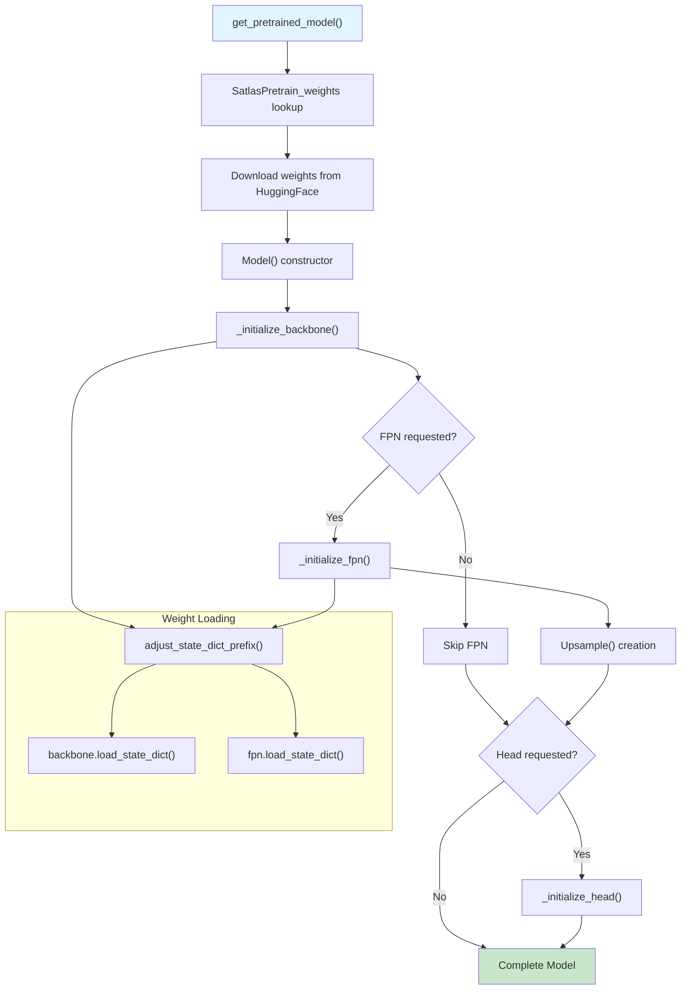
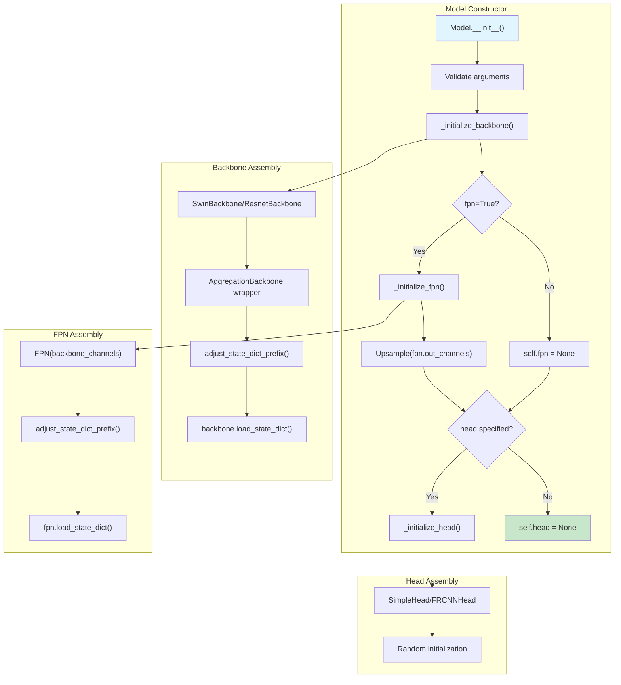
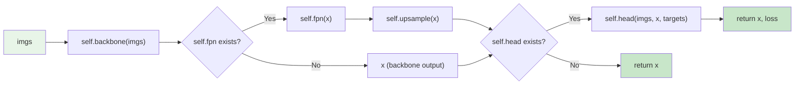
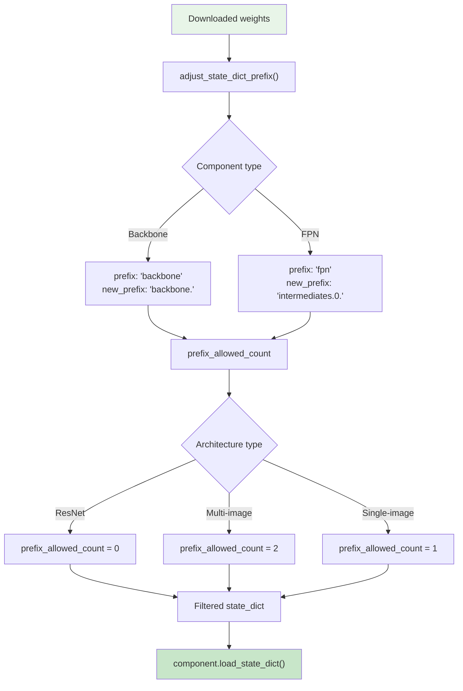

<!-- source: DeepWiki mcp.deepwiki.com · repo allenai/satlaspretrain_models · page 4.4 Model Assembly · fetched 2026-10-26 -->

# Model Assembly

<details>
<summary>Relevant source files</summary>

The following files were used as context for generating this wiki page:

- [satlaspretrain_models/model.py](satlaspretrain_models/model.py)
- [satlaspretrain_models/models/__init__.py](satlaspretrain_models/models/__init__.py)

</details>


This section documents how the modular components (backbones, FPN, and heads) are assembled into complete models for different computer vision tasks. The assembly process coordinates weight loading, component initialization, and proper wiring of the neural network modules.

For information about individual component architectures, see [Backbone Networks](#4.1), [Feature Pyramid Networks](#4.2), and [Task-Specific Heads](#4.3). For usage examples, see [Basic Usage Examples](#5.1).

## Assembly Orchestration

The model assembly process is orchestrated by two main classes: `Weights` for loading pretrained models and `Model` for direct model construction. The assembly follows a strict sequence that ensures proper component initialization and weight loading.

## Assembly Flow

The complete model assembly process follows this sequence:



Sources: [satlaspretrain_models/model.py:16-53](), [satlaspretrain_models/model.py:56-95]()

## Component Assembly Architecture

The `Model` class assembles components in a specific order with careful attention to channel dimensions and weight loading:



Sources: [satlaspretrain_models/model.py:56-95](), [satlaspretrain_models/model.py:96-124](), [satlaspretrain_models/model.py:126-133](), [satlaspretrain_models/model.py:135-151]()

## Component Wiring and Data Flow

The assembled model components are wired together with careful attention to channel dimensions and data flow:

### Channel Dimension Management

| Component | Input Channels | Output Channels | Notes |
|-----------|---------------|-----------------|-------|
| Backbone | `num_channels` | `backbone.out_channels` | Variable based on architecture |
| FPN | `backbone.out_channels` | `fpn.out_channels` (128) | Fixed at 128 channels |
| Upsample | `fpn.out_channels` | `fpn.out_channels` | Preserves channel count |
| Head | `fpn.out_channels` or `backbone.out_channels` | `num_categories` | Depends on FPN presence |

### Forward Pass Assembly

The forward pass demonstrates how components are chained together:



Sources: [satlaspretrain_models/model.py:153-162]()

## Weight Loading Strategy

The assembly process uses a sophisticated weight loading strategy that handles different component prefixes:

### State Dictionary Prefix Handling



Sources: [satlaspretrain_models/model.py:120-122](), [satlaspretrain_models/model.py:130-132](), [satlaspretrain_models/utils.py]() (referenced via imports)

## Assembly Validation and Error Handling

The assembly process includes comprehensive validation:

### Input Validation

- `model_identifier` must exist in `SatlasPretrain_weights`
- `backbone` must be a valid `Backbone` enum
- `head` must be a valid `Head` enum if specified
- `num_categories` required when head is specified

### Architecture Compatibility

| Backbone | Multi-image Support | FPN Support | Head Support |
|----------|-------------------|-------------|--------------|
| SWINB | ✓ | ✓ | All heads |
| SWINT | ✓ | ✓ | All heads |
| RESNET50 | ✓ | ✓ | All heads |
| RESNET152 | ✓ | ✓ | All heads |

Sources: [satlaspretrain_models/model.py:28-33](), [satlaspretrain_models/model.py:76-81]()

## Assembly Examples

### Backbone-Only Assembly
```python
# Creates model with only backbone component
model = weights_manager.get_pretrained_model('Sentinel2_RGB_SIL_SwinB')
```

### Backbone + FPN Assembly
```python
# Adds pretrained FPN to backbone
model = weights_manager.get_pretrained_model('Sentinel2_RGB_SIL_SwinB', fpn=True)
```

### Complete Pipeline Assembly
```python
# Full assembly with all components
model = weights_manager.get_pretrained_model(
    'Sentinel2_RGB_SIL_SwinB', 
    fpn=True, 
    head=Head.CLASSIFY, 
    num_categories=10
)
```

The assembly system provides flexibility while maintaining proper component integration and weight loading consistency across different model configurations.

Sources: [satlaspretrain_models/model.py:168-213]()

---

