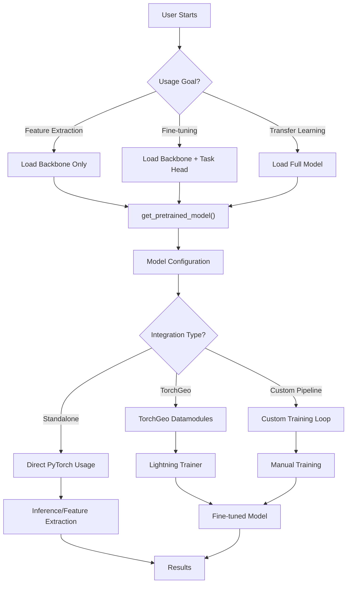
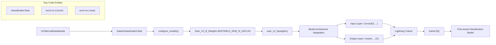
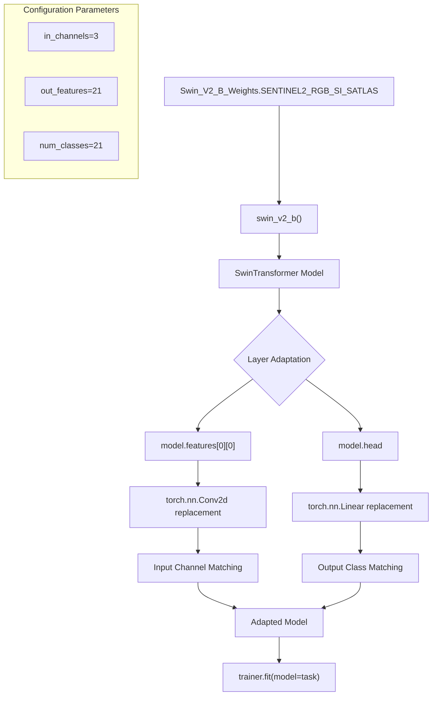
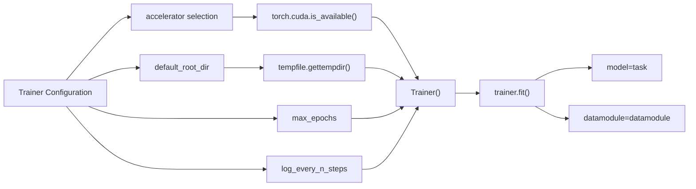

<!-- source: DeepWiki mcp.deepwiki.com · repo allenai/satlaspretrain_models · page 5 Examples and Tutorials · fetched 2026-10-26 -->

# Examples and Tutorials

Relevant source files

The following files were used as context for generating this wiki page:

- [demo.ipynb](demo.ipynb)
- [torchgeo_demo.ipynb](torchgeo_demo.ipynb)

This page provides practical examples and step-by-step tutorials for using the satlaspretrain_models library. The examples demonstrate common workflows from basic model loading to complete fine-tuning pipelines for satellite imagery analysis tasks.

For installation and initial setup instructions, see [Installation](#2.1). For detailed API documentation, see [Core API Reference](#3).

## Overview of Available Examples

The library includes several demonstration notebooks and tutorials that showcase different usage patterns:

| Example Type | Purpose | Complexity | Key Components |
|--------------|---------|------------|----------------|
| Basic Usage | Model loading and inference | Beginner | `get_pretrained_model`, backbone extraction |
| TorchGeo Integration | Fine-tuning with geospatial datasets | Intermediate | TorchGeo datamodules, PyTorch Lightning |
| Custom Fine-tuning | Task-specific model adaptation | Advanced | Custom heads, training loops |

## Common Usage Workflows

The following diagram illustrates the typical workflows for using pre-trained models from this library:

Sources: [torchgeo_demo.ipynb:1-246]()

## TorchGeo Integration Example

The library provides seamless integration with TorchGeo for geospatial deep learning workflows. The primary example demonstrates fine-tuning on the UCMerced land use classification dataset:

The implementation follows this pattern in the notebook:

- **Data Setup**: Uses `UCMercedDataModule` for automatic dataset management [torchgeo_demo.ipynb:68-72]()
- **Model Configuration**: Extends `ClassificationTask` to load Satlas weights [torchgeo_demo.ipynb:83-111]()
- **Architecture Adaptation**: Modifies input channels and output classes [torchgeo_demo.ipynb:88-98]()
- **Training Setup**: Configures `Trainer` with appropriate settings [torchgeo_demo.ipynb:146-153]()

Sources: [torchgeo_demo.ipynb:35-44](), [torchgeo_demo.ipynb:83-111](), [torchgeo_demo.ipynb:146-153]()

## Model Loading and Adaptation Patterns

The following diagram shows the key code entities involved in adapting pre-trained models for downstream tasks:

Key adaptation steps include:
- **Input Layer Modification**: Replacing `model.features[0][0]` to match input channels [torchgeo_demo.ipynb:89-95]()
- **Output Layer Modification**: Replacing `model.head` for task-specific classes [torchgeo_demo.ipynb:98]()
- **Parameter Preservation**: Maintaining kernel sizes and architectural properties [torchgeo_demo.ipynb:92-94]()

Sources: [torchgeo_demo.ipynb:84-98]()

## Training Configuration Examples

The library examples demonstrate various training configurations optimized for satellite imagery tasks:

| Configuration | Value | Purpose |
|---------------|-------|---------|
| `batch_size` | 8 | Memory-efficient processing |
| `max_epochs` | 10 | Quick demonstration training |
| `num_workers` | 2 | Parallel data loading |
| `accelerator` | "gpu" or "cpu" | Hardware adaptation |

The training setup pattern follows:

Sources: [torchgeo_demo.ipynb:54-58](), [torchgeo_demo.ipynb:143-153]()

## Environment Setup Requirements

The examples require specific environment configurations depending on the integration type:

- **TorchGeo Integration**: Requires separate conda environment with TorchGeo from git [torchgeo_demo.ipynb:13-17]()
- **Dependencies**: PyTorch Lightning, TorchGeo, and standard PyTorch stack [torchgeo_demo.ipynb:36-44]()
- **Hardware**: Supports both GPU and CPU execution with automatic detection [torchgeo_demo.ipynb:143]()

For detailed tutorials on specific use cases, see [Basic Usage Examples](#5.1) and [Fine-tuning Tutorial](#5.2).

Sources: [torchgeo_demo.ipynb:13-17](), [torchgeo_demo.ipynb:36-44](), [torchgeo_demo.ipynb:143-153]()

---

