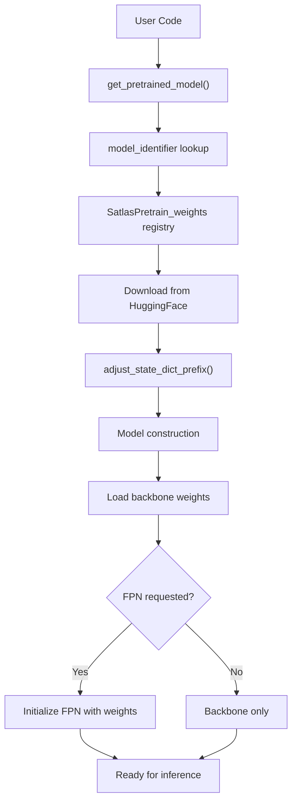
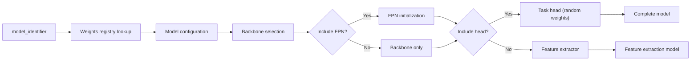
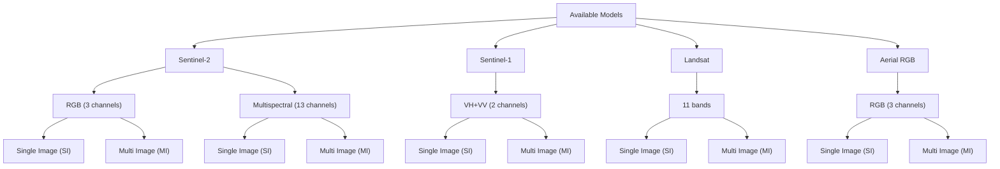
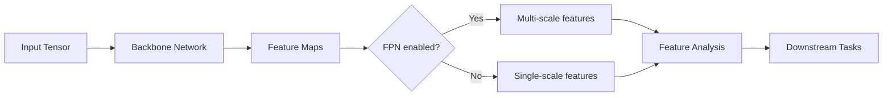
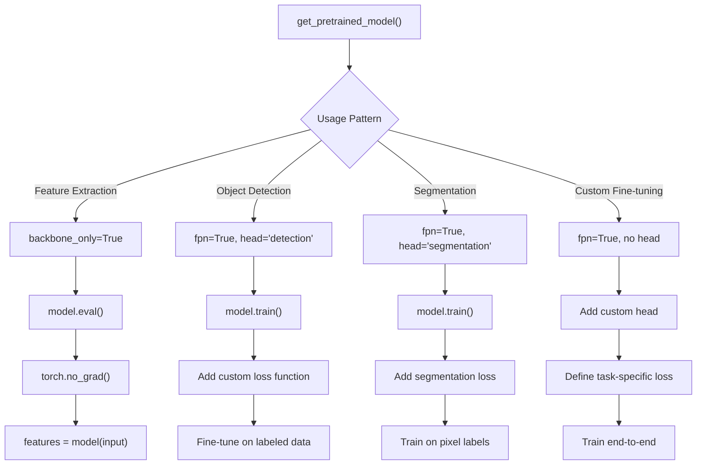

<!-- source: DeepWiki mcp.deepwiki.com · repo allenai/satlaspretrain_models · page 5.1 Basic Usage Examples · fetched 2026-10-26 -->

# Basic Usage Examples

<details>
<summary>Relevant source files</summary>

The following files were used as context for generating this wiki page:

- [demo.ipynb](demo.ipynb)

</details>


This page demonstrates fundamental usage patterns for the satlaspretrain_models library, focusing on model loading, inference, and feature extraction. These examples provide the essential building blocks for satellite imagery analysis using pre-trained models.

For complete fine-tuning workflows and training procedures, see [Fine-tuning Tutorial](#5.2). For integration with geospatial datasets, see [TorchGeo Integration](#2.3).

## Core Model Loading Workflow

The primary interface for accessing pre-trained models is through the `get_pretrained_model` function, which handles model downloading, configuration, and initialization.



**Basic Model Loading Pattern**

The most common usage pattern involves loading a complete model with backbone and Feature Pyramid Network:

```python
from satlaspretrain_models import get_pretrained_model

# Load Sentinel-2 RGB model with SwinB backbone and FPN
model = get_pretrained_model('Sentinel2_RGB_SwinB_SI_MI')
```

**Sources:** [satlaspretrain_models/model.py](), [demo.ipynb]()

## Model Configuration Options

The library supports modular model loading, allowing users to load different combinations of components based on their specific needs.

| Configuration | Components | Use Case |
|---------------|------------|----------|
| Backbone Only | Feature extractor | Transfer learning, feature analysis |
| Backbone + FPN | Multi-scale features | Object detection, segmentation prep |
| Full Model + Head | Task-specific output | End-to-end inference |



**Component Loading Examples**

```python
# Backbone only for feature extraction
backbone = get_pretrained_model('Sentinel2_RGB_SwinB_SI_MI', backbone_only=True)

# Backbone + FPN for multi-scale features  
fpn_model = get_pretrained_model('Sentinel2_RGB_SwinB_SI_MI', fpn=True)

# Full model with detection head
detection_model = get_pretrained_model('Sentinel2_RGB_SwinB_SI_MI', 
                                     fpn=True, 
                                     head='detection')
```

**Sources:** [satlaspretrain_models/model.py](), [satlaspretrain_models/utils.py]()

## Available Model Types

The library provides pre-trained models for different satellite data sources and sensor configurations.



**Model Identifier Examples**

```python
# Sentinel-2 models
s2_rgb_swinb = get_pretrained_model('Sentinel2_RGB_SwinB_SI_MI')
s2_ms_resnet = get_pretrained_model('Sentinel2_MS_ResNet50_SI_MI')

# Sentinel-1 SAR data
s1_swinb = get_pretrained_model('Sentinel1_SwinB_SI_MI') 

# Landsat multispectral
landsat_swinb = get_pretrained_model('Landsat_SwinB_SI_MI')

# Aerial RGB imagery
aerial_swinb = get_pretrained_model('Aerial_SwinB_SI_MI')
```

**Sources:** [satlaspretrain_models/utils.py](), [demo.ipynb]()

## Feature Extraction Workflow

Feature extraction is a common use case for transfer learning and analysis of satellite imagery representations.



**Feature Extraction Pattern**

```python
import torch

# Load backbone for feature extraction
model = get_pretrained_model('Sentinel2_RGB_SwinB_SI_MI', backbone_only=True)
model.eval()

# Process satellite image tensor
with torch.no_grad():
    # Input shape: [batch_size, channels, height, width]
    input_tensor = torch.randn(1, 3, 224, 224)  # Example Sentinel-2 RGB
    features = model(input_tensor)
    
    # Features contain learned representations
    print(f"Feature shape: {features.shape}")
```

**Multi-scale Feature Extraction with FPN**

```python
# Load model with FPN for multi-scale features
fpn_model = get_pretrained_model('Sentinel2_RGB_SwinB_SI_MI', fpn=True)
fpn_model.eval()

with torch.no_grad():
    input_tensor = torch.randn(1, 3, 224, 224)
    feature_dict = fpn_model(input_tensor)
    
    # FPN returns dictionary of features at different scales
    for scale, features in feature_dict.items():
        print(f"Scale {scale}: {features.shape}")
```

**Sources:** [demo.ipynb](), [satlaspretrain_models/fpn.py]()

## Multi-Image Processing

The library supports both single-image (SI) and multi-image (MI) processing for temporal analysis and multi-temporal change detection.

**Single Image vs Multi-Image Models**

| Model Type | Input Shape | Use Case |
|------------|-------------|----------|
| Single Image (SI) | `[B, C, H, W]` | Individual scene analysis |
| Multi Image (MI) | `[B, T, C, H, W]` | Temporal analysis, change detection |

```python
# Single Image model
si_model = get_pretrained_model('Sentinel2_RGB_SwinB_SI_MI')

# Multi Image model - same identifier, handles both formats
mi_input = torch.randn(1, 4, 3, 224, 224)  # 4 temporal frames
features = si_model(mi_input)  # Model auto-detects multi-image format
```

**Sources:** [satlaspretrain_models/model.py](), [demo.ipynb]()

## Common Usage Patterns

The following diagram shows typical workflows from model loading to task completion:



**Error Handling and Model Validation**

```python
# Check if model identifier exists
try:
    model = get_pretrained_model('Custom_Model_Name')
except KeyError:
    print("Model identifier not found in registry")

# Validate input tensor dimensions
input_tensor = torch.randn(1, 3, 224, 224)
if input_tensor.shape[1] != model.expected_channels:
    raise ValueError(f"Expected {model.expected_channels} channels")
```

**Sources:** [satlaspretrain_models/model.py](), [satlaspretrain_models/utils.py](), [demo.ipynb]()

---

