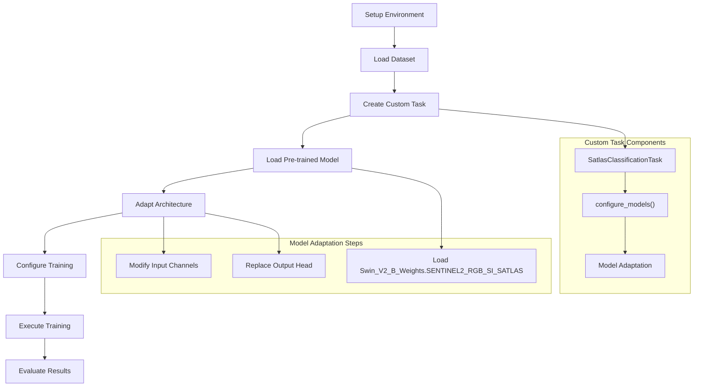
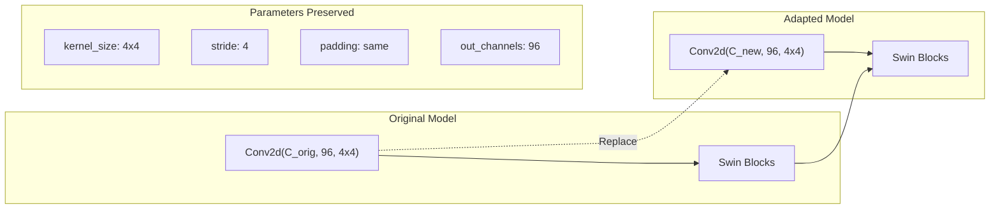
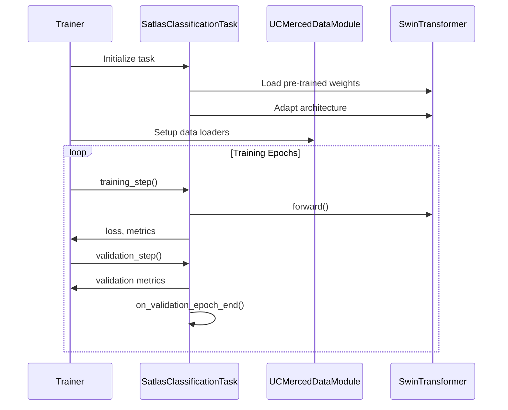

<!-- source: DeepWiki mcp.deepwiki.com · repo allenai/satlaspretrain_models · page 5.2 Fine-tuning Tutorial · fetched 2026-10-26 -->

# Fine-tuning Tutorial

<details>
<summary>Relevant source files</summary>

The following files were used as context for generating this wiki page:

- [torchgeo_demo.ipynb](torchgeo_demo.ipynb)

</details>


This tutorial demonstrates how to fine-tune pre-trained satellite imagery models from the satlaspretrain_models library for downstream tasks. The tutorial focuses on classification tasks using the TorchGeo ecosystem, showing how to adapt pre-trained models to new datasets and domains.

For basic model loading and inference, see [Basic Usage Examples](#5.1). For information about available pre-trained models, see [Available Models Catalog](#7.1). For TorchGeo integration basics, see [TorchGeo Integration](#2.3).

## Prerequisites and Environment Setup

Fine-tuning requires a specialized environment with TorchGeo and PyTorch Lightning. The setup differs from basic model usage and requires additional dependencies.

### Required Dependencies

```bash
conda create --name torchgeo_finetune python=3.12
conda activate torchgeo_finetune
pip install git+https://github.com/microsoft/torchgeo
pip install lightning
```

The tutorial uses TorchGeo's built-in integration with satlaspretrain_models, which provides seamless access to pre-trained weights through the `Swin_V2_B_Weights` enum.

**Sources:** [torchgeo_demo.ipynb:13-17]()

## Fine-tuning Workflow Overview



**Sources:** [torchgeo_demo.ipynb:68-214]()

## Dataset Setup

The tutorial uses the UCMerced land use dataset as an example, demonstrating TorchGeo's data loading capabilities:

```python
# Dataset configuration
root = os.path.join(tempfile.gettempdir(), "ucm")
datamodule = UCMercedDataModule(
    root=root, 
    batch_size=batch_size, 
    num_workers=num_workers, 
    download=True
)
```

The `UCMercedDataModule` handles automatic download, preprocessing, and train/validation splits. The modular design allows easy substitution with other TorchGeo datasets.

**Sources:** [torchgeo_demo.ipynb:68-72]()

## Custom Training Task Implementation

### Core Task Structure

Fine-tuning requires creating a custom task class that inherits from TorchGeo's `ClassificationTask`. This class handles model configuration, architecture adaptation, and training logic:

```mermaid
classDiagram
    class ClassificationTask {
        +configure_models()
        +training_step()
        +validation_step()
        +configure_optimizers()
    }
    
    class SatlasClassificationTask {
        +configure_models()
        +on_validation_epoch_end()
        -model: SwinTransformer
        -weights: Swin_V2_B_Weights
    }
    
    ClassificationTask <|-- SatlasClassificationTask
    
    note for SatlasClassificationTask : "Loads SENTINEL2_RGB_SI_SATLAS weights\nAdapts input/output layers\nProvides custom logging"
```

**Sources:** [torchgeo_demo.ipynb:82-111]()

### Model Configuration Method

The `configure_models()` method loads the pre-trained model and adapts its architecture:

| Step | Action | Code Location |
|------|--------|---------------|
| 1 | Load pre-trained weights | [torchgeo_demo.ipynb:85-86]() |
| 2 | Adapt input layer | [torchgeo_demo.ipynb:88-95]() |
| 3 | Replace classification head | [torchgeo_demo.ipynb:97-98]() |

The method uses `Swin_V2_B_Weights.SENTINEL2_RGB_SI_SATLAS` to access pre-trained weights and applies the `swin_v2_b()` constructor to create the model instance.

**Sources:** [torchgeo_demo.ipynb:84-98]()

## Model Architecture Adaptation

### Input Layer Modification

The pre-trained model expects specific input channels based on the satellite imagery type. For fine-tuning on different data, the first convolutional layer must be adapted:



The adaptation preserves all architectural parameters except input channels, ensuring compatibility with the pre-trained feature extraction layers.

**Sources:** [torchgeo_demo.ipynb:88-95]()

### Output Head Replacement

The classification head is replaced to match the target dataset's number of classes:

```python
# Original head: Linear(1024, original_classes)
# New head: Linear(1024, num_classes)
self.model.head = torch.nn.Linear(
    in_features=1024, 
    out_features=self.hparams["num_classes"], 
    bias=True
)
```

The feature dimension (1024) remains constant as it corresponds to the Swin Transformer's final feature representation.

**Sources:** [torchgeo_demo.ipynb:97-98]()

## Training Pipeline Configuration

### Training Parameters

The training pipeline uses PyTorch Lightning's `Trainer` class with the following configuration:

| Parameter | Value | Purpose |
|-----------|-------|---------|
| `accelerator` | "gpu" or "cpu" | Hardware acceleration |
| `max_epochs` | 10 | Training duration |
| `batch_size` | 8 | Memory optimization |
| `num_workers` | 2 | Data loading parallelization |

**Sources:** [torchgeo_demo.ipynb:54-58](), [torchgeo_demo.ipynb:142-153]()

### Training Execution Flow



**Sources:** [torchgeo_demo.ipynb:212-213]()

## Training Execution and Monitoring

### Validation Monitoring

The custom task implements validation monitoring to track training progress:

```python
def on_validation_epoch_end(self):
    val_loss = self.trainer.callback_metrics.get('val_loss', 'N/A')
    val_acc = self.trainer.callback_metrics.get('val_OverallAccuracy', 'N/A')
    print(f"Epoch {self.current_epoch} Validation - Loss: {val_loss}, Accuracy: {val_acc}")
```

This provides real-time feedback on model performance during training.

**Sources:** [torchgeo_demo.ipynb:100-104]()

### Model Parameters and Memory Usage

The fine-tuning process involves approximately 86.9M trainable parameters:

| Component | Parameters | Trainable |
|-----------|------------|-----------|
| SwinTransformer | 86.9M | Yes |
| CrossEntropyLoss | 0 | N/A |
| Metrics | 0 | N/A |
| **Total** | **86.9M** | **Yes** |

**Sources:** [torchgeo_demo.ipynb:167-178]()

## Best Practices and Considerations

### Memory Management

Fine-tuning large models requires careful memory management:
- Use appropriate batch sizes (typically 8-16 for Swin-B)
- Enable gradient checkpointing for memory-constrained environments
- Consider mixed precision training for GPU acceleration

### Architecture Compatibility

When adapting models for different input channels:
- Preserve spatial dimensions and architectural parameters
- Only modify the first and last layers
- Ensure input preprocessing matches pre-training expectations

### Training Stability

For stable fine-tuning:
- Use lower learning rates than training from scratch
- Implement learning rate warmup
- Monitor validation metrics for overfitting

**Sources:** [torchgeo_demo.ipynb:54-58](), [torchgeo_demo.ipynb:88-98]()

---

