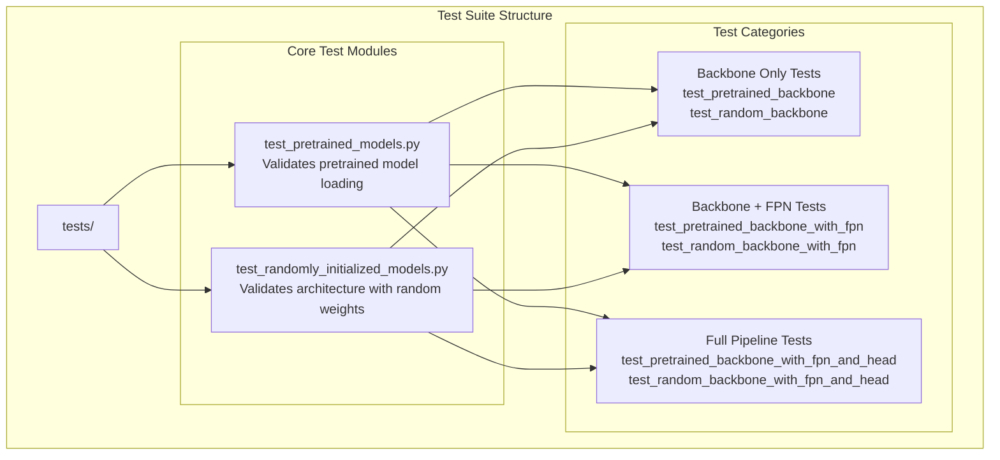
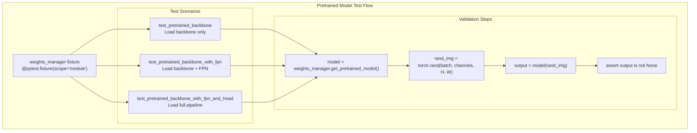
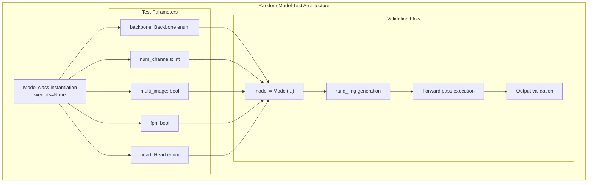
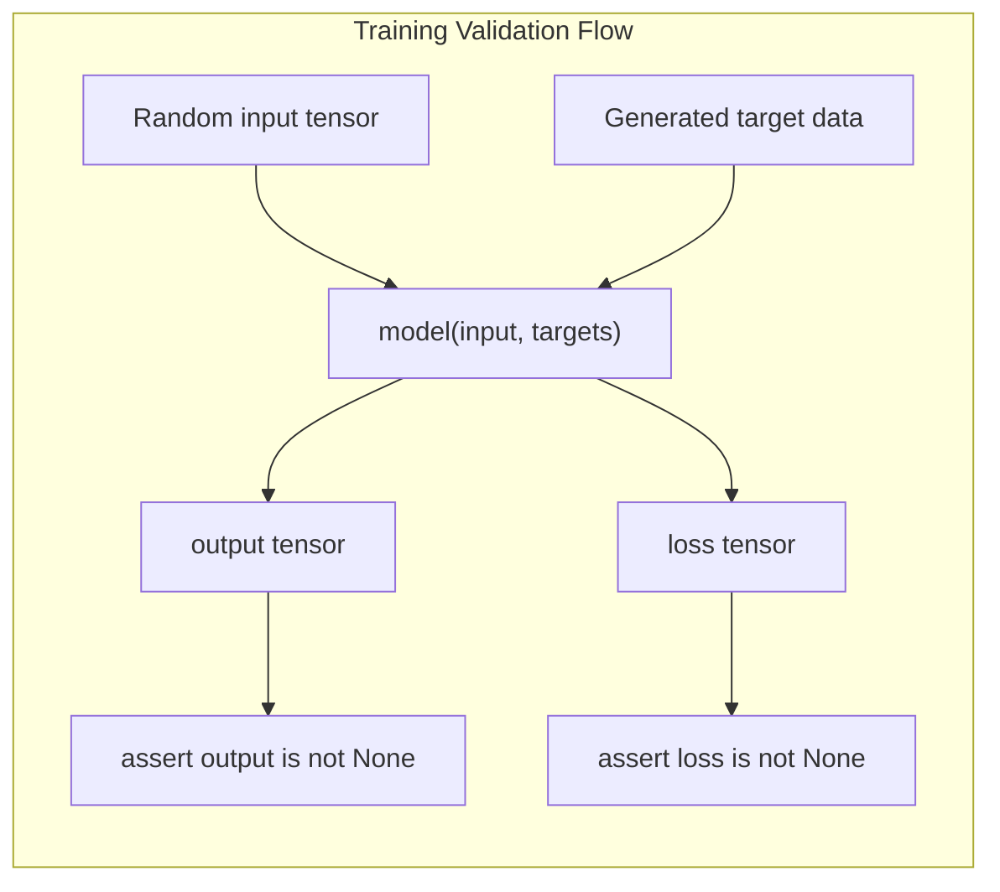

<!-- source: DeepWiki mcp.deepwiki.com · repo allenai/satlaspretrain_models · page 6 Testing and Development · fetched 2026-10-26 -->

# Testing and Development

<details>
<summary>Relevant source files</summary>

The following files were used as context for generating this wiki page:

- [tests/test_pretrained_models.py](tests/test_pretrained_models.py)
- [tests/test_randomly_initialized_models.py](tests/test_randomly_initialized_models.py)

</details>


This section provides comprehensive information for developers and contributors about the testing infrastructure and development practices for the satlaspretrain_models library. It covers the automated test suite, test organization, and development environment setup.

For basic usage examples and tutorials, see [Examples and Tutorials](#5). For API reference documentation, see [Core API Reference](#3).

## Testing Framework Overview

The satlaspretrain_models library uses `pytest` as its primary testing framework to ensure reliability across all supported model configurations and architectures. The test suite provides comprehensive coverage of model loading, architecture validation, and forward pass execution for both pretrained and randomly initialized models.

### Test Structure and Organization

The testing framework is organized into two primary test modules that validate different aspects of the model system:



**Sources:** [tests/test_pretrained_models.py:1-65](), [tests/test_randomly_initialized_models.py:1-57]()

### Parametrized Testing Strategy

The test suite employs pytest's parametrized testing to achieve comprehensive coverage across all model configurations:

| Test Type | Parametrization | Coverage |
|-----------|----------------|----------|
| Pretrained Models | `SatlasPretrain_weights.keys()` | All 22+ available pretrained models |
| Random Models | `Backbone` enum | All backbone architectures |
| Head Combinations | `model_id × Head` enum | All model-head combinations |

**Sources:** [tests/test_pretrained_models.py:13-14](), [tests/test_pretrained_models.py:31](), [tests/test_randomly_initialized_models.py:8]()

## Model Loading and Validation Tests

### Pretrained Model Testing

The pretrained model tests validate the complete model loading pipeline from HuggingFace Hub through the `Weights` manager:



**Sources:** [tests/test_pretrained_models.py:8-10](), [tests/test_pretrained_models.py:14-19](), [tests/test_pretrained_models.py:23-28](), [tests/test_pretrained_models.py:32-35]()

### Random Model Testing

Random model tests validate the architecture construction without pretrained weights, ensuring the `Model` class can instantiate properly with all configuration combinations:



**Sources:** [tests/test_randomly_initialized_models.py:10](), [tests/test_randomly_initialized_models.py:18](), [tests/test_randomly_initialized_models.py:26]()

## Head-Specific Target Generation

The test suite includes sophisticated target data generation for different task heads to validate both forward and backward passes:

### Target Data Configuration

| Head Type | Target Structure | Test Data Generation |
|-----------|------------------|---------------------|
| `Head.DETECT` | Detection boxes and labels | `{'boxes': tensor, 'labels': tensor}` |
| `Head.INSTANCE` | Instance masks, boxes, labels | `{'boxes': tensor, 'labels': tensor, 'masks': tensor}` |
| `Head.BINSEGMENT` | Binary segmentation masks | `torch.zeros((1, 2, 32, 32))` |
| `Head.REGRESS` | Regression targets | `torch.zeros((1, 2, 32, 32)).float()` |
| `Head.CLASSIFY` | Class labels | `torch.tensor([1])` |

**Sources:** [tests/test_pretrained_models.py:37-54](), [tests/test_randomly_initialized_models.py:29-46]()

### Training Mode Validation

For heads that support training, the tests validate both output generation and loss computation:



**Sources:** [tests/test_pretrained_models.py:58-61](), [tests/test_randomly_initialized_models.py:50-53]()

## Development Setup

### Test Execution

The test suite can be executed using standard pytest commands:

```bash
# Run all tests
pytest tests/

# Run specific test modules
pytest tests/test_pretrained_models.py
pytest tests/test_randomly_initialized_models.py

# Run with verbose output
pytest -v tests/
```

### Package Dependencies

The testing framework requires the following dependencies, as defined in the package configuration:

- `pytest` - Testing framework
- `torch` - PyTorch for model operations
- Core library dependencies from `satlaspretrain_models.model` and `satlaspretrain_models.utils`

**Sources:** [tests/test_pretrained_models.py:1-5](), [tests/test_randomly_initialized_models.py:1-5]()

### Test Coverage Gaps

The current test suite includes identified areas for future enhancement:

```python
# TODO: add rand_targets for SEGMENT and MULTICLASSIFY
```

**Sources:** [tests/test_pretrained_models.py:56](), [tests/test_randomly_initialized_models.py:48]()

This indicates that `Head.SEGMENT` and `Head.MULTICLASSIFY` target generation is not yet implemented in the test suite, representing areas for developer contribution.

---

