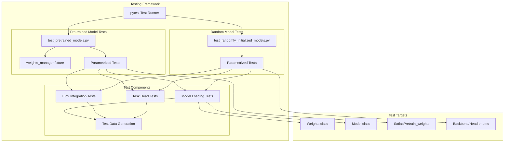
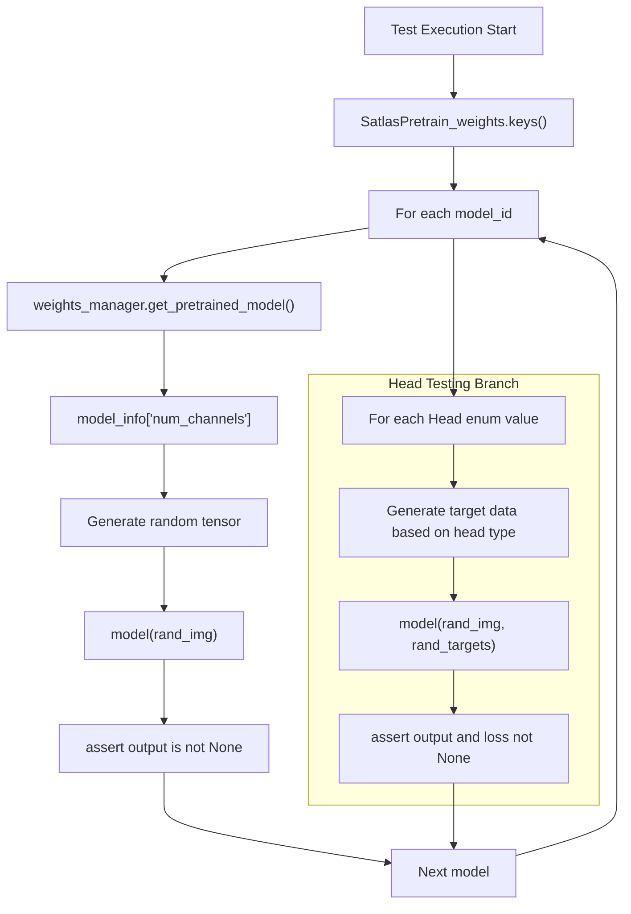
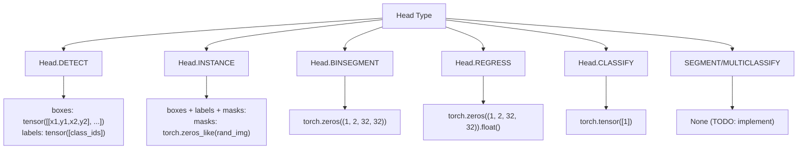

<!-- source: DeepWiki mcp.deepwiki.com · repo allenai/satlaspretrain_models · page 6.1 Testing Framework · fetched 2026-10-26 -->

# Testing Framework

<details>
<summary>Relevant source files</summary>

The following files were used as context for generating this wiki page:

- [tests/test_pretrained_models.py](tests/test_pretrained_models.py)
- [tests/test_randomly_initialized_models.py](tests/test_randomly_initialized_models.py)

</details>


This document covers the automated testing infrastructure for the satlaspretrain_models library. The testing framework validates model loading, architecture assembly, and forward pass execution across all supported model configurations and task heads.

For information about setting up the development environment, see [Development Setup](#6.2). For details about the model architecture being tested, see [Model Architecture](#4).

## Overview

The testing framework uses pytest to systematically validate the library's core functionality through parametrized tests. It ensures that all 22+ pre-trained models can be loaded correctly and that both pre-trained and randomly initialized models function properly across all supported configurations.

## Test Architecture

The testing framework is organized into two main test modules that validate different aspects of model functionality:

### Test Structure Diagram



Sources: [tests/test_pretrained_models.py:1-65](), [tests/test_randomly_initialized_models.py:1-57]()

## Pre-trained Model Testing

The pre-trained model tests validate that all models in the `SatlasPretrain_weights` registry can be loaded and executed correctly. These tests use a shared `weights_manager` fixture and parametrized test functions.

### Test Categories

| Test Function | Purpose | Parameters |
|---------------|---------|------------|
| `test_pretrained_backbone` | Backbone-only loading | All model IDs |
| `test_pretrained_backbone_with_fpn` | Backbone + FPN loading | All model IDs |
| `test_pretrained_backbone_with_fpn_and_head` | Complete model with task heads | All model IDs × All head types |

### Weights Manager Fixture

The `weights_manager` fixture provides a module-scoped instance of the `Weights` class:

```python
@pytest.fixture(scope="module")
def weights_manager():
    return Weights()
```

This fixture is shared across all pre-trained model tests to avoid redundant initialization.

Sources: [tests/test_pretrained_models.py:7-10]()

### Parametrized Testing Flow



Sources: [tests/test_pretrained_models.py:13-28](), [tests/test_pretrained_models.py:31-64]()

## Random Model Testing

The random model tests validate that models can be constructed from scratch without pre-trained weights. These tests use the `Model` class directly with `weights=None`.

### Test Coverage

The random model tests mirror the pre-trained model test structure but use combinations of `Backbone` and `Head` enums rather than specific model IDs:

- **Backbone testing**: Tests all backbone types (`Backbone` enum values)
- **FPN integration**: Validates FPN with all backbone types  
- **Head integration**: Tests all `Backbone` × `Head` combinations

### Key Differences from Pre-trained Tests

| Aspect | Pre-trained Tests | Random Tests |
|--------|------------------|--------------|
| Model instantiation | `weights_manager.get_pretrained_model()` | `Model(weights=None)` |
| Parameter source | `SatlasPretrain_weights` registry | `Backbone`/`Head` enums |
| Channel configuration | From model metadata | Fixed at 3 channels |
| Weight initialization | Pre-trained weights | Random initialization |

Sources: [tests/test_randomly_initialized_models.py:8-21](), [tests/test_randomly_initialized_models.py:24-56]()

## Test Data Generation

Both test modules generate appropriate input and target data for different model configurations and task heads.

### Input Data Generation

Input tensors are generated based on model channel requirements:

```python
# Pre-trained models use model-specific channels
rand_img = torch.rand((8, model_info['num_channels'], 128, 128)).float()

# Random models use fixed 3 channels  
rand_img = torch.rand((8, 3, 128, 128)).float()
```

### Target Data by Head Type



Sources: [tests/test_pretrained_models.py:37-55](), [tests/test_randomly_initialized_models.py:29-47]()

### Forward Pass Validation

The tests validate model outputs using conditional logic based on target availability:

```python
if rand_targets is not None:
    output, loss = model(rand_img, rand_targets)
    assert output is not None
    assert loss is not None
else:
    output = model(rand_img)
    assert output is not None
```

This pattern ensures that training mode (with targets) and inference mode (without targets) both function correctly.

Sources: [tests/test_pretrained_models.py:58-64](), [tests/test_randomly_initialized_models.py:50-56]()

## Running Tests

The tests can be executed using standard pytest commands:

```bash
# Run all tests
pytest tests/

# Run specific test modules
pytest tests/test_pretrained_models.py
pytest tests/test_randomly_initialized_models.py

# Run with verbose output
pytest -v tests/

# Run specific test functions
pytest tests/test_pretrained_models.py::test_pretrained_backbone
```

The parametrized nature of the tests means that hundreds of individual test cases are executed, covering all combinations of models, architectures, and task heads supported by the library.

Sources: [tests/test_pretrained_models.py:1-65](), [tests/test_randomly_initialized_models.py:1-57]()

---

