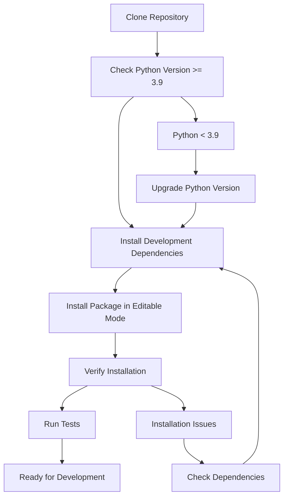
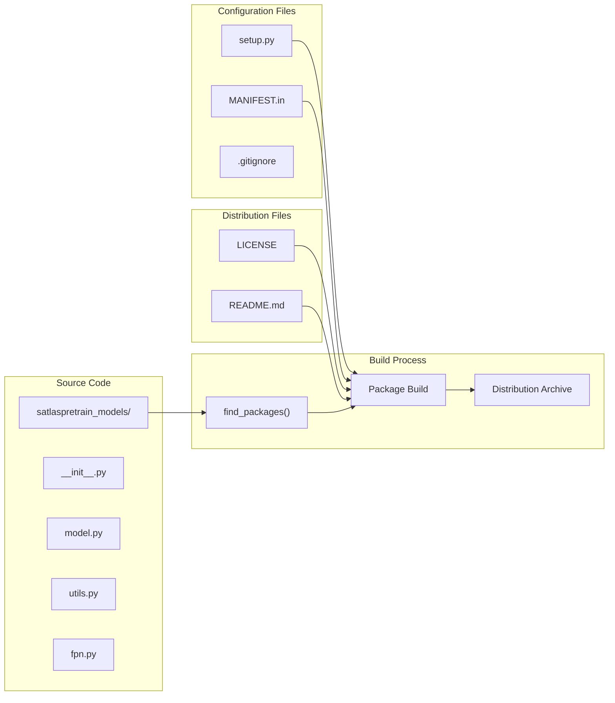
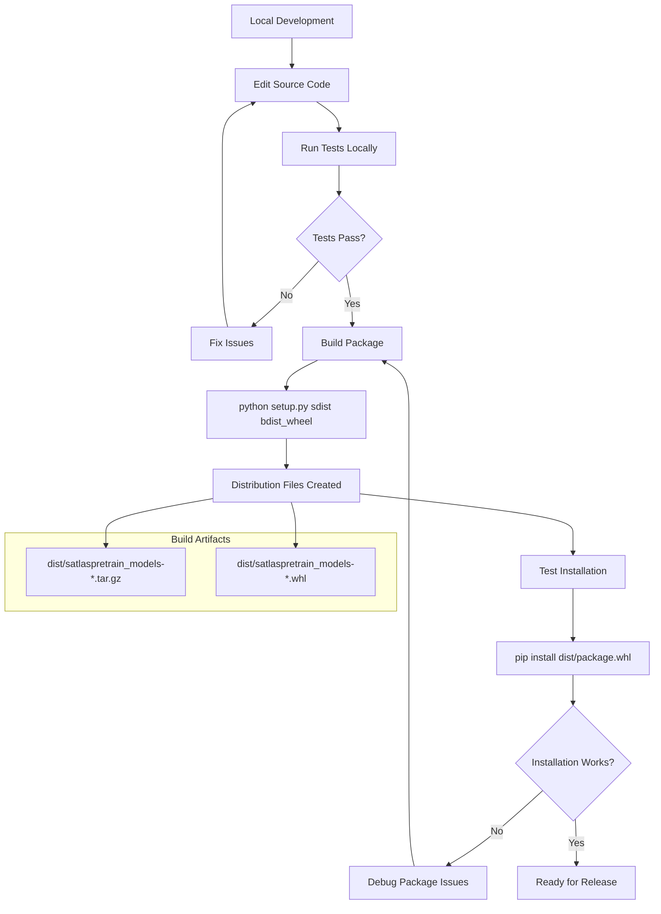

<!-- source: DeepWiki mcp.deepwiki.com · repo allenai/satlaspretrain_models · page 6.2 Development Setup · fetched 2026-10-26 -->

# Development Setup

Relevant source files

The following files were used as context for generating this wiki page:

- [.gitignore](.gitignore)
- [MANIFEST.in](MANIFEST.in)
- [setup.py](setup.py)

This document provides instructions for setting up a development environment for the `satlaspretrain_models` library and understanding the package structure. This guide is intended for contributors and developers working on the codebase itself.

For end-user installation instructions, see [Installation](#2.1). For information about the testing framework, see [Testing Framework](#6.1).

## Purpose and Scope

This page covers the development environment setup, package structure, build process, and development workflow for contributors to the `satlaspretrain_models` library. It does not cover end-user installation or usage of the library.

## Development Environment Setup

### Prerequisites

The development environment requires Python 3.9 or higher as specified in the package configuration. This constraint ensures compatibility with the core PyTorch dependencies and modern Python features used throughout the codebase.

**Development Environment Setup Flowchart**

Sources: [setup.py:18]()

### Core Dependencies

The library has specific version requirements for its core dependencies to ensure model compatibility and stable operation:

| Dependency | Minimum Version | Purpose |
|------------|----------------|---------|
| `torch` | 2.1.0 | Core PyTorch framework for neural networks |
| `torchvision` | 0.16.0 | Computer vision utilities and pre-trained models |
| `requests` | Latest | HTTP library for downloading model weights |
| `matplotlib` | Latest | Plotting utilities for visualization |

Sources: [setup.py:19-24]()

### Package Structure

The package uses `setuptools.find_packages()` to automatically discover all Python packages within the source tree. This approach ensures that any new modules added to the codebase are automatically included in the package distribution.

**Package Structure and Build Process**

Sources: [setup.py:3-25](), [MANIFEST.in:1-3]()

## Package Configuration

### Setup.py Structure

The `setup.py` file defines the package metadata and build configuration:

- **Package Name**: `satlaspretrain_models`
- **Version**: 0.3.1
- **Author**: Satlas @ AI2
- **License**: Apache Software License
- **Python Compatibility**: 3.9+

The package is configured as a standard Python library with automatic package discovery, ensuring that all modules in the source directory are included in the distribution.

Sources: [setup.py:3-17]()

### Version Control Configuration

The `.gitignore` file is configured to exclude common Python development artifacts:

- `*__pycache__*` - Python bytecode cache directories
- `*.swp` - Vim editor swap files  
- `*.pyc` - Compiled Python files

This minimal configuration focuses on essential exclusions without being overly restrictive for development workflows.

Sources: [.gitignore:1-4]()

### Distribution Manifest

The `MANIFEST.in` file explicitly includes documentation and legal files in the package distribution:

- `LICENSE` - Apache license text
- `README.md` - Package documentation and usage examples

These files are essential for proper package distribution and legal compliance.

Sources: [MANIFEST.in:1-3]()

## Development Workflow

**Development and Build Workflow**

Sources: [setup.py:1-26]()

## Environment Variables and Configuration

The package does not rely on environment variables for core functionality, as it uses a registry-based approach for model configuration. All model specifications are embedded in the code, making the development environment straightforward to set up without external configuration files.

## Build and Distribution

The package uses standard Python packaging tools:

1. **setuptools** for package building and dependency management
2. **find_packages()** for automatic module discovery
3. **MANIFEST.in** for including non-Python files in distributions

The build process creates both source distributions (`.tar.gz`) and wheel distributions (`.whl`) for different installation scenarios.

Sources: [setup.py:1-26](), [MANIFEST.in:1-3]()

---

