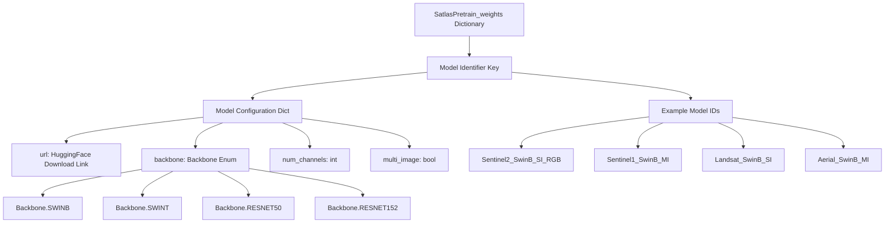
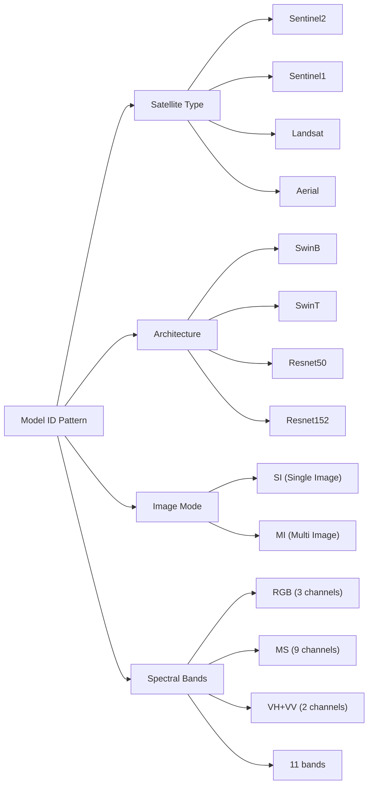
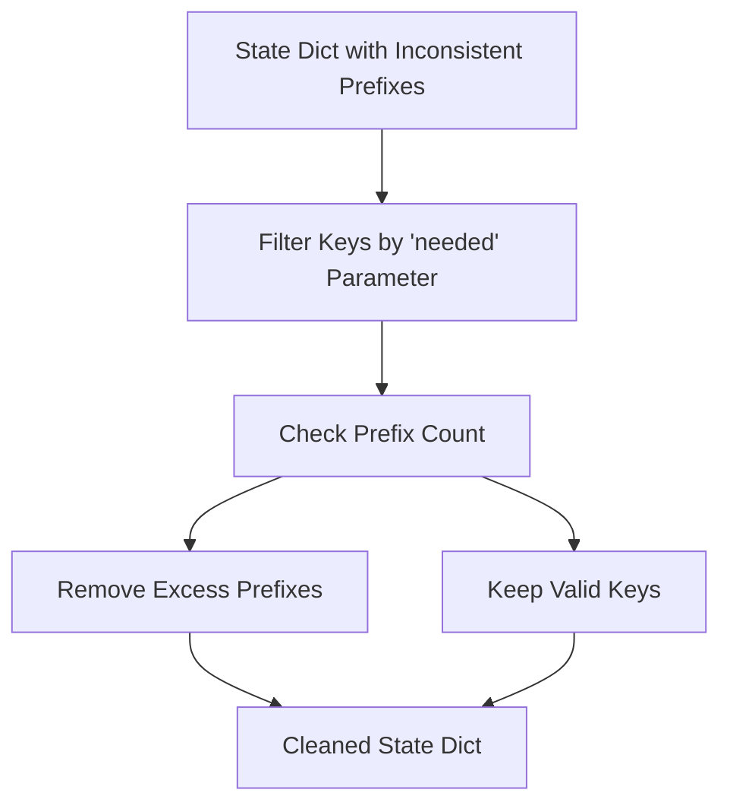

<!-- source: DeepWiki mcp.deepwiki.com · repo allenai/satlaspretrain_models · page 7 Reference · fetched 2026-10-26 -->

# Reference

Relevant source files

The following files were used as context for generating this wiki page:

- [LICENSE](LICENSE)
- [satlaspretrain_models/__init__.py](satlaspretrain_models/__init__.py)
- [satlaspretrain_models/utils.py](satlaspretrain_models/utils.py)

This page provides comprehensive reference information for the satlaspretrain_models library, including enumeration values, model catalog structure, and legal information. This serves as a quick lookup guide for developers integrating the library into their applications.

For detailed information about individual models and their specifications, see [Available Models Catalog](#7.1). For license terms and usage rights, see [License and Legal](#7.2).

## Quick Reference Tables

### Backbone Architecture Types

The library supports four backbone architectures defined in the `Backbone` enum:

| Enum Value | Architecture | Description |
|------------|-------------|-------------|
| `Backbone.SWINB` | Swin Transformer Base | Vision transformer with hierarchical feature maps |
| `Backbone.SWINT` | Swin Transformer Tiny | Smaller variant of Swin Transformer |
| `Backbone.RESNET50` | ResNet-50 | 50-layer residual convolutional network |
| `Backbone.RESNET152` | ResNet-152 | 152-layer residual convolutional network |

### Task Head Types

The library supports seven types of task-specific heads defined in the `Head` enum:

| Enum Value | Task Type | Purpose |
|------------|-----------|---------|
| `Head.CLASSIFY` | Single-label Classification | Assign one class label per image |
| `Head.MULTICLASSIFY` | Multi-label Classification | Assign multiple class labels per image |
| `Head.DETECT` | Object Detection | Locate and classify objects with bounding boxes |
| `Head.INSTANCE` | Instance Segmentation | Segment individual object instances |
| `Head.SEGMENT` | Semantic Segmentation | Pixel-level classification |
| `Head.BINSEGMENT` | Binary Segmentation | Two-class pixel-level classification |
| `Head.REGRESS` | Regression | Predict continuous values |

Sources: [satlaspretrain_models/utils.py:3-17]()

## Model Registry Architecture

The library uses a centralized registry system to manage pre-trained model configurations. The `SatlasPretrain_weights` dictionary serves as the authoritative source for all available models.

### Registry Structure Diagram

### Model Identifier Naming Convention

Model identifiers follow a systematic naming pattern that encodes key properties:

Sources: [satlaspretrain_models/utils.py:18-152]()

## Configuration Properties

Each model in the registry contains four essential configuration properties:

### URL Structure
All models are hosted on HuggingFace Hub with consistent URL patterns:
- Base URL: `https://huggingface.co/allenai/satlas-pretrain/resolve/main/`
- Filename pattern: `{satellite}_{architecture}_{mode}_{bands}.pth`
- Download parameter: `?download=true`

### Channel Specifications
The `num_channels` property defines input dimensionality:

| Satellite Type | Spectral Mode | Channels | Description |
|----------------|---------------|----------|-------------|
| Sentinel-2 | RGB | 3 | Red, Green, Blue |
| Sentinel-2 | MS | 9 | Multi-spectral bands |
| Sentinel-1 | - | 2 | VH, VV polarizations |
| Landsat | - | 11 | Full spectral range |
| Aerial | - | 3 | RGB imagery |

### Multi-Image Processing
The `multi_image` boolean flag indicates temporal processing capability:
- `False`: Single image processing
- `True`: Multi-temporal image sequence processing

Sources: [satlaspretrain_models/utils.py:20-151]()

## State Dictionary Processing

The library includes utility functions for handling pre-trained model weights:

### adjust_state_dict_prefix Function

This function addresses prefix mismatches between saved model weights and expected model structure, commonly occurring when loading backbone weights into complete models.

Sources: [satlaspretrain_models/utils.py:155-177]()

## Library Exports

The main library exports are defined in the package initialization:

| Export | Source Module | Type | Purpose |
|--------|---------------|------|---------|
| `Weights` | `model.py` | Class | Model weight management |
| `Model` | `model.py` | Class | Model construction |
| `Head` | `utils.py` | Enum | Task head types |
| `Backbone` | `utils.py` | Enum | Architecture types |

Sources: [satlaspretrain_models/__init__.py:1-3]()

## Legal Information Summary

The library is distributed under the Apache License, Version 2.0. Key points:

- **Usage Rights**: Commercial and non-commercial use permitted
- **Distribution**: Source and binary redistribution allowed with attribution
- **Modification**: Modifications permitted with change notices
- **Patent Grant**: Contributors grant patent rights for their contributions
- **Warranty Disclaimer**: Provided "AS IS" without warranties

For complete license text and legal terms, see [License and Legal](#7.2).

Sources: [LICENSE:1-202]()

---

