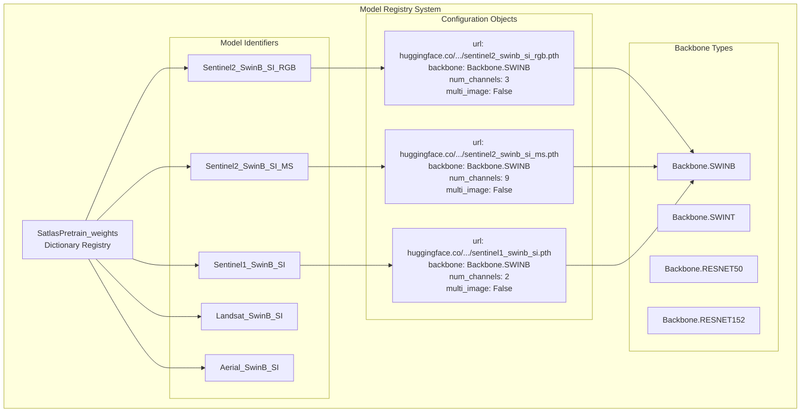
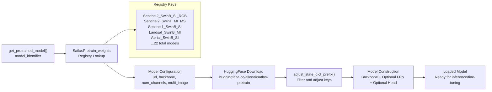
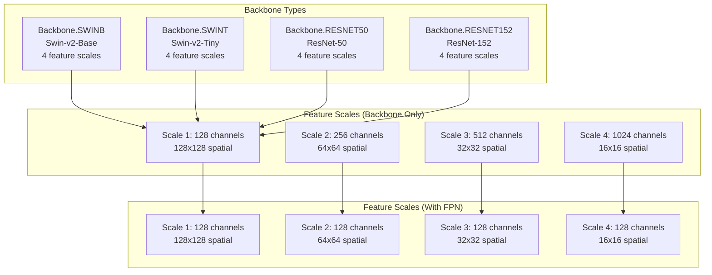

<!-- source: DeepWiki mcp.deepwiki.com · repo allenai/satlaspretrain_models · page 7.1 Available Models Catalog · fetched 2026-10-26 -->

# Available Models Catalog

<details>
<summary>Relevant source files</summary>

The following files were used as context for generating this wiki page:

- [README.md](README.md)
- [satlaspretrain_models/__init__.py](satlaspretrain_models/__init__.py)
- [satlaspretrain_models/utils.py](satlaspretrain_models/utils.py)

</details>


This page provides a comprehensive catalog of all 22 pre-trained models available in the satlaspretrain_models library. Each model is documented with its specifications, input requirements, and usage guidelines. For information about how to load these models, see [Weights Manager](#3.1). For examples of using these models in practice, see [Basic Usage Examples](#5.1).

## Model Registry System

The model catalog is managed through a centralized registry system that maps model identifiers to their configurations and download URLs.

### Registry Architecture



Sources: [satlaspretrain_models/utils.py:19-152](), [satlaspretrain_models/utils.py:3-8]()

### Model Loading Pipeline



Sources: [satlaspretrain_models/utils.py:155-177](), [README.md:28-32]()

## Complete Model Catalog

### Sentinel-2 Models

Sentinel-2 models support both RGB (3-band) and multi-spectral (9-band) inputs, with single-image and multi-image variants for each backbone architecture.

| Model Identifier | Backbone | Input Type | Image Mode | Channels | HuggingFace URL |
|------------------|----------|------------|------------|----------|-----------------|
| `Sentinel2_SwinB_SI_RGB` | Swin-v2-Base | RGB | Single-image | 3 | sentinel2_swinb_si_rgb.pth |
| `Sentinel2_SwinB_MI_RGB` | Swin-v2-Base | RGB | Multi-image | 3 | sentinel2_swinb_mi_rgb.pth |
| `Sentinel2_SwinB_SI_MS` | Swin-v2-Base | Multi-spectral | Single-image | 9 | sentinel2_swinb_si_ms.pth |
| `Sentinel2_SwinB_MI_MS` | Swin-v2-Base | Multi-spectral | Multi-image | 9 | sentinel2_swinb_mi_ms.pth |
| `Sentinel2_SwinT_SI_RGB` | Swin-v2-Tiny | RGB | Single-image | 3 | sentinel2_swint_si_rgb.pth |
| `Sentinel2_SwinT_MI_RGB` | Swin-v2-Tiny | RGB | Multi-image | 3 | sentinel2_swint_mi_rgb.pth |
| `Sentinel2_SwinT_SI_MS` | Swin-v2-Tiny | Multi-spectral | Single-image | 9 | sentinel2_swint_si_ms.pth |
| `Sentinel2_SwinT_MI_MS` | Swin-v2-Tiny | Multi-spectral | Multi-image | 9 | sentinel2_swint_mi_ms.pth |
| `Sentinel2_Resnet50_SI_RGB` | ResNet-50 | RGB | Single-image | 3 | sentinel2_resnet50_si_rgb.pth |
| `Sentinel2_Resnet50_MI_RGB` | ResNet-50 | RGB | Multi-image | 3 | sentinel2_resnet50_mi_rgb.pth |
| `Sentinel2_Resnet50_SI_MS` | ResNet-50 | Multi-spectral | Single-image | 9 | sentinel2_resnet50_si_ms.pth |
| `Sentinel2_Resnet50_MI_MS` | ResNet-50 | Multi-spectral | Multi-image | 9 | sentinel2_resnet50_mi_ms.pth |
| `Sentinel2_Resnet152_SI_RGB` | ResNet-152 | RGB | Single-image | 3 | sentinel2_resnet152_si_rgb.pth |
| `Sentinel2_Resnet152_MI_RGB` | ResNet-152 | RGB | Multi-image | 3 | sentinel2_resnet152_mi_rgb.pth |
| `Sentinel2_Resnet152_SI_MS` | ResNet-152 | Multi-spectral | Single-image | 9 | sentinel2_resnet152_si_ms.pth |
| `Sentinel2_Resnet152_MI_MS` | ResNet-152 | Multi-spectral | Multi-image | 9 | sentinel2_resnet152_mi_ms.pth |

**Input Specifications:**
- **RGB Models**: Use Sentinel-2 bands B4, B3, B2 only
- **Multi-spectral Models**: Use 9 Sentinel-2 bands
- **Normalization**: Divide 0-255 pixel values by 255 to get 0-1 range
- **Expected Input**: Sentinel-2 L1C TCI images

Sources: [README.md:53-66](), [satlaspretrain_models/utils.py:20-151]()

### Sentinel-1 Models

Sentinel-1 models process SAR data with VH and VV polarizations.

| Model Identifier | Backbone | Input Type | Image Mode | Channels | HuggingFace URL |
|------------------|----------|------------|------------|----------|-----------------|
| `Sentinel1_SwinB_SI` | Swin-v2-Base | VH+VV | Single-image | 2 | sentinel1_swinb_si.pth |
| `Sentinel1_SwinB_MI` | Swin-v2-Base | VH+VV | Multi-image | 2 | sentinel1_swinb_mi.pth |

**Input Specifications:**
- **Bands**: VH and VV polarizations (in that order)
- **Normalization**: Divide 16-bit values by 255, then clip to 0-1 range
- **Expected Input**: Sentinel-1 SAR imagery with dual polarization

Sources: [README.md:68-71](), [satlaspretrain_models/utils.py:44-55]()

### Landsat Models

Landsat models process all 11 bands from Landsat 8/9 sensors.

| Model Identifier | Backbone | Input Type | Image Mode | Channels | HuggingFace URL |
|------------------|----------|------------|------------|----------|-----------------|
| `Landsat_SwinB_SI` | Swin-v2-Base | All bands | Single-image | 11 | landsat_swinb_si.pth |
| `Landsat_SwinB_MI` | Swin-v2-Base | All bands | Multi-image | 11 | landsat_swinb_mi.pth |

**Input Specifications:**
- **Bands**: B1-B11 stacked in order
- **Normalization**: `(pixel_values - 4000) / 16320`, then clip to 0-1 range
- **Expected Input**: Landsat 8/9 16-bit imagery with all spectral bands

Sources: [README.md:73-76](), [satlaspretrain_models/utils.py:56-67]()

### Aerial Models

Aerial models handle high-resolution RGB imagery from various sources.

| Model Identifier | Backbone | Input Type | Image Mode | Channels | HuggingFace URL |
|------------------|----------|------------|------------|----------|-----------------|
| `Aerial_SwinB_SI` | Swin-v2-Base | RGB | Single-image | 3 | aerial_swinb_si.pth |
| `Aerial_SwinB_MI` | Swin-v2-Base | RGB | Multi-image | 3 | aerial_swinb_mi.pth |

**Input Specifications:**
- **Resolution**: 0.5-2 meters per pixel
- **Normalization**: Divide 0-255 pixel values by 255 to get 0-1 range
- **Expected Input**: High-resolution aerial RGB imagery (NAIP and similar sources)

Sources: [README.md:78-81](), [satlaspretrain_models/utils.py:68-79]()

## Model Architecture Specifications

### Backbone Architecture Support



Sources: [satlaspretrain_models/utils.py:3-7](), [README.md:111-115](), [README.md:127-130]()

### Multi-Image Processing

Multi-image models apply temporal max pooling across multiple aligned images of the same location:

| Processing Mode | Description | Training Images | Inference Flexibility |
|----------------|-------------|-----------------|----------------------|
| Single-image (SI) | Individual image processing | 1 image per sample | Fixed to 1 image |
| Multi-image (MI) | Temporal max pooling | 4-8 images per sample | Variable image count |

**Multi-image Architecture:**
1. Backbone applied to each image individually
2. Temporal max pooling across image dimension
3. Feature maps aggregated for downstream tasks

Sources: [README.md:23-24](), [README.md:84-85]()

## Model Selection Guide

### By Satellite Data Type

| Data Source | Recommended Models | Key Considerations |
|-------------|-------------------|-------------------|
| **Sentinel-2 RGB** | `Sentinel2_SwinB_SI_RGB` (baseline)<br/>`Sentinel2_SwinB_MI_RGB` (temporal) | Use RGB for standard vision tasks |
| **Sentinel-2 Multi-spectral** | `Sentinel2_SwinB_SI_MS` (baseline)<br/>`Sentinel2_SwinB_MI_MS` (temporal) | Use MS for spectral analysis tasks |
| **Sentinel-1 SAR** | `Sentinel1_SwinB_SI` (baseline)<br/>`Sentinel1_SwinB_MI` (temporal) | Only VH+VV polarization supported |
| **Landsat** | `Landsat_SwinB_SI` (baseline)<br/>`Landsat_SwinB_MI` (temporal) | Full 11-band spectral coverage |
| **Aerial Imagery** | `Aerial_SwinB_SI` (baseline)<br/>`Aerial_SwinB_MI` (temporal) | High-resolution RGB imagery |

### By Computational Requirements

| Model Size | Backbone | Parameters | Recommended Use Case |
|------------|----------|------------|---------------------|
| **Largest** | ResNet-152 | ~60M | Maximum accuracy, sufficient compute |
| **Large** | Swin-v2-Base | ~88M | Best balance of accuracy/efficiency |
| **Compact** | Swin-v2-Tiny | ~28M | Limited compute resources |
| **Medium** | ResNet-50 | ~25M | Familiar architecture, good baseline |

### By Task Requirements

| Task Type | Image Mode | FPN Recommendation | Head Options |
|-----------|------------|-------------------|--------------|
| **Classification** | Single-image | Optional | `Head.CLASSIFY`, `Head.MULTICLASSIFY` |
| **Object Detection** | Single/Multi-image | Required | `Head.DETECT` |
| **Segmentation** | Single-image | Required | `Head.SEGMENT`, `Head.BINSEGMENT` |
| **Instance Segmentation** | Single-image | Required | `Head.INSTANCE` |
| **Regression** | Single/Multi-image | Optional | `Head.REGRESS` |
| **Feature Extraction** | Either | Optional | No head |

Sources: [README.md:46-87](), [satlaspretrain_models/utils.py:9-16](), [README.md:144-150]()

## Usage Examples

### Loading Model Configurations

```python
# Access model registry
from satlaspretrain_models.utils import SatlasPretrain_weights

# Get model configuration
config = SatlasPretrain_weights['Sentinel2_SwinB_SI_RGB']
print(f"Backbone: {config['backbone']}")
print(f"Channels: {config['num_channels']}")
print(f"Multi-image: {config['multi_image']}")
```

### Model Identifier Patterns

All model identifiers follow the pattern: `{DataSource}_{Backbone}_{ImageMode}_{BandType}`

- **DataSource**: `Sentinel2`, `Sentinel1`, `Landsat`, `Aerial`
- **Backbone**: `SwinB`, `SwinT`, `Resnet50`, `Resnet152`
- **ImageMode**: `SI` (single-image), `MI` (multi-image)
- **BandType**: `RGB`, `MS` (multi-spectral), or omitted for default

Sources: [satlaspretrain_models/utils.py:19-152](), [README.md:99-100]()

---

