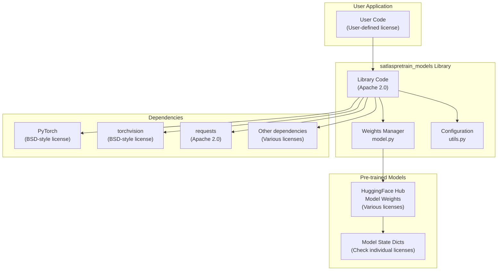
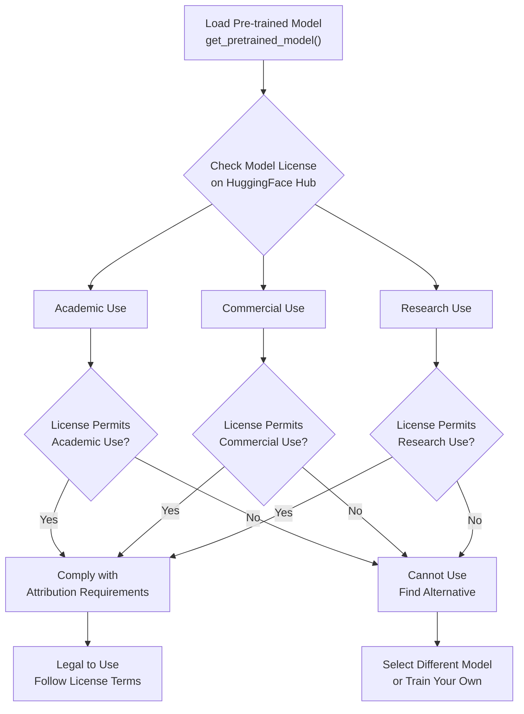

<!-- source: DeepWiki mcp.deepwiki.com · repo allenai/satlaspretrain_models · page 7.2 License and Legal · fetched 2026-10-26 -->

# License and Legal

Relevant source files

The following files were used as context for generating this wiki page:

- [LICENSE](LICENSE)

This section provides comprehensive information about the licensing terms, legal requirements, and compliance considerations for using the satlaspretrain_models library. It covers the library's source code license, pre-trained model licensing considerations, dependency licensing, and user obligations for legal compliance.

For information about available pre-trained models and their specifications, see [Available Models Catalog](#7.1).

## Library License

The satlaspretrain_models library is distributed under the Apache License, Version 2.0. This is a permissive open-source license that allows for both commercial and non-commercial use with minimal restrictions.

### Apache 2.0 License Terms

The Apache License 2.0 grants users the following permissions:

| Permission | Description |
|------------|-------------|
| **Use** | Use the software for any purpose |
| **Modify** | Make changes to the source code |
| **Distribute** | Share copies of the original or modified software |
| **Patent Grant** | Protection from patent claims by contributors |
| **Private Use** | Use in private/proprietary projects |
| **Commercial Use** | Use in commercial applications |

### License Requirements

When using or redistributing the library, users must:

- Include a copy of the Apache 2.0 license text
- Preserve copyright notices in source distributions  
- Clearly mark any modifications made to the original code
- Include attribution notices if a NOTICE file exists

Sources: [LICENSE:1-202]()

## Licensing Architecture

The satlaspretrain_models system involves multiple components with different licensing considerations:

This diagram illustrates the different licensing layers that apply when using the satlaspretrain_models library.

Sources: [LICENSE:1-202]()

## Pre-trained Model Licensing

### Model Weight Considerations

The pre-trained model weights hosted on HuggingFace Hub may have different licensing terms than the library code itself. Users must verify the licensing terms for each specific pre-trained model before use.

### Model Usage Compliance

Users must individually verify licensing terms for each pre-trained model accessed through the `get_pretrained_model()` function.

Sources: [satlaspretrain_models/model.py]()

## Dependency Licensing

The library has several dependencies, each with their own licensing terms:

### Core Dependencies

| Dependency | License Type | Implications |
|------------|--------------|--------------|
| `torch` | BSD-style | Permissive, allows commercial use |
| `torchvision` | BSD-style | Permissive, allows commercial use |
| `requests` | Apache 2.0 | Same as main library license |

### License Compatibility

All core dependencies use permissive licenses that are compatible with the Apache 2.0 license of the main library. This ensures that the combined work can be distributed under Apache 2.0 terms.

Sources: [setup.py]()

## Usage Guidelines and Compliance

### For Library Users

When using satlaspretrain_models in your projects:

1. **Include License**: Retain the Apache 2.0 license notice in your distributions
2. **Attribution**: Provide appropriate credit to the Allen Institute for AI
3. **Model Verification**: Check individual model licenses on HuggingFace Hub
4. **Modification Notice**: Mark any changes made to the library code

### For Redistributors

If redistributing the library or modified versions:

1. **License Inclusion**: Include complete Apache 2.0 license text
2. **Copyright Preservation**: Maintain all copyright notices
3. **Change Documentation**: Document any modifications clearly
4. **NOTICE File**: Include any NOTICE file from the original distribution

### Commercial Use Considerations

The Apache 2.0 license explicitly permits commercial use. However, users should:

- Verify that chosen pre-trained models allow commercial use
- Ensure compliance with any attribution requirements
- Consider any additional obligations from downstream dependencies

Sources: [LICENSE:66-71](), [LICENSE:89-128]()

## Legal Disclaimers

### Warranty Disclaimer

The library is provided "AS IS" without warranties of any kind. The Apache 2.0 license explicitly disclaims warranties including:

- MERCHANTABILITY
- FITNESS FOR A PARTICULAR PURPOSE  
- NON-INFRINGEMENT
- TITLE

### Limitation of Liability

Contributors to the library are not liable for damages resulting from use of the software, including but not limited to:

- Direct or indirect damages
- Commercial damages or losses
- Computer failure or malfunction
- Loss of goodwill or work stoppage

### User Responsibility

Users are solely responsible for:

- Determining appropriateness of use for their specific applications
- Assuming risks associated with exercising license permissions
- Ensuring compliance with all applicable laws and regulations
- Verifying licensing compatibility with their use cases

Sources: [LICENSE:143-174]()

## Compliance Checklist

Use this checklist to ensure legal compliance when using satlaspretrain_models:

- [ ] Included Apache 2.0 license text in distribution
- [ ] Preserved copyright notices from original source
- [ ] Verified licensing terms for each pre-trained model used
- [ ] Documented any modifications made to library code
- [ ] Provided appropriate attribution to Allen Institute for AI
- [ ] Checked compatibility with intended use case (academic/commercial/research)
- [ ] Reviewed dependency licenses for compatibility
- [ ] Understood warranty disclaimers and liability limitations

Sources: [LICENSE:1-202]()