# Page: Overview

# Overview

<details>
<summary>Relevant source files</summary>

The following files were used as context for generating this wiki page:

- [README.md](README.md)

</details>


## Purpose and Scope

The `satlaspretrain_models` library provides access to pre-trained foundation models for satellite and aerial imagery analysis. This library serves as a lightweight interface for loading SatlasPretrain models that have been pre-trained on large-scale remote sensing datasets and published at ICCV 2023.

The library supports four primary satellite/aerial imagery types: Sentinel-2, Sentinel-1, Landsat 8/9, and high-resolution aerial imagery (0.5-2m/pixel). Users can load models with different architectural components (backbone only, backbone+FPN, or full pipeline with task heads) for feature extraction, fine-tuning, or direct inference.

For detailed installation instructions, see [Installation Guide](#2.1). For practical usage examples, see [Quick Start Guide](#2.2) and [Examples and Tutorials](#5). For comprehensive model specifications, see [Available Models Catalog](#7.1).

## System Architecture

The SatlasPretrain model architecture follows a modular design with three main components that can be loaded independently or together:

### Core Model Pipeline

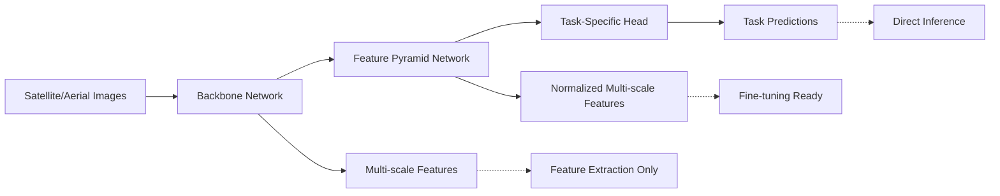

Sources: [README.md:19-34]()

### Code Entity Architecture

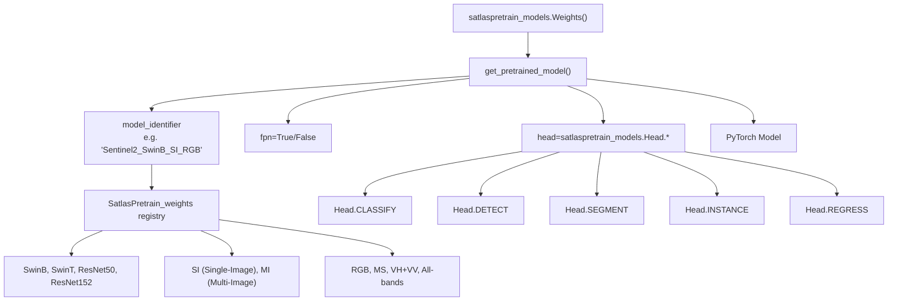

Sources: [README.md:91-96](), [README.md:139-150]()

## Key Components

### Backbone Networks

The library supports multiple backbone architectures optimized for satellite imagery:

| Architecture | Variants | Input Support |
|--------------|----------|---------------|
| Swin Transformer v2 | Base, Tiny | Single/Multi-image |
| ResNet | 50, 152 | Single/Multi-image |

Multi-image models apply temporal max pooling across aligned image captures of the same location, enabling robust predictions for static objects.

### Feature Pyramid Network (FPN)

The FPN component provides multi-scale feature aggregation with 128 channels per scale level. When enabled via `fpn=True`, it normalizes backbone outputs to consistent channel dimensions across all feature map scales.

### Task-Specific Heads

Available prediction heads for downstream tasks:

- `Head.CLASSIFY`: Classification with pooling + linear layers
- `Head.DETECT`: Faster R-CNN decoder for object detection  
- `Head.SEGMENT`: U-Net decoder with cross-entropy loss
- `Head.INSTANCE`: Mask R-CNN decoder for instance segmentation
- `Head.REGRESS`: U-Net decoder with L1 loss
- Multi-label classification variant

Sources: [README.md:144-150]()

## Available Model Catalog

The library provides 22+ pre-trained models across satellite imagery types:

### Sentinel-2 Models
- **Input Types**: RGB (3 bands: B4,B3,B2) or Multispectral (9 bands)
- **Architectures**: SwinB, SwinT, ResNet50, ResNet152
- **Modes**: Single-image (SI) and Multi-image (MI)
- **Example ID**: `"Sentinel2_SwinB_SI_RGB"`

### Sentinel-1 Models  
- **Input**: VH+VV bands (2 channels)
- **Architecture**: SwinB only
- **Example ID**: `"Sentinel1_SwinB_SI"`

### Landsat 8/9 Models
- **Input**: All bands B1-B11 (11 channels) 
- **Architecture**: SwinB only
- **Example ID**: `"Landsat_SwinB_MI"`

### Aerial Imagery Models
- **Input**: RGB high-resolution imagery (0.5-2m/pixel)
- **Architecture**: SwinB only  
- **Example ID**: `"Aerial_SwinB_SI"`

Sources: [README.md:46-86]()

## Usage Patterns

### Model Loading Interface

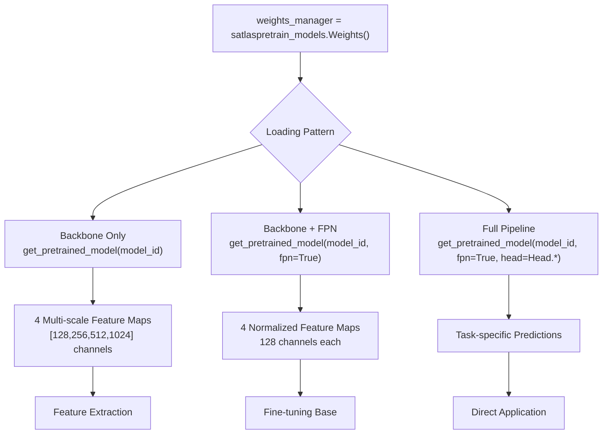

Sources: [README.md:102-193]()

### Integration Ecosystem

The library integrates with standard PyTorch workflows and specialized geospatial libraries:

- **PyTorch Native**: Standard `torch.nn.Module` interface
- **TorchGeo Integration**: Seamless dataset and training workflows  
- **HuggingFace Hub**: Automatic checkpoint downloading
- **Multi-framework Support**: Compatible with various computer vision frameworks

For TorchGeo-specific integration patterns, see [TorchGeo Integration](#2.3). For complete fine-tuning examples, see [Fine-tuning Tutorial](#5.2).

Sources: [README.md:1-15](), [README.md:196-202]()

---

# Page: Getting Started

# Getting Started

<details>
<summary>Relevant source files</summary>

The following files were used as context for generating this wiki page:

- [README.md](README.md)
- [setup.py](setup.py)

</details>


This document provides an overview of the `satlaspretrain_models` library and guides you through the essential concepts needed to begin using pre-trained satellite imagery models. For detailed installation instructions, see [Installation](#2.1). For step-by-step usage examples, see [Quick Start Guide](#2.2). For integration with geospatial datasets, see [TorchGeo Integration](#2.3).

## Purpose and Scope

The `satlaspretrain_models` library provides easy access to 22+ foundation models pre-trained on satellite and aerial imagery data. These models serve as feature extractors or starting points for fine-tuning on downstream remote sensing tasks. The library handles model downloading, weight loading, and architecture assembly, allowing you to focus on your specific application rather than model management infrastructure.

The library supports models trained on four types of imagery:
- **Sentinel-2**: Multispectral satellite imagery (RGB and 9-band)
- **Sentinel-1**: SAR imagery (VH+VV polarizations) 
- **Landsat 8/9**: 11-band multispectral imagery
- **Aerial**: High-resolution RGB imagery (0.5-2m/pixel)

## Core API Overview

The library centers around the `Weights` class and its `get_pretrained_model()` method. This design provides a clean interface for loading different model configurations while abstracting the complexity of weight management and architecture assembly.

### Primary API Components

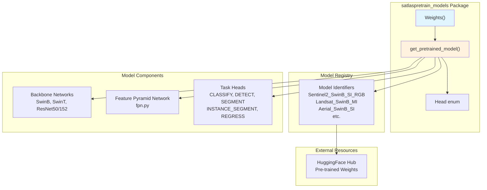

**Core API Workflow**

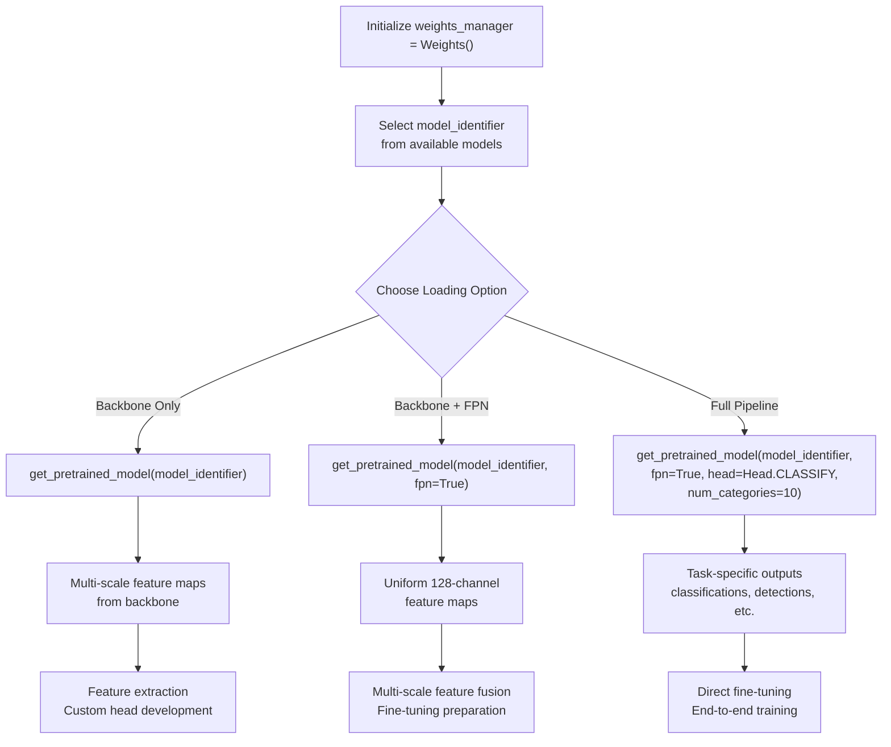

Sources: [README.md:28-32](), [README.md:91-97]()

## Model Architecture Structure

The library implements a modular three-component architecture that allows flexible model assembly. Each component serves a specific purpose in the feature extraction and prediction pipeline.

### Architecture Components

| Component | Purpose | Configurable | Parameters |
|-----------|---------|--------------|------------|
| **Backbone** | Feature extraction from raw imagery | ✓ | Pre-trained from SatlasPretrain |
| **FPN** | Multi-scale feature aggregation | ✓ | Pre-trained from SatlasPretrain |
| **Head** | Task-specific predictions | ✓ | Randomly initialized |

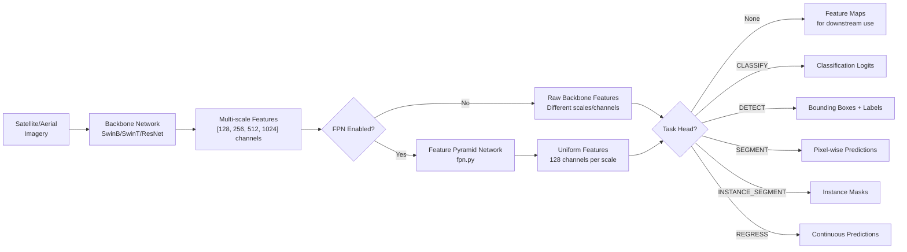

Sources: [README.md:17-26](), [README.md:144-151]()

## Available Model Types

The library provides models across different satellite data sources, each optimized for specific imagery characteristics and use cases. Models are identified by structured names that encode their specifications.

### Model Naming Convention

Model identifiers follow the pattern: `{DataSource}_{Architecture}_{ImageMode}_{Bands}`

- **DataSource**: `Sentinel2`, `Sentinel1`, `Landsat`, `Aerial`
- **Architecture**: `SwinB`, `SwinT`, `Resnet50`, `Resnet152`
- **ImageMode**: `SI` (single-image), `MI` (multi-image)
- **Bands**: `RGB`, `MS` (multispectral), or sensor-specific

### Model Categories Overview

| Data Source | Bands | Architectures | Single/Multi-Image | Total Models |
|-------------|-------|---------------|-------------------|--------------|
| **Sentinel-2** | RGB (3), MS (9) | SwinB, SwinT, ResNet50, ResNet152 | Both | 16 |
| **Sentinel-1** | VH+VV (2) | SwinB | Both | 2 |
| **Landsat** | All bands (11) | SwinB | Both | 2 |
| **Aerial** | RGB (3) | SwinB | Both | 2 |

**Multi-Image Processing**: Multi-image models apply temporal max pooling across multiple aligned images of the same location, enabling robust predictions for static objects while maintaining per-image backbone processing.

Sources: [README.md:46-86](), [README.md:84-86]()

## Getting Started Workflow

To begin using the library, follow this typical workflow:

1. **Install the package** - See [Installation](#2.1) for detailed setup instructions including Python version requirements and dependency management.

2. **Choose your model** - Select from 22+ available pre-trained models based on your imagery type and task requirements. See [Available Models Catalog](#7.1) for the complete model specifications.

3. **Load the model** - Use the `Weights` class and `get_pretrained_model()` method with appropriate configuration options. See [Quick Start Guide](#2.2) for step-by-step examples.

4. **Integrate with data** - Connect your model to satellite imagery datasets, particularly using TorchGeo integration. See [TorchGeo Integration](#2.3) for geospatial workflow examples.

5. **Fine-tune or extract features** - Either use the pre-trained features directly or fine-tune on your downstream task. See [Examples and Tutorials](#5) for complete implementation guides.

The library is designed to minimize setup complexity while providing maximum flexibility for different use cases, from simple feature extraction to full end-to-end model training.

Sources: [README.md:38-44](), [README.md:195-202]()

---

# Page: Installation

# Installation

<details>
<summary>Relevant source files</summary>

The following files were used as context for generating this wiki page:

- [MANIFEST.in](MANIFEST.in)
- [setup.py](setup.py)

</details>


This document provides comprehensive installation instructions for the `satlaspretrain_models` library, including system requirements, dependency management, and installation verification procedures. For basic usage examples after installation, see [Quick Start Guide](#2.2). For development environment setup, see [Development Setup](#6.2).

## System Requirements

The `satlaspretrain_models` library requires specific system configurations to ensure proper functionality with satellite imagery processing and deep learning model operations.

### Python Version Requirements

The library requires Python 3.9 or higher as specified in [setup.py:18](). This minimum version ensures compatibility with modern PyTorch features and type hinting used throughout the codebase.

### Hardware Considerations

| Component | Minimum | Recommended |
|-----------|---------|-------------|
| RAM | 8 GB | 16+ GB |
| Storage | 2 GB free | 10+ GB free |
| GPU | Optional | CUDA-compatible GPU |
| CPU | Multi-core | 8+ cores |

**Sources:** [setup.py:18-24]()

## Installation Methods

### Standard Installation via PyPI

The primary installation method uses the Python Package Index (PyPI) distribution:

```bash
pip install satlaspretrain_models
```

This installs the package along with all required dependencies as defined in the `install_requires` section of [setup.py:19-24]().

### Installation Flow Diagram

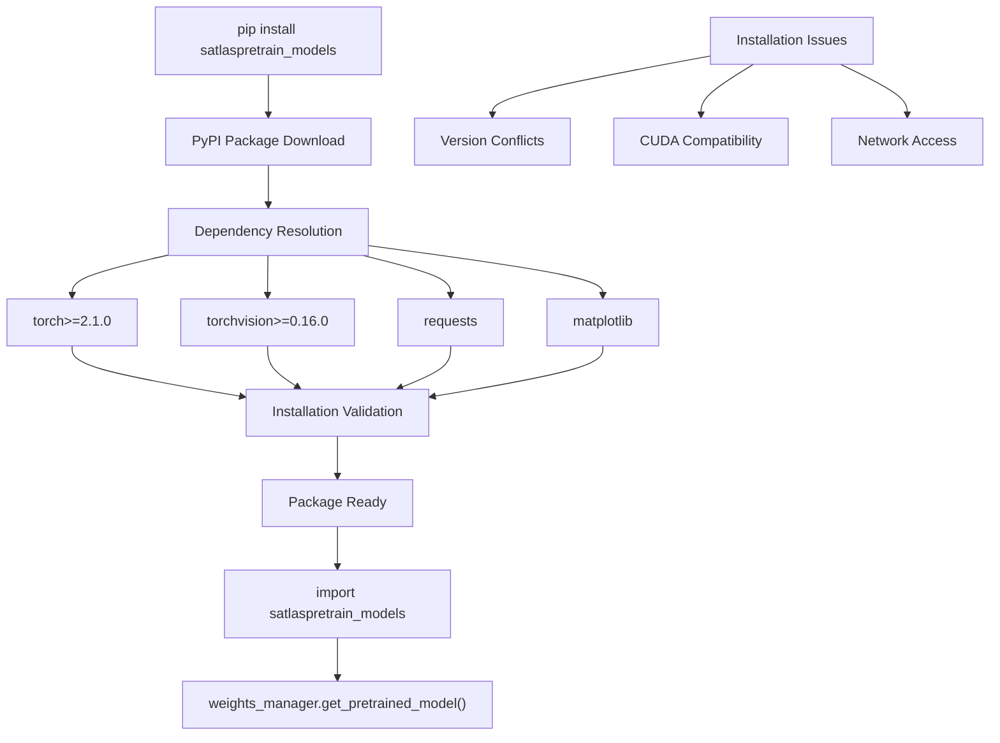

**Sources:** [setup.py:19-24]()

## Dependency Analysis

The library maintains a minimal dependency footprint while ensuring compatibility with the PyTorch ecosystem and remote model loading capabilities.

### Core Dependencies

#### PyTorch Framework Dependencies
- **torch>=2.1.0**: Core tensor operations and neural network functionality
- **torchvision>=0.16.0**: Computer vision utilities and pre-trained model components

#### Utility Dependencies  
- **requests**: HTTP client for downloading model weights from HuggingFace Hub
- **matplotlib**: Visualization support for demos and examples

### Dependency Architecture

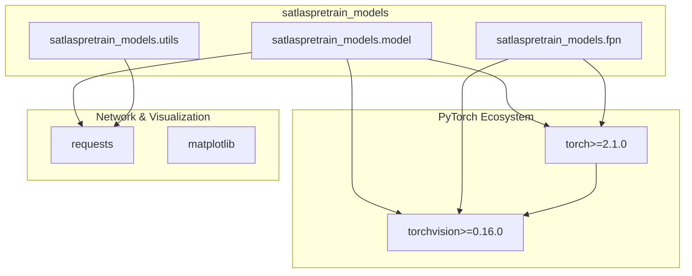

**Sources:** [setup.py:19-24]()

## Installation Verification

### Basic Import Test

Verify successful installation by importing the main module:

```python
import satlaspretrain_models
from satlaspretrain_models import get_pretrained_model
```

### Functional Verification

Test core functionality by loading a lightweight model:

```python
# Verify model loading capability
model = get_pretrained_model(
    model_identifier="Sentinel2_RGB_SwinB_SI_MS", 
    load_backbone=True
)
print(f"Model loaded successfully: {type(model)}")
```

### Version Information

Check installed version and dependencies:

```python
import satlaspretrain_models
import torch
import torchvision

print(f"satlaspretrain_models version: {satlaspretrain_models.__version__}")
print(f"PyTorch version: {torch.__version__}")
print(f"TorchVision version: {torchvision.__version__}")
```

**Sources:** [setup.py:5]()

## Package Metadata and Distribution

The package configuration defines key metadata for proper distribution and dependency management:

| Attribute | Value |
|-----------|-------|
| Package Name | `satlaspretrain_models` |
| Current Version | `0.3.1` |
| License | Apache Software License |
| Author | Satlas @ AI2 |
| Repository | https://github.com/allenai/satlaspretrain_models |

### Package Structure

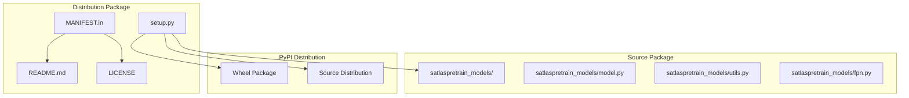

**Sources:** [setup.py:1-25](), [MANIFEST.in:1-3]()

## Troubleshooting Common Issues

### PyTorch Version Conflicts

If encountering PyTorch version incompatibilities:

```bash
# Upgrade PyTorch to minimum required version
pip install --upgrade torch>=2.1.0 torchvision>=0.16.0
```

### CUDA Compatibility Issues

For GPU support, ensure CUDA toolkit compatibility:

```bash
# Check CUDA availability
python -c "import torch; print(torch.cuda.is_available())"
```

### Network Access for Model Downloads

The library requires internet access to download pre-trained weights from HuggingFace Hub. Ensure network connectivity and firewall permissions for HTTPS requests.

### Dependency Resolution Conflicts

For complex environments with existing package conflicts:

```bash
# Install in isolated environment
python -m venv satlas_env
source satlas_env/bin/activate  # On Windows: satlas_env\Scripts\activate
pip install satlaspretrain_models
```

**Sources:** [setup.py:19-24]()

---

# Page: Quick Start Guide

# Quick Start Guide

<details>
<summary>Relevant source files</summary>

The following files were used as context for generating this wiki page:

- [README.md](README.md)
- [demo.ipynb](demo.ipynb)

</details>


This guide provides essential examples for loading pre-trained satellite imagery models and performing basic inference. It covers the core workflow from initialization to model output, demonstrating the most common usage patterns.

For detailed installation instructions, see [Installation](#2.1). For integration with geospatial datasets, see [TorchGeo Integration](#2.3). For comprehensive usage examples and tutorials, see [Basic Usage Examples](#5.1) and [Fine-tuning Tutorial](#5.2).

## Basic Workflow

The typical workflow involves three steps: initializing the weights manager, selecting a model identifier, and loading the model with desired components.

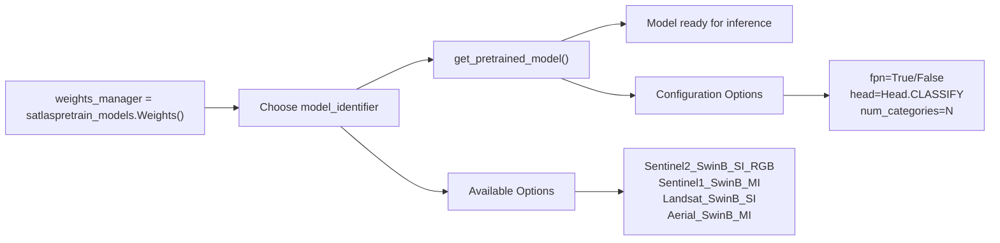

Sources: [README.md:91-97](), [README.md:28-32]()

## Essential Concepts

### Model Architecture Components

The library supports loading models with different component combinations:

| Component | Purpose | When to Use |
|-----------|---------|-------------|
| **Backbone Only** | Feature extraction | Transfer learning, custom heads |
| **Backbone + FPN** | Multi-scale features | Object detection, segmentation |
| **Backbone + FPN + Head** | End-to-end models | Fine-tuning, quick prototyping |

### Image Processing Types

| Type | Description | Input Format |
|------|-------------|--------------|
| **Single-image (SI)** | Processes individual images | `(batch, channels, height, width)` |
| **Multi-image (MI)** | Temporal max pooling across images | `(batch, num_images, channels, height, width)` |

Sources: [README.md:19-26](), [README.md:84-87]()

## Core API Usage

### Initialize Weights Manager

```python
import satlaspretrain_models
import torch

weights_manager = satlaspretrain_models.Weights()
```

### Load Backbone Only

```python
model = weights_manager.get_pretrained_model("Sentinel2_SwinB_SI_RGB")

# Input: Sentinel-2 RGB image (0-1 normalized)
tensor = torch.zeros((1, 3, 512, 512), dtype=torch.float32)
output = model(tensor)

# Output: Multi-scale feature maps from Swin-v2-Base
# [torch.Size([1, 128, 128, 128]), torch.Size([1, 256, 64, 64]), 
#  torch.Size([1, 512, 32, 32]), torch.Size([1, 1024, 16, 16])]
```

### Load Backbone + FPN

```python
model = weights_manager.get_pretrained_model("Sentinel1_SwinB_SI", fpn=True)

# Input: Sentinel-1 VH+VV channels (0-1 normalized, clipped)
tensor = torch.zeros((1, 2, 512, 512), dtype=torch.float32)
output = model(tensor)

# Output: Uniform 128-channel feature maps at multiple scales
# [torch.Size([1, 128, 128, 128]), torch.Size([1, 128, 64, 64]),
#  torch.Size([1, 128, 32, 32]), torch.Size([1, 128, 16, 16])]
```

Sources: [README.md:102-115](), [README.md:117-130]()

## Model Loading Patterns

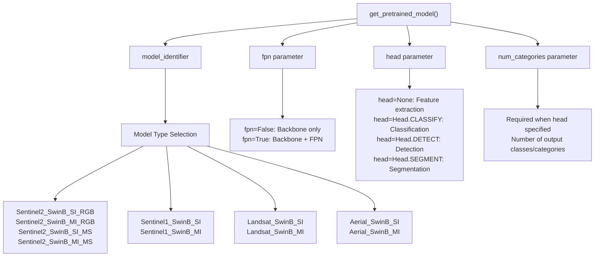

Sources: [README.md:139-142](), [README.md:144-151]()

## Common Use Cases

### Feature Extraction for Transfer Learning

```python
# Load backbone for feature extraction
model = weights_manager.get_pretrained_model("Sentinel2_SwinB_SI_RGB")

# Extract features at multiple scales
features = model(input_tensor)
# Use features as input to custom downstream models
```

### Multi-Image Processing

```python
# Multi-image aerial model with classification head
model = weights_manager.get_pretrained_model(
    "Aerial_SwinB_MI", 
    fpn=True, 
    head=satlaspretrain_models.Head.CLASSIFY, 
    num_categories=2
)

# Input: 4 RGB images stacked (reshape for model input)
tensor = torch.zeros((1, 4, 3, 512, 512), dtype=torch.float32)
output = model(tensor.reshape(1, 4*3, 512, 512))
# Output: Classification probabilities [batch_size, num_categories]
```

### Object Detection Setup

```python
# Landsat model with detection head
model = weights_manager.get_pretrained_model(
    "Landsat_SwinB_MI", 
    fpn=True, 
    head=satlaspretrain_models.Head.DETECT, 
    num_categories=5
)

# Input: 8 Landsat images with 11 bands each
tensor = torch.zeros((1, 8, 11, 512, 512), dtype=torch.float32)
output = model(tensor.reshape(1, 8*11, 512, 512))
# Output: List of detection dictionaries with 'boxes', 'labels', 'scores'
```

Sources: [README.md:152-170](), [README.md:172-193]()

## Model Configuration Reference

### Available Heads

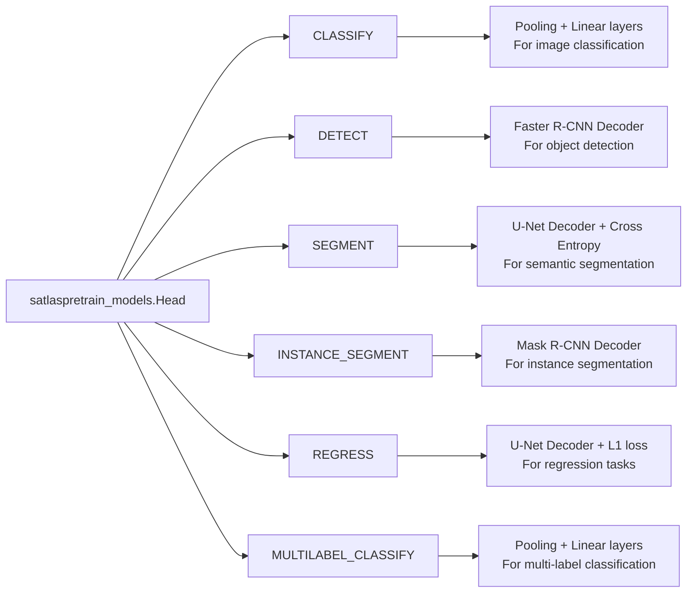

### Input Normalization Requirements

| Model Type | Input Format | Normalization |
|------------|--------------|---------------|
| **Sentinel-2 RGB** | B4, B3, B2 bands | Divide by 255 (0-1) |
| **Sentinel-2 MS** | 9 bands | Divide by 255 (0-1) |
| **Sentinel-1** | VH, VV bands | Divide by 255, clip to 0-1 |
| **Landsat** | B1-B11 bands | `(pixel_value - 4000) / 16320`, clip to 0-1 |
| **Aerial** | RGB bands | Divide by 255 (0-1) |

Sources: [README.md:144-151](), [README.md:86-87](), [README.md:106-109](), [README.md:121-124](), [README.md:158-161](), [README.md:180-183]()

---

# Page: TorchGeo Integration

# TorchGeo Integration

<details>
<summary>Relevant source files</summary>

The following files were used as context for generating this wiki page:

- [torchgeo_demo.ipynb](torchgeo_demo.ipynb)

</details>


This document explains how to use satlaspretrain_models with the TorchGeo ecosystem for geospatial deep learning workflows. TorchGeo provides a comprehensive framework for working with geospatial datasets, and the satlaspretrain models are integrated as first-class citizens in TorchGeo's model registry.

For basic model loading without TorchGeo, see [Quick Start Guide](#2.2). For detailed information about available models and configurations, see [Model Configuration](#3.2).

## Integration Overview

The satlaspretrain_models are accessible through TorchGeo's standardized model interface, enabling seamless integration with TorchGeo's data modules, trainers, and PyTorch Lightning workflows. This integration allows users to leverage both the pre-trained satellite imagery models and TorchGeo's extensive geospatial dataset ecosystem.

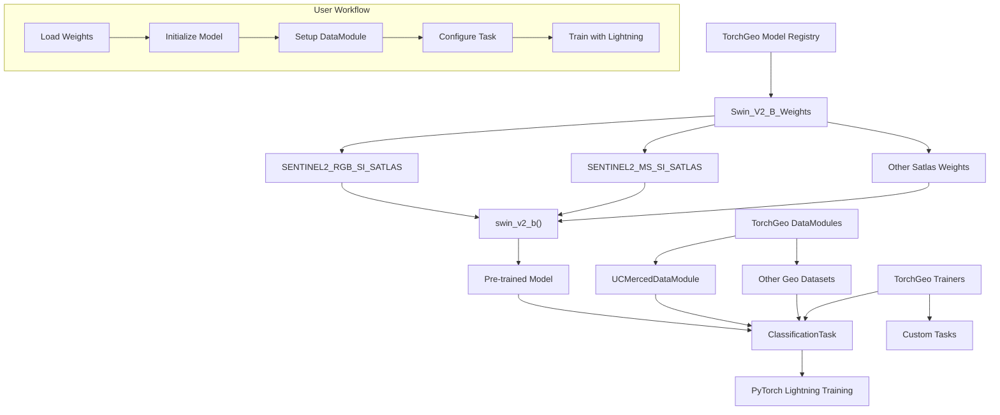

Sources: [torchgeo_demo.ipynb:42-44]()

## Model Loading Through TorchGeo

TorchGeo provides a standardized weights enumeration system that includes Satlas pre-trained models. Models are loaded using TorchGeo's model functions with specific weight configurations.

### Available Weight Configurations

| Weight Enum | Data Source | Channels | Model Type |
|-------------|-------------|----------|------------|
| `SENTINEL2_RGB_SI_SATLAS` | Sentinel-2 RGB | 3 | Single Image |
| `SENTINEL2_MS_SI_SATLAS` | Sentinel-2 Multispectral | 10+ | Single Image |
| Additional Satlas weights | Various satellite sources | Variable | Single/Multi Image |

### Loading Models

```python
from torchgeo.models import Swin_V2_B_Weights, swin_v2_b

# Load pre-trained weights
weights = Swin_V2_B_Weights.SENTINEL2_RGB_SI_SATLAS
model = swin_v2_b(weights)
```

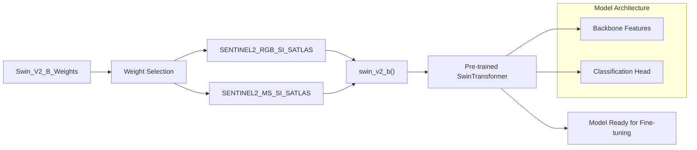

Sources: [torchgeo_demo.ipynb:85-86]()

## Custom Task Implementation

TorchGeo's training framework uses PyTorch Lightning tasks that can be customized to work with Satlas models. The key integration points are model configuration and architecture adaptation.

### SatlasClassificationTask Example

The integration requires extending TorchGeo's base task classes and implementing custom model configuration:

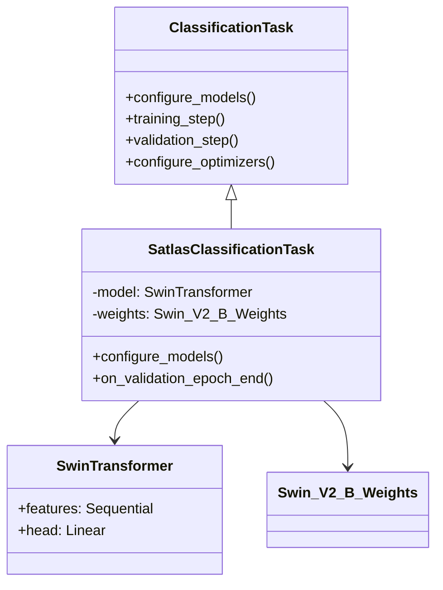

### Model Configuration Process

The custom task handles model initialization and architecture adaptation:

1. **Weight Loading**: Uses TorchGeo's weight enumeration system
2. **Architecture Adaptation**: Modifies input/output layers for task-specific requirements
3. **Head Replacement**: Replaces classification head for target number of classes

Key implementation details from the demo:

- Input channel adaptation: [torchgeo_demo.ipynb:89-95]()
- Output layer replacement: [torchgeo_demo.ipynb:98]()
- Model loading through TorchGeo: [torchgeo_demo.ipynb:85-86]()

Sources: [torchgeo_demo.ipynb:83-111]()

## Data Integration Workflow

TorchGeo provides standardized data modules that work seamlessly with Satlas models through the Lightning framework.

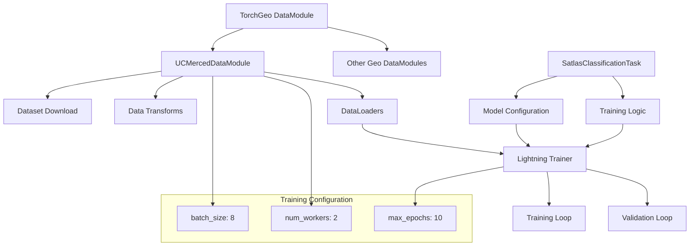

### DataModule Setup

The integration uses TorchGeo's data modules with standard PyTorch Lightning configuration:

- Dataset initialization: [torchgeo_demo.ipynb:69-72]()
- Training parameters: [torchgeo_demo.ipynb:54-58]()
- Trainer configuration: [torchgeo_demo.ipynb:146-153]()

Sources: [torchgeo_demo.ipynb:68-73](), [torchgeo_demo.ipynb:146-153]()

## Complete Training Pipeline

The full integration combines TorchGeo's data handling, model loading, and Lightning training infrastructure.

### Training Setup Flow

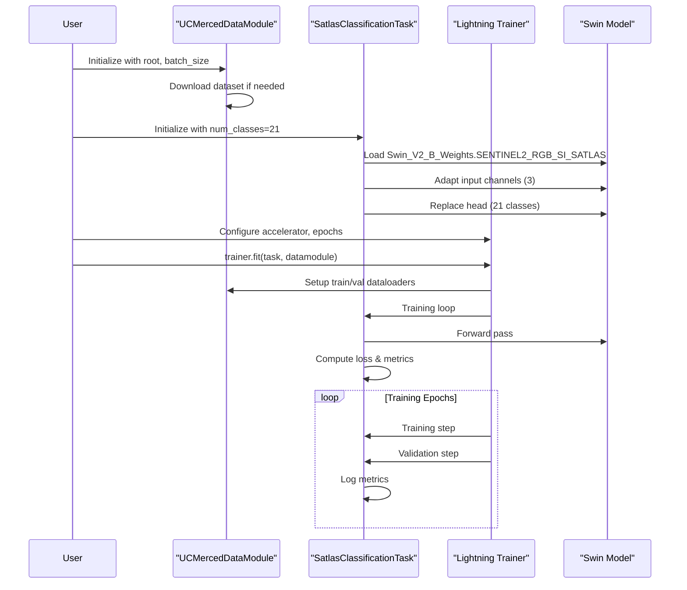

### Environment Setup

The TorchGeo integration requires specific dependencies and setup:

```bash
# Create environment
conda create --name torchgeodemo python=3.12
conda activate torchgeodemo

# Install TorchGeo (development version for Satlas support)
pip install git+https://github.com/microsoft/torchgeo
```

### Key Integration Components

| Component | Purpose | Configuration |
|-----------|---------|---------------|
| `UCMercedDataModule` | Dataset handling | Root directory, batch size, workers |
| `SatlasClassificationTask` | Training logic | Number of classes, model weights |
| `Lightning Trainer` | Training orchestration | Accelerator, epochs, logging |
| `Swin_V2_B_Weights` | Model weights | Satellite data source, architecture |

Sources: [torchgeo_demo.ipynb:13-17](), [torchgeo_demo.ipynb:121](), [torchgeo_demo.ipynb:213]()

## Validation and Monitoring

The integration includes built-in validation monitoring through TorchGeo's metric collection system:

- Validation metrics: Loss and accuracy tracking
- Epoch-level reporting: [torchgeo_demo.ipynb:100-110]()
- Lightning callback integration for metrics access

The training process automatically handles validation loops and metric computation through TorchGeo's standardized trainer interface.

Sources: [torchgeo_demo.ipynb:100-110](), [torchgeo_demo.ipynb:212-214]()

---

# Page: Core API Reference

# Core API Reference

<details>
<summary>Relevant source files</summary>

The following files were used as context for generating this wiki page:

- [satlaspretrain_models/__init__.py](satlaspretrain_models/__init__.py)
- [satlaspretrain_models/model.py](satlaspretrain_models/model.py)
- [satlaspretrain_models/utils.py](satlaspretrain_models/utils.py)

</details>


This page documents the primary classes and functions that form the core API of the satlaspretrain_models library. This includes the main entry points for loading pre-trained models, configuring model architectures, and managing model components.

For detailed documentation of the weights management system, see [Weights Manager](#3.1). For comprehensive information about available models and configuration options, see [Model Configuration](#3.2).

## API Overview

The core API consists of two primary classes that work together to provide model loading and configuration capabilities:

| Class | Purpose | Primary Methods |
|-------|---------|----------------|
| `Weights` | Manages downloading and loading pre-trained models | `get_pretrained_model()` |
| `Model` | Represents the actual model architecture | `forward()`, `_initialize_backbone()`, `_initialize_fpn()`, `_initialize_head()` |

## Core Components Architecture

**Core API Class Relationships**
```mermaid
classDiagram
    class Weights {
        +get_pretrained_model(model_identifier, fpn, head, num_categories, device) Model
    }
    
    class Model {
        +backbone
        +fpn
        +head
        +forward(imgs, targets)
        +_initialize_backbone(num_channels, backbone_arch, multi_image, weights)
        +_initialize_fpn(backbone_channels, weights)
        +_initialize_head(head, backbone_channels, num_categories)
    }
    
    class Backbone {
        <<enumeration>>
        SWINB
        SWINT
        RESNET50
        RESNET152
    }
    
    class Head {
        <<enumeration>>
        CLASSIFY
        MULTICLASSIFY
        DETECT
        INSTANCE
        SEGMENT
        BINSEGMENT
        REGRESS
    }
    
    class SatlasPretrain_weights {
        <<dictionary>>
        +22_model_configurations
    }
    
    Weights --> Model : creates
    Model --> Backbone : uses
    Model --> Head : uses
    Weights --> SatlasPretrain_weights : queries
    Model --> "adjust_state_dict_prefix()" : calls
```

Sources: [satlaspretrain_models/model.py:9-54](), [satlaspretrain_models/model.py:56-95](), [satlaspretrain_models/utils.py:3-17](), [satlaspretrain_models/utils.py:19-152]()

## Model Loading Flow

**get_pretrained_model() Execution Flow**
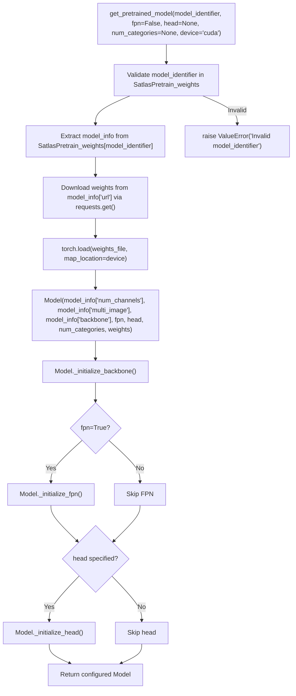

Sources: [satlaspretrain_models/model.py:16-53](), [satlaspretrain_models/model.py:56-95]()

## Primary Method Signatures

### Weights Class

The `Weights` class provides the main entry point for loading pre-trained models:

```python
class Weights:
    def get_pretrained_model(self, model_identifier, fpn=False, head=None, num_categories=None, device='cuda')
```

**Parameters:**
- `model_identifier` (str): Key from `SatlasPretrain_weights` dictionary
- `fpn` (bool): Whether to include pre-trained Feature Pyramid Network
- `head` (Head enum): Type of task-specific head to attach
- `num_categories` (int): Number of output categories for the head
- `device` (str): Target device ('cuda' or 'cpu')

**Returns:** Configured `Model` instance with loaded weights

Sources: [satlaspretrain_models/model.py:16-27]()

### Model Class

The `Model` class represents the actual neural network architecture:

```python
class Model(torch.nn.Module):
    def __init__(self, num_channels=3, multi_image=False, backbone=Backbone.SWINB, 
                 fpn=False, head=None, num_categories=None, weights=None)
    
    def forward(self, imgs, targets=None)
```

**Constructor Parameters:**
- `num_channels` (int): Input channel count
- `multi_image` (bool): Whether model expects multi-image input
- `backbone` (Backbone enum): Architecture type
- `fpn` (bool): Include Feature Pyramid Network
- `head` (Head enum): Task-specific head type
- `num_categories` (int): Output category count
- `weights` (dict): Pre-trained weights to load

**Forward Method:**
- `imgs` (torch.Tensor): Input image tensor
- `targets` (optional): Ground truth targets for training
- **Returns:** Feature maps or (predictions, loss) tuple

Sources: [satlaspretrain_models/model.py:57-72](), [satlaspretrain_models/model.py:153-162]()

## Configuration Enumerations

### Backbone Types

The `Backbone` enum defines available architecture options:

| Value | Description |
|-------|-------------|
| `Backbone.SWINB` | Swin Transformer Base |
| `Backbone.SWINT` | Swin Transformer Tiny |
| `Backbone.RESNET50` | ResNet-50 |
| `Backbone.RESNET152` | ResNet-152 |

### Head Types

The `Head` enum defines available task-specific heads:

| Value | Task Type |
|-------|-----------|
| `Head.CLASSIFY` | Single-label classification |
| `Head.MULTICLASSIFY` | Multi-label classification |
| `Head.DETECT` | Object detection (Faster R-CNN) |
| `Head.INSTANCE` | Instance segmentation (Mask R-CNN) |
| `Head.SEGMENT` | Semantic segmentation |
| `Head.BINSEGMENT` | Binary segmentation |
| `Head.REGRESS` | Regression |

Sources: [satlaspretrain_models/utils.py:3-16]()

## Error Handling

The API implements several validation checks:

- **Invalid model identifier:** Raises `ValueError` if `model_identifier` not in `SatlasPretrain_weights`
- **Missing num_categories:** Raises `ValueError` if `head` specified without `num_categories`
- **Invalid backbone/head types:** Raises `ValueError` for non-enum values
- **Download failures:** Raises `Exception` for HTTP request failures

Sources: [satlaspretrain_models/model.py:28-33](), [satlaspretrain_models/model.py:75-81](), [satlaspretrain_models/model.py:42-43]()

## Utility Functions

### adjust_state_dict_prefix()

Processes state dictionaries to match expected model component prefixes:

```python
def adjust_state_dict_prefix(state_dict, needed, prefix=None, prefix_allowed_count=None)
```

This function filters state dictionary keys and adjusts prefixes to match the target model component's expected naming convention.

Sources: [satlaspretrain_models/utils.py:155-177]()

## Import Structure

The core API components are exposed through the main package import:

```python
from satlaspretrain_models import Weights, Model, Head, Backbone
```

Sources: [satlaspretrain_models/__init__.py:1-2]()

---

# Page: Weights Manager

# Weights Manager

<details>
<summary>Relevant source files</summary>

The following files were used as context for generating this wiki page:

- [satlaspretrain_models/model.py](satlaspretrain_models/model.py)

</details>


The Weights Manager provides the primary interface for loading pre-trained SatlasPretrain models from HuggingFace Hub. It handles model validation, weight downloading, and model construction with configurable components including backbones, Feature Pyramid Networks (FPN), and task-specific heads.

This page covers the `Weights` class and its integration with the `Model` class for constructing complete neural network architectures. For information about available model configurations, see [Model Configuration](#3.2). For details about individual model components, see [Model Architecture](#4).

## Weights Class Overview

The `Weights` class serves as the main entry point for accessing pre-trained models. It provides a single public method `get_pretrained_model()` that orchestrates the entire model loading process.

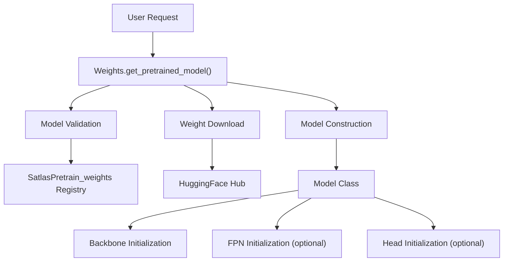

**Weights Manager Workflow**

The class constructor [satlaspretrain_models/model.py:10-14]() is minimal, with all functionality contained in the `get_pretrained_model()` method.

Sources: [satlaspretrain_models/model.py:9-14]()

## Model Loading Process

The `get_pretrained_model()` method implements a multi-step process for constructing pre-trained models:

```mermaid
flowchart TD
    Start["get_pretrained_model()"] --> Validate["Validate model_identifier"]
    Validate --> Check["Check SatlasPretrain_weights registry"]
    Check --> GetInfo["Extract model_info"]
    
    GetInfo --> Download["Download weights from HuggingFace"]
    Download --> LoadWeights["torch.load() weights"]
    
    LoadWeights --> Construct["Model() construction"]
    Construct --> Return["Return initialized model"]
    
    subgraph "Model Construction"
        Construct --> InitBB["Initialize backbone"]
        InitBB --> InitFPN["Initialize FPN (if requested)"]
        InitFPN --> InitHead["Initialize head (if requested)"]
    end
    
    subgraph "Validation Checks"
        Validate --> CheckID["model_identifier in registry?"]
        Validate --> CheckHead["head requires num_categories?"]
    end
```

**Model Loading Pipeline**

### Key Parameters

| Parameter | Type | Required | Description |
|-----------|------|----------|-------------|
| `model_identifier` | str | Yes | Key from `SatlasPretrain_weights` registry |
| `fpn` | bool | No | Whether to include pre-trained FPN |
| `head` | Head enum | No | Task-specific head type |
| `num_categories` | int | Conditional | Required when `head` is specified |
| `device` | str | No | Target device ('cuda' or 'cpu') |

The method performs validation at [satlaspretrain_models/model.py:28-33]() to ensure the model identifier exists and required parameters are provided.

Sources: [satlaspretrain_models/model.py:16-53]()

## Weight Download and Loading

The system downloads pre-trained weights directly from HuggingFace Hub using HTTP requests:

```mermaid
sequenceDiagram
    participant WM as "Weights Manager"
    participant HF as "HuggingFace Hub" 
    participant Torch as "PyTorch"
    participant Model as "Model Class"
    
    WM->>HF: requests.get(weights_url)
    HF-->>WM: Binary weight data
    WM->>Torch: torch.load(weights_file)
    Torch-->>WM: State dictionary
    WM->>Model: Model(weights=state_dict)
    Model-->>WM: Initialized model
```

**Weight Download Sequence**

The download process [satlaspretrain_models/model.py:37-48]() uses the URL from the model registry and handles device placement for CPU or GPU loading. Error handling ensures failed downloads raise appropriate exceptions.

Sources: [satlaspretrain_models/model.py:37-48]()

## Model Class Integration

The `Weights` class delegates model construction to the `Model` class, passing the downloaded weights and configuration parameters:

```mermaid
graph LR
    subgraph "Weights Class"
        GPM["get_pretrained_model()"] --> ModelCall["Model() instantiation"]
    end
    
    subgraph "Model Class"
        ModelCall --> Init["__init__()"]
        Init --> IBB["_initialize_backbone()"]
        Init --> IFPN["_initialize_fpn()"]
        Init --> IH["_initialize_head()"]
    end
    
    subgraph "Weight Loading"
        IBB --> LoadBB["Load backbone weights"]
        IFPN --> LoadFPN["Load FPN weights"]
        IH --> RandomInit["Random head initialization"]
    end
```

**Model Construction Architecture**

The `Model` class constructor [satlaspretrain_models/model.py:57-95]() accepts the same parameters as `get_pretrained_model()` plus additional low-level configuration options.

### Component Initialization

Each model component is initialized through dedicated methods:

- **Backbone**: `_initialize_backbone()` [satlaspretrain_models/model.py:96-124]() supports Swin Transformer and ResNet architectures
- **FPN**: `_initialize_fpn()` [satlaspretrain_models/model.py:126-133]() adds multi-scale feature processing
- **Head**: `_initialize_head()` [satlaspretrain_models/model.py:135-151]() creates task-specific output layers

Sources: [satlaspretrain_models/model.py:56-95](), [satlaspretrain_models/model.py:96-151]()

## State Dictionary Processing

The system uses `adjust_state_dict_prefix()` to handle weight loading for different model components:

| Component | Prefix Pattern | Allowed Count |
|-----------|----------------|---------------|
| Backbone (single-image) | `backbone.` | 1 |
| Backbone (multi-image) | `backbone.` | 2 |
| Backbone (ResNet) | `backbone.` | 0 |
| FPN | `intermediates.0.` | 0 |

The prefix adjustment ensures compatibility between saved weights and model architecture, particularly for multi-image models that wrap backbones with aggregation layers [satlaspretrain_models/model.py:109-117]().

Sources: [satlaspretrain_models/model.py:109-124](), [satlaspretrain_models/model.py:130-132]()

## Usage Patterns

The Weights Manager supports three primary usage patterns:

### Feature Extraction Only
```python
model = weights_manager.get_pretrained_model('sentinel2_rgb_swinb_si')
features = model(images)  # Returns backbone features
```

### Feature Extraction with FPN
```python
model = weights_manager.get_pretrained_model('sentinel2_rgb_swinb_si', fpn=True)
features = model(images)  # Returns multi-scale FPN features
```

### Task-Specific Models
```python
model = weights_manager.get_pretrained_model(
    'sentinel2_rgb_swinb_si', 
    fpn=True, 
    head=Head.CLASSIFY, 
    num_categories=10
)
predictions, loss = model(images, targets)
```

The comprehensive test suite [satlaspretrain_models/model.py:165-214]() demonstrates all supported combinations of backbones, FPN, and heads across all available pre-trained models.

Sources: [satlaspretrain_models/model.py:165-214]()

---

# Page: Model Configuration

# Model Configuration

<details>
<summary>Relevant source files</summary>

The following files were used as context for generating this wiki page:

- [README.md](README.md)
- [satlaspretrain_models/__init__.py](satlaspretrain_models/__init__.py)
- [satlaspretrain_models/utils.py](satlaspretrain_models/utils.py)

</details>


This page documents the model configuration system in satlaspretrain_models, including available pre-trained models, backbone architectures, input channel configurations, and task-specific head options. The configuration system provides a declarative way to specify model architectures and load appropriate pre-trained weights.

For information about loading configured models, see [Weights Manager](#3.1). For detailed architectural information about the configured components, see [Model Architecture](#4).

## Model Registry System

The library uses a centralized registry system to manage available pre-trained models and their configurations. Each model is identified by a unique string identifier that encodes key characteristics of the model.

```mermaid
graph TB
    subgraph "SatlasPretrain_weights Registry"
        Registry["SatlasPretrain_weights<br/>Dictionary"]
        
        subgraph "Model Identifiers"
            S2_RGB["Sentinel2_SwinB_SI_RGB"]
            S2_MS["Sentinel2_SwinB_MI_MS"] 
            S1["Sentinel1_SwinB_SI"]
            LS["Landsat_SwinB_MI"]
            AER["Aerial_SwinB_SI"]
        end
        
        subgraph "Configuration Objects"
            Config1["{'url': 'huggingface_url',<br/>'backbone': Backbone.SWINB,<br/>'num_channels': 3,<br/>'multi_image': False}"]
            Config2["{'url': 'huggingface_url',<br/>'backbone': Backbone.SWINB,<br/>'num_channels': 9,<br/>'multi_image': True}"]
            Config3["{'url': 'huggingface_url',<br/>'backbone': Backbone.SWINB,<br/>'num_channels': 2,<br/>'multi_image': False}"]
        end
    end
    
    Registry --> S2_RGB
    Registry --> S2_MS
    Registry --> S1
    Registry --> LS
    Registry --> AER
    
    S2_RGB --> Config1
    S2_MS --> Config2
    S1 --> Config3
    
    subgraph "Configuration Parameters"
        URL["url: HuggingFace download URL"]
        BB["backbone: Backbone enum value"]
        CH["num_channels: Input channel count"]
        MI["multi_image: Boolean flag"]
    end
    
    Config1 --> URL
    Config1 --> BB
    Config1 --> CH
    Config1 --> MI
```

The registry maps model identifiers to configuration dictionaries containing four key parameters:

| Parameter | Type | Description |
|-----------|------|-------------|
| `url` | string | HuggingFace Hub download URL for pre-trained weights |
| `backbone` | `Backbone` enum | Backbone architecture type |
| `num_channels` | integer | Number of input channels expected by the model |
| `multi_image` | boolean | Whether model processes multiple temporal images |

Sources: [satlaspretrain_models/utils.py:18-152]()

## Backbone Configuration

The library supports four backbone architectures, defined in the `Backbone` enum:

```mermaid
graph LR
    subgraph "Backbone Enum"
        SWINB["SWINB<br/>Swin-v2-Base"]
        SWINT["SWINT<br/>Swin-v2-Tiny"] 
        R50["RESNET50<br/>ResNet-50"]
        R152["RESNET152<br/>ResNet-152"]
    end
    
    subgraph "Model Availability"
        Sent2["Sentinel-2<br/>All backbones"]
        Sent1["Sentinel-1<br/>SwinB only"]
        Land["Landsat<br/>SwinB only"]
        Aerial["Aerial<br/>SwinB only"]
    end
    
    SWINB --> Sent2
    SWINT --> Sent2
    R50 --> Sent2
    R152 --> Sent2
    
    SWINB --> Sent1
    SWINB --> Land
    SWINB --> Aerial
```

### Backbone Characteristics

| Backbone | Parameters | Input Resolution | Feature Scales |
|----------|------------|------------------|----------------|
| Swin-v2-Base | ~88M | 512×512 | 4 scales (128×128 to 16×16) |
| Swin-v2-Tiny | ~28M | 512×512 | 4 scales (128×128 to 16×16) |
| ResNet-50 | ~26M | 512×512 | 4 scales (128×128 to 16×16) |
| ResNet-152 | ~60M | 512×512 | 4 scales (128×128 to 16×16) |

Sources: [satlaspretrain_models/utils.py:3-8]()

## Input Channel Configuration

Different satellite and aerial imagery sources require different input channel configurations:

```mermaid
graph TD
    subgraph "Data Sources and Channels"
        subgraph "Sentinel-2"
            S2_RGB["RGB (3 channels)<br/>B4, B3, B2"]
            S2_MS["Multispectral (9 channels)<br/>B2-B8A, B11, B12"]
        end
        
        subgraph "Sentinel-1"
            S1_VH_VV["SAR (2 channels)<br/>VH, VV"]
        end
        
        subgraph "Landsat 8/9"
            LS_ALL["All Bands (11 channels)<br/>B1-B11"]
        end
        
        subgraph "Aerial Imagery"
            AER_RGB["RGB (3 channels)<br/>Red, Green, Blue"]
        end
    end
    
    subgraph "Channel Configurations"
        Ch3["num_channels: 3"]
        Ch9["num_channels: 9"] 
        Ch2["num_channels: 2"]
        Ch11["num_channels: 11"]
    end
    
    S2_RGB --> Ch3
    AER_RGB --> Ch3
    S2_MS --> Ch9
    S1_VH_VV --> Ch2
    LS_ALL --> Ch11
```

### Channel Configuration Details

| Data Source | Channels | Description | Normalization |
|-------------|----------|-------------|---------------|
| Sentinel-2 RGB | 3 | B4 (Red), B3 (Green), B2 (Blue) | Divide by 255 |
| Sentinel-2 MS | 9 | B2, B3, B4, B5, B6, B7, B8, B8A, B11, B12 | Divide by 255 |
| Sentinel-1 | 2 | VH, VV polarizations | Divide by 255, clip to [0,1] |
| Landsat | 11 | B1-B11 bands | (pixel - 4000) / 16320, clip to [0,1] |
| Aerial | 3 | RGB from high-resolution imagery | Divide by 255 |

Sources: [README.md:86-87](), [satlaspretrain_models/utils.py:20-152]()

## Multi-Image vs Single-Image Models

The configuration system supports two temporal processing modes:

```mermaid
graph TB
    subgraph "Single-Image Models (multi_image: False)"
        SI_Input["Single Image Input<br/>(B, C, H, W)"]
        SI_Process["Direct Backbone Processing"]
        SI_Output["Feature Maps<br/>4 scales"]
    end
    
    subgraph "Multi-Image Models (multi_image: True)"
        MI_Input["Multi-Image Input<br/>(B, T, C, H, W)"]
        MI_Reshape["Reshape to<br/>(B*T, C, H, W)"]
        MI_Backbone["Backbone Processing<br/>per image"]
        MI_Pool["Temporal Max Pooling<br/>across T dimension"]
        MI_Output["Aggregated Features<br/>4 scales"]
    end
    
    SI_Input --> SI_Process
    SI_Process --> SI_Output
    
    MI_Input --> MI_Reshape
    MI_Reshape --> MI_Backbone
    MI_Backbone --> MI_Pool
    MI_Pool --> MI_Output
```

### Model Type Characteristics

| Model Type | Input Shape | Processing | Use Case |
|------------|-------------|------------|----------|
| Single-Image | `(batch, channels, height, width)` | Direct processing | Individual image analysis |
| Multi-Image | `(batch, time, channels, height, width)` | Temporal max pooling | Time-series analysis, change detection |

Multi-image models are trained to handle temporal sequences but can accept variable numbers of images at inference time.

Sources: [README.md:23-24](), [README.md:84]()

## Task Head Configuration

The library provides task-specific heads that can be attached to backbone+FPN configurations:

```mermaid
graph LR
    subgraph "Head Enum"
        CLASSIFY["CLASSIFY<br/>Classification"]
        MULTICLASSIFY["MULTICLASSIFY<br/>Multi-label Classification"]
        DETECT["DETECT<br/>Object Detection"]
        INSTANCE["INSTANCE<br/>Instance Segmentation"]
        SEGMENT["SEGMENT<br/>Semantic Segmentation"]
        BINSEGMENT["BINSEGMENT<br/>Binary Segmentation"]
        REGRESS["REGRESS<br/>Regression"]
    end
    
    subgraph "Head Architectures"
        Pool_Linear["Pooling + Linear Layers"]
        UNet_CE["U-Net Decoder + CrossEntropy"]
        UNet_L1["U-Net Decoder + L1 Loss"]
        FRCNN["Faster R-CNN Decoder"]
        MRCNN["Mask R-CNN Decoder"]
    end
    
    CLASSIFY --> Pool_Linear
    MULTICLASSIFY --> Pool_Linear
    SEGMENT --> UNet_CE
    BINSEGMENT --> UNet_CE
    REGRESS --> UNet_L1
    DETECT --> FRCNN
    INSTANCE --> MRCNN
```

### Head Configuration Parameters

| Head Type | Architecture | Loss Function | Output Format |
|-----------|--------------|---------------|---------------|
| CLASSIFY | Pooling + Linear | Cross-Entropy | Class probabilities |
| MULTICLASSIFY | Pooling + Linear | Binary Cross-Entropy | Multi-label probabilities |
| DETECT | Faster R-CNN | RPN + Classification | Bounding boxes + labels |
| INSTANCE | Mask R-CNN | Detection + Segmentation | Boxes + masks + labels |
| SEGMENT | U-Net Decoder | Cross-Entropy | Pixel-wise classifications |
| BINSEGMENT | U-Net Decoder | Binary Cross-Entropy | Binary pixel classifications |
| REGRESS | U-Net Decoder | L1 Loss | Continuous pixel values |

All task heads are initialized with random weights and must be fine-tuned for specific tasks.

Sources: [satlaspretrain_models/utils.py:9-17](), [README.md:144-151]()

## Complete Model Catalog

The registry contains 22 pre-trained models covering different combinations of data sources, architectures, and temporal modes:

| Data Source | Backbone | Channels | Single-Image | Multi-Image |
|-------------|----------|----------|--------------|-------------|
| Sentinel-2 | SwinB | 3 (RGB) | ✓ | ✓ |
| Sentinel-2 | SwinB | 9 (MS) | ✓ | ✓ |
| Sentinel-2 | SwinT | 3 (RGB) | ✓ | ✓ |
| Sentinel-2 | SwinT | 9 (MS) | ✓ | ✓ |
| Sentinel-2 | ResNet50 | 3 (RGB) | ✓ | ✓ |
| Sentinel-2 | ResNet50 | 9 (MS) | ✓ | ✓ |
| Sentinel-2 | ResNet152 | 3 (RGB) | ✓ | ✓ |
| Sentinel-2 | ResNet152 | 9 (MS) | ✓ | ✓ |
| Sentinel-1 | SwinB | 2 (VH+VV) | ✓ | ✓ |
| Landsat | SwinB | 11 (All bands) | ✓ | ✓ |
| Aerial | SwinB | 3 (RGB) | ✓ | ✓ |

### Model Identifier Format

Model identifiers follow a consistent naming convention:
```
{DataSource}_{Backbone}_{ImageMode}_{ChannelType}
```

Examples:
- `Sentinel2_SwinB_SI_RGB`: Sentinel-2, Swin-Base, Single-Image, RGB
- `Landsat_SwinB_MI`: Landsat, Swin-Base, Multi-Image, All bands
- `Aerial_SwinB_SI`: Aerial, Swin-Base, Single-Image, RGB

Sources: [satlaspretrain_models/utils.py:19-152](), [README.md:53-82]()

---

# Page: Model Architecture

# Model Architecture

<details>
<summary>Relevant source files</summary>

The following files were used as context for generating this wiki page:

- [satlaspretrain_models/models/backbones.py](satlaspretrain_models/models/backbones.py)
- [satlaspretrain_models/models/fpn.py](satlaspretrain_models/models/fpn.py)
- [satlaspretrain_models/models/heads.py](satlaspretrain_models/models/heads.py)

</details>


This document describes the modular architecture design of the satlaspretrain_models library. The architecture follows a three-tier approach: backbone networks for feature extraction, optional Feature Pyramid Networks (FPN) for multi-scale feature aggregation, and task-specific heads for final predictions. This modular design enables flexible model assembly for different satellite imagery tasks while maintaining compatibility with pre-trained weights.

For detailed information about individual backbone types, see [Backbone Networks](#4.1). For FPN implementation details, see [Feature Pyramid Networks](#4.2). For task-specific prediction heads, see [Task-Specific Heads](#4.3). For model assembly patterns, see [Model Assembly](#4.4).

## Architecture Overview

The model architecture consists of three primary components that can be combined in various configurations:

```mermaid
graph TD
    Input["Input Images<br/>(Satellite/Aerial Data)"] --> Backbone["Backbone Network<br/>(SwinBackbone or ResnetBackbone)"]
    
    Backbone --> Features["Multi-scale Features<br/>[layer1, layer2, layer3, layer4]"]
    
    Features --> FPN_Decision{"FPN Enabled?"}
    FPN_Decision -->|Yes| FPN["FPN Module<br/>(torchvision.ops.FeaturePyramidNetwork)"]
    FPN_Decision -->|No| RawFeatures["Raw Backbone Features"]
    
    FPN --> ProcessedFeatures["Processed Features<br/>(128 channels each scale)"]
    RawFeatures --> ProcessedFeatures
    
    ProcessedFeatures --> Head_Decision{"Task Head Type"}
    Head_Decision -->|"detection/instance"| FRCNN["FRCNNHead<br/>(Faster R-CNN/Mask R-CNN)"]
    Head_Decision -->|"segment/classify/regress"| Simple["SimpleHead<br/>(Convolutional layers)"]
    Head_Decision -->|"None"| FeatureExtract["Feature Extraction Only"]
    
    FRCNN --> Output["Task Outputs<br/>(Detections/Masks)"]
    Simple --> Output
    FeatureExtract --> Features_Out["Feature Maps"]
```

Sources: [satlaspretrain_models/models/backbones.py:1-130](), [satlaspretrain_models/models/fpn.py:1-55](), [satlaspretrain_models/models/heads.py:1-222]()

## Component Interaction Diagram

The following diagram shows the specific classes and their interactions within the codebase:

```mermaid
graph LR
    subgraph "Backbone Layer"
        SwinBackbone["SwinBackbone<br/>(torchvision.models.swin_v2_*)"]
        ResnetBackbone["ResnetBackbone<br/>(torchvision.models.resnet*)"]
        AggregationBackbone["AggregationBackbone<br/>(Multi-image wrapper)"]
    end
    
    subgraph "Feature Processing"
        FPN["FPN<br/>(torchvision.ops.FeaturePyramidNetwork)"]
        Upsample["Upsample<br/>(ConvTranspose2d layers)"]
    end
    
    subgraph "Task Heads"
        FRCNNHead["FRCNNHead<br/>(RegionProposalNetwork + RoIHeads)"]
        SimpleHead["SimpleHead<br/>(Conv2d + task-specific layers)"]
    end
    
    SwinBackbone --> FPN
    ResnetBackbone --> FPN
    AggregationBackbone --> FPN
    
    SwinBackbone --> FRCNNHead
    ResnetBackbone --> SimpleHead
    
    FPN --> FRCNNHead
    FPN --> SimpleHead
    FPN --> Upsample
```

Sources: [satlaspretrain_models/models/backbones.py:4-130](), [satlaspretrain_models/models/fpn.py:6-55](), [satlaspretrain_models/models/heads.py:30-222]()

## Modular Design Principles

### Backbone Independence
Each backbone network (`SwinBackbone`, `ResnetBackbone`, `AggregationBackbone`) implements a consistent interface that outputs multi-scale features with standardized channel specifications. All backbones return four feature maps with progressively lower spatial resolution and higher channel count.

| Backbone Type | Feature Scales | Channel Configurations |
|---------------|----------------|----------------------|
| `SwinBackbone` | 4x, 8x, 16x, 32x | [128,256,512,1024] or [96,192,384,768] |
| `ResnetBackbone` | 4x, 8x, 16x, 32x | [256,512,1024,2048] |
| `AggregationBackbone` | 4x, 8x, 16x, 32x | Concatenated group features |

Sources: [satlaspretrain_models/models/backbones.py:10-23](), [satlaspretrain_models/models/backbones.py:41-56](), [satlaspretrain_models/models/backbones.py:91-92]()

### Feature Processing Layer
The FPN and Upsample modules provide optional feature processing between backbone and heads:

- **FPN**: Standardizes all feature maps to 128 channels while preserving spatial hierarchies
- **Upsample**: Generates higher resolution features through transpose convolutions

Sources: [satlaspretrain_models/models/fpn.py:10-14](), [satlaspretrain_models/models/fpn.py:33-34]()

### Task-Specific Heads
Two main head types handle different task categories:

**FRCNNHead** supports object detection and instance segmentation through:
- `RegionProposalNetwork` for proposal generation
- `RoIHeads` for detection/classification
- Optional mask prediction for instance segmentation

**SimpleHead** supports pixel-level and image-level tasks:
- Segmentation (`segment`, `bin_segment`)
- Regression (`regress`)
- Classification (`classification`, `multi-label-classification`)

Sources: [satlaspretrain_models/models/heads.py:30-121](), [satlaspretrain_models/models/heads.py:123-221]()

## Multi-Image Processing

The `AggregationBackbone` enables processing of temporal or multi-spectral image sequences by:

1. Processing each image independently through the underlying backbone
2. Aggregating features across images using max pooling operations
3. Concatenating results across predefined groups

This design supports temporal analysis and multi-image comparison tasks common in satellite imagery applications.

Sources: [satlaspretrain_models/models/backbones.py:75-129]()

## Channel Adaptation

All backbone networks adapt their input layers to handle variable channel counts for different satellite imagery types:

- **Swin Transformers**: Modify the patch embedding layer (`features[0][0]`)
- **ResNet**: Replace the initial convolution layer (`conv1`)
- **Aggregation**: Wraps underlying backbones with multi-image processing

This enables the same architecture to work with RGB (3 channels), multispectral (4+ channels), or SAR data (2 channels).

Sources: [satlaspretrain_models/models/backbones.py:27-27](), [satlaspretrain_models/models/backbones.py:50-50](), [satlaspretrain_models/models/backbones.py:80-83]()

---

# Page: Backbone Networks

# Backbone Networks

<details>
<summary>Relevant source files</summary>

The following files were used as context for generating this wiki page:

- [satlaspretrain_models/models/backbones.py](satlaspretrain_models/models/backbones.py)

</details>


This page documents the backbone network architectures available in the satlaspretrain_models library. Backbone networks serve as the feature extraction foundation for satellite imagery analysis tasks, providing multi-scale feature representations that can be used with Feature Pyramid Networks (see [4.2](#4.2)) and task-specific heads (see [4.3](#4.3)).

The library supports two primary backbone architectures: Swin Vision Transformer v2 and ResNet, both with modifications for satellite imagery channels. Additionally, a multi-image aggregation wrapper enables processing temporal sequences or multi-spectral image stacks.

## Backbone Architecture Overview

The backbone system is implemented through three main classes that provide consistent multi-scale feature extraction interfaces for downstream tasks.

### Backbone Class Hierarchy

```mermaid
classDiagram
    class SwinBackbone {
        +__init__(num_channels, arch)
        +forward(x) List~Tensor~
        +out_channels List~Tuple~
        -backbone swin_v2_b|swin_v2_t
    }
    
    class ResnetBackbone {
        +__init__(num_channels, arch)
        +forward(x) List~Tensor~
        +out_channels List~Tuple~
        -resnet resnet50|resnet152
    }
    
    class AggregationBackbone {
        +__init__(num_channels, backbone)
        +forward(x) List~Tensor~
        +out_channels List~Tuple~
        -backbone SwinBackbone|ResnetBackbone
        -groups List~List~
        -aggregation_op str
    }
    
    SwinBackbone --|> torch_nn_Module
    ResnetBackbone --|> torch_nn_Module
    AggregationBackbone --|> torch_nn_Module
    AggregationBackbone --> SwinBackbone : wraps
    AggregationBackbone --> ResnetBackbone : wraps
```

Sources: [satlaspretrain_models/models/backbones.py:4-130]()

## Swin Transformer Backbone

The `SwinBackbone` class implements Swin Vision Transformer v2 architectures optimized for satellite imagery. It supports both Base (`swinb`) and Tiny (`swint`) variants with customizable input channels.

### Swin Architecture Specifications

| Architecture | Patch Size | Channel Progression | Output Channels |
|--------------|------------|-------------------|------------------|
| `swinb` | 4×4 | 128→256→512→1024 | [128, 256, 512, 1024] |
| `swint` | 4×4 | 96→192→384→768 | [96, 192, 384, 768] |

The first convolutional layer is modified to accept arbitrary input channels for satellite data:

```python
# Modified from the original 3-channel RGB input
self.backbone.features[0][0] = torch.nn.Conv2d(
    num_channels, 
    self.backbone.features[0][0].out_channels, 
    kernel_size=(4, 4), 
    stride=(4, 4)
)
```

### Swin Feature Extraction Pipeline

```mermaid
flowchart LR
    Input["Input Tensor<br/>(B, C, H, W)"] --> Conv1["Patch Embedding<br/>Conv2d 4x4 stride 4"]
    Conv1 --> Stage1["Stage 1<br/>Depth 4"]
    Stage1 --> Stage2["Stage 2<br/>Depth 8"] 
    Stage2 --> Stage3["Stage 3<br/>Depth 16"]
    Stage3 --> Stage4["Stage 4<br/>Depth 32"]
    
    Stage1 --> Out1["Feature Map 1<br/>1/4 resolution"]
    Stage2 --> Out2["Feature Map 2<br/>1/8 resolution"]  
    Stage3 --> Out3["Feature Map 3<br/>1/16 resolution"]
    Stage4 --> Out4["Feature Map 4<br/>1/32 resolution"]
    
    Out1 --> Output["Multi-scale Features<br/>[F1, F2, F3, F4]"]
    Out2 --> Output
    Out3 --> Output
    Out4 --> Output
```

The forward pass extracts features at four different scales, with spatial dimensions reduced by factors of 4, 8, 16, and 32 respectively.

Sources: [satlaspretrain_models/models/backbones.py:4-34]()

## ResNet Backbone  

The `ResnetBackbone` class provides ResNet-50 and ResNet-152 architectures with modified input layers for satellite imagery channels.

### ResNet Architecture Specifications

Both ResNet variants use the same channel progression but differ in the number of residual blocks:

| Architecture | Layers | Channel Progression | Output Channels |
|--------------|--------|-------------------|------------------|
| `resnet50` | [3,4,6,3] | 256→512→1024→2048 | [256, 512, 1024, 2048] |
| `resnet152` | [3,8,36,3] | 256→512→1024→2048 | [256, 512, 1024, 2048] |

The initial 7×7 convolution is modified for satellite imagery:

```python
self.resnet.conv1 = torch.nn.Conv2d(
    num_channels, 
    self.resnet.conv1.out_channels, 
    kernel_size=7, 
    stride=2, 
    padding=3, 
    bias=False
)
```

### ResNet Feature Extraction Pipeline

```mermaid
flowchart LR
    Input["Input Tensor<br/>(B, C, H, W)"] --> Conv1["Initial Conv<br/>7x7 stride 2"]
    Conv1 --> BN1["BatchNorm + ReLU"]
    BN1 --> MaxPool["MaxPool 3x3<br/>stride 2"]
    
    MaxPool --> Layer1["ResNet Layer 1<br/>Depth 4"]
    Layer1 --> Layer2["ResNet Layer 2<br/>Depth 8"]
    Layer2 --> Layer3["ResNet Layer 3<br/>Depth 16"] 
    Layer3 --> Layer4["ResNet Layer 4<br/>Depth 32"]
    
    Layer1 --> Out1["Feature Map 1<br/>256 channels"]
    Layer2 --> Out2["Feature Map 2<br/>512 channels"]
    Layer3 --> Out3["Feature Map 3<br/>1024 channels"]
    Layer4 --> Out4["Feature Map 4<br/>2048 channels"]
    
    Out1 --> Output["Multi-scale Features<br/>[F1, F2, F3, F4]"]
    Out2 --> Output
    Out3 --> Output  
    Out4 --> Output
```

Sources: [satlaspretrain_models/models/backbones.py:37-72]()

## Multi-Image Aggregation

The `AggregationBackbone` class enables processing multiple related images (temporal sequences, multi-spectral stacks) by wrapping any base backbone with aggregation operations.

### Aggregation Architecture

```mermaid
flowchart TB
    Input["Multi-Image Input<br/>(B, N*C, H, W)"] --> Split["Split into N Images<br/>each (B, C, H, W)"]
    
    Split --> Img1["Image 1<br/>Backbone Forward"]
    Split --> Img2["Image 2<br/>Backbone Forward"] 
    Split --> ImgN["Image N<br/>Backbone Forward"]
    
    Img1 --> F1_1["Features 1<br/>Scale 1"]
    Img1 --> F1_2["Features 1<br/>Scale 2"]
    Img1 --> F1_N["Features 1<br/>Scale N"]
    
    Img2 --> F2_1["Features 2<br/>Scale 1"]
    Img2 --> F2_2["Features 2<br/>Scale 2"] 
    Img2 --> F2_N["Features 2<br/>Scale N"]
    
    ImgN --> FN_1["Features N<br/>Scale 1"]
    ImgN --> FN_2["Features N<br/>Scale 2"]
    ImgN --> FN_N["Features N<br/>Scale N"]
    
    F1_1 --> Agg1["Max Aggregation<br/>Scale 1"]
    F2_1 --> Agg1
    FN_1 --> Agg1
    
    F1_2 --> Agg2["Max Aggregation<br/>Scale 2"]
    F2_2 --> Agg2
    FN_2 --> Agg2
    
    F1_N --> AggN["Max Aggregation<br/>Scale N"]
    F2_N --> AggN
    FN_N --> AggN
    
    Agg1 --> Output["Aggregated Features<br/>[A1, A2, ..., AN]"]
    Agg2 --> Output
    AggN --> Output
```

### Aggregation Configuration

The aggregation system uses configurable groupings to determine which images are processed together:

```python
# Default: all images in one group for max aggregation
self.groups = [[0, 1, 2, 3, 4, 5, 6, 7]]
```

The `max` aggregation operation computes element-wise maximum across the temporal/spectral dimension, producing robust features for downstream tasks.

Sources: [satlaspretrain_models/models/backbones.py:75-129]()

## Output Channel Specifications

All backbone classes provide consistent `out_channels` specifications that indicate the spatial downsampling factor and channel count at each scale:

### Channel Configuration Format

```python
# Format: [(downsampling_factor, channel_count), ...]
# Example for SwinB:
out_channels = [
    [4, 128],   # 1/4 resolution, 128 channels
    [8, 256],   # 1/8 resolution, 256 channels  
    [16, 512],  # 1/16 resolution, 512 channels
    [32, 1024], # 1/32 resolution, 1024 channels
]
```

### Multi-Scale Feature Comparison

| Backbone | Scale 1 | Scale 2 | Scale 3 | Scale 4 |
|----------|---------|---------|---------|---------|
| **SwinB** | 4×, 128ch | 8×, 256ch | 16×, 512ch | 32×, 1024ch |
| **SwinT** | 4×, 96ch | 8×, 192ch | 16×, 384ch | 32×, 768ch |
| **ResNet50/152** | 4×, 256ch | 8×, 512ch | 16×, 1024ch | 32×, 2048ch |

The `AggregationBackbone` multiplies channel counts by the number of groups, typically resulting in the same channel counts when using a single group.

Sources: [satlaspretrain_models/models/backbones.py:10-15](), [satlaspretrain_models/models/backbones.py:18-23](), [satlaspretrain_models/models/backbones.py:51-56](), [satlaspretrain_models/models/backbones.py:91]()

## Usage Integration

Backbone networks are typically not instantiated directly but loaded through the weights manager system (see [3.1](#3.1)) and integrated with Feature Pyramid Networks (see [4.2](#4.2)) and task heads (see [4.3](#4.3)) via the model assembly process (see [4.4](#4.4)).

The backbone architectures support satellite imagery with various channel configurations including RGB (3 channels), multi-spectral Sentinel-2 (12 channels), Sentinel-1 SAR (2 channels), and Landsat (11 channels).

Sources: [satlaspretrain_models/models/backbones.py:1-130]()

---

# Page: Feature Pyramid Networks

# Feature Pyramid Networks

<details>
<summary>Relevant source files</summary>

The following files were used as context for generating this wiki page:

- [satlaspretrain_models/models/fpn.py](satlaspretrain_models/models/fpn.py)

</details>


This document covers the Feature Pyramid Network (FPN) implementation in the satlaspretrain_models library, which provides multi-scale feature aggregation between backbone networks and task-specific heads. The FPN module enables models to process features at multiple spatial resolutions, improving performance on tasks that require detection or analysis of objects at different scales.

For information about backbone architectures that feed into FPN, see page [4.1](#4.1). For documentation of task-specific heads that consume FPN outputs, see page [4.3](#4.3).

## Architecture Overview

The FPN system consists of two main components that work together to provide multi-scale feature processing: the `FPN` class for lateral connections and top-down feature fusion, and the `Upsample` class for generating higher-resolution feature maps.

### FPN in the Model Pipeline

```mermaid
flowchart LR
    A[backbone_features] --> B["FPN"]
    B --> C[fpn_features]
    C --> D["task_heads"]
    
    subgraph fpn_processing ["FPN Processing"]
        E["torchvision.ops.FeaturePyramidNetwork"] --> F["128_channels_per_scale"]
    end
    
    subgraph optional_upsampling ["Optional Upsampling"]
        G["Upsample"] --> H["higher_resolution_features"]
    end
    
    B --> fpn_processing
    C --> optional_upsampling
```

Sources: [satlaspretrain_models/models/fpn.py:6-21]()

## FPN Class Implementation

The `FPN` class provides a wrapper around torchvision's `FeaturePyramidNetwork` that standardizes multi-scale feature processing for satellite imagery models.

### Class Structure and Initialization

```mermaid
graph TD
    A["FPN.__init__"] --> B["backbone_channels_input"]
    B --> C["extract_in_channels_list"]
    C --> D["torchvision.ops.FeaturePyramidNetwork"]
    D --> E["out_channels=128"]
    
    F["self.out_channels"] --> G["update_channel_metadata"]
    
    subgraph channel_processing ["Channel Processing"]
        H["backbone_channels"] --> I["[(depth, channels), ...]"]
        I --> J["in_channels_list"]
        J --> K["[channels_only]"]
    end
    
    B --> channel_processing
    C --> K
```

The FPN constructor takes `backbone_channels` as input and processes it to extract channel dimensions. The implementation standardizes output channels to 128 across all scales, as defined in [satlaspretrain_models/models/fpn.py:10]().

| Parameter | Type | Description |
|-----------|------|-------------|
| `backbone_channels` | List of tuples | Format: `[(depth_scale, num_channels), ...]` |
| `out_channels` | int | Fixed at 128 for all output scales |
| `in_channels_list` | List of ints | Extracted from backbone_channels for torchvision FPN |

Sources: [satlaspretrain_models/models/fpn.py:7-14]()

### Forward Pass Processing

```mermaid
flowchart LR
    A["input_features"] --> B["collections.OrderedDict"]
    B --> C["feat0_feat1_feat2_..."]
    C --> D["torchvision.ops.FeaturePyramidNetwork.forward"]
    D --> E["fpn_output_dict"]
    E --> F["list(output.values())"]
    F --> G["output_features_list"]
    
    subgraph dict_conversion ["Dictionary Conversion"]
        H["enumerate(x)"] --> I["feat{i}: feature_tensor"]
    end
    
    A --> dict_conversion
    B --> I
```

The forward pass converts input features to the expected OrderedDict format required by torchvision's FPN, then converts the output back to a list format, as implemented in [satlaspretrain_models/models/fpn.py:16-21]().

Sources: [satlaspretrain_models/models/fpn.py:16-21]()

## Upsample Class Implementation

The `Upsample` class generates feature maps at higher spatial resolutions through transpose convolution layers, enabling full-resolution output for dense prediction tasks.

### Upsample Architecture

```mermaid
graph TD
    A["Upsample.__init__"] --> B["backbone_channels[0]"]
    B --> C["depth_and_channels"]
    C --> D["build_layers_loop"]
    
    subgraph layer_construction ["Layer Construction"]
        E["while_depth_gt_1"] --> F["Conv2d_3x3"]
        F --> G["ReLU"]
        G --> H["ConvTranspose2d_4x4_stride2"]
        H --> I["ReLU"]
        I --> J["Sequential_layer"]
        J --> K["depth_divide_by_2"]
        K --> E
    end
    
    D --> layer_construction
    
    L["self.layers"] --> M["Sequential(*layers)"]
```

The upsampling process constructs a series of transpose convolution blocks, with each block halving the depth scale while maintaining or reducing channel dimensions, as defined in [satlaspretrain_models/models/fpn.py:36-50]().

### Channel Dimension Management

| Component | Input Channels | Output Channels | Spatial Scale |
|-----------|----------------|-----------------|---------------|
| Conv2d | `ch` | `ch` | Same |
| ConvTranspose2d | `ch` | `max(ch//2, out_channels)` | 2x upsampled |
| Final output | Variable | `backbone_channels[0][1]` | 1x resolution |

The channel reduction strategy ensures computational efficiency while preserving sufficient representational capacity, implemented in [satlaspretrain_models/models/fpn.py:39]().

Sources: [satlaspretrain_models/models/fpn.py:24-54]()

### Forward Pass Flow

```mermaid
flowchart LR
    A["input_features[0]"] --> B["self.layers"]
    B --> C["upsampled_output"]
    C --> D["[upsampled_output] + input_features"]
    D --> E["extended_feature_list"]
    
    subgraph processing_detail ["Processing Detail"]
        F["highest_resolution_feature"] --> G["transpose_conv_layers"]
        G --> H["1x_resolution_output"]
    end
    
    A --> processing_detail
    B --> G
```

The forward pass processes only the highest resolution feature from the input list (index 0), applies the upsampling layers, and prepends the result to the original feature list, as implemented in [satlaspretrain_models/models/fpn.py:52-54]().

Sources: [satlaspretrain_models/models/fpn.py:52-54]()

## Integration with Model Architecture

The FPN components integrate seamlessly with the broader model architecture through standardized channel metadata and feature list formats.

### Channel Metadata Format

Both `FPN` and `Upsample` classes maintain `out_channels` attributes that follow the standard format: `[(depth_scale, num_channels), ...]`. This enables downstream components to understand the spatial and channel dimensions of output features.

- **FPN output**: Maintains original depth scales with 128 channels each
- **Upsample output**: Adds 1x resolution scale while preserving all original scales

Sources: [satlaspretrain_models/models/fpn.py:14](), [satlaspretrain_models/models/fpn.py:34]()

---

# Page: Task-Specific Heads

# Task-Specific Heads

<details>
<summary>Relevant source files</summary>

The following files were used as context for generating this wiki page:

- [satlaspretrain_models/models/heads.py](satlaspretrain_models/models/heads.py)

</details>


This document covers the task-specific prediction heads that are applied on top of backbone features to perform various computer vision tasks. These heads convert the rich feature representations from backbone networks into task-specific outputs like object detection boxes, segmentation masks, or classification scores.

For information about backbone networks that generate the input features, see [Backbone Networks](#4.1). For details on feature pyramid networks that may process features before the heads, see [Feature Pyramid Networks](#4.2).

## Overview

The satlaspretrain_models library provides two main types of task-specific heads that handle different categories of computer vision tasks:

- **FRCNNHead**: Complex detection head for object detection and instance segmentation
- **SimpleHead**: Lightweight head for classification, semantic segmentation, and regression tasks

```mermaid
graph TD
    Features["Backbone Features<br/>(from backbone + optional FPN)"] --> HeadType{"Head Type Selection"}
    
    HeadType -->|"Complex Detection Tasks"| FRCNN["FRCNNHead"]
    HeadType -->|"Simple Dense Prediction"| Simple["SimpleHead"]
    
    FRCNN --> DetectionTasks["Object Detection<br/>Instance Segmentation"]
    Simple --> SimpleTasks["Classification<br/>Semantic Segmentation<br/>Regression<br/>Multi-label Classification"]
    
    DetectionTasks --> DetectionOutput["Bounding Boxes<br/>Class Scores<br/>Instance Masks"]
    SimpleTasks --> SimpleOutput["Class Probabilities<br/>Pixel Classifications<br/>Regression Values"]
```

**Task Type to Head Class Mapping**

| Task Type | Head Class | Output Format |
|-----------|------------|---------------|
| `detection` | `FRCNNHead` | Bounding boxes + class scores |
| `instance` | `FRCNNHead` | Bounding boxes + class scores + masks |
| `classification` | `SimpleHead` | Class probabilities |
| `multi-label-classification` | `SimpleHead` | Multi-label probabilities |
| `segment` | `SimpleHead` | Pixel-wise class probabilities |
| `bin_segment` | `SimpleHead` | Binary segmentation masks |
| `regress` | `SimpleHead` | Continuous values |

Sources: [satlaspretrain_models/models/heads.py:30-221]()

## FRCNNHead Architecture

The `FRCNNHead` class implements a full Faster R-CNN detection pipeline for object detection and instance segmentation tasks. It consists of two main components: a Region Proposal Network (RPN) and ROI heads for final predictions.

```mermaid
graph TB
    subgraph "FRCNNHead Architecture"
        Features["Multi-scale Features<br/>(OrderedDict)"] --> RPN["RegionProposalNetwork<br/>(self.rpn)"]
        Features --> ROIHeads["RoIHeads<br/>(self.roi_heads)"]
        
        RPN --> Proposals["Object Proposals<br/>(candidate regions)"]
        Proposals --> ROIHeads
        
        ROIHeads --> Detection["Detection Results<br/>(boxes + scores)"]
        
        subgraph "RPN Components"
            AnchorGen["AnchorGenerator<br/>(anchor_sizes: 32,64,128,256)"]
            RPNHead["RPNHead<br/>(classification + regression)"]
        end
        
        subgraph "ROI Components"  
            ROIPool["MultiScaleRoIAlign<br/>(output_size=7)"]
            BoxHead["TwoMLPHead<br/>(1024 features)"]
            BoxPredictor["FastRCNNPredictor"]
        end
        
        subgraph "Instance Segmentation Extension"
            MaskROI["mask_roi_pool<br/>(output_size=14)"]
            MaskHead["MaskRCNNHeads<br/>(mask_layers: 256x4)"]
            MaskPredictor["MaskRCNNPredictor"]
        end
    end
    
    TaskType{"task_type == 'instance'?"} --> |Yes| MaskROI
    TaskType --> |No| Detection
    MaskROI --> MaskHead
    MaskHead --> MaskPredictor
    MaskPredictor --> InstanceOutput["Instance Masks<br/>(+ Detection Results)"]
```

### Key Implementation Details

The `FRCNNHead` constructor [satlaspretrain_models/models/heads.py:31-103]() configures the detection pipeline with the following parameters:

**RPN Configuration**:
- Anchor sizes: `[32], [64], [128], [256]` pixels
- Aspect ratios: `(0.5, 1.0, 2.0)` for each scale
- IoU thresholds: foreground=0.7, background=0.3
- NMS threshold: 0.7

**ROI Head Configuration**:
- ROI pooling output size: 7×7
- Box head hidden size: 1024 features  
- IoU thresholds: foreground=0.5, background=0.5
- Detection score threshold: 0.05
- Maximum detections per image: 100

For instance segmentation tasks, additional mask components are added:
- Mask ROI pooling: 14×14 output size
- Mask head: 4 layers of 256 channels each
- Mask predictor outputs per-class masks

Sources: [satlaspretrain_models/models/heads.py:30-103]()

## SimpleHead Architecture  

The `SimpleHead` class provides a lightweight, flexible architecture for dense prediction tasks. It consists of convolutional layers followed by task-specific output processing.

```mermaid
graph TB
    subgraph "SimpleHead Architecture"
        Input["Features from Backbone<br/>(backbone_channels[0])"] --> ConvLayers["Sequential Conv Layers<br/>(self.layers)"]
        
        ConvLayers --> TaskBranch{"Task Type"}
        
        TaskBranch -->|"segment/bin_segment"| SegmentOut["Conv2d → Softmax<br/>(pixel classifications)"]
        TaskBranch -->|"regress"| RegressOut["Conv2d → Scale<br/>(continuous values)"]
        TaskBranch -->|"classification"| ClassifyOut["GlobalMaxPool → Linear<br/>(self.extra)"]
        TaskBranch -->|"multi-label"| MultiOut["GlobalMaxPool → Linear<br/>(sigmoid activation)"]
        
        SegmentOut --> SegmentLoss["CrossEntropyLoss"]
        RegressOut --> RegressLoss["MSE Loss"]  
        ClassifyOut --> ClassifyLoss["CrossEntropyLoss"]
        MultiOut --> MultiLoss["BCEWithLogitsLoss"]
    end
    
    subgraph "Loss Functions"
        SegmentLoss --> SegmentFunc["F.cross_entropy(logits, targets)"]
        RegressLoss --> RegressFunc["torch.square(outputs - targets)"]
        ClassifyLoss --> ClassifyFunc["F.cross_entropy(logits, targets)"]
        MultiLoss --> MultiFunc["F.binary_cross_entropy_with_logits"]
    end
```

### Task-Specific Processing

Each task type in `SimpleHead` has specialized forward processing [satlaspretrain_models/models/heads.py:171-221]():

**Segmentation Tasks** (`segment`, `bin_segment`):
- Output: Softmax probabilities over classes
- Loss: Cross-entropy with pixel-wise targets
- Shape: `[batch, num_classes, height, width]`

**Regression Task** (`regress`):
- Output: Scaled continuous values (×255)
- Loss: Mean squared error
- Shape: `[batch, height, width]` (single channel)

**Classification Tasks** (`classification`, `multi-label-classification`):
- Feature aggregation: Global max pooling over spatial dimensions
- Linear projection: `self.extra` layer maps to class scores
- Output: Softmax (classification) or sigmoid (multi-label) probabilities
- Shape: `[batch, num_classes]`

Sources: [satlaspretrain_models/models/heads.py:123-221]()

## Head Selection and Integration

Task-specific heads are integrated into the overall model architecture through the model loading system. The head type is automatically selected based on the requested task parameter.

```mermaid
graph LR
    ModelRequest["get_pretrained_model<br/>(head='classification')"] --> HeadFactory{"Head Selection Logic"}
    
    HeadFactory -->|"detection, instance"| CreateFRCNN["FRCNNHead<br/>(task, backbone_channels)"]
    HeadFactory -->|"classification, segment,<br/>regress, multi-label"| CreateSimple["SimpleHead<br/>(task, backbone_channels)"]
    
    CreateFRCNN --> FRCNNInstance["FRCNNHead Instance<br/>(initialized with random weights)"]
    CreateSimple --> SimpleInstance["SimpleHead Instance<br/>(initialized with random weights)"]
    
    BackboneFeatures["Backbone + FPN Features"] --> FRCNNInstance
    BackboneFeatures --> SimpleInstance
    
    FRCNNInstance --> DetectionResults["Object Detection<br/>Instance Segmentation"]
    SimpleInstance --> DenseResults["Classification<br/>Segmentation<br/>Regression"]
```

### Forward Pass Integration

Both head types expect features from the backbone (with optional FPN processing) and return task-specific outputs along with loss values during training:

**FRCNNHead Forward Pass** [satlaspretrain_models/models/heads.py:104-121]():
```
Input: (image_list, raw_features, targets=None)
Output: (detections, loss)
```

**SimpleHead Forward Pass** [satlaspretrain_models/models/heads.py:171-221]():
```
Input: (image_list, raw_features, targets=None)  
Output: (outputs, loss)
```

The heads are designed to work seamlessly with the feature extraction pipeline, accepting features from any backbone architecture and optional FPN processing.

Sources: [satlaspretrain_models/models/heads.py:104-121](), [satlaspretrain_models/models/heads.py:171-221]()

---

# Page: Model Assembly

# Model Assembly

<details>
<summary>Relevant source files</summary>

The following files were used as context for generating this wiki page:

- [satlaspretrain_models/model.py](satlaspretrain_models/model.py)
- [satlaspretrain_models/models/__init__.py](satlaspretrain_models/models/__init__.py)

</details>


This section documents how the modular components (backbones, FPN, and heads) are assembled into complete models for different computer vision tasks. The assembly process coordinates weight loading, component initialization, and proper wiring of the neural network modules.

For information about individual component architectures, see [Backbone Networks](#4.1), [Feature Pyramid Networks](#4.2), and [Task-Specific Heads](#4.3). For usage examples, see [Basic Usage Examples](#5.1).

## Assembly Orchestration

The model assembly process is orchestrated by two main classes: `Weights` for loading pretrained models and `Model` for direct model construction. The assembly follows a strict sequence that ensures proper component initialization and weight loading.

## Assembly Flow

The complete model assembly process follows this sequence:

```mermaid
flowchart TD
    A["get_pretrained_model()"] --> B["SatlasPretrain_weights lookup"]
    B --> C["Download weights from HuggingFace"]
    C --> D["Model() constructor"]
    
    D --> E["_initialize_backbone()"]
    E --> F{"FPN requested?"}
    
    F -->|Yes| G["_initialize_fpn()"]
    F -->|No| H["Skip FPN"]
    
    G --> I["Upsample() creation"]
    H --> J{"Head requested?"}
    I --> J
    
    J -->|Yes| K["_initialize_head()"]
    J -->|No| L["Complete Model"]
    
    K --> L
    
    subgraph "Weight Loading"
        M["adjust_state_dict_prefix()"]
        N["backbone.load_state_dict()"]
        O["fpn.load_state_dict()"]
    end
    
    E --> M
    G --> M
    M --> N
    M --> O
    
    style A fill:#e1f5fe
    style L fill:#c8e6c9
```

Sources: [satlaspretrain_models/model.py:16-53](), [satlaspretrain_models/model.py:56-95]()

## Component Assembly Architecture

The `Model` class assembles components in a specific order with careful attention to channel dimensions and weight loading:

```mermaid
graph TD
    subgraph "Model Constructor"
        A["Model.__init__()"]
        A --> B["Validate arguments"]
        B --> C["_initialize_backbone()"]
        C --> D{"fpn=True?"}
        D -->|Yes| E["_initialize_fpn()"]
        D -->|No| F["self.fpn = None"]
        E --> G["Upsample(fpn.out_channels)"]
        F --> H{"head specified?"}
        G --> H
        H -->|Yes| I["_initialize_head()"]
        H -->|No| J["self.head = None"]
    end
    
    subgraph "Backbone Assembly"
        K["SwinBackbone/ResnetBackbone"]
        L["AggregationBackbone wrapper"]
        M["adjust_state_dict_prefix()"]
        N["backbone.load_state_dict()"]
    end
    
    subgraph "FPN Assembly"
        O["FPN(backbone_channels)"]
        P["adjust_state_dict_prefix()"]
        Q["fpn.load_state_dict()"]
    end
    
    subgraph "Head Assembly"
        R["SimpleHead/FRCNNHead"]
        S["Random initialization"]
    end
    
    C --> K
    K --> L
    L --> M
    M --> N
    
    E --> O
    O --> P
    P --> Q
    
    I --> R
    R --> S
    
    style A fill:#e1f5fe
    style J fill:#c8e6c9
```

Sources: [satlaspretrain_models/model.py:56-95](), [satlaspretrain_models/model.py:96-124](), [satlaspretrain_models/model.py:126-133](), [satlaspretrain_models/model.py:135-151]()

## Component Wiring and Data Flow

The assembled model components are wired together with careful attention to channel dimensions and data flow:

### Channel Dimension Management

| Component | Input Channels | Output Channels | Notes |
|-----------|---------------|-----------------|-------|
| Backbone | `num_channels` | `backbone.out_channels` | Variable based on architecture |
| FPN | `backbone.out_channels` | `fpn.out_channels` (128) | Fixed at 128 channels |
| Upsample | `fpn.out_channels` | `fpn.out_channels` | Preserves channel count |
| Head | `fpn.out_channels` or `backbone.out_channels` | `num_categories` | Depends on FPN presence |

### Forward Pass Assembly

The forward pass demonstrates how components are chained together:

```mermaid
flowchart LR
    A["imgs"] --> B["self.backbone(imgs)"]
    B --> C{"self.fpn exists?"}
    
    C -->|Yes| D["self.fpn(x)"]
    C -->|No| E["x (backbone output)"]
    
    D --> F["self.upsample(x)"]
    F --> G{"self.head exists?"}
    E --> G
    
    G -->|Yes| H["self.head(imgs, x, targets)"]
    G -->|No| I["return x"]
    
    H --> J["return x, loss"]
    
    style A fill:#e8f5e8
    style I fill:#c8e6c9
    style J fill:#c8e6c9
```

Sources: [satlaspretrain_models/model.py:153-162]()

## Weight Loading Strategy

The assembly process uses a sophisticated weight loading strategy that handles different component prefixes:

### State Dictionary Prefix Handling

```mermaid
graph TD
    A["Downloaded weights"] --> B["adjust_state_dict_prefix()"]
    
    B --> C{"Component type"}
    C -->|Backbone| D["prefix: 'backbone'<br/>new_prefix: 'backbone.'"]
    C -->|FPN| E["prefix: 'fpn'<br/>new_prefix: 'intermediates.0.'"]
    
    D --> F["prefix_allowed_count"]
    E --> F
    
    F --> G{"Architecture type"}
    G -->|ResNet| H["prefix_allowed_count = 0"]
    G -->|Multi-image| I["prefix_allowed_count = 2"]
    G -->|Single-image| J["prefix_allowed_count = 1"]
    
    H --> K["Filtered state_dict"]
    I --> K
    J --> K
    
    K --> L["component.load_state_dict()"]
    
    style A fill:#e8f5e8
    style L fill:#c8e6c9
```

Sources: [satlaspretrain_models/model.py:120-122](), [satlaspretrain_models/model.py:130-132](), [satlaspretrain_models/utils.py]() (referenced via imports)

## Assembly Validation and Error Handling

The assembly process includes comprehensive validation:

### Input Validation

- `model_identifier` must exist in `SatlasPretrain_weights`
- `backbone` must be a valid `Backbone` enum
- `head` must be a valid `Head` enum if specified
- `num_categories` required when head is specified

### Architecture Compatibility

| Backbone | Multi-image Support | FPN Support | Head Support |
|----------|-------------------|-------------|--------------|
| SWINB | ✓ | ✓ | All heads |
| SWINT | ✓ | ✓ | All heads |
| RESNET50 | ✓ | ✓ | All heads |
| RESNET152 | ✓ | ✓ | All heads |

Sources: [satlaspretrain_models/model.py:28-33](), [satlaspretrain_models/model.py:76-81]()

## Assembly Examples

### Backbone-Only Assembly
```python
# Creates model with only backbone component
model = weights_manager.get_pretrained_model('Sentinel2_RGB_SIL_SwinB')
```

### Backbone + FPN Assembly
```python
# Adds pretrained FPN to backbone
model = weights_manager.get_pretrained_model('Sentinel2_RGB_SIL_SwinB', fpn=True)
```

### Complete Pipeline Assembly
```python
# Full assembly with all components
model = weights_manager.get_pretrained_model(
    'Sentinel2_RGB_SIL_SwinB', 
    fpn=True, 
    head=Head.CLASSIFY, 
    num_categories=10
)
```

The assembly system provides flexibility while maintaining proper component integration and weight loading consistency across different model configurations.

Sources: [satlaspretrain_models/model.py:168-213]()

---

# Page: Examples and Tutorials

# Examples and Tutorials

<details>
<summary>Relevant source files</summary>

The following files were used as context for generating this wiki page:

- [demo.ipynb](demo.ipynb)
- [torchgeo_demo.ipynb](torchgeo_demo.ipynb)

</details>


This page provides practical examples and step-by-step tutorials for using the satlaspretrain_models library. The examples demonstrate common workflows from basic model loading to complete fine-tuning pipelines for satellite imagery analysis tasks.

For installation and initial setup instructions, see [Installation](#2.1). For detailed API documentation, see [Core API Reference](#3).

## Overview of Available Examples

The library includes several demonstration notebooks and tutorials that showcase different usage patterns:

| Example Type | Purpose | Complexity | Key Components |
|--------------|---------|------------|----------------|
| Basic Usage | Model loading and inference | Beginner | `get_pretrained_model`, backbone extraction |
| TorchGeo Integration | Fine-tuning with geospatial datasets | Intermediate | TorchGeo datamodules, PyTorch Lightning |
| Custom Fine-tuning | Task-specific model adaptation | Advanced | Custom heads, training loops |

## Common Usage Workflows

The following diagram illustrates the typical workflows for using pre-trained models from this library:

```mermaid
flowchart TD
    A["User Starts"] --> B{"Usage Goal?"}
    
    B -->|"Feature Extraction"| C["Load Backbone Only"]
    B -->|"Fine-tuning"| D["Load Backbone + Task Head"]
    B -->|"Transfer Learning"| E["Load Full Model"]
    
    C --> F["get_pretrained_model()"]
    D --> F
    E --> F
    
    F --> G["Model Configuration"]
    G --> H{"Integration Type?"}
    
    H -->|"Standalone"| I["Direct PyTorch Usage"]
    H -->|"TorchGeo"| J["TorchGeo Datamodules"]
    H -->|"Custom Pipeline"| K["Custom Training Loop"]
    
    I --> L["Inference/Feature Extraction"]
    J --> M["Lightning Trainer"]
    K --> N["Manual Training"]
    
    M --> O["Fine-tuned Model"]
    N --> O
    
    L --> P["Results"]
    O --> P
```

Sources: [torchgeo_demo.ipynb:1-246]()

## TorchGeo Integration Example

The library provides seamless integration with TorchGeo for geospatial deep learning workflows. The primary example demonstrates fine-tuning on the UCMerced land use classification dataset:

```mermaid
flowchart LR
    A["UCMercedDataModule"] --> B["SatlasClassificationTask"]
    B --> C["configure_models()"]
    
    C --> D["Swin_V2_B_Weights.SENTINEL2_RGB_SI_SATLAS"]
    D --> E["swin_v2_b(weights)"]
    
    E --> F["Model Architecture Adaptation"]
    F --> G["Input Layer: Conv2d(3, ...)"]
    F --> H["Output Layer: Linear(..., 21)"]
    
    G --> I["Lightning Trainer"]
    H --> I
    
    I --> J["trainer.fit()"]
    J --> K["Fine-tuned Classification Model"]
    
    subgraph "Key Code Entities"
        L["ClassificationTask"]
        M["torch.nn.Conv2d"]
        N["torch.nn.Linear"]
    end
```

The implementation follows this pattern in the notebook:

- **Data Setup**: Uses `UCMercedDataModule` for automatic dataset management [torchgeo_demo.ipynb:68-72]()
- **Model Configuration**: Extends `ClassificationTask` to load Satlas weights [torchgeo_demo.ipynb:83-111]()
- **Architecture Adaptation**: Modifies input channels and output classes [torchgeo_demo.ipynb:88-98]()
- **Training Setup**: Configures `Trainer` with appropriate settings [torchgeo_demo.ipynb:146-153]()

Sources: [torchgeo_demo.ipynb:35-44](), [torchgeo_demo.ipynb:83-111](), [torchgeo_demo.ipynb:146-153]()

## Model Loading and Adaptation Patterns

The following diagram shows the key code entities involved in adapting pre-trained models for downstream tasks:

```mermaid
flowchart TD
    A["Swin_V2_B_Weights.SENTINEL2_RGB_SI_SATLAS"] --> B["swin_v2_b()"]
    
    B --> C["SwinTransformer Model"]
    
    C --> D{"Layer Adaptation"}
    D --> E["model.features[0][0]"]
    D --> F["model.head"]
    
    E --> G["torch.nn.Conv2d replacement"]
    F --> H["torch.nn.Linear replacement"]
    
    G --> I["Input Channel Matching"]
    H --> J["Output Class Matching"]
    
    I --> K["Adapted Model"]
    J --> K
    
    K --> L["trainer.fit(model=task)"]
    
    subgraph "Configuration Parameters"
        M["in_channels=3"]
        N["out_features=21"]
        O["num_classes=21"]
    end
```

Key adaptation steps include:
- **Input Layer Modification**: Replacing `model.features[0][0]` to match input channels [torchgeo_demo.ipynb:89-95]()
- **Output Layer Modification**: Replacing `model.head` for task-specific classes [torchgeo_demo.ipynb:98]()
- **Parameter Preservation**: Maintaining kernel sizes and architectural properties [torchgeo_demo.ipynb:92-94]()

Sources: [torchgeo_demo.ipynb:84-98]()

## Training Configuration Examples

The library examples demonstrate various training configurations optimized for satellite imagery tasks:

| Configuration | Value | Purpose |
|---------------|-------|---------|
| `batch_size` | 8 | Memory-efficient processing |
| `max_epochs` | 10 | Quick demonstration training |
| `num_workers` | 2 | Parallel data loading |
| `accelerator` | "gpu" or "cpu" | Hardware adaptation |

The training setup pattern follows:

```mermaid
flowchart LR
    A["Trainer Configuration"] --> B["accelerator selection"]
    A --> C["default_root_dir"]
    A --> D["max_epochs"]
    A --> E["log_every_n_steps"]
    
    B --> F["torch.cuda.is_available()"]
    C --> G["tempfile.gettempdir()"]
    
    F --> H["Trainer()"]
    G --> H
    D --> H
    E --> H
    
    H --> I["trainer.fit()"]
    I --> J["model=task"]
    I --> K["datamodule=datamodule"]
```

Sources: [torchgeo_demo.ipynb:54-58](), [torchgeo_demo.ipynb:143-153]()

## Environment Setup Requirements

The examples require specific environment configurations depending on the integration type:

- **TorchGeo Integration**: Requires separate conda environment with TorchGeo from git [torchgeo_demo.ipynb:13-17]()
- **Dependencies**: PyTorch Lightning, TorchGeo, and standard PyTorch stack [torchgeo_demo.ipynb:36-44]()
- **Hardware**: Supports both GPU and CPU execution with automatic detection [torchgeo_demo.ipynb:143]()

For detailed tutorials on specific use cases, see [Basic Usage Examples](#5.1) and [Fine-tuning Tutorial](#5.2).

Sources: [torchgeo_demo.ipynb:13-17](), [torchgeo_demo.ipynb:36-44](), [torchgeo_demo.ipynb:143-153]()

---

# Page: Basic Usage Examples

# Basic Usage Examples

<details>
<summary>Relevant source files</summary>

The following files were used as context for generating this wiki page:

- [demo.ipynb](demo.ipynb)

</details>


This page demonstrates fundamental usage patterns for the satlaspretrain_models library, focusing on model loading, inference, and feature extraction. These examples provide the essential building blocks for satellite imagery analysis using pre-trained models.

For complete fine-tuning workflows and training procedures, see [Fine-tuning Tutorial](#5.2). For integration with geospatial datasets, see [TorchGeo Integration](#2.3).

## Core Model Loading Workflow

The primary interface for accessing pre-trained models is through the `get_pretrained_model` function, which handles model downloading, configuration, and initialization.

```mermaid
flowchart TD
    A[User Code] --> B["get_pretrained_model()"]
    B --> C["model_identifier lookup"]
    C --> D["SatlasPretrain_weights registry"]
    D --> E["Download from HuggingFace"]
    E --> F["adjust_state_dict_prefix()"]
    F --> G["Model construction"]
    G --> H["Load backbone weights"]
    H --> I{FPN requested?}
    I -->|Yes| J["Initialize FPN with weights"]
    I -->|No| K["Backbone only"]
    J --> L["Ready for inference"]
    K --> L
```

**Basic Model Loading Pattern**

The most common usage pattern involves loading a complete model with backbone and Feature Pyramid Network:

```python
from satlaspretrain_models import get_pretrained_model

# Load Sentinel-2 RGB model with SwinB backbone and FPN
model = get_pretrained_model('Sentinel2_RGB_SwinB_SI_MI')
```

**Sources:** [satlaspretrain_models/model.py](), [demo.ipynb]()

## Model Configuration Options

The library supports modular model loading, allowing users to load different combinations of components based on their specific needs.

| Configuration | Components | Use Case |
|---------------|------------|----------|
| Backbone Only | Feature extractor | Transfer learning, feature analysis |
| Backbone + FPN | Multi-scale features | Object detection, segmentation prep |
| Full Model + Head | Task-specific output | End-to-end inference |

```mermaid
graph LR
    A["model_identifier"] --> B["Weights registry lookup"]
    B --> C["Model configuration"]
    C --> D["Backbone selection"]
    D --> E{Include FPN?}
    E -->|Yes| F["FPN initialization"]
    E -->|No| G["Backbone only"]
    F --> H{Include head?}
    G --> H
    H -->|Yes| I["Task head (random weights)"]
    H -->|No| J["Feature extractor"]
    I --> K["Complete model"]
    J --> L["Feature extraction model"]
```

**Component Loading Examples**

```python
# Backbone only for feature extraction
backbone = get_pretrained_model('Sentinel2_RGB_SwinB_SI_MI', backbone_only=True)

# Backbone + FPN for multi-scale features  
fpn_model = get_pretrained_model('Sentinel2_RGB_SwinB_SI_MI', fpn=True)

# Full model with detection head
detection_model = get_pretrained_model('Sentinel2_RGB_SwinB_SI_MI', 
                                     fpn=True, 
                                     head='detection')
```

**Sources:** [satlaspretrain_models/model.py](), [satlaspretrain_models/utils.py]()

## Available Model Types

The library provides pre-trained models for different satellite data sources and sensor configurations.

```mermaid
graph TD
    A["Available Models"] --> B["Sentinel-2"]
    A --> C["Sentinel-1"] 
    A --> D["Landsat"]
    A --> E["Aerial RGB"]
    
    B --> B1["RGB (3 channels)"]
    B --> B2["Multispectral (13 channels)"]
    B1 --> B1a["Single Image (SI)"]
    B1 --> B1b["Multi Image (MI)"]
    B2 --> B2a["Single Image (SI)"]
    B2 --> B2b["Multi Image (MI)"]
    
    C --> C1["VH+VV (2 channels)"]
    C1 --> C1a["Single Image (SI)"]
    C1 --> C1b["Multi Image (MI)"]
    
    D --> D1["11 bands"]
    D1 --> D1a["Single Image (SI)"]
    D1 --> D1b["Multi Image (MI)"]
    
    E --> E1["RGB (3 channels)"]
    E1 --> E1a["Single Image (SI)"]
    E1 --> E1b["Multi Image (MI)"]
```

**Model Identifier Examples**

```python
# Sentinel-2 models
s2_rgb_swinb = get_pretrained_model('Sentinel2_RGB_SwinB_SI_MI')
s2_ms_resnet = get_pretrained_model('Sentinel2_MS_ResNet50_SI_MI')

# Sentinel-1 SAR data
s1_swinb = get_pretrained_model('Sentinel1_SwinB_SI_MI') 

# Landsat multispectral
landsat_swinb = get_pretrained_model('Landsat_SwinB_SI_MI')

# Aerial RGB imagery
aerial_swinb = get_pretrained_model('Aerial_SwinB_SI_MI')
```

**Sources:** [satlaspretrain_models/utils.py](), [demo.ipynb]()

## Feature Extraction Workflow

Feature extraction is a common use case for transfer learning and analysis of satellite imagery representations.

```mermaid
flowchart LR
    A["Input Tensor"] --> B["Backbone Network"]
    B --> C["Feature Maps"]
    C --> D{FPN enabled?}
    D -->|Yes| E["Multi-scale features"]
    D -->|No| F["Single-scale features"]
    E --> G["Feature Analysis"]
    F --> G
    G --> H["Downstream Tasks"]
```

**Feature Extraction Pattern**

```python
import torch

# Load backbone for feature extraction
model = get_pretrained_model('Sentinel2_RGB_SwinB_SI_MI', backbone_only=True)
model.eval()

# Process satellite image tensor
with torch.no_grad():
    # Input shape: [batch_size, channels, height, width]
    input_tensor = torch.randn(1, 3, 224, 224)  # Example Sentinel-2 RGB
    features = model(input_tensor)
    
    # Features contain learned representations
    print(f"Feature shape: {features.shape}")
```

**Multi-scale Feature Extraction with FPN**

```python
# Load model with FPN for multi-scale features
fpn_model = get_pretrained_model('Sentinel2_RGB_SwinB_SI_MI', fpn=True)
fpn_model.eval()

with torch.no_grad():
    input_tensor = torch.randn(1, 3, 224, 224)
    feature_dict = fpn_model(input_tensor)
    
    # FPN returns dictionary of features at different scales
    for scale, features in feature_dict.items():
        print(f"Scale {scale}: {features.shape}")
```

**Sources:** [demo.ipynb](), [satlaspretrain_models/fpn.py]()

## Multi-Image Processing

The library supports both single-image (SI) and multi-image (MI) processing for temporal analysis and multi-temporal change detection.

**Single Image vs Multi-Image Models**

| Model Type | Input Shape | Use Case |
|------------|-------------|----------|
| Single Image (SI) | `[B, C, H, W]` | Individual scene analysis |
| Multi Image (MI) | `[B, T, C, H, W]` | Temporal analysis, change detection |

```python
# Single Image model
si_model = get_pretrained_model('Sentinel2_RGB_SwinB_SI_MI')

# Multi Image model - same identifier, handles both formats
mi_input = torch.randn(1, 4, 3, 224, 224)  # 4 temporal frames
features = si_model(mi_input)  # Model auto-detects multi-image format
```

**Sources:** [satlaspretrain_models/model.py](), [demo.ipynb]()

## Common Usage Patterns

The following diagram shows typical workflows from model loading to task completion:

```mermaid
graph TD
    A["get_pretrained_model()"] --> B{Usage Pattern}
    
    B -->|Feature Extraction| C["backbone_only=True"]
    B -->|Object Detection| D["fpn=True, head='detection'"]
    B -->|Segmentation| E["fpn=True, head='segmentation'"]
    B -->|Custom Fine-tuning| F["fpn=True, no head"]
    
    C --> C1["model.eval()"]
    C1 --> C2["torch.no_grad()"]
    C2 --> C3["features = model(input)"]
    
    D --> D1["model.train()"]
    D1 --> D2["Add custom loss function"]
    D2 --> D3["Fine-tune on labeled data"]
    
    E --> E1["model.train()"]
    E1 --> E2["Add segmentation loss"]
    E2 --> E3["Train on pixel labels"]
    
    F --> F1["Add custom head"]
    F1 --> F2["Define task-specific loss"]
    F2 --> F3["Train end-to-end"]
```

**Error Handling and Model Validation**

```python
# Check if model identifier exists
try:
    model = get_pretrained_model('Custom_Model_Name')
except KeyError:
    print("Model identifier not found in registry")

# Validate input tensor dimensions
input_tensor = torch.randn(1, 3, 224, 224)
if input_tensor.shape[1] != model.expected_channels:
    raise ValueError(f"Expected {model.expected_channels} channels")
```

**Sources:** [satlaspretrain_models/model.py](), [satlaspretrain_models/utils.py](), [demo.ipynb]()

---

# Page: Fine-tuning Tutorial

# Fine-tuning Tutorial

<details>
<summary>Relevant source files</summary>

The following files were used as context for generating this wiki page:

- [torchgeo_demo.ipynb](torchgeo_demo.ipynb)

</details>


This tutorial demonstrates how to fine-tune pre-trained satellite imagery models from the satlaspretrain_models library for downstream tasks. The tutorial focuses on classification tasks using the TorchGeo ecosystem, showing how to adapt pre-trained models to new datasets and domains.

For basic model loading and inference, see [Basic Usage Examples](#5.1). For information about available pre-trained models, see [Available Models Catalog](#7.1). For TorchGeo integration basics, see [TorchGeo Integration](#2.3).

## Prerequisites and Environment Setup

Fine-tuning requires a specialized environment with TorchGeo and PyTorch Lightning. The setup differs from basic model usage and requires additional dependencies.

### Required Dependencies

```bash
conda create --name torchgeo_finetune python=3.12
conda activate torchgeo_finetune
pip install git+https://github.com/microsoft/torchgeo
pip install lightning
```

The tutorial uses TorchGeo's built-in integration with satlaspretrain_models, which provides seamless access to pre-trained weights through the `Swin_V2_B_Weights` enum.

**Sources:** [torchgeo_demo.ipynb:13-17]()

## Fine-tuning Workflow Overview

```mermaid
flowchart TD
    A["Setup Environment"] --> B["Load Dataset"]
    B --> C["Create Custom Task"]
    C --> D["Load Pre-trained Model"]
    D --> E["Adapt Architecture"]
    E --> F["Configure Training"]
    F --> G["Execute Training"]
    G --> H["Evaluate Results"]
    
    subgraph "Custom Task Components"
        I["SatlasClassificationTask"]
        J["configure_models()"]
        K["Model Adaptation"]
    end
    
    subgraph "Model Adaptation Steps"
        L["Load Swin_V2_B_Weights.SENTINEL2_RGB_SI_SATLAS"]
        M["Modify Input Channels"]
        N["Replace Output Head"]
    end
    
    C --> I
    I --> J
    J --> K
    D --> L
    E --> M
    E --> N
```

**Sources:** [torchgeo_demo.ipynb:68-214]()

## Dataset Setup

The tutorial uses the UCMerced land use dataset as an example, demonstrating TorchGeo's data loading capabilities:

```python
# Dataset configuration
root = os.path.join(tempfile.gettempdir(), "ucm")
datamodule = UCMercedDataModule(
    root=root, 
    batch_size=batch_size, 
    num_workers=num_workers, 
    download=True
)
```

The `UCMercedDataModule` handles automatic download, preprocessing, and train/validation splits. The modular design allows easy substitution with other TorchGeo datasets.

**Sources:** [torchgeo_demo.ipynb:68-72]()

## Custom Training Task Implementation

### Core Task Structure

Fine-tuning requires creating a custom task class that inherits from TorchGeo's `ClassificationTask`. This class handles model configuration, architecture adaptation, and training logic:

```mermaid
classDiagram
    class ClassificationTask {
        +configure_models()
        +training_step()
        +validation_step()
        +configure_optimizers()
    }
    
    class SatlasClassificationTask {
        +configure_models()
        +on_validation_epoch_end()
        -model: SwinTransformer
        -weights: Swin_V2_B_Weights
    }
    
    ClassificationTask <|-- SatlasClassificationTask
    
    note for SatlasClassificationTask : "Loads SENTINEL2_RGB_SI_SATLAS weights\nAdapts input/output layers\nProvides custom logging"
```

**Sources:** [torchgeo_demo.ipynb:82-111]()

### Model Configuration Method

The `configure_models()` method loads the pre-trained model and adapts its architecture:

| Step | Action | Code Location |
|------|--------|---------------|
| 1 | Load pre-trained weights | [torchgeo_demo.ipynb:85-86]() |
| 2 | Adapt input layer | [torchgeo_demo.ipynb:88-95]() |
| 3 | Replace classification head | [torchgeo_demo.ipynb:97-98]() |

The method uses `Swin_V2_B_Weights.SENTINEL2_RGB_SI_SATLAS` to access pre-trained weights and applies the `swin_v2_b()` constructor to create the model instance.

**Sources:** [torchgeo_demo.ipynb:84-98]()

## Model Architecture Adaptation

### Input Layer Modification

The pre-trained model expects specific input channels based on the satellite imagery type. For fine-tuning on different data, the first convolutional layer must be adapted:

```mermaid
graph LR
    subgraph "Original Model"
        A["Conv2d(C_orig, 96, 4x4)"] --> B["Swin Blocks"]
    end
    
    subgraph "Adapted Model"  
        C["Conv2d(C_new, 96, 4x4)"] --> D["Swin Blocks"]
    end
    
    subgraph "Parameters Preserved"
        E["kernel_size: 4x4"]
        F["stride: 4"]
        G["padding: same"]
        H["out_channels: 96"]
    end
    
    A -.->|"Replace"| C
    B --> D
```

The adaptation preserves all architectural parameters except input channels, ensuring compatibility with the pre-trained feature extraction layers.

**Sources:** [torchgeo_demo.ipynb:88-95]()

### Output Head Replacement

The classification head is replaced to match the target dataset's number of classes:

```python
# Original head: Linear(1024, original_classes)
# New head: Linear(1024, num_classes)
self.model.head = torch.nn.Linear(
    in_features=1024, 
    out_features=self.hparams["num_classes"], 
    bias=True
)
```

The feature dimension (1024) remains constant as it corresponds to the Swin Transformer's final feature representation.

**Sources:** [torchgeo_demo.ipynb:97-98]()

## Training Pipeline Configuration

### Training Parameters

The training pipeline uses PyTorch Lightning's `Trainer` class with the following configuration:

| Parameter | Value | Purpose |
|-----------|-------|---------|
| `accelerator` | "gpu" or "cpu" | Hardware acceleration |
| `max_epochs` | 10 | Training duration |
| `batch_size` | 8 | Memory optimization |
| `num_workers` | 2 | Data loading parallelization |

**Sources:** [torchgeo_demo.ipynb:54-58](), [torchgeo_demo.ipynb:142-153]()

### Training Execution Flow

```mermaid
sequenceDiagram
    participant T as Trainer
    participant M as SatlasClassificationTask  
    participant D as UCMercedDataModule
    participant Model as SwinTransformer
    
    T->>M: Initialize task
    M->>Model: Load pre-trained weights
    M->>Model: Adapt architecture
    T->>D: Setup data loaders
    
    loop Training Epochs
        T->>M: training_step()
        M->>Model: forward()
        M->>T: loss, metrics
        T->>M: validation_step()
        M->>T: validation metrics
        M->>M: on_validation_epoch_end()
    end
```

**Sources:** [torchgeo_demo.ipynb:212-213]()

## Training Execution and Monitoring

### Validation Monitoring

The custom task implements validation monitoring to track training progress:

```python
def on_validation_epoch_end(self):
    val_loss = self.trainer.callback_metrics.get('val_loss', 'N/A')
    val_acc = self.trainer.callback_metrics.get('val_OverallAccuracy', 'N/A')
    print(f"Epoch {self.current_epoch} Validation - Loss: {val_loss}, Accuracy: {val_acc}")
```

This provides real-time feedback on model performance during training.

**Sources:** [torchgeo_demo.ipynb:100-104]()

### Model Parameters and Memory Usage

The fine-tuning process involves approximately 86.9M trainable parameters:

| Component | Parameters | Trainable |
|-----------|------------|-----------|
| SwinTransformer | 86.9M | Yes |
| CrossEntropyLoss | 0 | N/A |
| Metrics | 0 | N/A |
| **Total** | **86.9M** | **Yes** |

**Sources:** [torchgeo_demo.ipynb:167-178]()

## Best Practices and Considerations

### Memory Management

Fine-tuning large models requires careful memory management:
- Use appropriate batch sizes (typically 8-16 for Swin-B)
- Enable gradient checkpointing for memory-constrained environments
- Consider mixed precision training for GPU acceleration

### Architecture Compatibility

When adapting models for different input channels:
- Preserve spatial dimensions and architectural parameters
- Only modify the first and last layers
- Ensure input preprocessing matches pre-training expectations

### Training Stability

For stable fine-tuning:
- Use lower learning rates than training from scratch
- Implement learning rate warmup
- Monitor validation metrics for overfitting

**Sources:** [torchgeo_demo.ipynb:54-58](), [torchgeo_demo.ipynb:88-98]()

---

# Page: Testing and Development

# Testing and Development

<details>
<summary>Relevant source files</summary>

The following files were used as context for generating this wiki page:

- [tests/test_pretrained_models.py](tests/test_pretrained_models.py)
- [tests/test_randomly_initialized_models.py](tests/test_randomly_initialized_models.py)

</details>


This section provides comprehensive information for developers and contributors about the testing infrastructure and development practices for the satlaspretrain_models library. It covers the automated test suite, test organization, and development environment setup.

For basic usage examples and tutorials, see [Examples and Tutorials](#5). For API reference documentation, see [Core API Reference](#3).

## Testing Framework Overview

The satlaspretrain_models library uses `pytest` as its primary testing framework to ensure reliability across all supported model configurations and architectures. The test suite provides comprehensive coverage of model loading, architecture validation, and forward pass execution for both pretrained and randomly initialized models.

### Test Structure and Organization

The testing framework is organized into two primary test modules that validate different aspects of the model system:

```mermaid
graph TB
    subgraph "Test Suite Structure"
        TestRoot["tests/"]
        
        subgraph "Core Test Modules"
            PretrainedTests["test_pretrained_models.py<br/>Validates pretrained model loading"]
            RandomTests["test_randomly_initialized_models.py<br/>Validates architecture with random weights"]
        end
        
        subgraph "Test Categories"
            BackboneOnly["Backbone Only Tests<br/>test_pretrained_backbone<br/>test_random_backbone"]
            BackboneFPN["Backbone + FPN Tests<br/>test_pretrained_backbone_with_fpn<br/>test_random_backbone_with_fpn"]
            FullPipeline["Full Pipeline Tests<br/>test_pretrained_backbone_with_fpn_and_head<br/>test_random_backbone_with_fpn_and_head"]
        end
        
        TestRoot --> PretrainedTests
        TestRoot --> RandomTests
        
        PretrainedTests --> BackboneOnly
        PretrainedTests --> BackboneFPN  
        PretrainedTests --> FullPipeline
        
        RandomTests --> BackboneOnly
        RandomTests --> BackboneFPN
        RandomTests --> FullPipeline
    end
```

**Sources:** [tests/test_pretrained_models.py:1-65](), [tests/test_randomly_initialized_models.py:1-57]()

### Parametrized Testing Strategy

The test suite employs pytest's parametrized testing to achieve comprehensive coverage across all model configurations:

| Test Type | Parametrization | Coverage |
|-----------|----------------|----------|
| Pretrained Models | `SatlasPretrain_weights.keys()` | All 22+ available pretrained models |
| Random Models | `Backbone` enum | All backbone architectures |
| Head Combinations | `model_id × Head` enum | All model-head combinations |

**Sources:** [tests/test_pretrained_models.py:13-14](), [tests/test_pretrained_models.py:31](), [tests/test_randomly_initialized_models.py:8]()

## Model Loading and Validation Tests

### Pretrained Model Testing

The pretrained model tests validate the complete model loading pipeline from HuggingFace Hub through the `Weights` manager:

```mermaid
flowchart TD
    subgraph "Pretrained Model Test Flow"
        Fixture["weights_manager fixture<br/>@pytest.fixture(scope='module')"]
        
        subgraph "Test Scenarios"
            T1["test_pretrained_backbone<br/>Load backbone only"]
            T2["test_pretrained_backbone_with_fpn<br/>Load backbone + FPN"]
            T3["test_pretrained_backbone_with_fpn_and_head<br/>Load full pipeline"]
        end
        
        subgraph "Validation Steps"
            ModelLoad["model = weights_manager.get_pretrained_model()"]
            InputGen["rand_img = torch.rand(batch, channels, H, W)"]
            ForwardPass["output = model(rand_img)"]
            Assert["assert output is not None"]
        end
        
        Fixture --> T1
        Fixture --> T2
        Fixture --> T3
        
        T1 --> ModelLoad
        T2 --> ModelLoad
        T3 --> ModelLoad
        
        ModelLoad --> InputGen
        InputGen --> ForwardPass
        ForwardPass --> Assert
    end
```

**Sources:** [tests/test_pretrained_models.py:8-10](), [tests/test_pretrained_models.py:14-19](), [tests/test_pretrained_models.py:23-28](), [tests/test_pretrained_models.py:32-35]()

### Random Model Testing

Random model tests validate the architecture construction without pretrained weights, ensuring the `Model` class can instantiate properly with all configuration combinations:

```mermaid
graph TB
    subgraph "Random Model Test Architecture"
        ModelClass["Model class instantiation<br/>weights=None"]
        
        subgraph "Test Parameters"
            BackboneParam["backbone: Backbone enum"]
            ChannelParam["num_channels: int"]
            MultiImageParam["multi_image: bool"]
            FPNParam["fpn: bool"]
            HeadParam["head: Head enum"]
        end
        
        subgraph "Validation Flow"
            Create["model = Model(...)"]
            Generate["rand_img generation"]
            Forward["Forward pass execution"]
            Validate["Output validation"]
        end
        
        ModelClass --> BackboneParam
        ModelClass --> ChannelParam
        ModelClass --> MultiImageParam
        ModelClass --> FPNParam
        ModelClass --> HeadParam
        
        BackboneParam --> Create
        ChannelParam --> Create
        MultiImageParam --> Create
        FPNParam --> Create
        HeadParam --> Create
        
        Create --> Generate
        Generate --> Forward
        Forward --> Validate
    end
```

**Sources:** [tests/test_randomly_initialized_models.py:10](), [tests/test_randomly_initialized_models.py:18](), [tests/test_randomly_initialized_models.py:26]()

## Head-Specific Target Generation

The test suite includes sophisticated target data generation for different task heads to validate both forward and backward passes:

### Target Data Configuration

| Head Type | Target Structure | Test Data Generation |
|-----------|------------------|---------------------|
| `Head.DETECT` | Detection boxes and labels | `{'boxes': tensor, 'labels': tensor}` |
| `Head.INSTANCE` | Instance masks, boxes, labels | `{'boxes': tensor, 'labels': tensor, 'masks': tensor}` |
| `Head.BINSEGMENT` | Binary segmentation masks | `torch.zeros((1, 2, 32, 32))` |
| `Head.REGRESS` | Regression targets | `torch.zeros((1, 2, 32, 32)).float()` |
| `Head.CLASSIFY` | Class labels | `torch.tensor([1])` |

**Sources:** [tests/test_pretrained_models.py:37-54](), [tests/test_randomly_initialized_models.py:29-46]()

### Training Mode Validation

For heads that support training, the tests validate both output generation and loss computation:

```mermaid
flowchart LR
    subgraph "Training Validation Flow"
        Input["Random input tensor"]
        Targets["Generated target data"]
        
        Model["model(input, targets)"]
        
        Output["output tensor"]
        Loss["loss tensor"] 
        
        ValidateOutput["assert output is not None"]
        ValidateLoss["assert loss is not None"]
    end
    
    Input --> Model
    Targets --> Model
    
    Model --> Output
    Model --> Loss
    
    Output --> ValidateOutput
    Loss --> ValidateLoss
```

**Sources:** [tests/test_pretrained_models.py:58-61](), [tests/test_randomly_initialized_models.py:50-53]()

## Development Setup

### Test Execution

The test suite can be executed using standard pytest commands:

```bash
# Run all tests
pytest tests/

# Run specific test modules
pytest tests/test_pretrained_models.py
pytest tests/test_randomly_initialized_models.py

# Run with verbose output
pytest -v tests/
```

### Package Dependencies

The testing framework requires the following dependencies, as defined in the package configuration:

- `pytest` - Testing framework
- `torch` - PyTorch for model operations
- Core library dependencies from `satlaspretrain_models.model` and `satlaspretrain_models.utils`

**Sources:** [tests/test_pretrained_models.py:1-5](), [tests/test_randomly_initialized_models.py:1-5]()

### Test Coverage Gaps

The current test suite includes identified areas for future enhancement:

```python
# TODO: add rand_targets for SEGMENT and MULTICLASSIFY
```

**Sources:** [tests/test_pretrained_models.py:56](), [tests/test_randomly_initialized_models.py:48]()

This indicates that `Head.SEGMENT` and `Head.MULTICLASSIFY` target generation is not yet implemented in the test suite, representing areas for developer contribution.

---

# Page: Testing Framework

# Testing Framework

<details>
<summary>Relevant source files</summary>

The following files were used as context for generating this wiki page:

- [tests/test_pretrained_models.py](tests/test_pretrained_models.py)
- [tests/test_randomly_initialized_models.py](tests/test_randomly_initialized_models.py)

</details>


This document covers the automated testing infrastructure for the satlaspretrain_models library. The testing framework validates model loading, architecture assembly, and forward pass execution across all supported model configurations and task heads.

For information about setting up the development environment, see [Development Setup](#6.2). For details about the model architecture being tested, see [Model Architecture](#4).

## Overview

The testing framework uses pytest to systematically validate the library's core functionality through parametrized tests. It ensures that all 22+ pre-trained models can be loaded correctly and that both pre-trained and randomly initialized models function properly across all supported configurations.

## Test Architecture

The testing framework is organized into two main test modules that validate different aspects of model functionality:

### Test Structure Diagram

```mermaid
graph TB
    subgraph "Testing Framework"
        pytest["pytest Test Runner"]
        
        subgraph "Pre-trained Model Tests"
            PM["test_pretrained_models.py"]
            WM_Fixture["weights_manager fixture"]
            PM_Tests["Parametrized Tests"]
        end
        
        subgraph "Random Model Tests" 
            RM["test_randomly_initialized_models.py"]
            RM_Tests["Parametrized Tests"]
        end
        
        subgraph "Test Components"
            ModelLoad["Model Loading Tests"]
            FPNTest["FPN Integration Tests"] 
            HeadTest["Task Head Tests"]
            DataGen["Test Data Generation"]
        end
    end
    
    subgraph "Test Targets"
        Weights["Weights class"]
        Model["Model class"]
        Configs["SatlasPretrain_weights"]
        Enums["Backbone/Head enums"]
    end
    
    pytest --> PM
    pytest --> RM
    
    PM --> WM_Fixture
    PM --> PM_Tests
    RM --> RM_Tests
    
    PM_Tests --> ModelLoad
    PM_Tests --> FPNTest
    PM_Tests --> HeadTest
    RM_Tests --> ModelLoad
    RM_Tests --> FPNTest
    RM_Tests --> HeadTest
    
    ModelLoad --> DataGen
    FPNTest --> DataGen
    HeadTest --> DataGen
    
    ModelLoad --> Weights
    ModelLoad --> Model
    PM_Tests --> Configs
    RM_Tests --> Enums
```

Sources: [tests/test_pretrained_models.py:1-65](), [tests/test_randomly_initialized_models.py:1-57]()

## Pre-trained Model Testing

The pre-trained model tests validate that all models in the `SatlasPretrain_weights` registry can be loaded and executed correctly. These tests use a shared `weights_manager` fixture and parametrized test functions.

### Test Categories

| Test Function | Purpose | Parameters |
|---------------|---------|------------|
| `test_pretrained_backbone` | Backbone-only loading | All model IDs |
| `test_pretrained_backbone_with_fpn` | Backbone + FPN loading | All model IDs |
| `test_pretrained_backbone_with_fpn_and_head` | Complete model with task heads | All model IDs × All head types |

### Weights Manager Fixture

The `weights_manager` fixture provides a module-scoped instance of the `Weights` class:

```python
@pytest.fixture(scope="module")
def weights_manager():
    return Weights()
```

This fixture is shared across all pre-trained model tests to avoid redundant initialization.

Sources: [tests/test_pretrained_models.py:7-10]()

### Parametrized Testing Flow

```mermaid
flowchart TD
    Start["Test Execution Start"] --> GetModels["SatlasPretrain_weights.keys()"]
    GetModels --> ModelLoop["For each model_id"]
    
    ModelLoop --> LoadModel["weights_manager.get_pretrained_model()"]
    LoadModel --> GetChannels["model_info['num_channels']"]
    GetChannels --> GenInput["Generate random tensor"]
    GenInput --> Forward["model(rand_img)"]
    Forward --> Assert["assert output is not None"]
    
    subgraph "Head Testing Branch"
        HeadLoop["For each Head enum value"]
        GenTargets["Generate target data based on head type"]
        ForwardWithTargets["model(rand_img, rand_targets)"]
        AssertBoth["assert output and loss not None"]
    end
    
    ModelLoop --> HeadLoop
    HeadLoop --> GenTargets
    GenTargets --> ForwardWithTargets
    ForwardWithTargets --> AssertBoth
    
    Assert --> Next["Next model"]
    AssertBoth --> Next
    Next --> ModelLoop
```

Sources: [tests/test_pretrained_models.py:13-28](), [tests/test_pretrained_models.py:31-64]()

## Random Model Testing

The random model tests validate that models can be constructed from scratch without pre-trained weights. These tests use the `Model` class directly with `weights=None`.

### Test Coverage

The random model tests mirror the pre-trained model test structure but use combinations of `Backbone` and `Head` enums rather than specific model IDs:

- **Backbone testing**: Tests all backbone types (`Backbone` enum values)
- **FPN integration**: Validates FPN with all backbone types  
- **Head integration**: Tests all `Backbone` × `Head` combinations

### Key Differences from Pre-trained Tests

| Aspect | Pre-trained Tests | Random Tests |
|--------|------------------|--------------|
| Model instantiation | `weights_manager.get_pretrained_model()` | `Model(weights=None)` |
| Parameter source | `SatlasPretrain_weights` registry | `Backbone`/`Head` enums |
| Channel configuration | From model metadata | Fixed at 3 channels |
| Weight initialization | Pre-trained weights | Random initialization |

Sources: [tests/test_randomly_initialized_models.py:8-21](), [tests/test_randomly_initialized_models.py:24-56]()

## Test Data Generation

Both test modules generate appropriate input and target data for different model configurations and task heads.

### Input Data Generation

Input tensors are generated based on model channel requirements:

```python
# Pre-trained models use model-specific channels
rand_img = torch.rand((8, model_info['num_channels'], 128, 128)).float()

# Random models use fixed 3 channels  
rand_img = torch.rand((8, 3, 128, 128)).float()
```

### Target Data by Head Type

```mermaid
graph TB
    HeadType["Head Type"] --> Detection["Head.DETECT"]
    HeadType --> Instance["Head.INSTANCE"] 
    HeadType --> BinSeg["Head.BINSEGMENT"]
    HeadType --> Regress["Head.REGRESS"]
    HeadType --> Classify["Head.CLASSIFY"]
    HeadType --> Other["SEGMENT/MULTICLASSIFY"]
    
    Detection --> DetData["boxes: tensor([[x1,y1,x2,y2], ...])<br/>labels: tensor([class_ids])"]
    Instance --> InstData["boxes + labels + masks:<br/>masks: torch.zeros_like(rand_img)"]
    BinSeg --> BinData["torch.zeros((1, 2, 32, 32))"]
    Regress --> RegData["torch.zeros((1, 2, 32, 32)).float()"]
    Classify --> ClsData["torch.tensor([1])"]
    Other --> None["None (TODO: implement)"]
```

Sources: [tests/test_pretrained_models.py:37-55](), [tests/test_randomly_initialized_models.py:29-47]()

### Forward Pass Validation

The tests validate model outputs using conditional logic based on target availability:

```python
if rand_targets is not None:
    output, loss = model(rand_img, rand_targets)
    assert output is not None
    assert loss is not None
else:
    output = model(rand_img)
    assert output is not None
```

This pattern ensures that training mode (with targets) and inference mode (without targets) both function correctly.

Sources: [tests/test_pretrained_models.py:58-64](), [tests/test_randomly_initialized_models.py:50-56]()

## Running Tests

The tests can be executed using standard pytest commands:

```bash
# Run all tests
pytest tests/

# Run specific test modules
pytest tests/test_pretrained_models.py
pytest tests/test_randomly_initialized_models.py

# Run with verbose output
pytest -v tests/

# Run specific test functions
pytest tests/test_pretrained_models.py::test_pretrained_backbone
```

The parametrized nature of the tests means that hundreds of individual test cases are executed, covering all combinations of models, architectures, and task heads supported by the library.

Sources: [tests/test_pretrained_models.py:1-65](), [tests/test_randomly_initialized_models.py:1-57]()

---

# Page: Development Setup

# Development Setup

<details>
<summary>Relevant source files</summary>

The following files were used as context for generating this wiki page:

- [.gitignore](.gitignore)
- [MANIFEST.in](MANIFEST.in)
- [setup.py](setup.py)

</details>


This document provides instructions for setting up a development environment for the `satlaspretrain_models` library and understanding the package structure. This guide is intended for contributors and developers working on the codebase itself.

For end-user installation instructions, see [Installation](#2.1). For information about the testing framework, see [Testing Framework](#6.1).

## Purpose and Scope

This page covers the development environment setup, package structure, build process, and development workflow for contributors to the `satlaspretrain_models` library. It does not cover end-user installation or usage of the library.

## Development Environment Setup

### Prerequisites

The development environment requires Python 3.9 or higher as specified in the package configuration. This constraint ensures compatibility with the core PyTorch dependencies and modern Python features used throughout the codebase.

**Development Environment Setup Flowchart**

```mermaid
flowchart TD
    A[Clone Repository] --> B["Check Python Version >= 3.9"]
    B --> C["Install Development Dependencies"]
    C --> D["Install Package in Editable Mode"]
    D --> E["Verify Installation"]
    E --> F["Run Tests"]
    F --> G["Ready for Development"]
    
    B --> H["Python < 3.9"]
    H --> I["Upgrade Python Version"]
    I --> C
    
    E --> J["Installation Issues"]
    J --> K["Check Dependencies"]
    K --> C
```

Sources: [setup.py:18]()

### Core Dependencies

The library has specific version requirements for its core dependencies to ensure model compatibility and stable operation:

| Dependency | Minimum Version | Purpose |
|------------|----------------|---------|
| `torch` | 2.1.0 | Core PyTorch framework for neural networks |
| `torchvision` | 0.16.0 | Computer vision utilities and pre-trained models |
| `requests` | Latest | HTTP library for downloading model weights |
| `matplotlib` | Latest | Plotting utilities for visualization |

Sources: [setup.py:19-24]()

### Package Structure

The package uses `setuptools.find_packages()` to automatically discover all Python packages within the source tree. This approach ensures that any new modules added to the codebase are automatically included in the package distribution.

**Package Structure and Build Process**

```mermaid
flowchart LR
    subgraph "Source Code"
        A["satlaspretrain_models/"]
        A1["__init__.py"]
        A2["model.py"]
        A3["utils.py"]
        A4["fpn.py"]
    end
    
    subgraph "Configuration Files"
        B1["setup.py"]
        B2["MANIFEST.in"]
        B3[".gitignore"]
    end
    
    subgraph "Distribution Files"
        C1["LICENSE"]
        C2["README.md"]
    end
    
    subgraph "Build Process"
        D["find_packages()"]
        E["Package Build"]
        F["Distribution Archive"]
    end
    
    A --> D
    B1 --> E
    B2 --> E
    C1 --> E
    C2 --> E
    D --> E
    E --> F
```

Sources: [setup.py:3-25](), [MANIFEST.in:1-3]()

## Package Configuration

### Setup.py Structure

The `setup.py` file defines the package metadata and build configuration:

- **Package Name**: `satlaspretrain_models`
- **Version**: 0.3.1
- **Author**: Satlas @ AI2
- **License**: Apache Software License
- **Python Compatibility**: 3.9+

The package is configured as a standard Python library with automatic package discovery, ensuring that all modules in the source directory are included in the distribution.

Sources: [setup.py:3-17]()

### Version Control Configuration

The `.gitignore` file is configured to exclude common Python development artifacts:

- `*__pycache__*` - Python bytecode cache directories
- `*.swp` - Vim editor swap files  
- `*.pyc` - Compiled Python files

This minimal configuration focuses on essential exclusions without being overly restrictive for development workflows.

Sources: [.gitignore:1-4]()

### Distribution Manifest

The `MANIFEST.in` file explicitly includes documentation and legal files in the package distribution:

- `LICENSE` - Apache license text
- `README.md` - Package documentation and usage examples

These files are essential for proper package distribution and legal compliance.

Sources: [MANIFEST.in:1-3]()

## Development Workflow

**Development and Build Workflow**

```mermaid
flowchart TD
    A["Local Development"] --> B["Edit Source Code"]
    B --> C["Run Tests Locally"]
    C --> D{"Tests Pass?"}
    
    D -->|No| E["Fix Issues"]
    E --> B
    
    D -->|Yes| F["Build Package"]
    F --> G["python setup.py sdist bdist_wheel"]
    G --> H["Distribution Files Created"]
    
    H --> I["Test Installation"]
    I --> J["pip install dist/package.whl"]
    J --> K{"Installation Works?"}
    
    K -->|No| L["Debug Package Issues"]
    L --> F
    
    K -->|Yes| M["Ready for Release"]
    
    subgraph "Build Artifacts"
        N["dist/satlaspretrain_models-*.tar.gz"]
        O["dist/satlaspretrain_models-*.whl"]
    end
    
    H --> N
    H --> O
```

Sources: [setup.py:1-26]()

## Environment Variables and Configuration

The package does not rely on environment variables for core functionality, as it uses a registry-based approach for model configuration. All model specifications are embedded in the code, making the development environment straightforward to set up without external configuration files.

## Build and Distribution

The package uses standard Python packaging tools:

1. **setuptools** for package building and dependency management
2. **find_packages()** for automatic module discovery
3. **MANIFEST.in** for including non-Python files in distributions

The build process creates both source distributions (`.tar.gz`) and wheel distributions (`.whl`) for different installation scenarios.

Sources: [setup.py:1-26](), [MANIFEST.in:1-3]()

---

# Page: Reference

# Reference

<details>
<summary>Relevant source files</summary>

The following files were used as context for generating this wiki page:

- [LICENSE](LICENSE)
- [satlaspretrain_models/__init__.py](satlaspretrain_models/__init__.py)
- [satlaspretrain_models/utils.py](satlaspretrain_models/utils.py)

</details>


This page provides comprehensive reference information for the satlaspretrain_models library, including enumeration values, model catalog structure, and legal information. This serves as a quick lookup guide for developers integrating the library into their applications.

For detailed information about individual models and their specifications, see [Available Models Catalog](#7.1). For license terms and usage rights, see [License and Legal](#7.2).

## Quick Reference Tables

### Backbone Architecture Types

The library supports four backbone architectures defined in the `Backbone` enum:

| Enum Value | Architecture | Description |
|------------|-------------|-------------|
| `Backbone.SWINB` | Swin Transformer Base | Vision transformer with hierarchical feature maps |
| `Backbone.SWINT` | Swin Transformer Tiny | Smaller variant of Swin Transformer |
| `Backbone.RESNET50` | ResNet-50 | 50-layer residual convolutional network |
| `Backbone.RESNET152` | ResNet-152 | 152-layer residual convolutional network |

### Task Head Types

The library supports seven types of task-specific heads defined in the `Head` enum:

| Enum Value | Task Type | Purpose |
|------------|-----------|---------|
| `Head.CLASSIFY` | Single-label Classification | Assign one class label per image |
| `Head.MULTICLASSIFY` | Multi-label Classification | Assign multiple class labels per image |
| `Head.DETECT` | Object Detection | Locate and classify objects with bounding boxes |
| `Head.INSTANCE` | Instance Segmentation | Segment individual object instances |
| `Head.SEGMENT` | Semantic Segmentation | Pixel-level classification |
| `Head.BINSEGMENT` | Binary Segmentation | Two-class pixel-level classification |
| `Head.REGRESS` | Regression | Predict continuous values |

Sources: [satlaspretrain_models/utils.py:3-17]()

## Model Registry Architecture

The library uses a centralized registry system to manage pre-trained model configurations. The `SatlasPretrain_weights` dictionary serves as the authoritative source for all available models.

### Registry Structure Diagram

```mermaid
graph TD
    Registry["SatlasPretrain_weights Dictionary"] --> ModelID["Model Identifier Key"]
    ModelID --> Config["Model Configuration Dict"]
    
    Config --> URL["url: HuggingFace Download Link"]
    Config --> Backbone["backbone: Backbone Enum"]
    Config --> Channels["num_channels: int"]
    Config --> MultiImage["multi_image: bool"]
    
    Backbone --> SWINB["Backbone.SWINB"]
    Backbone --> SWINT["Backbone.SWINT"] 
    Backbone --> RESNET50["Backbone.RESNET50"]
    Backbone --> RESNET152["Backbone.RESNET152"]
    
    ModelID --> Examples["Example Model IDs"]
    Examples --> S2RGB["Sentinel2_SwinB_SI_RGB"]
    Examples --> S1MI["Sentinel1_SwinB_MI"] 
    Examples --> LandsatSI["Landsat_SwinB_SI"]
    Examples --> AerialMI["Aerial_SwinB_MI"]
```

### Model Identifier Naming Convention

Model identifiers follow a systematic naming pattern that encodes key properties:

```mermaid
graph LR
    Pattern["Model ID Pattern"] --> Satellite["Satellite Type"]
    Pattern --> Architecture["Architecture"]
    Pattern --> ImageMode["Image Mode"]
    Pattern --> Spectral["Spectral Bands"]
    
    Satellite --> S2["Sentinel2"]
    Satellite --> S1["Sentinel1"]
    Satellite --> LS["Landsat"]
    Satellite --> AR["Aerial"]
    
    Architecture --> SwinB["SwinB"]
    Architecture --> SwinT["SwinT"]
    Architecture --> R50["Resnet50"]
    Architecture --> R152["Resnet152"]
    
    ImageMode --> SI["SI (Single Image)"]
    ImageMode --> MI["MI (Multi Image)"]
    
    Spectral --> RGB["RGB (3 channels)"]
    Spectral --> MS["MS (9 channels)"]
    Spectral --> S1Bands["VH+VV (2 channels)"]
    Spectral --> LSBands["11 bands"]
```

Sources: [satlaspretrain_models/utils.py:18-152]()

## Configuration Properties

Each model in the registry contains four essential configuration properties:

### URL Structure
All models are hosted on HuggingFace Hub with consistent URL patterns:
- Base URL: `https://huggingface.co/allenai/satlas-pretrain/resolve/main/`
- Filename pattern: `{satellite}_{architecture}_{mode}_{bands}.pth`
- Download parameter: `?download=true`

### Channel Specifications
The `num_channels` property defines input dimensionality:

| Satellite Type | Spectral Mode | Channels | Description |
|----------------|---------------|----------|-------------|
| Sentinel-2 | RGB | 3 | Red, Green, Blue |
| Sentinel-2 | MS | 9 | Multi-spectral bands |
| Sentinel-1 | - | 2 | VH, VV polarizations |
| Landsat | - | 11 | Full spectral range |
| Aerial | - | 3 | RGB imagery |

### Multi-Image Processing
The `multi_image` boolean flag indicates temporal processing capability:
- `False`: Single image processing
- `True`: Multi-temporal image sequence processing

Sources: [satlaspretrain_models/utils.py:20-151]()

## State Dictionary Processing

The library includes utility functions for handling pre-trained model weights:

### adjust_state_dict_prefix Function

```mermaid
graph TD
    Input["State Dict with Inconsistent Prefixes"] --> Filter["Filter Keys by 'needed' Parameter"]
    Filter --> PrefixCheck["Check Prefix Count"]
    PrefixCheck --> Remove["Remove Excess Prefixes"]
    Remove --> Output["Cleaned State Dict"]
    
    PrefixCheck --> Keep["Keep Valid Keys"]
    Keep --> Output
```

This function addresses prefix mismatches between saved model weights and expected model structure, commonly occurring when loading backbone weights into complete models.

Sources: [satlaspretrain_models/utils.py:155-177]()

## Library Exports

The main library exports are defined in the package initialization:

| Export | Source Module | Type | Purpose |
|--------|---------------|------|---------|
| `Weights` | `model.py` | Class | Model weight management |
| `Model` | `model.py` | Class | Model construction |
| `Head` | `utils.py` | Enum | Task head types |
| `Backbone` | `utils.py` | Enum | Architecture types |

Sources: [satlaspretrain_models/__init__.py:1-3]()

## Legal Information Summary

The library is distributed under the Apache License, Version 2.0. Key points:

- **Usage Rights**: Commercial and non-commercial use permitted
- **Distribution**: Source and binary redistribution allowed with attribution
- **Modification**: Modifications permitted with change notices
- **Patent Grant**: Contributors grant patent rights for their contributions
- **Warranty Disclaimer**: Provided "AS IS" without warranties

For complete license text and legal terms, see [License and Legal](#7.2).

Sources: [LICENSE:1-202]()

---

# Page: Available Models Catalog

# Available Models Catalog

<details>
<summary>Relevant source files</summary>

The following files were used as context for generating this wiki page:

- [README.md](README.md)
- [satlaspretrain_models/__init__.py](satlaspretrain_models/__init__.py)
- [satlaspretrain_models/utils.py](satlaspretrain_models/utils.py)

</details>


This page provides a comprehensive catalog of all 22 pre-trained models available in the satlaspretrain_models library. Each model is documented with its specifications, input requirements, and usage guidelines. For information about how to load these models, see [Weights Manager](#3.1). For examples of using these models in practice, see [Basic Usage Examples](#5.1).

## Model Registry System

The model catalog is managed through a centralized registry system that maps model identifiers to their configurations and download URLs.

### Registry Architecture

```mermaid
graph TB
    subgraph "Model Registry System"
        Registry["SatlasPretrain_weights<br/>Dictionary Registry"]
        
        subgraph "Model Identifiers"
            S2_RGB["Sentinel2_SwinB_SI_RGB"]
            S2_MS["Sentinel2_SwinB_SI_MS"]
            S1["Sentinel1_SwinB_SI"]
            LS["Landsat_SwinB_SI"]
            AR["Aerial_SwinB_SI"]
        end
        
        subgraph "Configuration Objects"
            Config1["url: huggingface.co/.../sentinel2_swinb_si_rgb.pth<br/>backbone: Backbone.SWINB<br/>num_channels: 3<br/>multi_image: False"]
            Config2["url: huggingface.co/.../sentinel2_swinb_si_ms.pth<br/>backbone: Backbone.SWINB<br/>num_channels: 9<br/>multi_image: False"]
            Config3["url: huggingface.co/.../sentinel1_swinb_si.pth<br/>backbone: Backbone.SWINB<br/>num_channels: 2<br/>multi_image: False"]
        end
        
        subgraph "Backbone Types"
            SWINB["Backbone.SWINB"]
            SWINT["Backbone.SWINT"] 
            RESNET50["Backbone.RESNET50"]
            RESNET152["Backbone.RESNET152"]
        end
    end
    
    Registry --> S2_RGB
    Registry --> S2_MS
    Registry --> S1
    Registry --> LS
    Registry --> AR
    
    S2_RGB --> Config1
    S2_MS --> Config2
    S1 --> Config3
    
    Config1 --> SWINB
    Config2 --> SWINB
    Config3 --> SWINB
```

Sources: [satlaspretrain_models/utils.py:19-152](), [satlaspretrain_models/utils.py:3-8]()

### Model Loading Pipeline

```mermaid
flowchart LR
    A["get_pretrained_model()<br/>model_identifier"] --> B["SatlasPretrain_weights<br/>Registry Lookup"]
    
    B --> C["Model Configuration<br/>url, backbone, num_channels, multi_image"]
    
    C --> D["HuggingFace Download<br/>huggingface.co/allenai/satlas-pretrain"]
    
    D --> E["adjust_state_dict_prefix()<br/>Filter and adjust keys"]
    
    E --> F["Model Construction<br/>Backbone + Optional FPN + Optional Head"]
    
    F --> G["Loaded Model<br/>Ready for inference/fine-tuning"]
    
    subgraph "Registry Keys"
        H["Sentinel2_SwinB_SI_RGB<br/>Sentinel2_SwinT_MI_MS<br/>Sentinel1_SwinB_SI<br/>Landsat_SwinB_MI<br/>Aerial_SwinB_SI<br/>...22 total models"]
    end
    
    B --> H
```

Sources: [satlaspretrain_models/utils.py:155-177](), [README.md:28-32]()

## Complete Model Catalog

### Sentinel-2 Models

Sentinel-2 models support both RGB (3-band) and multi-spectral (9-band) inputs, with single-image and multi-image variants for each backbone architecture.

| Model Identifier | Backbone | Input Type | Image Mode | Channels | HuggingFace URL |
|------------------|----------|------------|------------|----------|-----------------|
| `Sentinel2_SwinB_SI_RGB` | Swin-v2-Base | RGB | Single-image | 3 | sentinel2_swinb_si_rgb.pth |
| `Sentinel2_SwinB_MI_RGB` | Swin-v2-Base | RGB | Multi-image | 3 | sentinel2_swinb_mi_rgb.pth |
| `Sentinel2_SwinB_SI_MS` | Swin-v2-Base | Multi-spectral | Single-image | 9 | sentinel2_swinb_si_ms.pth |
| `Sentinel2_SwinB_MI_MS` | Swin-v2-Base | Multi-spectral | Multi-image | 9 | sentinel2_swinb_mi_ms.pth |
| `Sentinel2_SwinT_SI_RGB` | Swin-v2-Tiny | RGB | Single-image | 3 | sentinel2_swint_si_rgb.pth |
| `Sentinel2_SwinT_MI_RGB` | Swin-v2-Tiny | RGB | Multi-image | 3 | sentinel2_swint_mi_rgb.pth |
| `Sentinel2_SwinT_SI_MS` | Swin-v2-Tiny | Multi-spectral | Single-image | 9 | sentinel2_swint_si_ms.pth |
| `Sentinel2_SwinT_MI_MS` | Swin-v2-Tiny | Multi-spectral | Multi-image | 9 | sentinel2_swint_mi_ms.pth |
| `Sentinel2_Resnet50_SI_RGB` | ResNet-50 | RGB | Single-image | 3 | sentinel2_resnet50_si_rgb.pth |
| `Sentinel2_Resnet50_MI_RGB` | ResNet-50 | RGB | Multi-image | 3 | sentinel2_resnet50_mi_rgb.pth |
| `Sentinel2_Resnet50_SI_MS` | ResNet-50 | Multi-spectral | Single-image | 9 | sentinel2_resnet50_si_ms.pth |
| `Sentinel2_Resnet50_MI_MS` | ResNet-50 | Multi-spectral | Multi-image | 9 | sentinel2_resnet50_mi_ms.pth |
| `Sentinel2_Resnet152_SI_RGB` | ResNet-152 | RGB | Single-image | 3 | sentinel2_resnet152_si_rgb.pth |
| `Sentinel2_Resnet152_MI_RGB` | ResNet-152 | RGB | Multi-image | 3 | sentinel2_resnet152_mi_rgb.pth |
| `Sentinel2_Resnet152_SI_MS` | ResNet-152 | Multi-spectral | Single-image | 9 | sentinel2_resnet152_si_ms.pth |
| `Sentinel2_Resnet152_MI_MS` | ResNet-152 | Multi-spectral | Multi-image | 9 | sentinel2_resnet152_mi_ms.pth |

**Input Specifications:**
- **RGB Models**: Use Sentinel-2 bands B4, B3, B2 only
- **Multi-spectral Models**: Use 9 Sentinel-2 bands
- **Normalization**: Divide 0-255 pixel values by 255 to get 0-1 range
- **Expected Input**: Sentinel-2 L1C TCI images

Sources: [README.md:53-66](), [satlaspretrain_models/utils.py:20-151]()

### Sentinel-1 Models

Sentinel-1 models process SAR data with VH and VV polarizations.

| Model Identifier | Backbone | Input Type | Image Mode | Channels | HuggingFace URL |
|------------------|----------|------------|------------|----------|-----------------|
| `Sentinel1_SwinB_SI` | Swin-v2-Base | VH+VV | Single-image | 2 | sentinel1_swinb_si.pth |
| `Sentinel1_SwinB_MI` | Swin-v2-Base | VH+VV | Multi-image | 2 | sentinel1_swinb_mi.pth |

**Input Specifications:**
- **Bands**: VH and VV polarizations (in that order)
- **Normalization**: Divide 16-bit values by 255, then clip to 0-1 range
- **Expected Input**: Sentinel-1 SAR imagery with dual polarization

Sources: [README.md:68-71](), [satlaspretrain_models/utils.py:44-55]()

### Landsat Models

Landsat models process all 11 bands from Landsat 8/9 sensors.

| Model Identifier | Backbone | Input Type | Image Mode | Channels | HuggingFace URL |
|------------------|----------|------------|------------|----------|-----------------|
| `Landsat_SwinB_SI` | Swin-v2-Base | All bands | Single-image | 11 | landsat_swinb_si.pth |
| `Landsat_SwinB_MI` | Swin-v2-Base | All bands | Multi-image | 11 | landsat_swinb_mi.pth |

**Input Specifications:**
- **Bands**: B1-B11 stacked in order
- **Normalization**: `(pixel_values - 4000) / 16320`, then clip to 0-1 range
- **Expected Input**: Landsat 8/9 16-bit imagery with all spectral bands

Sources: [README.md:73-76](), [satlaspretrain_models/utils.py:56-67]()

### Aerial Models

Aerial models handle high-resolution RGB imagery from various sources.

| Model Identifier | Backbone | Input Type | Image Mode | Channels | HuggingFace URL |
|------------------|----------|------------|------------|----------|-----------------|
| `Aerial_SwinB_SI` | Swin-v2-Base | RGB | Single-image | 3 | aerial_swinb_si.pth |
| `Aerial_SwinB_MI` | Swin-v2-Base | RGB | Multi-image | 3 | aerial_swinb_mi.pth |

**Input Specifications:**
- **Resolution**: 0.5-2 meters per pixel
- **Normalization**: Divide 0-255 pixel values by 255 to get 0-1 range
- **Expected Input**: High-resolution aerial RGB imagery (NAIP and similar sources)

Sources: [README.md:78-81](), [satlaspretrain_models/utils.py:68-79]()

## Model Architecture Specifications

### Backbone Architecture Support

```mermaid
graph TB
    subgraph "Backbone Types"
        SWINB["Backbone.SWINB<br/>Swin-v2-Base<br/>4 feature scales"]
        SWINT["Backbone.SWINT<br/>Swin-v2-Tiny<br/>4 feature scales"]
        RN50["Backbone.RESNET50<br/>ResNet-50<br/>4 feature scales"]
        RN152["Backbone.RESNET152<br/>ResNet-152<br/>4 feature scales"]
    end
    
    subgraph "Feature Scales (Backbone Only)"
        Scale1["Scale 1: 128 channels<br/>128x128 spatial"]
        Scale2["Scale 2: 256 channels<br/>64x64 spatial"]
        Scale3["Scale 3: 512 channels<br/>32x32 spatial"]
        Scale4["Scale 4: 1024 channels<br/>16x16 spatial"]
    end
    
    subgraph "Feature Scales (With FPN)"
        FPN1["Scale 1: 128 channels<br/>128x128 spatial"]
        FPN2["Scale 2: 128 channels<br/>64x64 spatial"]
        FPN3["Scale 3: 128 channels<br/>32x32 spatial"]
        FPN4["Scale 4: 128 channels<br/>16x16 spatial"]
    end
    
    SWINB --> Scale1
    SWINT --> Scale1
    RN50 --> Scale1
    RN152 --> Scale1
    
    Scale1 --> FPN1
    Scale2 --> FPN2
    Scale3 --> FPN3
    Scale4 --> FPN4
```

Sources: [satlaspretrain_models/utils.py:3-7](), [README.md:111-115](), [README.md:127-130]()

### Multi-Image Processing

Multi-image models apply temporal max pooling across multiple aligned images of the same location:

| Processing Mode | Description | Training Images | Inference Flexibility |
|----------------|-------------|-----------------|----------------------|
| Single-image (SI) | Individual image processing | 1 image per sample | Fixed to 1 image |
| Multi-image (MI) | Temporal max pooling | 4-8 images per sample | Variable image count |

**Multi-image Architecture:**
1. Backbone applied to each image individually
2. Temporal max pooling across image dimension
3. Feature maps aggregated for downstream tasks

Sources: [README.md:23-24](), [README.md:84-85]()

## Model Selection Guide

### By Satellite Data Type

| Data Source | Recommended Models | Key Considerations |
|-------------|-------------------|-------------------|
| **Sentinel-2 RGB** | `Sentinel2_SwinB_SI_RGB` (baseline)<br/>`Sentinel2_SwinB_MI_RGB` (temporal) | Use RGB for standard vision tasks |
| **Sentinel-2 Multi-spectral** | `Sentinel2_SwinB_SI_MS` (baseline)<br/>`Sentinel2_SwinB_MI_MS` (temporal) | Use MS for spectral analysis tasks |
| **Sentinel-1 SAR** | `Sentinel1_SwinB_SI` (baseline)<br/>`Sentinel1_SwinB_MI` (temporal) | Only VH+VV polarization supported |
| **Landsat** | `Landsat_SwinB_SI` (baseline)<br/>`Landsat_SwinB_MI` (temporal) | Full 11-band spectral coverage |
| **Aerial Imagery** | `Aerial_SwinB_SI` (baseline)<br/>`Aerial_SwinB_MI` (temporal) | High-resolution RGB imagery |

### By Computational Requirements

| Model Size | Backbone | Parameters | Recommended Use Case |
|------------|----------|------------|---------------------|
| **Largest** | ResNet-152 | ~60M | Maximum accuracy, sufficient compute |
| **Large** | Swin-v2-Base | ~88M | Best balance of accuracy/efficiency |
| **Compact** | Swin-v2-Tiny | ~28M | Limited compute resources |
| **Medium** | ResNet-50 | ~25M | Familiar architecture, good baseline |

### By Task Requirements

| Task Type | Image Mode | FPN Recommendation | Head Options |
|-----------|------------|-------------------|--------------|
| **Classification** | Single-image | Optional | `Head.CLASSIFY`, `Head.MULTICLASSIFY` |
| **Object Detection** | Single/Multi-image | Required | `Head.DETECT` |
| **Segmentation** | Single-image | Required | `Head.SEGMENT`, `Head.BINSEGMENT` |
| **Instance Segmentation** | Single-image | Required | `Head.INSTANCE` |
| **Regression** | Single/Multi-image | Optional | `Head.REGRESS` |
| **Feature Extraction** | Either | Optional | No head |

Sources: [README.md:46-87](), [satlaspretrain_models/utils.py:9-16](), [README.md:144-150]()

## Usage Examples

### Loading Model Configurations

```python
# Access model registry
from satlaspretrain_models.utils import SatlasPretrain_weights

# Get model configuration
config = SatlasPretrain_weights['Sentinel2_SwinB_SI_RGB']
print(f"Backbone: {config['backbone']}")
print(f"Channels: {config['num_channels']}")
print(f"Multi-image: {config['multi_image']}")
```

### Model Identifier Patterns

All model identifiers follow the pattern: `{DataSource}_{Backbone}_{ImageMode}_{BandType}`

- **DataSource**: `Sentinel2`, `Sentinel1`, `Landsat`, `Aerial`
- **Backbone**: `SwinB`, `SwinT`, `Resnet50`, `Resnet152`
- **ImageMode**: `SI` (single-image), `MI` (multi-image)
- **BandType**: `RGB`, `MS` (multi-spectral), or omitted for default

Sources: [satlaspretrain_models/utils.py:19-152](), [README.md:99-100]()

---

# Page: License and Legal

# License and Legal

<details>
<summary>Relevant source files</summary>

The following files were used as context for generating this wiki page:

- [LICENSE](LICENSE)

</details>


This section provides comprehensive information about the licensing terms, legal requirements, and compliance considerations for using the satlaspretrain_models library. It covers the library's source code license, pre-trained model licensing considerations, dependency licensing, and user obligations for legal compliance.

For information about available pre-trained models and their specifications, see [Available Models Catalog](#7.1).

## Library License

The satlaspretrain_models library is distributed under the Apache License, Version 2.0. This is a permissive open-source license that allows for both commercial and non-commercial use with minimal restrictions.

### Apache 2.0 License Terms

The Apache License 2.0 grants users the following permissions:

| Permission | Description |
|------------|-------------|
| **Use** | Use the software for any purpose |
| **Modify** | Make changes to the source code |
| **Distribute** | Share copies of the original or modified software |
| **Patent Grant** | Protection from patent claims by contributors |
| **Private Use** | Use in private/proprietary projects |
| **Commercial Use** | Use in commercial applications |

### License Requirements

When using or redistributing the library, users must:

- Include a copy of the Apache 2.0 license text
- Preserve copyright notices in source distributions  
- Clearly mark any modifications made to the original code
- Include attribution notices if a NOTICE file exists

Sources: [LICENSE:1-202]()

## Licensing Architecture

The satlaspretrain_models system involves multiple components with different licensing considerations:

```mermaid
graph TB
    subgraph "User Application"
        UA["User Code<br/>(User-defined license)"]
    end
    
    subgraph "satlaspretrain_models Library"
        LC["Library Code<br/>(Apache 2.0)"]
        WM["Weights Manager<br/>model.py"]
        Utils["Configuration<br/>utils.py"]
    end
    
    subgraph "Pre-trained Models"
        HF["HuggingFace Hub<br/>Model Weights<br/>(Various licenses)"]
        MW["Model State Dicts<br/>(Check individual licenses)"]
    end
    
    subgraph "Dependencies"
        PT["PyTorch<br/>(BSD-style license)"]
        TV["torchvision<br/>(BSD-style license)"]
        REQ["requests<br/>(Apache 2.0)"]
        OTHER["Other dependencies<br/>(Various licenses)"]
    end
    
    UA --> LC
    LC --> WM
    LC --> Utils
    WM --> HF
    HF --> MW
    LC --> PT
    LC --> TV
    LC --> REQ
    LC --> OTHER
```

This diagram illustrates the different licensing layers that apply when using the satlaspretrain_models library.

Sources: [LICENSE:1-202]()

## Pre-trained Model Licensing

### Model Weight Considerations

The pre-trained model weights hosted on HuggingFace Hub may have different licensing terms than the library code itself. Users must verify the licensing terms for each specific pre-trained model before use.

### Model Usage Compliance

```mermaid
flowchart TD
    A["Load Pre-trained Model<br/>get_pretrained_model()"] --> B{"Check Model License<br/>on HuggingFace Hub"}
    
    B --> C["Academic Use"]
    B --> D["Commercial Use"] 
    B --> E["Research Use"]
    
    C --> F{"License Permits<br/>Academic Use?"}
    D --> G{"License Permits<br/>Commercial Use?"}
    E --> H{"License Permits<br/>Research Use?"}
    
    F -->|Yes| I["Comply with<br/>Attribution Requirements"]
    F -->|No| J["Cannot Use<br/>Find Alternative"]
    
    G -->|Yes| I
    G -->|No| J
    
    H -->|Yes| I
    H -->|No| J
    
    I --> K["Legal to Use<br/>Follow License Terms"]
    J --> L["Select Different Model<br/>or Train Your Own"]
```

Users must individually verify licensing terms for each pre-trained model accessed through the `get_pretrained_model()` function.

Sources: [satlaspretrain_models/model.py]()

## Dependency Licensing

The library has several dependencies, each with their own licensing terms:

### Core Dependencies

| Dependency | License Type | Implications |
|------------|--------------|--------------|
| `torch` | BSD-style | Permissive, allows commercial use |
| `torchvision` | BSD-style | Permissive, allows commercial use |
| `requests` | Apache 2.0 | Same as main library license |

### License Compatibility

All core dependencies use permissive licenses that are compatible with the Apache 2.0 license of the main library. This ensures that the combined work can be distributed under Apache 2.0 terms.

Sources: [setup.py]()

## Usage Guidelines and Compliance

### For Library Users

When using satlaspretrain_models in your projects:

1. **Include License**: Retain the Apache 2.0 license notice in your distributions
2. **Attribution**: Provide appropriate credit to the Allen Institute for AI
3. **Model Verification**: Check individual model licenses on HuggingFace Hub
4. **Modification Notice**: Mark any changes made to the library code

### For Redistributors

If redistributing the library or modified versions:

1. **License Inclusion**: Include complete Apache 2.0 license text
2. **Copyright Preservation**: Maintain all copyright notices
3. **Change Documentation**: Document any modifications clearly
4. **NOTICE File**: Include any NOTICE file from the original distribution

### Commercial Use Considerations

The Apache 2.0 license explicitly permits commercial use. However, users should:

- Verify that chosen pre-trained models allow commercial use
- Ensure compliance with any attribution requirements
- Consider any additional obligations from downstream dependencies

Sources: [LICENSE:66-71](), [LICENSE:89-128]()

## Legal Disclaimers

### Warranty Disclaimer

The library is provided "AS IS" without warranties of any kind. The Apache 2.0 license explicitly disclaims warranties including:

- MERCHANTABILITY
- FITNESS FOR A PARTICULAR PURPOSE  
- NON-INFRINGEMENT
- TITLE

### Limitation of Liability

Contributors to the library are not liable for damages resulting from use of the software, including but not limited to:

- Direct or indirect damages
- Commercial damages or losses
- Computer failure or malfunction
- Loss of goodwill or work stoppage

### User Responsibility

Users are solely responsible for:

- Determining appropriateness of use for their specific applications
- Assuming risks associated with exercising license permissions
- Ensuring compliance with all applicable laws and regulations
- Verifying licensing compatibility with their use cases

Sources: [LICENSE:143-174]()

## Compliance Checklist

Use this checklist to ensure legal compliance when using satlaspretrain_models:

- [ ] Included Apache 2.0 license text in distribution
- [ ] Preserved copyright notices from original source
- [ ] Verified licensing terms for each pre-trained model used
- [ ] Documented any modifications made to library code
- [ ] Provided appropriate attribution to Allen Institute for AI
- [ ] Checked compatibility with intended use case (academic/commercial/research)
- [ ] Reviewed dependency licenses for compatibility
- [ ] Understood warranty disclaimers and liability limitations

Sources: [LICENSE:1-202]()