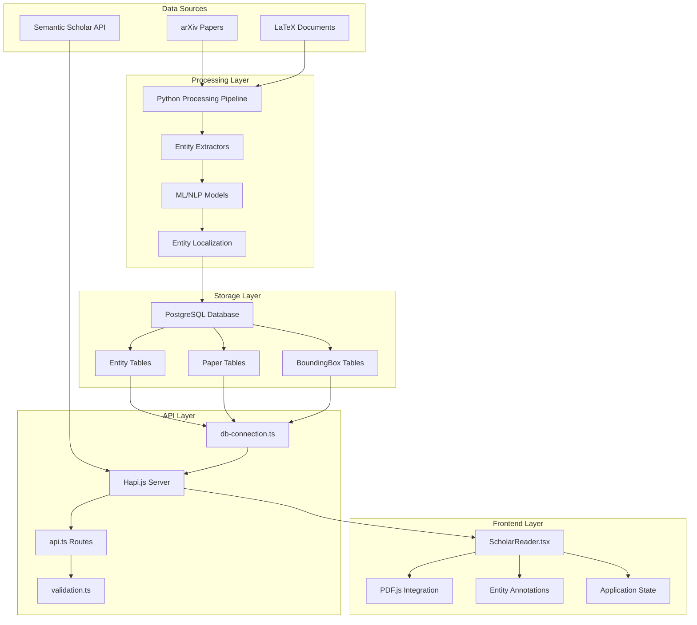
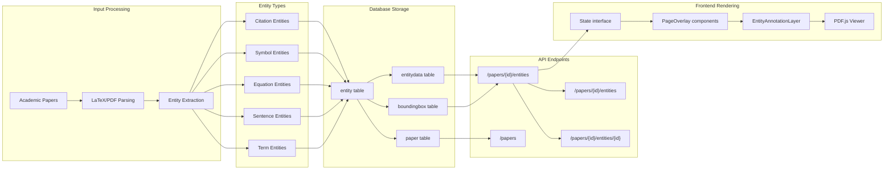
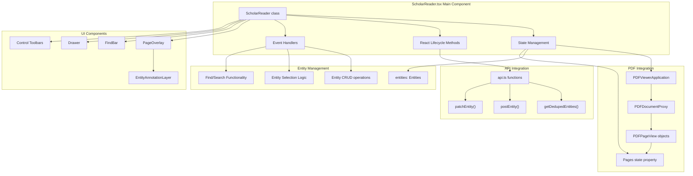
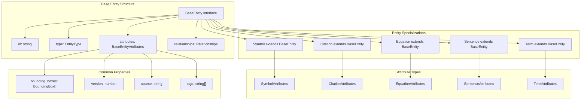
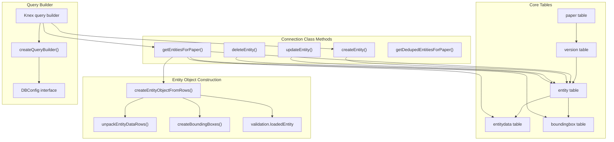
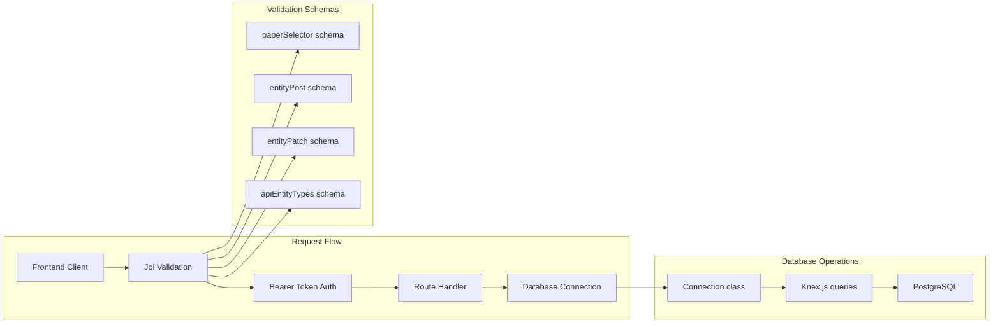

<!-- source: DeepWiki mcp.deepwiki.com · repo allenai/scholarphi · page 1 Overview · fetched 2026-10-26 -->

# Overview

Relevant source files

The following files were used as context for generating this wiki page:

- [README.md](README.md)
- [api/src/api.ts](api/src/api.ts)
- [api/src/db-connection.ts](api/src/db-connection.ts)
- [api/src/tests/api.test.ts](api/src/tests/api.test.ts)
- [api/src/types/api.ts](api/src/types/api.ts)
- [api/src/types/validation.ts](api/src/types/validation.ts)
- [ui/README.md](ui/README.md)
- [ui/src/ScholarReader.tsx](ui/src/ScholarReader.tsx)
- [ui/src/state.ts](ui/src/state.ts)

This document provides a comprehensive overview of the Scholar Reader system, an augmented PDF reader for academic papers that enhances the reading experience through automated entity extraction and interactive annotations. The system comprises a React/TypeScript frontend, Node.js/Hapi.js backend API, and Python-based data processing pipeline.

For detailed information about the frontend components and UI architecture, see [Frontend (UI System)](#2). For backend API implementation details, see [Backend (API System)](#3). For data processing and entity extraction specifics, see [Data Processing Pipeline](#4).

## System Architecture

Scholar Reader operates as a three-tier system where academic papers flow through a processing pipeline to generate an interactive PDF reading experience with entity annotations.

Sources: [ui/src/ScholarReader.tsx:1-1160](), [api/src/api.ts:1-352](), [api/src/db-connection.ts:1-767](), [README.md:1-79]()

## Data Flow Architecture

The system transforms raw academic papers into interactive, annotated PDF experiences through a multi-stage pipeline.

Sources: [api/src/types/api.ts:92-441](), [ui/src/state.ts:15-202](), [api/src/api.ts:178-268]()

## Core Component Architecture

The `ScholarReader` component serves as the main orchestrator, managing PDF viewing, entity annotations, and user interactions.

Sources: [ui/src/ScholarReader.tsx:69-124](), [ui/src/ScholarReader.tsx:665-678](), [ui/src/ScholarReader.tsx:711-730]()

## Entity Type System

Scholar Reader supports five primary entity types, each with specific attributes and relationships defined in the type system.

| Entity Type | TypeScript Interface | Key Attributes | Primary Use Case |
|-------------|---------------------|----------------|------------------|
| Citation | `Citation` | `paper_id` | Reference to other papers |
| Symbol | `Symbol` | `tex`, `mathml`, `definitions` | Mathematical notation |
| Equation | `Equation` | `tex` | Mathematical expressions |
| Sentence | `Sentence` | `text`, `tex_start`, `tex_end` | Text segmentation |
| Term | `Term` | `name`, `definitions`, `term_type` | Technical vocabulary |

Sources: [api/src/types/api.ts:108-398](), [api/src/types/api.ts:114-123](), [ui/src/state.ts:151-159]()

## Database Schema Integration

The system uses PostgreSQL with a normalized schema that separates entity metadata, attributes, and spatial information.

Sources: [api/src/db-connection.ts:24-35](), [api/src/db-connection.ts:276-406](), [api/src/db-connection.ts:242-274]()

## API Route Structure

The Hapi.js server exposes RESTful endpoints for paper and entity management with validation and authentication.

| HTTP Method | Route Pattern | Handler Function | Purpose |
|-------------|---------------|------------------|---------|
| GET | `/papers/list` | Paper listing | Paginated paper discovery |
| GET | `/papers/{paperSelector}` | Paper existence check | Verify paper availability |
| GET | `/papers/{paperSelector}/entities` | `getEntitiesForPaper()` | Retrieve all entities |
| GET | `/papers/{paperSelector}/entities-deduped` | `getDedupedEntitiesForPaper()` | Optimized entity retrieval |
| POST | `/papers/{arxivSelector}/entities` | `createEntity()` | Create new entities |
| PATCH | `/papers/{arxivSelector}/entities/{id}` | `updateEntity()` | Modify existing entities |
| DELETE | `/papers/{arxivSelector}/entities/{id}` | `deleteEntity()` | Remove entities |

Sources: [api/src/api.ts:73-351](), [api/src/types/validation.ts:31-282](), [api/src/api.ts:55-70]()

The Scholar Reader system demonstrates a sophisticated architecture for enhancing academic paper consumption through automated entity extraction, spatial annotation, and interactive user interfaces. The modular design enables independent development of data processing, API services, and frontend components while maintaining strong type safety and data consistency throughout the system.

---

