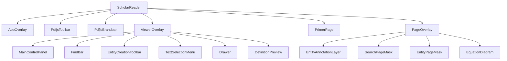
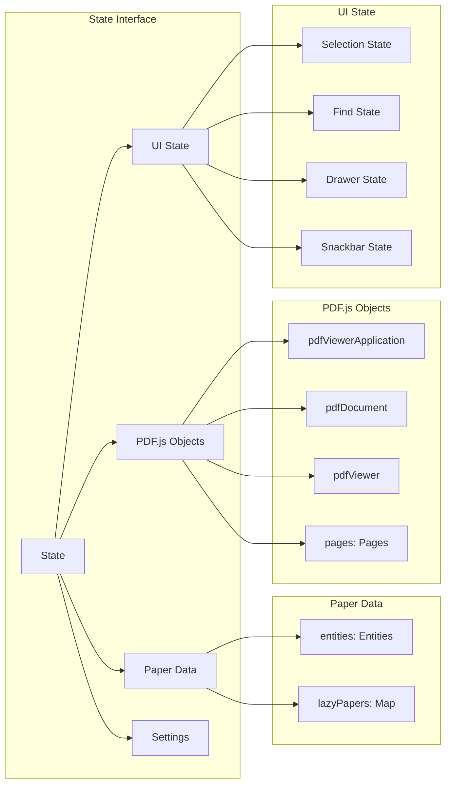
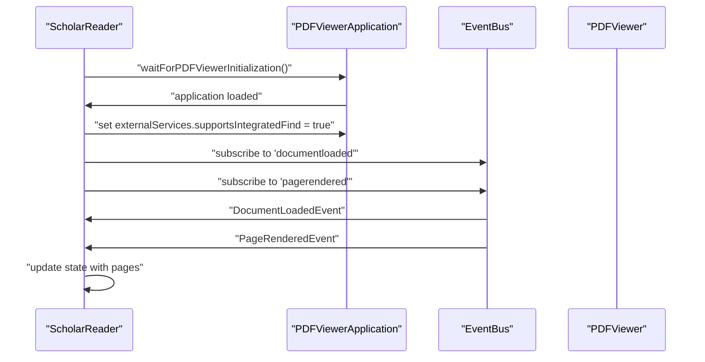
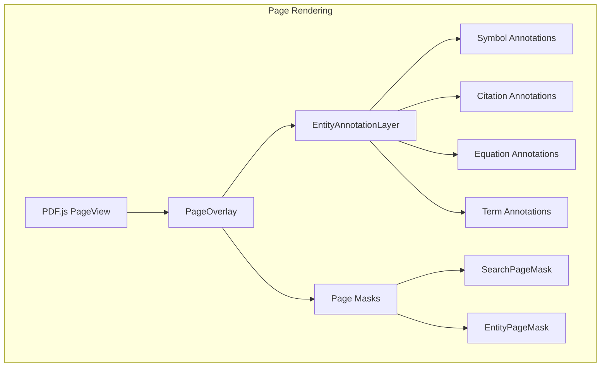
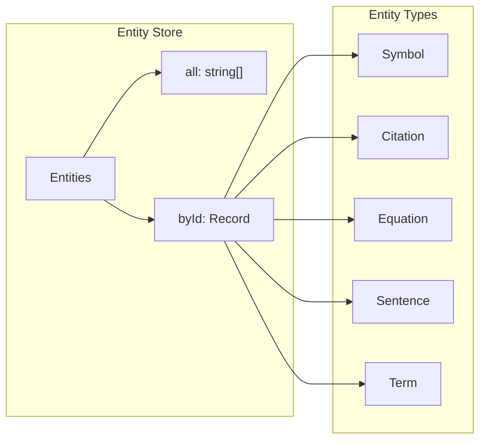
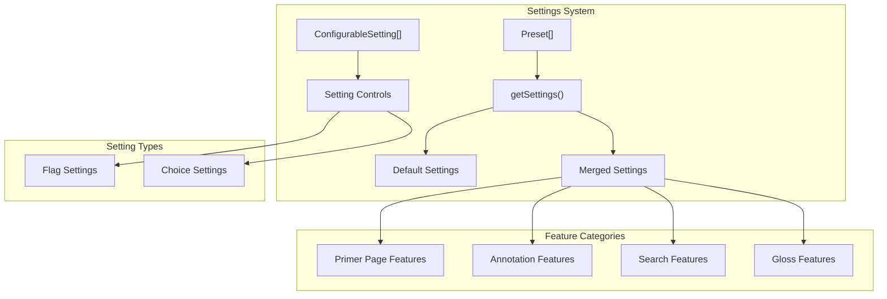
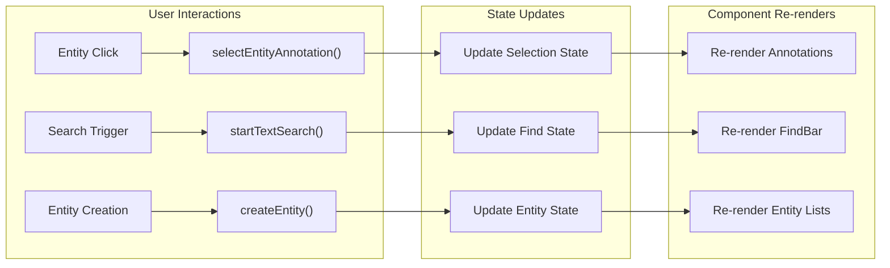
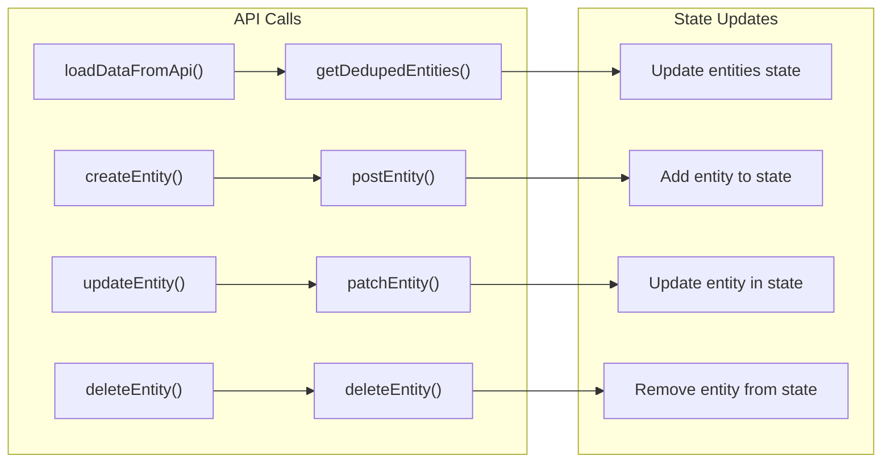

<!-- source: DeepWiki mcp.deepwiki.com · repo allenai/scholarphi · page 2 Frontend (UI System) · fetched 2026-10-26 -->

# Frontend (UI System)

Relevant source files

The following files were used as context for generating this wiki page:

- [ui/jest.config.ts](ui/jest.config.ts)
- [ui/package-lock.json](ui/package-lock.json)
- [ui/package.json](ui/package.json)
- [ui/src/ScholarReader.tsx](ui/src/ScholarReader.tsx)
- [ui/src/selectors/index.ts](ui/src/selectors/index.ts)
- [ui/src/settings.ts](ui/src/settings.ts)
- [ui/src/state.ts](ui/src/state.ts)
- [ui/src/style/equation-diagram.less](ui/src/style/equation-diagram.less)
- [ui/src/types/pdfjs-viewer.ts](ui/src/types/pdfjs-viewer.ts)

The Frontend (UI System) provides the interactive web interface for Scholar Reader, implementing an augmented PDF viewer built on React and TypeScript. This system integrates PDF.js for document rendering with a sophisticated annotation overlay system that displays extracted entities (symbols, citations, equations, terms) as interactive elements overlaid on the PDF pages.

The frontend serves as the primary user interface for browsing academic papers with enhanced navigation and search capabilities. For backend API integration details, see [Backend (API System)](#3). For information about how entities are processed and extracted, see [Data Processing Pipeline](#4).

## Core Architecture

The frontend is built as a single-page React application centered around the `ScholarReader` component, which orchestrates PDF viewing, entity annotation, search functionality, and user interface controls.

### Component Hierarchy

Sources: [ui/src/ScholarReader.tsx:1-1200]()

### State Management Architecture

Sources: [ui/src/state.ts:43-149]()

## PDF.js Integration

The frontend integrates Mozilla's PDF.js library to provide core PDF viewing capabilities while extending it with custom annotation overlays.

### PDF Viewer Integration Flow

Sources: [ui/src/ScholarReader.tsx:665-709](), [ui/src/types/pdfjs-viewer.ts:37-154]()

### Page Rendering and Overlay System

Each PDF page gets corresponding overlay components that render annotations on top of the PDF content:

Sources: [ui/src/ScholarReader.tsx:1000-1200]()

## State Management

The `ScholarReader` component manages all application state through React's built-in state management, implementing a flat state structure for performance optimization.

### State Categories

| Category | Properties | Purpose |
|----------|------------|---------|
| **Paper Data** | `entities`, `lazyPapers` | Entity data from API, cached paper metadata |
| **PDF.js Objects** | `pdfViewerApplication`, `pdfDocument`, `pdfViewer`, `pages` | References to PDF.js viewer components |
| **Selection State** | `selectedEntityIds`, `selectedAnnotationIds`, `multiselectEnabled` | User selection tracking |
| **Find State** | `isFindActive`, `findMode`, `findQuery`, `findMatchedEntities` | Search functionality |
| **UI State** | `drawerMode`, `snackbarMode`, `controlPanelShowing` | Interface visibility |

Sources: [ui/src/state.ts:43-149]()

### Entity Data Structure

Sources: [ui/src/state.ts:151-161](), [ui/src/api/types.ts]()

## Settings and Configuration

The frontend uses a flexible settings system that supports presets and runtime configuration.

### Settings Architecture

Sources: [ui/src/settings.ts:10-301]()

## Component Integration Patterns

### Event Handling Flow

Sources: [ui/src/ScholarReader.tsx:167-284](), [ui/src/ScholarReader.tsx:583-663]()

### API Integration

The frontend integrates with the backend API for entity data and paper metadata:

Sources: [ui/src/ScholarReader.tsx:711-730](), [ui/src/ScholarReader.tsx:317-542]()

This frontend architecture provides a scalable foundation for the Scholar Reader interface, with clear separation between PDF viewing, entity annotation, search functionality, and user interface controls. The component-based design allows for modular development and testing while maintaining performant rendering through careful state management.

---

