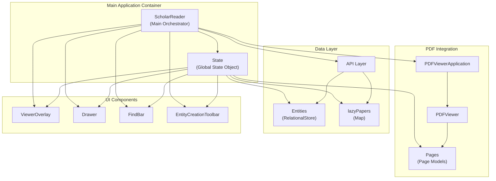
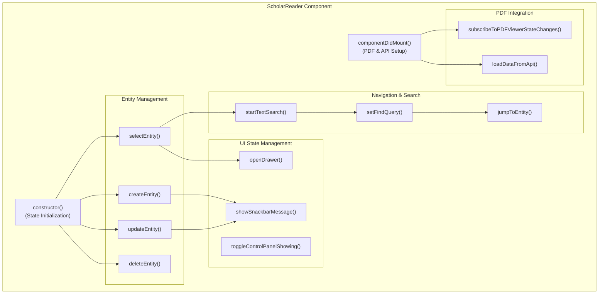
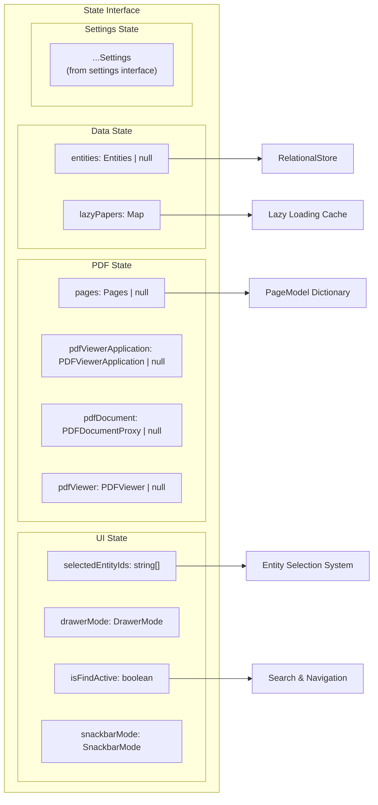
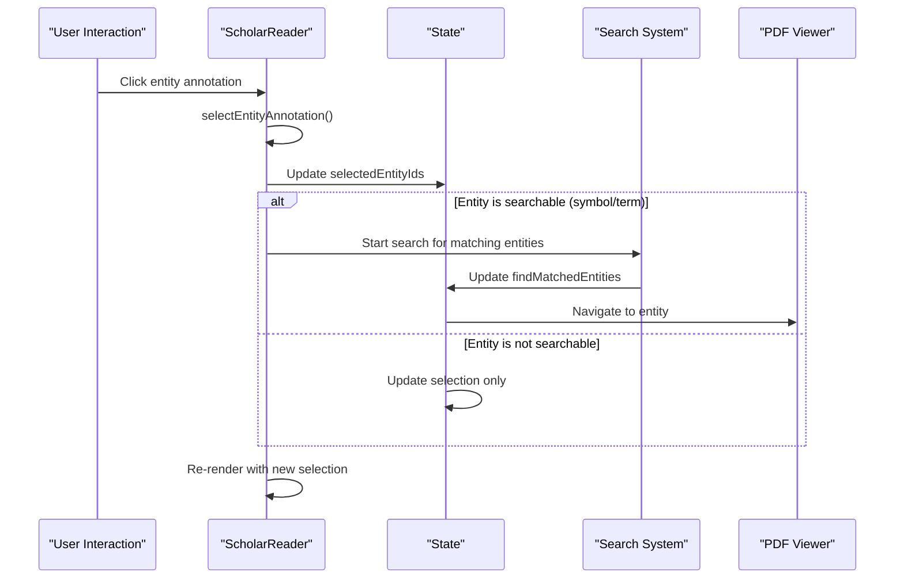
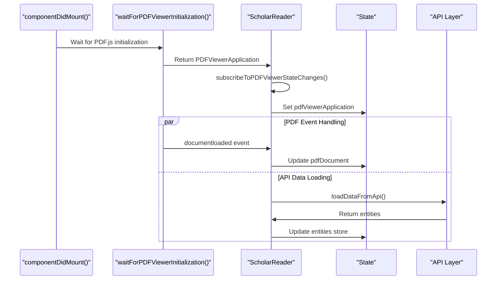
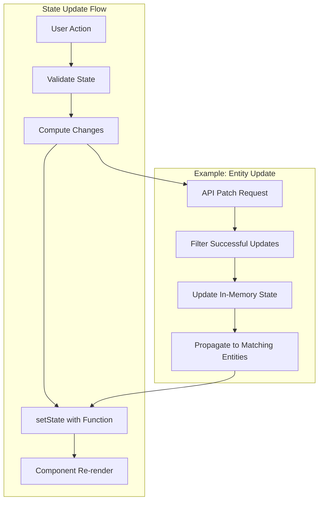
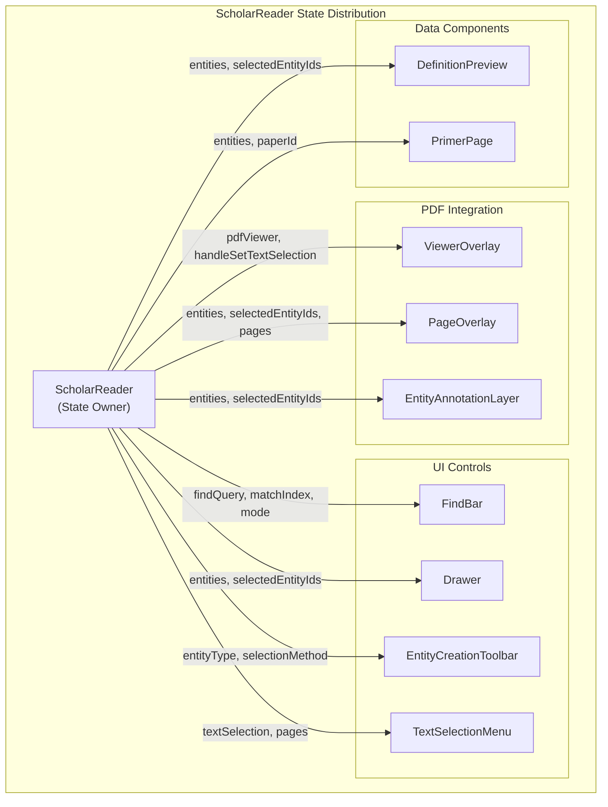

<!-- source: DeepWiki mcp.deepwiki.com · repo allenai/scholarphi · page 2.1 Core Architecture and State Management · fetched 2026-10-26 -->

# Core Architecture and State Management

<details>
<summary>Relevant source files</summary>

The following files were used as context for generating this wiki page:

- [ui/src/ScholarReader.tsx](ui/src/ScholarReader.tsx)
- [ui/src/index.tsx](ui/src/index.tsx)
- [ui/src/selectors/entity.ts](ui/src/selectors/entity.ts)
- [ui/src/selectors/symbol.ts](ui/src/selectors/symbol.ts)
- [ui/src/state.ts](ui/src/state.ts)
- [ui/src/utils/ui.test.ts](ui/src/utils/ui.test.ts)
- [ui/src/utils/ui.ts](ui/src/utils/ui.ts)

</details>


This document covers the core frontend architecture of the Scholar Reader system, focusing on the main `ScholarReader` component and the centralized state management patterns. It explains how the application orchestrates the PDF viewer, entity annotations, and user interactions through a single state container.

For information about PDF.js integration specifics, see [PDF Viewer Integration](#2.2). For details about the annotation rendering system, see [Annotation and Entity System](#2.3).

## Overview

The Scholar Reader frontend follows a centralized state management pattern where a single `ScholarReader` component acts as the main orchestrator for the entire application. This component manages all global state, coordinates between the PDF viewer and annotation systems, and handles user interactions.



**Sources:** [ui/src/ScholarReader.tsx:69-124](), [ui/src/state.ts:43-149]()

## ScholarReader Component Architecture

The `ScholarReader` component serves as the main application container, implementing a class-based React component that manages all global state and coordinates between subsystems.

### Component Responsibilities

| Responsibility | Methods | State Properties |
|----------------|---------|------------------|
| **State Management** | `setState`, `constructor` | All state properties |
| **Entity Operations** | `selectEntity`, `createEntity`, `updateEntity`, `deleteEntity` | `selectedEntityIds`, `entities` |
| **Navigation & Search** | `jumpToEntity`, `startTextSearch`, `setFindQuery` | `jumpTarget`, `isFindActive`, `findQuery` |
| **UI Coordination** | `openDrawer`, `showSnackbarMessage`, `toggleControlPanelShowing` | `drawerMode`, `snackbarMode`, `controlPanelShowing` |
| **PDF Integration** | `subscribeToPDFViewerStateChanges`, `loadDataFromApi` | `pdfViewerApplication`, `pdfViewer`, `pages` |



**Sources:** [ui/src/ScholarReader.tsx:69-124](), [ui/src/ScholarReader.tsx:665-677](), [ui/src/ScholarReader.tsx:711-730]()

## State Structure and Management

The application state is defined by the `State` interface, which extends the `Settings` interface and contains all global application data. The state follows a flat structure to avoid complex nested updates and enable precise control over re-rendering.

### Core State Categories



**Sources:** [ui/src/state.ts:43-149](), [ui/src/state.ts:198-201]()

### RelationalStore Pattern

The application uses a `RelationalStore` pattern for managing collections of entities, providing both ordered access and constant-time lookups.

```typescript
// From ui/src/state.ts:198-201
export interface RelationalStore<T> {
  all: string[];        // Ordered list of IDs
  byId: { [id: string]: T };  // Map for O(1) lookup
}
```

| Property | Purpose | Usage Pattern |
|----------|---------|---------------|
| `all` | Maintains insertion/display order | Iteration, rendering lists |
| `byId` | Enables fast entity lookup | Direct access by ID |

**Sources:** [ui/src/state.ts:189-201]()

## State Flow Patterns

The Scholar Reader implements several key state flow patterns to manage the complexity of coordinating between PDF viewing, entity management, and user interactions.

### Entity Selection Flow



**Sources:** [ui/src/ScholarReader.tsx:167-284]()

### PDF Integration Flow



**Sources:** [ui/src/ScholarReader.tsx:665-677](), [ui/src/ScholarReader.tsx:680-709](), [ui/src/ScholarReader.tsx:711-730]()

### State Update Patterns

The component uses React's `setState` with functional updates to ensure state consistency, especially for complex operations like entity updates that may affect multiple entities.



**Sources:** [ui/src/ScholarReader.tsx:423-503](), [ui/src/ScholarReader.tsx:317-342]()

## Component Integration Architecture

The `ScholarReader` component integrates multiple subsystems through prop-based data flow, avoiding context to maintain precise control over re-rendering performance.



**Sources:** [ui/src/ScholarReader.tsx:832-1224]()

## Key Architectural Decisions

### Centralized State Management

The application uses a single component for state management rather than external state management libraries like Redux. This design choice provides:

| Benefit | Implementation |
|---------|----------------|
| **Simplified Data Flow** | All state updates go through `ScholarReader.setState` |
| **Performance Control** | Precise control over which components re-render |
| **Type Safety** | Full TypeScript integration with state shape |
| **Debugging** | Single location for all state changes |

**Sources:** [ui/src/state.ts:16-42]()

### Prop-Based Distribution

Rather than using React Context, the application passes state through props to maintain performance:

```typescript
// Example from render method
<PageOverlay
  key={key}
  pageView={pageView}
  entities={entities}
  selectedEntityIds={selectedEntityIds}
  selectedAnnotationIds={selectedAnnotationIds}
  // ... other props
/>
```

This pattern allows components to use strict equality comparisons for re-render optimization.

**Sources:** [ui/src/ScholarReader.tsx:1000-1067]()

### Memoized Selectors

The application uses memoized selectors for expensive computations, particularly for entity filtering and ordering:

```typescript
// From selectors
export const orderByPosition = defaultMemoize(
  (entityIds: string[], entities: Entities) => {
    // Expensive sorting operation
  }
);
```

**Sources:** [ui/src/selectors/symbol.ts:70-76](), [ui/src/selectors/entity.ts:206-224]()

---

