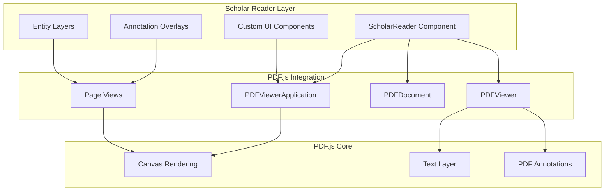
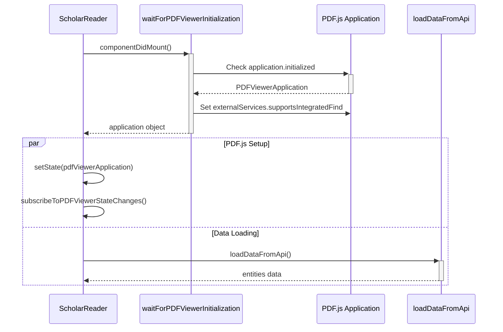
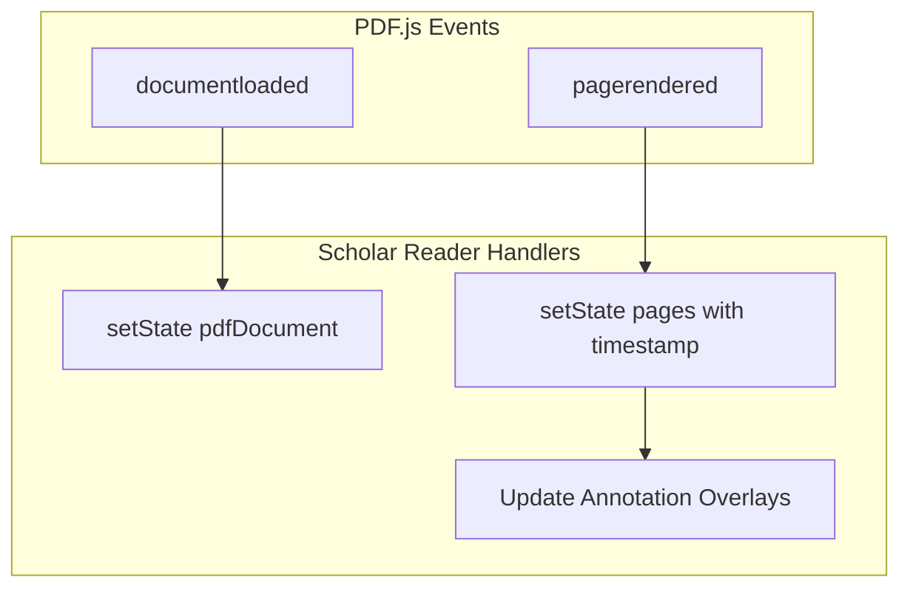
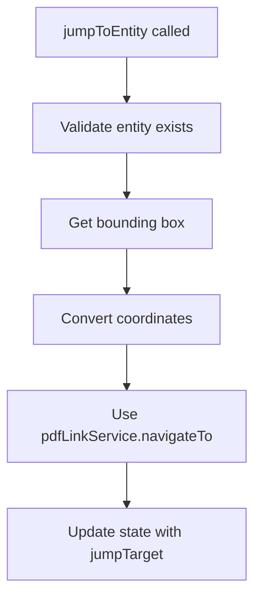
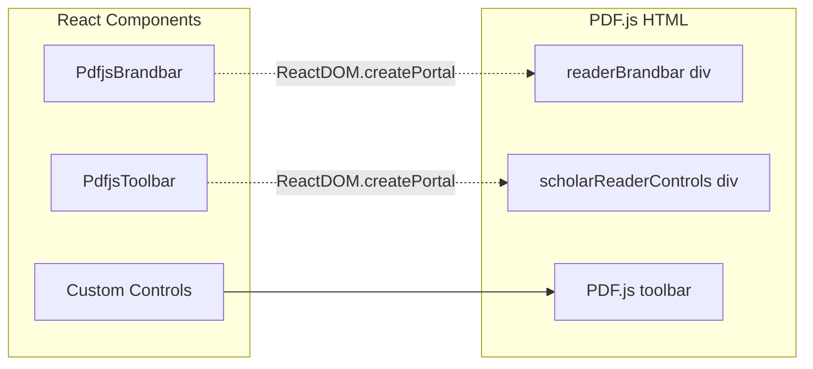
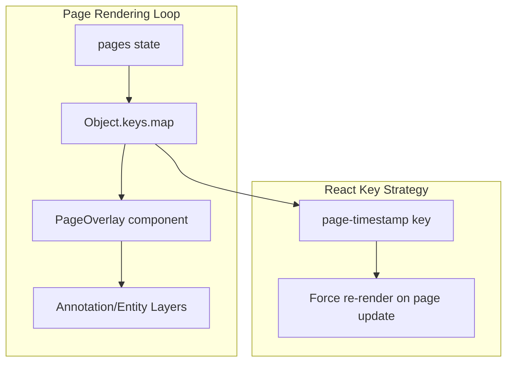

<!-- source: DeepWiki mcp.deepwiki.com · repo allenai/scholarphi · page 2.2 PDF Viewer Integration · fetched 2026-10-26 -->

# PDF Viewer Integration

<details>
<summary>Relevant source files</summary>

The following files were used as context for generating this wiki page:

- [ui/bin/build_pdf.js.sh](ui/bin/build_pdf.js.sh)
- [ui/jest.config.ts](ui/jest.config.ts)
- [ui/package-lock.json](ui/package-lock.json)
- [ui/package.json](ui/package.json)
- [ui/public/pdf.viewer.js](ui/public/pdf.viewer.js)
- [ui/public/pdf.worker.min.js](ui/public/pdf.worker.min.js)
- [ui/public/viewer.css](ui/public/viewer.css)
- [ui/public/viewer.html](ui/public/viewer.html)
- [ui/public/viewer.js.map](ui/public/viewer.js.map)
- [ui/src/ScholarReader.tsx](ui/src/ScholarReader.tsx)
- [ui/src/components/pdfjs/PdfjsBrandbar.tsx](ui/src/components/pdfjs/PdfjsBrandbar.tsx)
- [ui/src/selectors/index.ts](ui/src/selectors/index.ts)
- [ui/src/state.ts](ui/src/state.ts)
- [ui/src/style/brandbar.less](ui/src/style/brandbar.less)
- [ui/src/types/pdfjs-viewer.ts](ui/src/types/pdfjs-viewer.ts)
- [ui/webpack.config.js](ui/webpack.config.js)

</details>


This document describes how PDF.js is integrated into the Scholar Reader system to provide PDF viewing capabilities. It covers the initialization process, state management of PDF.js objects, event handling, and UI customization.

For information about the overall frontend architecture, see [Core Architecture and State Management](#2.1). For details about annotation overlays that are rendered on top of the PDF viewer, see [Annotation and Entity System](#2.3).

## Architecture Overview

The Scholar Reader system builds upon the Mozilla PDF.js viewer, extending it with academic paper annotation capabilities. The integration follows a layered approach where PDF.js handles core PDF rendering while Scholar Reader adds semantic overlays and interactive features.



The integration maintains separation of concerns by keeping PDF.js responsible for document parsing and rendering while Scholar Reader handles academic-specific features like entity annotations and interactive elements.

Sources: [ui/src/ScholarReader.tsx:1-100](), [ui/src/state.ts:50-60](), [ui/src/types/pdfjs-viewer.ts:1-50]()

## PDF.js State Management

Scholar Reader maintains references to key PDF.js objects in its central state store. These objects provide access to the PDF document, viewer controls, and rendered pages.

```mermaid
graph LR
    subgraph "Application State"
        PVA[pdfViewerApplication]
        PV[pdfViewer]
        PD[pdfDocument]
        PS[pages]
    end
    
    subgraph "PDF.js Objects"
        APP[PDFViewerApplication]
        VIEWER[PDFViewer]
        DOC[PDFDocumentProxy]
        PAGEVIEWS[PDFPageView[]]
    end
    
    PVA --> APP
    PV --> VIEWER
    PD --> DOC
    PS --> PAGEVIEWS
    
    APP --> VIEWER
    APP --> DOC
    VIEWER --> PAGEVIEWS
```

| State Property | Type | Purpose |
|---|---|---|
| `pdfViewerApplication` | `PDFViewerApplication \| null` | Main PDF.js application controller |
| `pdfViewer` | `PDFViewer \| null` | PDF viewer component for rendering |
| `pdfDocument` | `PDFDocumentProxy \| null` | Loaded PDF document proxy |
| `pages` | `Pages \| null` | Page view objects with render timestamps |

The `Pages` type is a custom mapping that tracks PDF.js page views along with rendering metadata:

```typescript
type Pages = { [pageNumber: number]: PageModel };

interface PageModel {
  timeOfLastRender: number;  // Timestamp for React re-rendering
  view: PDFPageView;         // PDF.js page view object
}
```

Sources: [ui/src/state.ts:51-56](), [ui/src/state.ts:171-182](), [ui/src/types/pdfjs-viewer.ts:148-154]()

## Initialization Process

The PDF viewer initialization follows a specific sequence that waits for PDF.js to load before Scholar Reader components can interact with it.



The initialization process includes several key steps:

1. **Wait for PDF.js**: The `waitForPDFViewerInitialization` function polls until PDF.js is fully loaded
2. **Configure external services**: Sets `supportsIntegratedFind = true` to override PDF.js find functionality
3. **Subscribe to events**: Registers listeners for PDF.js document and page events
4. **Load application data**: Fetches entities and annotations from the API

Sources: [ui/src/ScholarReader.tsx:665-677](), [ui/src/ScholarReader.tsx:680-709]()

## Event Handling and Subscriptions

Scholar Reader subscribes to PDF.js events to track document loading and page rendering. This enables the annotation system to respond to PDF viewer state changes.



### Document Loading Events

When a PDF document loads, Scholar Reader updates its state to reference the loaded document:

```typescript
eventBus.on("documentloaded", (eventData: DocumentLoadedEvent) => {
  this.setState({ pdfDocument: eventData.source });
});
```

### Page Rendering Events

Page rendering events are critical for annotation positioning. Each time a page renders, Scholar Reader:

1. Updates the page model with a new timestamp
2. Stores the PDF.js page view reference  
3. Triggers React re-renders of annotation overlays

```typescript
eventBus.on("pagerendered", (eventData: PageRenderedEvent) => {
  this.setState({
    pdfDocument: pdfViewerApplication.pdfDocument,
    pages: {
      ...this.state.pages,
      [getPageNumber(eventData.source)]: {
        timeOfLastRender: eventData.timestamp,
        view: eventData.source,
      },
    },
  });
});
```

Sources: [ui/src/ScholarReader.tsx:689-708](), [ui/src/types/pdfjs-viewer.ts:60-65](), [ui/src/types/pdfjs-viewer.ts:92-94]()

## Navigation and Entity Jumping

Scholar Reader extends PDF.js navigation capabilities to support jumping to specific entities within the document. This is essential for features like symbol search and citation navigation.

### Jump to Entity Implementation

The `jumpToEntity` function demonstrates how Scholar Reader uses PDF.js navigation APIs:



Key implementation details:

1. **Coordinate conversion**: Transforms entity bounding boxes to PDF coordinate system
2. **Navigation service**: Uses `pdfLinkService.navigateTo()` with XYZ destination format
3. **History integration**: Navigation calls save current position to browser history
4. **Offset adjustment**: Applies scroll offsets for optimal entity visibility

```typescript
const SCROLL_OFFSET_X = -200;
const SCROLL_OFFSET_Y = +100;

pdfViewerApplication.pdfLinkService.navigateTo([
  dest.page,
  { name: "XYZ" },
  left + SCROLL_OFFSET_X,
  top + SCROLL_OFFSET_Y,
]);
```

Sources: [ui/src/ScholarReader.tsx:751-803](), [ui/src/types/pdfjs-viewer.ts:120-141]()

## UI Integration and Customization

Scholar Reader customizes the PDF.js viewer interface by injecting React components into designated container elements within the PDF.js HTML structure.

### Toolbar Integration

Custom toolbar components are integrated using React portals to render into PDF.js toolbar containers:



### Brand Bar Integration

The `PdfjsBrandbar` component demonstrates the portal pattern used throughout the system:

```typescript
const elControlsContainer = document.getElementById("readerBrandbar");
const portalValue = (
  <div className="brandbar">
    <div className="brandbar__left">
      <S2LogoMarkOnly />
      <span className="brandbar__app-title">
        <span className="brandbar__app-title__word1">SEMANTIC</span>&nbsp;
        <span className="brandbar__app-title__word2">READER</span>
      </span>
    </div>
  </div>
);

return elControlsContainer 
  ? ReactDOM.createPortal(portalValue, elControlsContainer)
  : null;
```

### Viewer HTML Structure

The base PDF.js viewer HTML includes custom integration points:

| Element ID | Purpose |
|---|---|
| `readerBrandbar` | Scholar Reader branding and title |
| `scholarReaderControls` | Custom control panels and toolbars |
| `viewerContainer` | Main PDF viewing area with overlays |

Sources: [ui/src/components/pdfjs/PdfjsBrandbar.tsx:7-30](), [ui/public/viewer.html:238-264](), [ui/src/ScholarReader.tsx:850-862]()

## Page Overlay Management

Scholar Reader renders annotation overlays on top of each PDF page by creating `PageOverlay` components that align with PDF.js page views.



The overlay system uses a composite React key that combines page number with render timestamp:

```typescript
const key = `${pageNumber}-${pageModel.timeOfLastRender}`;

return (
  <PageOverlay key={key} pageView={pageView}>
    {/* Annotation components */}
  </PageOverlay>
);
```

This ensures that overlays re-render whenever PDF.js re-renders a page, maintaining proper alignment between PDF content and Scholar Reader annotations.

Sources: [ui/src/ScholarReader.tsx:1000-1015](), [ui/src/ScholarReader.tsx:1068-1070]()

---

