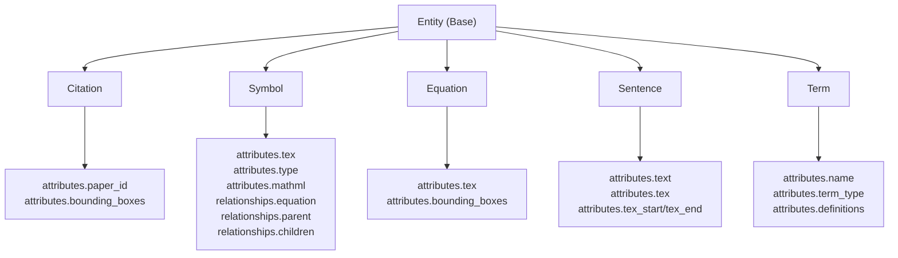
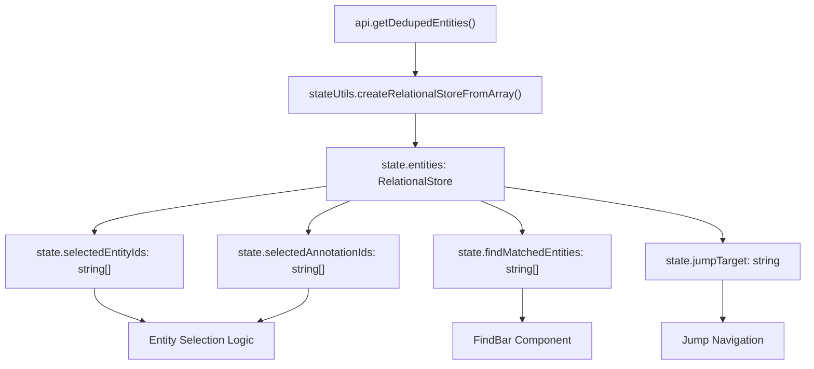
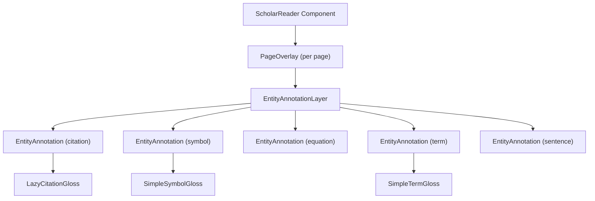
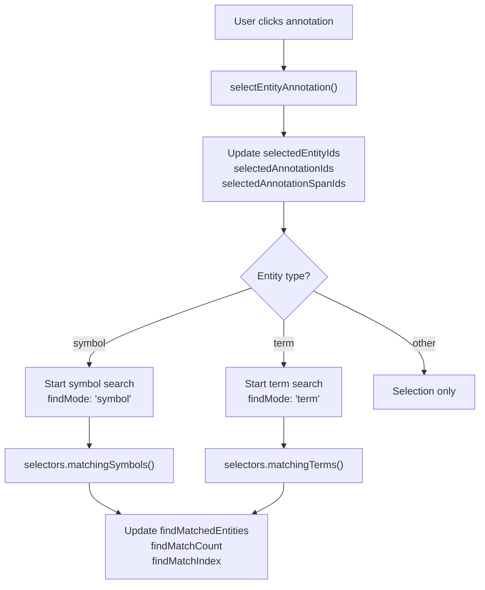
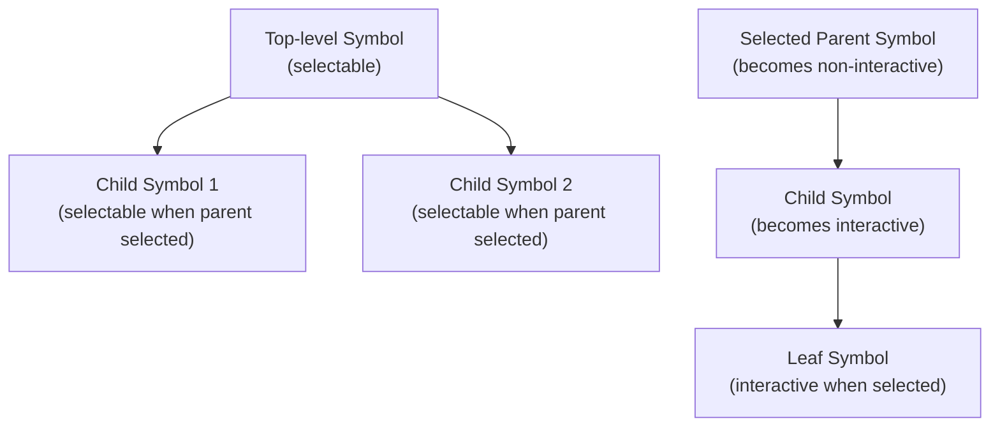
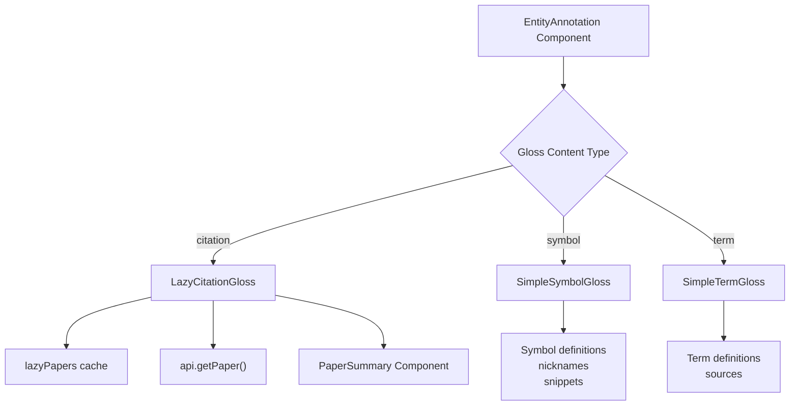
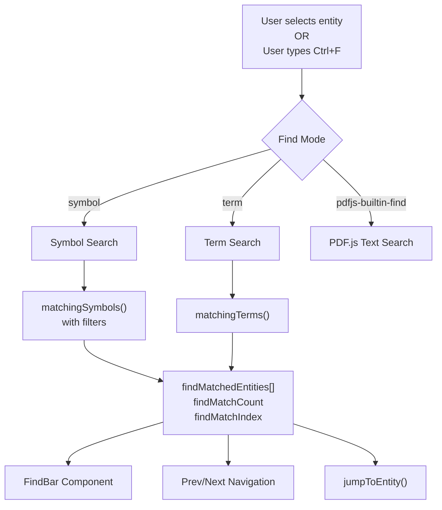

<!-- source: DeepWiki mcp.deepwiki.com · repo allenai/scholarphi · page 2.3 Annotation and Entity System · fetched 2026-10-26 -->

# Annotation and Entity System

Relevant source files

The following files were used as context for generating this wiki page:

- [ui/src/ScholarReader.tsx](ui/src/ScholarReader.tsx)
- [ui/src/api/api.ts](ui/src/api/api.ts)
- [ui/src/api/deduped.ts](ui/src/api/deduped.ts)
- [ui/src/components/entity/EntityAnnotationLayer.tsx](ui/src/components/entity/EntityAnnotationLayer.tsx)
- [ui/src/components/entity/citation/CitationGloss.tsx](ui/src/components/entity/citation/CitationGloss.tsx)
- [ui/src/components/entity/citation/LazyCitationGloss.tsx](ui/src/components/entity/citation/LazyCitationGloss.tsx)
- [ui/src/state.ts](ui/src/state.ts)
- [ui/src/style/control-panel.less](ui/src/style/control-panel.less)
- [ui/src/style/paper-summary.less](ui/src/style/paper-summary.less)
- [ui/src/style/viewer-overlay.less](ui/src/style/viewer-overlay.less)
- [ui/src/types/ui.ts](ui/src/types/ui.ts)

## Purpose and Scope

This document describes the frontend annotation and entity system that overlays interactive annotations on top of PDF pages in the Scholar Reader. The system handles rendering, selection, and interaction with various types of extracted entities (symbols, citations, equations, terms, and sentences) as visual annotations positioned over the corresponding text in the PDF viewer.

For information about the backend API that serves entity data, see [Backend (API System)](#3). For details about the data processing pipeline that extracts these entities, see [Data Processing Pipeline](#4).

## Entity Data Model

The annotation system operates on five primary entity types, each with specific attributes and rendering behavior. The entity data flows from the backend API through a normalized relational store structure in the application state.

### Entity Type Hierarchy

The entity data is stored in a `RelationalStore` structure with two main properties: `all` (ordered list of IDs) and `byId` (map from IDs to entity objects). This allows constant-time lookups while maintaining referential relationships between entities.

**Sources:** [ui/src/api/types.ts](), [ui/src/api/deduped.ts](), [ui/src/state.ts:189-201]()

### Entity State Management

**Sources:** [ui/src/ScholarReader.tsx:714-717](), [ui/src/state.ts:43-149]()

## Annotation Rendering Architecture

The annotation rendering system uses a layered approach where `EntityAnnotationLayer` components are positioned over each PDF page to render interactive annotations for entities with bounding boxes on that page.

### Page Overlay System

Each `EntityAnnotation` component handles positioning, visual styling, and interaction for a single entity instance. The positioning is calculated by converting entity bounding box coordinates to PDF page coordinates using `uiUtils.convertBoxToPdfCoordinates()`.

**Sources:** [ui/src/ScholarReader.tsx:1000-1067](), [ui/src/components/entity/EntityAnnotationLayer.tsx:155-185]()

### Entity Filtering and Rendering Logic

The `EntityAnnotationLayer` applies complex filtering logic to determine which entities should be rendered as interactive annotations:

| Entity Type | Rendering Conditions |
|-------------|---------------------|
| **Citation** | `citationAnnotationsEnabled` and `entity.attributes.paper_id !== null` |
| **Symbol** | Type must be "identifier" or "function", not in selected equation, and meets selectability criteria |
| **Equation** | `equationDiagramsEnabled`, has >1 top-level symbols, no selected symbols in equation |
| **Term** | `termAnnotationsEnabled`, `term_type !== "symbol"`, and `term_type !== "ignore"` |
| **Sentence** | Always rendered but only interactive if `copySentenceOnClick` enabled |

**Sources:** [ui/src/components/entity/EntityAnnotationLayer.tsx:229-465]()

## Entity Selection and Interaction

The selection system supports both single and multi-select modes, with automatic search initiation for searchable entity types (symbols and terms).

### Selection State Flow

Multi-select behavior is controlled by the `multiselectEnabled` state flag. When enabled, clicking additional entities adds them to the selection rather than replacing it.

**Sources:** [ui/src/ScholarReader.tsx:167-284]()

### Symbol Hierarchy Selection

Symbols have a parent-child hierarchy that affects selection behavior. The system allows refinement of symbol selection by enabling interaction with child symbols when their parent is selected:

This hierarchy is managed through the `isSelectable`, `isSelectionChild`, and `isSelectionDescendant` logic in the annotation layer.

**Sources:** [ui/src/components/entity/EntityAnnotationLayer.tsx:341-398]()

## Gloss System

The gloss system provides contextual information popups for entities, with different content and styling based on entity type and user settings.

### Gloss Architecture

### Gloss Display Modes

The system supports multiple gloss display styles controlled by the `glossStyle` setting:

| Style | Behavior |
|-------|----------|
| **tooltip** | Shows on hover, positioned near cursor |
| **overlay** | Shows as persistent overlay panel |
| **sidebar** | Shows in drawer/sidebar panel |

**Sources:** [ui/src/components/entity/EntityAnnotationLayer.tsx:428-440](), [ui/src/components/entity/citation/LazyCitationGloss.tsx]()

## Search and Find Integration

The annotation system integrates with the find bar to support entity-based search, allowing users to navigate between matching entities of the same type.

### Find System Architecture

When a symbol or term is selected, the system automatically starts a search for matching entities and highlights them on all pages. Users can navigate between matches using the find bar controls.

**Sources:** [ui/src/ScholarReader.tsx:252-282](), [ui/src/ScholarReader.tsx:597-663]()

### Entity Matching Logic

The matching algorithms differ by entity type:

- **Symbols**: Match based on TeX content (`entity.attributes.tex`)
- **Terms**: Match based on name (`entity.attributes.name`) 
- **Symbol Filters**: Additional filtering based on symbol attributes like `mathml_near_matches`

**Sources:** [ui/src/selectors.ts](), [ui/src/ScholarReader.tsx:617-649]()

---

