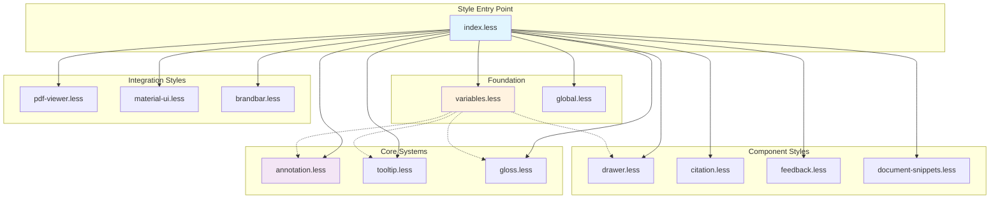
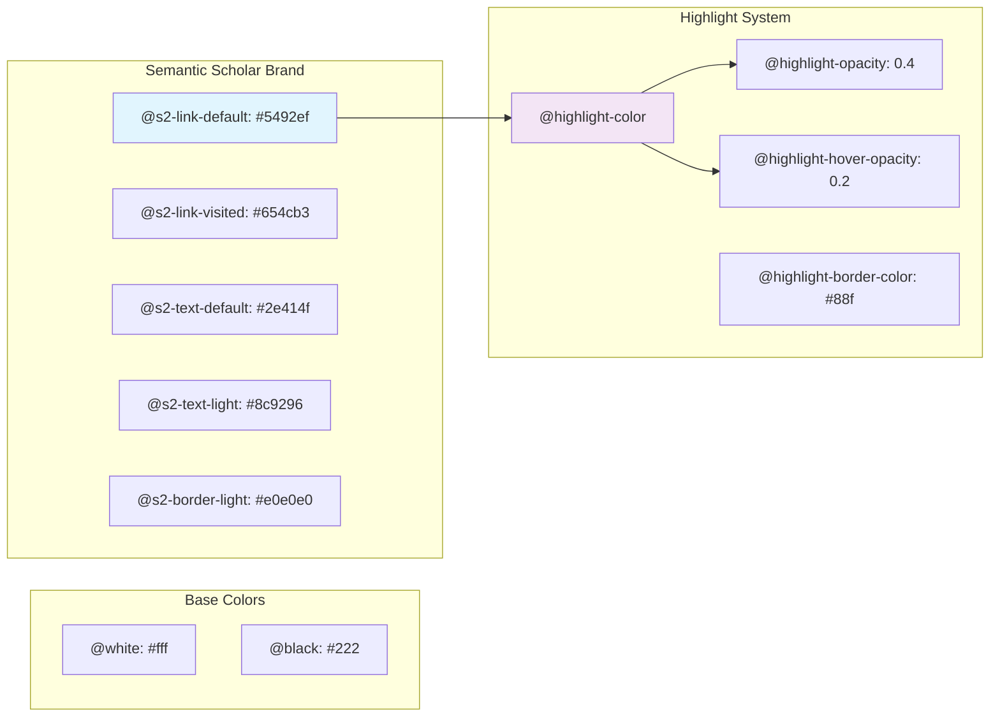
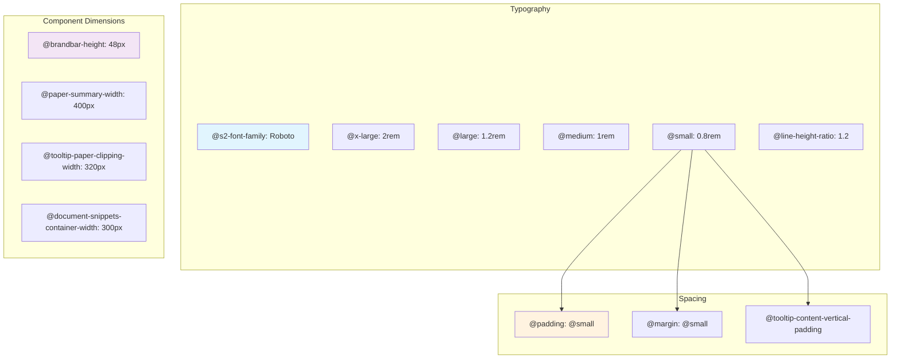
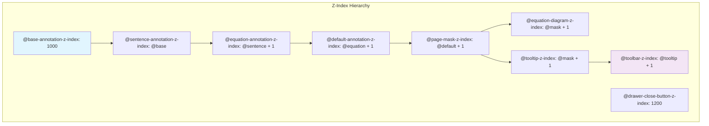
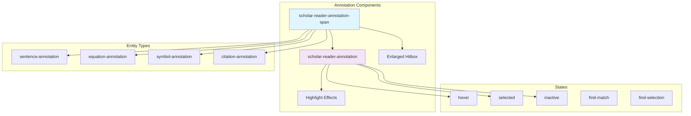
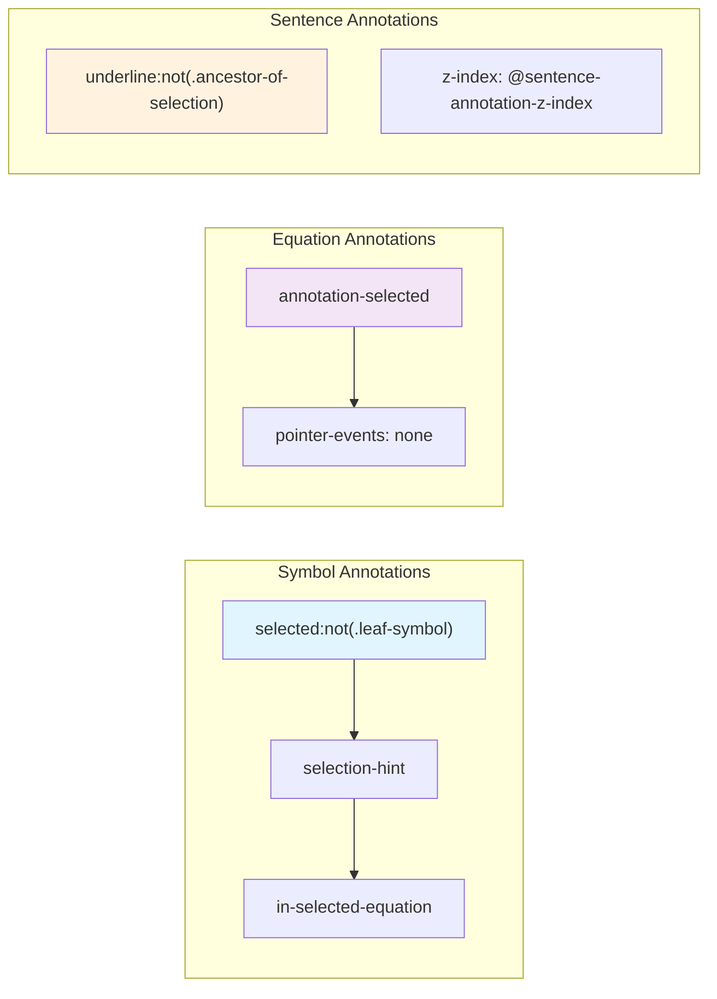
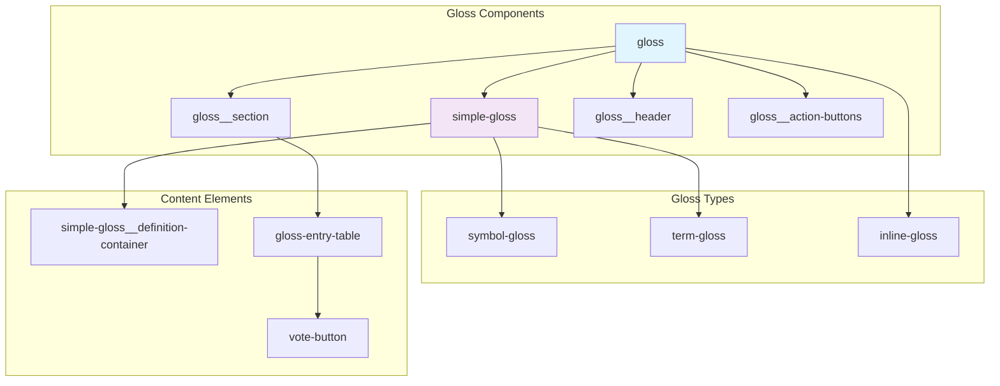
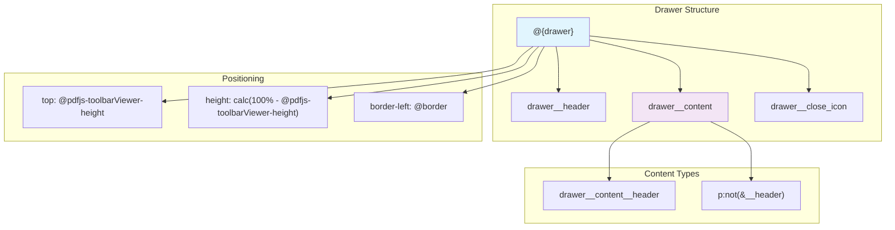
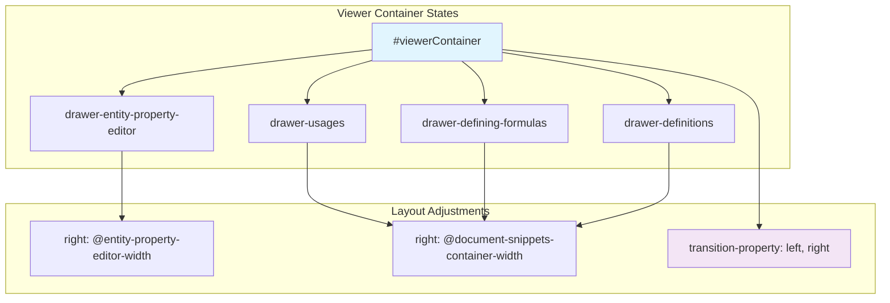
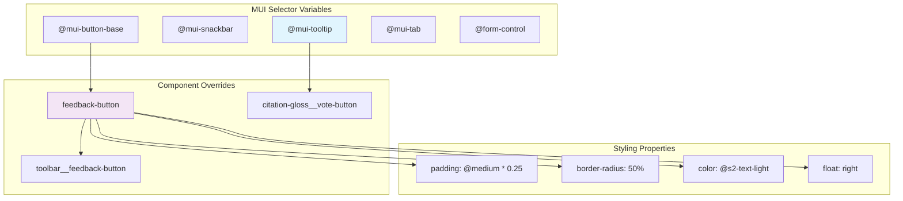

<!-- source: DeepWiki mcp.deepwiki.com · repo allenai/scholarphi · page 2.4 Styling and Visual Design · fetched 2026-10-26 -->

# Styling and Visual Design

<details>
<summary>Relevant source files</summary>

The following files were used as context for generating this wiki page:

- [ui/src/style/annotation.less](ui/src/style/annotation.less)
- [ui/src/style/citation.less](ui/src/style/citation.less)
- [ui/src/style/document-snippets.less](ui/src/style/document-snippets.less)
- [ui/src/style/drawer.less](ui/src/style/drawer.less)
- [ui/src/style/feedback.less](ui/src/style/feedback.less)
- [ui/src/style/formatted-text.less](ui/src/style/formatted-text.less)
- [ui/src/style/global.less](ui/src/style/global.less)
- [ui/src/style/gloss.less](ui/src/style/gloss.less)
- [ui/src/style/index.less](ui/src/style/index.less)
- [ui/src/style/pdf-viewer.less](ui/src/style/pdf-viewer.less)
- [ui/src/style/tooltip.less](ui/src/style/tooltip.less)
- [ui/src/style/variables.less](ui/src/style/variables.less)

</details>


This document covers the LESS-based styling system used throughout the Scholar Reader frontend, including design variables, component styles, annotation appearance, and visual consistency mechanisms. The styling system provides unified visual treatment across PDF viewing, annotation overlays, tooltips, and UI components.

For information about the React components that use these styles, see [Core Architecture and State Management](#2.1). For PDF rendering integration details, see [PDF Viewer Integration](#2.2).

## Architecture Overview

The Scholar Reader uses LESS as its CSS preprocessor, organizing styles through a modular import system with shared variables and component-specific stylesheets.



Sources: [ui/src/style/index.less:1-30]()

## Design System Variables

The design system is built around a comprehensive set of LESS variables that ensure visual consistency across all components.

### Color System



The color system defines semantic colors used throughout the application:

| Variable | Value | Usage |
|----------|-------|-------|
| `@s2-link-default` | `#5492ef` | Primary links and interactive elements |
| `@s2-text-default` | `#2e414f` | Main text content |
| `@s2-text-light` | `#8c9296` | Secondary text and subtle elements |
| `@highlight-color` | `darken(@s2-link-default, 20%)` | Annotation highlights |
| `@s2-border-light` | `#e0e0e0` | Component borders |

Sources: [ui/src/style/variables.less:16-30](), [ui/src/style/variables.less:32-42]()

### Layout and Spacing



Sources: [ui/src/style/variables.less:67-96]()

### Z-Index Management

The system uses a structured z-index hierarchy to prevent visual layering conflicts:



Sources: [ui/src/style/variables.less:98-114]()

## Annotation Styling System

The annotation system provides visual feedback for interactive elements overlaid on PDF pages.

### Base Annotation Structure



The `.scholar-reader-annotation-span` class provides absolute positioning and enlarged hitboxes:

```less
.scholar-reader-annotation-span {
  position: absolute;
  margin: -@highlight-hitbox-padding * 2/3 -@highlight-hitbox-padding;
  padding: @highlight-hitbox-padding * 2/3 @highlight-hitbox-padding;
}
```

Sources: [ui/src/style/annotation.less:4-14]()

### Highlight and Selection States

The annotation system provides consistent visual feedback across different interaction states:

| State | Styling | Purpose |
|-------|---------|---------|
| `:hover` | `fade(@highlight-color, @highlight-hover-opacity-percent)` | Interactive feedback |
| `.selected` | `fade(@highlight-color, @highlight-opacity-percent)` | Active selection |
| `.find-match` | `fade(@highlight-color, @highlight-hover-opacity-percent)` | Search results |
| `.find-selection` | `fade(@highlight-color, @highlight-opacity-percent)` | Current search match |
| `.jump-target` | Temporary highlight with fade animation | Navigation target |

Sources: [ui/src/style/annotation.less:19-79]()

### Entity-Specific Styling

Different entity types have specialized visual treatments:



Sources: [ui/src/style/annotation.less:117-155]()

## Component Styling System

### Gloss and Tooltip System

The gloss system provides contextual information overlays with consistent styling:



Key gloss styling features:
- Maximum width of 420px with minimum width of 200px for non-simple glosses
- Symbol and term glosses use `max-content` width up to 350px
- Nested list elements with `list-style-position: inside`
- Action buttons aligned to the right with consistent spacing

Sources: [ui/src/style/gloss.less:4-13](), [ui/src/style/gloss.less:19-51](), [ui/src/style/gloss.less:82-91]()

### Drawer System

The drawer provides slide-out panels with consistent positioning and styling:



The drawer uses the `@{drawer}` selector variable for high specificity targeting of Material-UI components.

Sources: [ui/src/style/drawer.less:4-7](), [ui/src/style/drawer.less:12-14](), [ui/src/style/drawer.less:35-48]()

## PDF Viewer Integration

The styling system integrates with PDF.js viewer components while maintaining visual consistency:

### Viewer Container Transitions



### PDF.js Style Overrides

The system overrides specific PDF.js styles for consistency:

| Override | Purpose | Implementation |
|----------|---------|----------------|
| `.linkAnnotation a[href^="#cite"]` | Hide default citation links | `display: none` |
| `.annotationLayer .linkAnnotation > a` | Remove hyperref borders | `border: none !important` |
| `.textLayer .highlight` | Consistent find highlights | Uses `@highlight-color` variables |
| `.pdfjs-toolbar__button` | Custom toolbar buttons | Flex layout with auto sizing |

Sources: [ui/src/style/pdf-viewer.less:5-17](), [ui/src/style/pdf-viewer.less:22-34](), [ui/src/style/pdf-viewer.less:39-61]()

## Material-UI Integration

The styling system uses high-specificity selectors to override Material-UI components without `!important` declarations:



The selector variables use LESS's `~"..."` syntax to create high-specificity CSS selectors without requiring `!important`.

Sources: [ui/src/style/variables.less:4-12](), [ui/src/style/feedback.less:5-15](), [ui/src/style/citation.less:41-45]()

---

