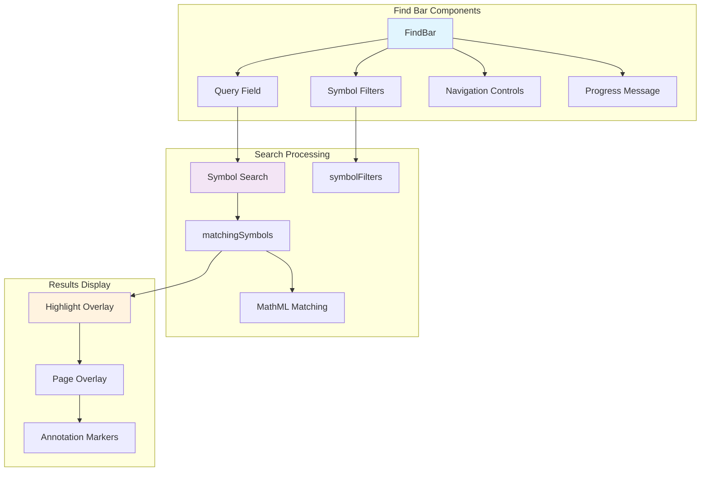
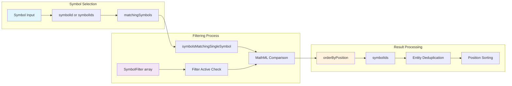
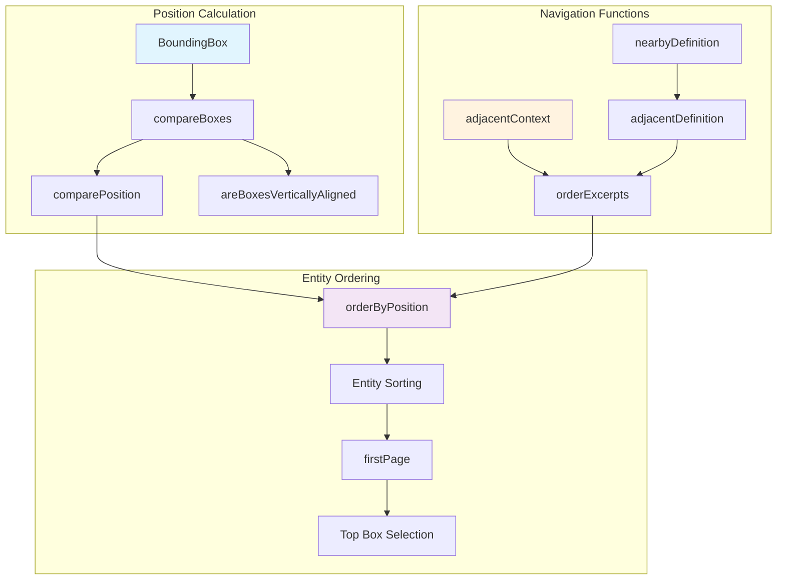
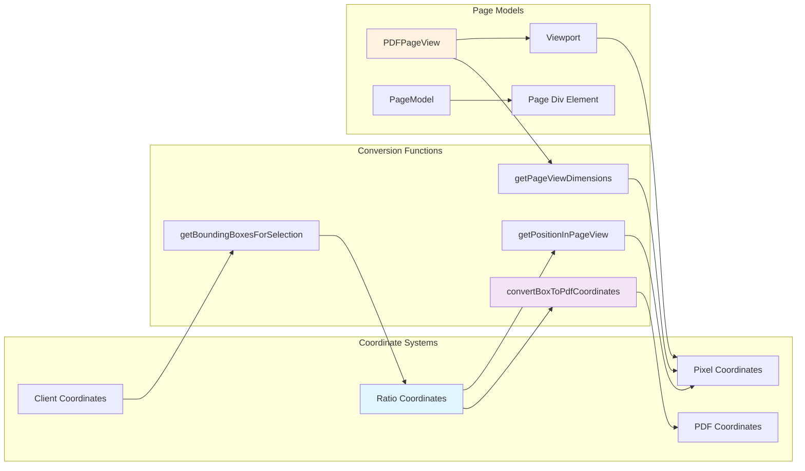
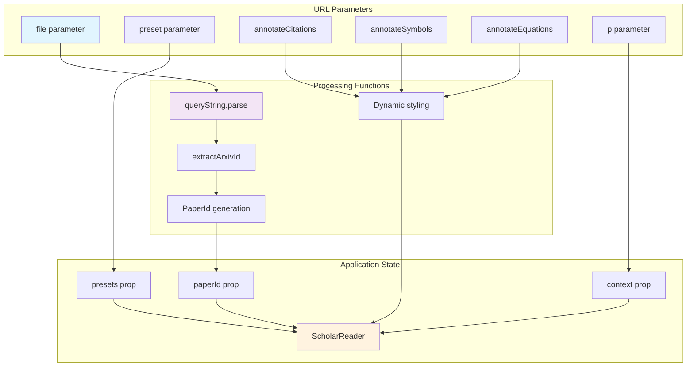
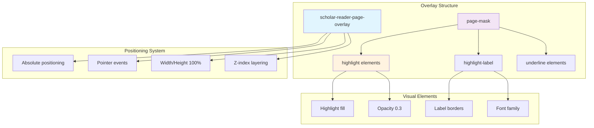

<!-- source: DeepWiki mcp.deepwiki.com · repo allenai/scholarphi · page 2.5 Search and Navigation · fetched 2026-10-26 -->

# Search and Navigation

Relevant source files

The following files were used as context for generating this wiki page:

- [ui/src/index.tsx](ui/src/index.tsx)
- [ui/src/selectors/entity.ts](ui/src/selectors/entity.ts)
- [ui/src/selectors/symbol.ts](ui/src/selectors/symbol.ts)
- [ui/src/style/find-bar.less](ui/src/style/find-bar.less)
- [ui/src/style/page-overlay.less](ui/src/style/page-overlay.less)
- [ui/src/utils/ui.test.ts](ui/src/utils/ui.test.ts)
- [ui/src/utils/ui.ts](ui/src/utils/ui.ts)

This document covers the search and navigation functionality within the Scholar Reader's PDF viewer interface. The system provides multiple ways for users to find and navigate to specific content, including a find bar for text search, symbol filtering for mathematical notation, entity-based navigation, and URL-based document loading.

For information about the PDF viewer integration and page management, see [PDF Viewer Integration](#2.2). For details about annotation display and interaction, see [Annotation and Entity System](#2.3).

## Find Bar Search System

The Scholar Reader implements a comprehensive find bar system that allows users to search for text content and filter mathematical symbols within academic papers. The find bar appears as an overlay component with search input, navigation controls, and filtering options.

The find bar is styled as an opaque overlay with higher z-index than annotation markers, ensuring it remains visible during search operations. The component includes query input fields, filter buttons for symbol types, and navigation controls for moving between search results.

**Sources:** [ui/src/style/find-bar.less:1-50](), [ui/src/selectors/symbol.ts:1-20]()

## Symbol Search and Filtering

The symbol search system provides sophisticated matching capabilities for mathematical notation, using MathML normalization to ensure precise matches across similar mathematical expressions.

The `matchingSymbols` function handles both single symbol IDs and arrays of symbol IDs, applying filters when provided. The system uses MathML attributes for matching rather than raw TeX, as MathML provides more reliable normalized representations for mathematical expressions.

**Sources:** [ui/src/selectors/symbol.ts:78-142](), [ui/src/selectors/symbol.ts:102-142]()

## Entity Positioning and Navigation

The navigation system includes sophisticated entity positioning logic that orders entities by their appearance in the document, taking into account page numbers, vertical alignment, and horizontal positioning.

The positioning system uses a sophisticated comparison algorithm that first compares page numbers, then checks for vertical alignment, and finally compares horizontal or vertical positions accordingly. This ensures entities are ordered in reading order throughout the document.

**Sources:** [ui/src/selectors/entity.ts:153-182](), [ui/src/selectors/entity.ts:206-224](), [ui/src/selectors/entity.ts:351-391]()

## Page Coordinate System

The navigation system includes comprehensive coordinate conversion utilities for translating between different coordinate systems used in PDF rendering and annotation positioning.

| Function | Purpose | Input Coordinates | Output Coordinates |
|----------|---------|-------------------|-------------------|
| `convertBoxToPdfCoordinates` | PDF coordinate conversion | Ratio coordinates | PDF points |
| `getPositionInPageView` | Annotation positioning | Ratio coordinates | Pixel positions |
| `getBoundingBoxesForSelection` | Selection processing | Client rectangles | Ratio coordinates |
| `getPageViewDimensions` | Viewport sizing | PDFPageView | Pixel dimensions |

The coordinate system supports precise positioning of annotations and search results across different rendering contexts, ensuring consistent visual alignment regardless of zoom level or viewport changes.

**Sources:** [ui/src/utils/ui.ts:132-175](), [ui/src/utils/ui.ts:181-266](), [ui/src/utils/ui.ts:273-281]()

## URL-Based Navigation and Document Loading

The application supports URL-based navigation through query parameters that control document loading, annotation presets, and visual highlighting options.

The URL parameter system supports dynamic annotation highlighting through runtime CSS injection, allowing different visual emphasis for citations, symbols, and equations based on query parameters.

**Sources:** [ui/src/index.tsx:25-96](), [ui/src/utils/ui.ts:398-401]()

## Page Overlay and Visual Navigation

The page overlay system provides visual feedback for search results and navigation, positioning highlight elements and labels precisely over PDF content.

The overlay system uses absolute positioning with full width and height coverage, while setting `pointer-events: none` on the container to maintain interactivity with underlying PDF content. Child elements automatically restore pointer events for interactive elements.

**Sources:** [ui/src/style/page-overlay.less:1-48](), [ui/src/style/find-bar.less:4-10]()

---

