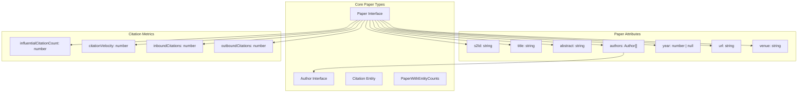
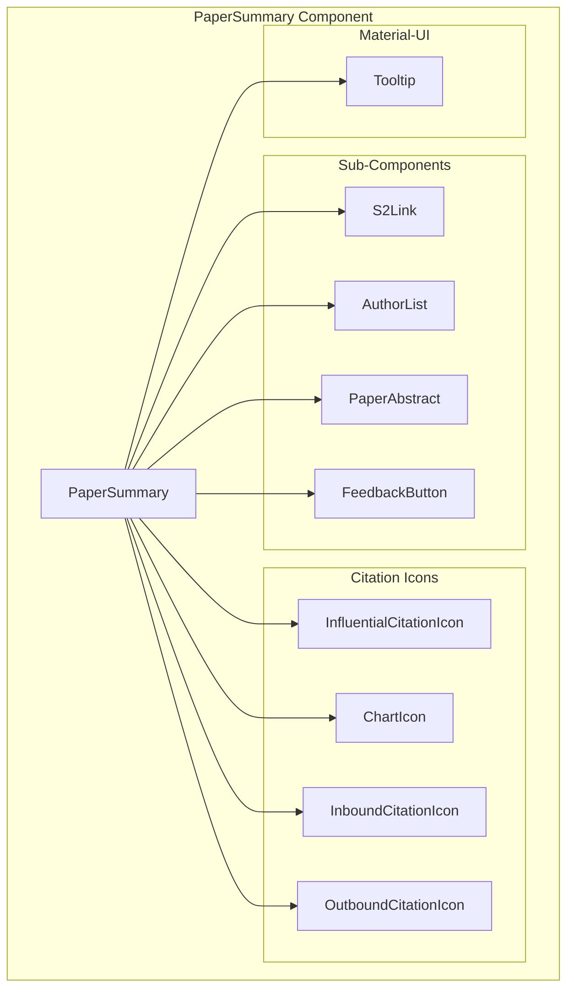
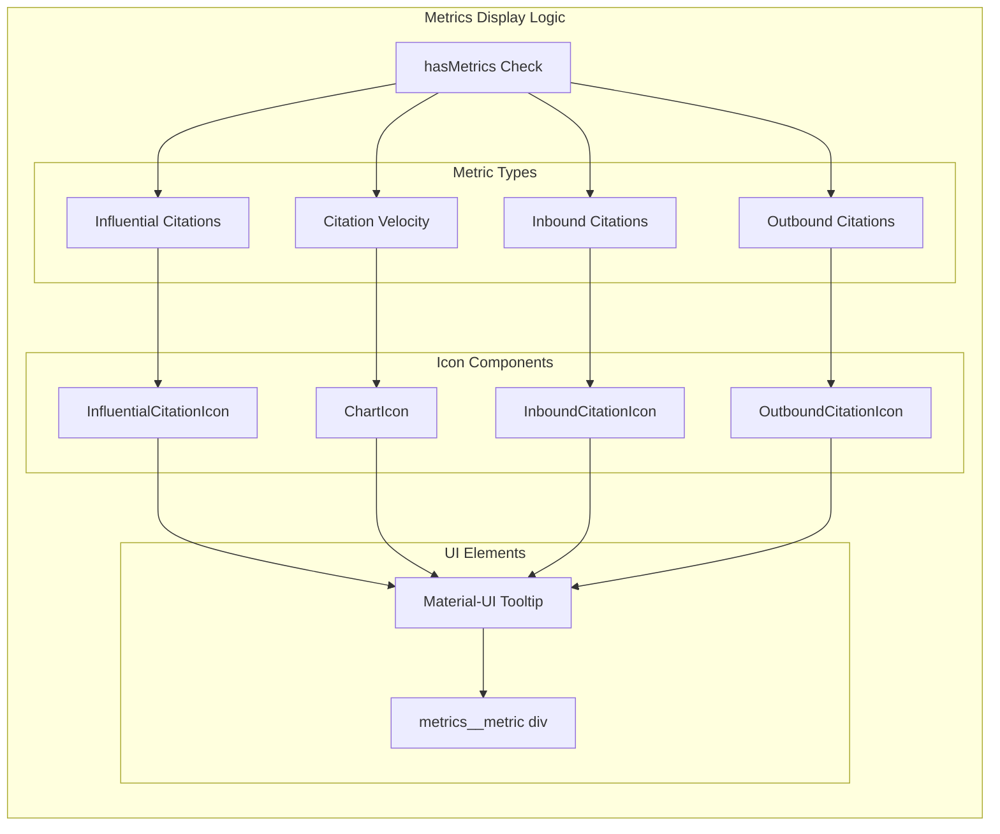
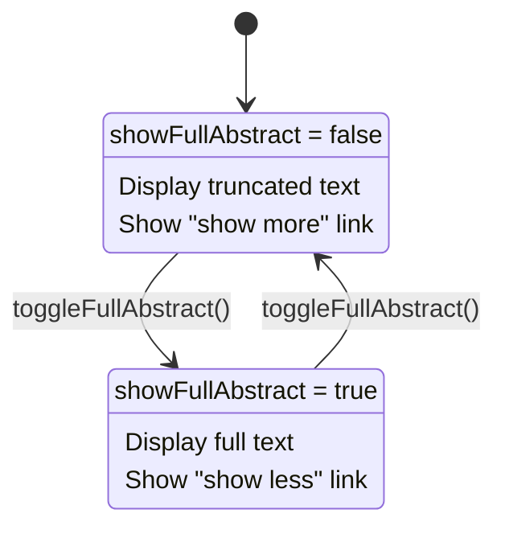
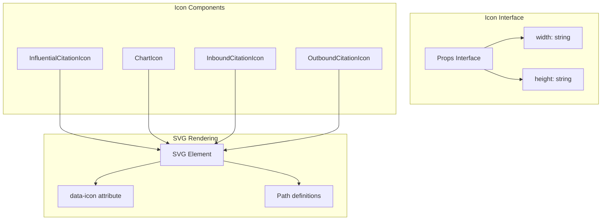
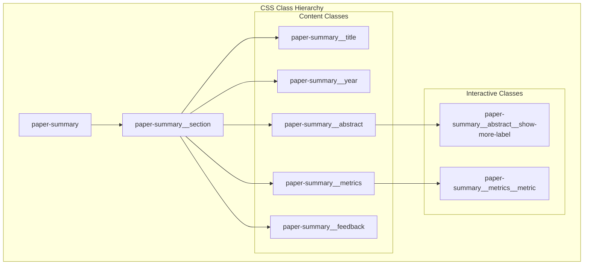
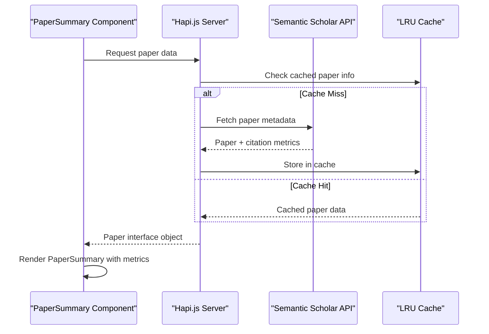

<!-- source: DeepWiki mcp.deepwiki.com · repo allenai/scholarphi · page 2.6 Paper and Citation Components · fetched 2026-10-26 -->

# Paper and Citation Components

Relevant source files

The following files were used as context for generating this wiki page:

- [ui/src/api/types.ts](ui/src/api/types.ts)
- [ui/src/components/entity/citation/PaperAbstract.tsx](ui/src/components/entity/citation/PaperAbstract.tsx)
- [ui/src/components/entity/citation/PaperSummary.tsx](ui/src/components/entity/citation/PaperSummary.tsx)
- [ui/src/components/icon/ChartIcon.tsx](ui/src/components/icon/ChartIcon.tsx)
- [ui/src/components/icon/InboundCitationIcon.tsx](ui/src/components/icon/InboundCitationIcon.tsx)
- [ui/src/components/icon/InfluentialCitationIcon.tsx](ui/src/components/icon/InfluentialCitationIcon.tsx)
- [ui/src/components/icon/OutboundCitationIcon.tsx](ui/src/components/icon/OutboundCitationIcon.tsx)
- [ui/src/components/icon/index.ts](ui/src/components/icon/index.ts)
- [ui/src/style/citation.less](ui/src/style/citation.less)

This page documents the React components responsible for displaying paper metadata, citation information, and related UI elements within the Scholar Reader system. These components handle the presentation of academic paper details including titles, authors, abstracts, citation metrics, and links to external resources like Semantic Scholar.

For information about the backend API that provides paper data, see [Backend (API System)](#3). For details about the annotation system that overlays entities on papers, see [Annotation and Entity System](#2.3).

## Data Model and Types

The paper and citation components work with strongly-typed data structures defined in the API types. The core `Paper` interface represents academic paper metadata with citation metrics from Semantic Scholar.

**Sources:** [ui/src/api/types.ts:38-50](), [ui/src/api/types.ts:80-84](), [ui/src/api/types.ts:313-325]()

## PaperSummary Component Architecture

The `PaperSummary` component serves as the primary container for displaying comprehensive paper information. It orchestrates several sub-components and handles the presentation of both metadata and citation metrics.

The component renders paper information in structured sections:

| Section | Content | Code Reference |
|---------|---------|----------------|
| Title | Paper title with S2 link | [ui/src/components/entity/citation/PaperSummary.tsx:36-40]() |
| Authors | Author list with links | [ui/src/components/entity/citation/PaperSummary.tsx:41-47]() |
| Year | Publication year | [ui/src/components/entity/citation/PaperSummary.tsx:48-52]() |
| Abstract | Expandable abstract text | [ui/src/components/entity/citation/PaperSummary.tsx:53-57]() |
| Metrics | Citation metrics with icons | [ui/src/components/entity/citation/PaperSummary.tsx:60-138]() |
| Feedback | Error reporting button | [ui/src/components/entity/citation/PaperSummary.tsx:140-146]() |

**Sources:** [ui/src/components/entity/citation/PaperSummary.tsx:23-150]()

## Citation Metrics Visualization

The citation metrics system displays quantitative information about papers using specialized icons and tooltips. Each metric type has its own icon and conditional rendering logic.

The metrics rendering follows this pattern:
- Check if metric value exists and is non-zero
- Render appropriate icon with value
- Wrap in tooltip with descriptive text
- Apply conditional pluralization for tooltip text

**Sources:** [ui/src/components/entity/citation/PaperSummary.tsx:27-31](), [ui/src/components/entity/citation/PaperSummary.tsx:61-137]()

## Abstract Display Component

The `PaperAbstract` component handles expandable text display with truncation for lengthy abstracts. It implements show more/less functionality with state management.

Key implementation details:
- Uses `truncateText` utility function with 300 character limit
- Compares truncated vs. full text to determine if expansion needed
- Toggle functionality updates component state
- Conditional rendering based on text length and state

**Sources:** [ui/src/components/entity/citation/PaperAbstract.tsx:13-50](), [ui/src/utils/ui.ts]()

## Citation Icon System

The system includes four specialized SVG icons for different types of citation metrics, each with consistent sizing props and semantic data attributes.

| Icon Component | Purpose | SVG Dimensions | Usage |
|----------------|---------|----------------|-------|
| `InfluentialCitationIcon` | Highly-cited papers indicator | 32x32 viewBox | Influential citation count |
| `ChartIcon` | Citation velocity trends | 36x36 viewBox | Citations per year |
| `InboundCitationIcon` | Papers citing this work | 36x36 viewBox | Citation count |
| `OutboundCitationIcon` | References made by paper | 27x24 viewBox | Reference count |

Each icon component follows the same pattern:
- Accepts `width` and `height` string props
- Renders SVG with appropriate `viewBox`
- Includes `data-icon` attribute for CSS targeting
- Uses semantic naming for accessibility

**Sources:** [ui/src/components/icon/InfluentialCitationIcon.tsx:8-16](), [ui/src/components/icon/ChartIcon.tsx:8-12](), [ui/src/components/icon/InboundCitationIcon.tsx:8-19](), [ui/src/components/icon/OutboundCitationIcon.tsx:8-12]()

## Styling and CSS Classes

The citation components use LESS-based styling with semantic class naming and consistent spacing variables.

Key styling features:
- BEM-style class naming convention
- Consistent padding using LESS variables (`@padding`, `@medium`)
- Semantic Scholar link styling with hover states
- Citation-specific spacing and typography rules

**Sources:** [ui/src/style/citation.less:1-46](), [ui/src/components/entity/citation/PaperSummary.tsx:34-147]()

## Integration with Backend API

The paper components consume data from the Hapi.js backend through typed interfaces, with caching and external API integration for Semantic Scholar data.

The data flow ensures:
- Type safety through TypeScript interfaces
- Efficient caching of Semantic Scholar API responses
- Graceful handling of missing or null metric values
- Consistent data structure across frontend components

**Sources:** [ui/src/api/types.ts:38-50](), [api/src/]()

---

