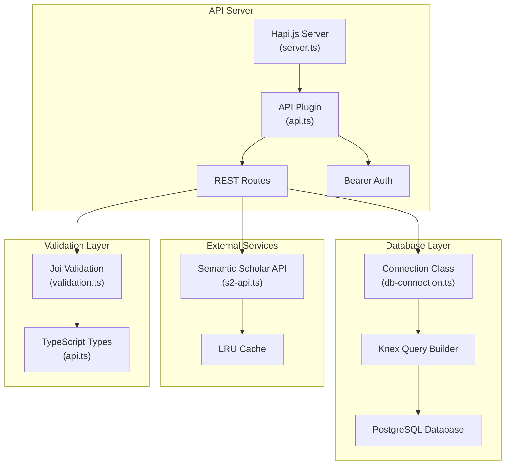
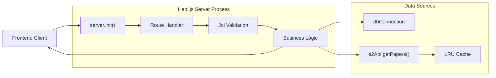
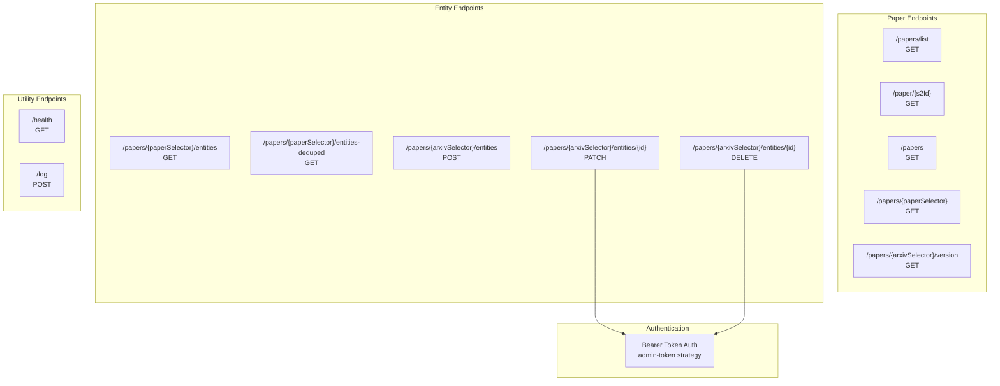
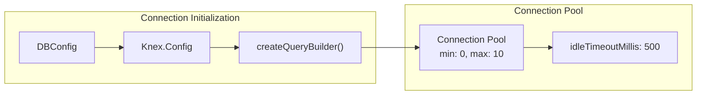
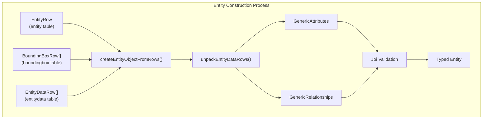
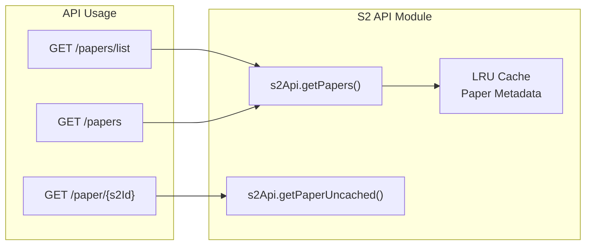
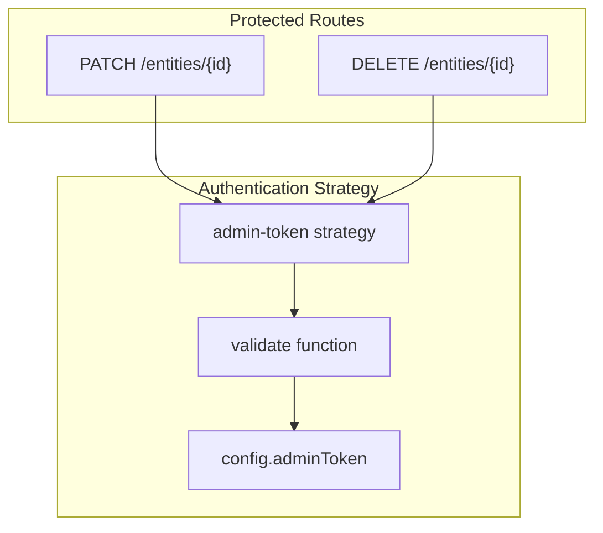
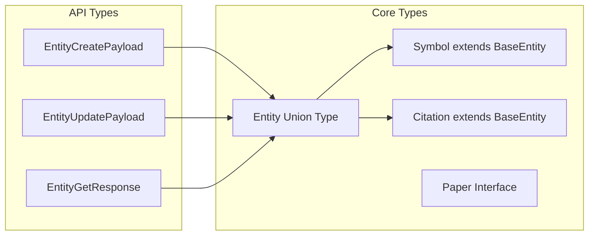
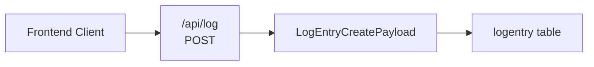

<!-- source: DeepWiki mcp.deepwiki.com · repo allenai/scholarphi · page 3 Backend (API System) · fetched 2026-10-26 -->

# Backend (API System)

Relevant source files

The following files were used as context for generating this wiki page:

- [api/.vscode/launch.json](api/.vscode/launch.json)
- [api/package-lock.json](api/package-lock.json)
- [api/package.json](api/package.json)
- [api/src/api.ts](api/src/api.ts)
- [api/src/db-connection.ts](api/src/db-connection.ts)
- [api/src/index.ts](api/src/index.ts)
- [api/src/server.ts](api/src/server.ts)
- [api/src/tests/api.test.ts](api/src/tests/api.test.ts)
- [api/src/types/api.ts](api/src/types/api.ts)
- [api/src/types/validation.ts](api/src/types/validation.ts)

## Purpose and Scope

The Backend (API System) provides a REST API server that serves paper and entity data to the Scholar Reader frontend. This Node.js/Hapi.js system acts as the primary data access layer, managing database interactions, external API integrations, and request validation. For information about the frontend UI components that consume this API, see [Frontend (UI System)](#2). For details about the data processing pipeline that populates the database, see [Data Processing Pipeline](#4).

## System Architecture Overview

The backend is built using Hapi.js as the web framework, with PostgreSQL as the primary database accessed through Knex.js query builder. The system integrates with the Semantic Scholar API for paper metadata enrichment and implements bearer token authentication for administrative operations.

### Core Architecture

**Sources:** [api/src/server.ts:1-150](), [api/src/api.ts:1-352](), [api/src/db-connection.ts:1-767]()

### Request Flow Architecture

**Sources:** [api/src/api.ts:49-351](), [api/src/server.ts:24-93]()

## API Server and Endpoints

The `ApiServer` class in [api/src/server.ts]() orchestrates the Hapi.js server lifecycle, while the main API plugin in [api/src/api.ts]() defines the REST endpoints.

### Core Server Configuration

The server initializes with CORS support for `*.semanticscholar.org` and `*.allenai.org` domains, runs on port 3000, and registers the API plugin under the `/api/v0/` prefix.

| Component | Implementation | Purpose |
|-----------|----------------|---------|
| `ApiServer.init()` | [server.ts:24-93]() | Server setup and plugin registration |
| `ApiServer.start()` | [server.ts:95-111]() | Server startup and event binding |
| `ApiServer.destroy()` | [server.ts:124-132]() | Resource cleanup and connection closure |

### REST API Endpoints

**Sources:** [api/src/api.ts:73-350](), [api/src/server.ts:65-92]()

### Key Route Handlers

| Route | Handler Function | Purpose |
|-------|------------------|---------|
| `GET /papers/list` | [api.ts:76-114]() | Paginated paper list with S2 metadata |
| `GET /papers/{paperSelector}/entities` | [api.ts:196-229]() | Entity retrieval with type filtering |
| `POST /papers/{arxivSelector}/entities` | [api.ts:274-288]() | Entity creation for arXiv papers |
| `PATCH /papers/{arxivSelector}/entities/{id}` | [api.ts:292-308]() | Entity updates (admin-only) |

## Database Integration

The `Connection` class in [api/src/db-connection.ts]() provides a typed interface to the PostgreSQL database using Knex.js as the query builder.

### Database Connection Setup

**Sources:** [api/src/db-connection.ts:24-35]()

### Core Database Operations

| Method | Purpose | Implementation |
|--------|---------|----------------|
| `getAllPapers()` | [db-connection.ts:68-101]() | Paginated paper listing with entity counts |
| `getEntitiesForPaper()` | [db-connection.ts:276-406]() | Entity retrieval with validation |
| `createEntity()` | [db-connection.ts:600-666]() | Entity creation with bounding boxes |
| `updateEntity()` | [db-connection.ts:668-738]() | Entity modification |
| `getDedupedEntitiesForPaper()` | [db-connection.ts:416-492]() | Memory-optimized entity retrieval |

### Entity Data Processing

The system handles complex entity data unpacking from the database's EAV (Entity-Attribute-Value) model:

**Sources:** [api/src/db-connection.ts:242-274](), [api/src/db-connection.ts:188-237]()

## External API Integration

The system integrates with the Semantic Scholar API for paper metadata enrichment, implementing caching strategies to optimize performance.

### Semantic Scholar API Integration

**Sources:** [api/src/api.ts:86-95](), [api/src/api.ts:122-134](), [api/src/api.ts:158-161]()

The paper list endpoint demonstrates the integration pattern:

1. Fetch paper IDs from local database
2. Batch request metadata from Semantic Scholar API
3. Merge local and S2 data into unified response
4. Return paginated results with combined information

## Authentication and Validation

### Bearer Token Authentication

The system implements bearer token authentication using the `hapi-auth-bearer-token` plugin for administrative operations:

**Sources:** [api/src/api.ts:55-70](), [api/src/api.ts:300](), [api/src/api.ts:319]()

### Request Validation

Joi schemas provide comprehensive request validation:

| Validation Schema | Purpose | Implementation |
|-------------------|---------|----------------|
| `paperSelector` | [validation.ts:31-37]() | S2 ID or arXiv ID validation |
| `entityPost` | [validation.ts:225-238]() | Entity creation validation |
| `entityPatch` | [validation.ts:240-254]() | Entity update validation |
| `apiEntityTypes` | [validation.ts:264-281]() | Entity type filtering |

### Type Safety

TypeScript interfaces ensure type safety across the API:

**Sources:** [api/src/types/api.ts:108-109](), [api/src/types/api.ts:174-183](), [api/src/types/api.ts:190-199]()

## Error Handling and Logging

The system provides structured error handling and logging capabilities:

### Error Response Patterns

| Error Type | HTTP Status | Implementation |
|------------|-------------|----------------|
| Validation Error | 400 | [api.ts:517](), [api.ts:623]() |
| Not Found | 404 | [api.ts:126-127](), [api.ts:184]() |
| Internal Error | 500 | [api.ts:131](), [api.ts:207]() |

### Logging System

The `/api/log` endpoint accepts structured log entries with client IP tracking:

**Sources:** [api/src/server.ts:67-92](), [api/src/types/api.ts:435-441]()

---

