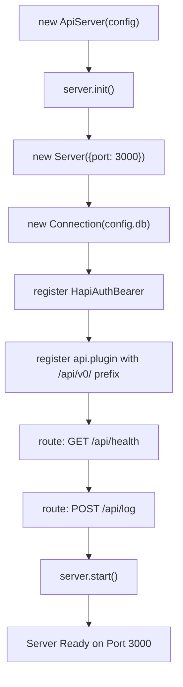
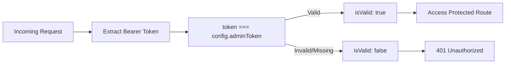
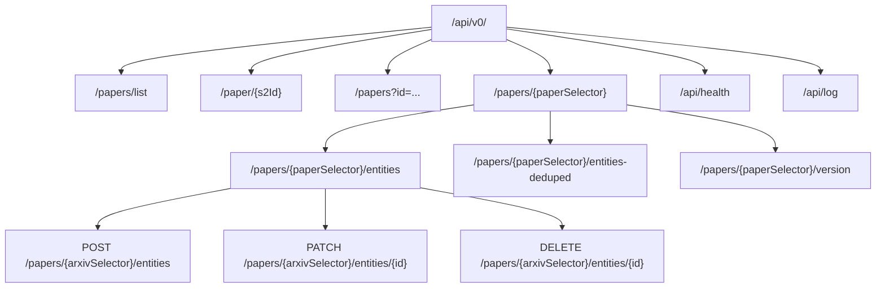
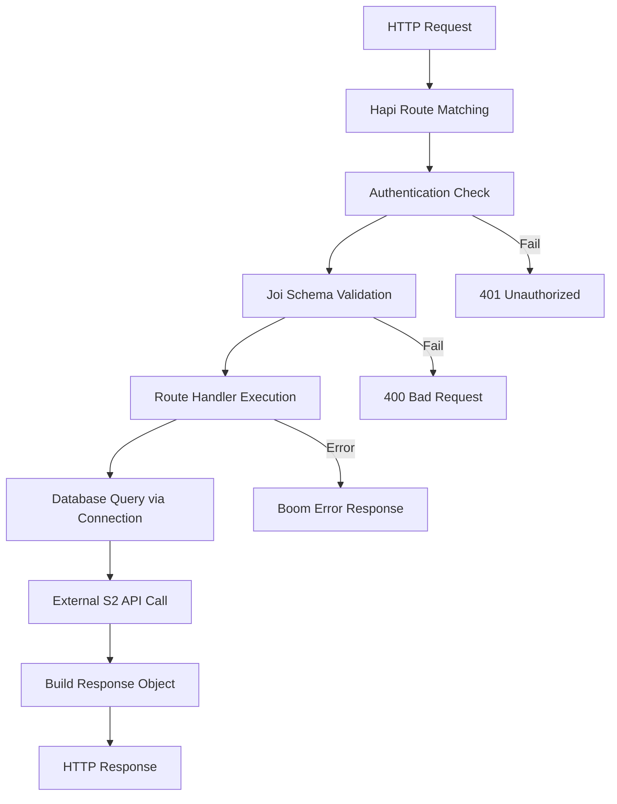

<!-- source: DeepWiki mcp.deepwiki.com · repo allenai/scholarphi · page 3.1 API Server and Endpoints · fetched 2026-10-26 -->

# API Server and Endpoints

<details>
<summary>Relevant source files</summary>

The following files were used as context for generating this wiki page:

- [api/.vscode/launch.json](api/.vscode/launch.json)
- [api/package-lock.json](api/package-lock.json)
- [api/package.json](api/package.json)
- [api/src/api.ts](api/src/api.ts)
- [api/src/db-connection.ts](api/src/db-connection.ts)
- [api/src/index.ts](api/src/index.ts)
- [api/src/server.ts](api/src/server.ts)
- [api/src/tests/api.test.ts](api/src/tests/api.test.ts)
- [api/src/types/api.ts](api/src/types/api.ts)
- [api/src/types/validation.ts](api/src/types/validation.ts)

</details>


This document covers the Node.js/Hapi.js backend API server that serves paper and entity data to the Scholar Reader frontend. The API provides REST endpoints for retrieving papers, entities, and their metadata, along with CRUD operations for entity management. For database integration details, see [Database Integration](#3.2). For external API integration with Semantic Scholar, see [External API Integration](#3.3).

## Server Architecture

The API server is built using Hapi.js and follows a plugin-based architecture. The main server wrapper is the `ApiServer` class which manages server lifecycle, database connections, and plugin registration.

### Server Initialization Flow



The `ApiServer` class encapsulates the Hapi.js server and provides lifecycle management methods:

- `init()` - Creates server instance, database connection, and registers plugins
- `start()` - Starts the HTTP server
- `stop()` - Stops the HTTP server  
- `destroy()` - Closes database connections and cleans up resources

**Sources:** [api/src/server.ts:13-149](), [api/src/index.ts:21-22]()

### Core Configuration

The server is configured with CORS support for `*.semanticscholar.org` and `*.allenai.org` domains, runs on port 3000, and uses PostgreSQL as the backend database. Configuration is managed through `nconf` with support for environment variables, command line arguments, and configuration files.

**Sources:** [api/src/server.ts:25-39](), [api/src/index.ts:5-14]()

## Authentication System

The API uses a bearer token authentication strategy powered by `hapi-auth-bearer-token`. Authentication is configured with the strategy name `admin-token` and supports tokens passed via query parameters or headers.



Protected routes include entity modification operations (PATCH, DELETE) that require the `admin-token` authentication strategy. The token validation compares the provided token against `config.adminToken`.

**Sources:** [api/src/api.ts:55-70](), [api/src/api.ts:300](), [api/src/api.ts:319]()

## API Endpoint Structure

The API follows REST conventions and is organized around two main resource types: papers and entities. All endpoints are prefixed with `/api/v0/`.

### Endpoint Overview



**Sources:** [api/src/api.ts:73-350](), [api/src/server.ts:65](), [api/src/server.ts:67-92]()

### Paper Endpoints

| Endpoint | Method | Purpose | Authentication |
|----------|---------|---------|----------------|
| `/papers/list` | GET | Paginated list of papers with metadata | None |
| `/paper/{s2Id}` | GET | Individual paper details from S2 API | None |
| `/papers` | GET | Batch fetch papers by ID list | None |
| `/papers/{paperSelector}` | GET | Check if paper exists (204/404) | None |

The `paperSelector` parameter accepts either S2 IDs (40-character hex strings) or arXiv IDs in formats like `arxiv:2101.12345` or `arxiv:cs.AI/0101001`.

**Sources:** [api/src/api.ts:75-191](), [api/src/types/validation.ts:21-48]()

### Entity Endpoints

| Endpoint | Method | Purpose | Authentication |
|----------|---------|---------|----------------|
| `/papers/{paperSelector}/entities` | GET | Get entities for paper | None |
| `/papers/{paperSelector}/entities-deduped` | GET | Get deduplicated entities | None |
| `/papers/{arxivSelector}/entities` | POST | Create new entity | None |
| `/papers/{arxivSelector}/entities/{id}` | PATCH | Update entity | Required |
| `/papers/{arxivSelector}/entities/{id}` | DELETE | Delete entity | Required |
| `/papers/{arxivSelector}/version` | GET | Get processed version info | None |

Entity endpoints support filtering by type (`citation`, `symbol`, `equation`, `sentence`, `term`) and offer a `slim` mode for reduced payload size.

**Sources:** [api/src/api.ts:194-349](), [api/src/types/validation.ts:263-281]()

## Request Processing Pipeline

The API implements a comprehensive request processing pipeline with validation, authentication, and error handling.

### Request Flow



**Sources:** [api/src/api.ts:49-350](), [api/src/server.ts:32-38]()

### Validation System

Request validation uses Joi schemas defined in the validation module. The system validates:

- URL parameters (`paperSelector`, entity IDs)
- Query parameters (entity types, pagination)
- Request payloads for POST/PATCH operations

Entity type validation supports a special `"all"` value that returns all entity types, and comma-separated lists for multiple types.

**Sources:** [api/src/types/validation.ts:1-281](), [api/src/api.ts:136-140](), [api/src/api.ts:163-175]()

### Error Handling

The API uses `@hapi/boom` for standardized HTTP error responses. Common error scenarios include:

- 400 Bad Request: Invalid request format or parameters
- 401 Unauthorized: Missing or invalid authentication token  
- 404 Not Found: Paper or entity not found
- 500 Internal Server Error: Database or external API failures

**Sources:** [api/src/api.ts:125-133](), [api/src/api.ts:205-208](), [api/src/api.ts:248-250]()

### Response Format

API responses follow a consistent structure with `data` wrappers for collections and proper HTTP status codes. Entity responses include comprehensive metadata:

```typescript
{
  "data": [
    {
      "id": "123",
      "type": "symbol", 
      "attributes": {
        "version": 1,
        "source": "extractor",
        "bounding_boxes": [...],
        "tex": "\\alpha",
        "mathml": "<math>...</math>"
      },
      "relationships": {
        "sentence": {"type": "sentence", "id": "456"}
      }
    }
  ]
}
```

**Sources:** [api/src/api.ts:218](), [api/src/types/api.ts:88-90](), [api/src/types/api.ts:115-123]()

---

