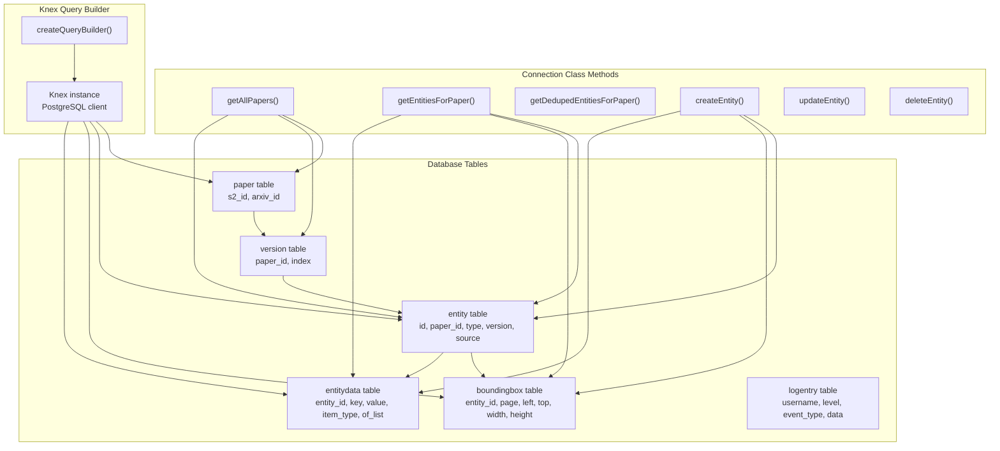
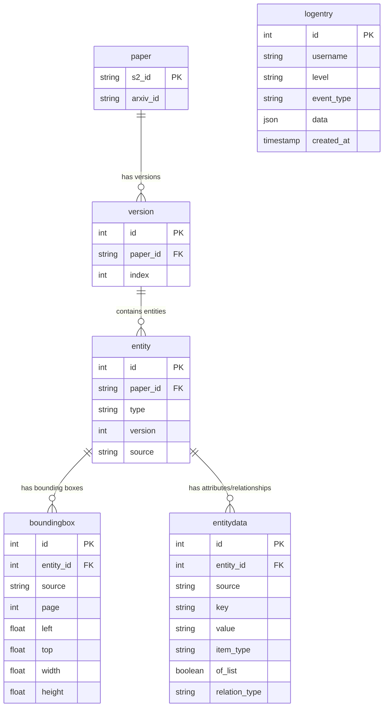
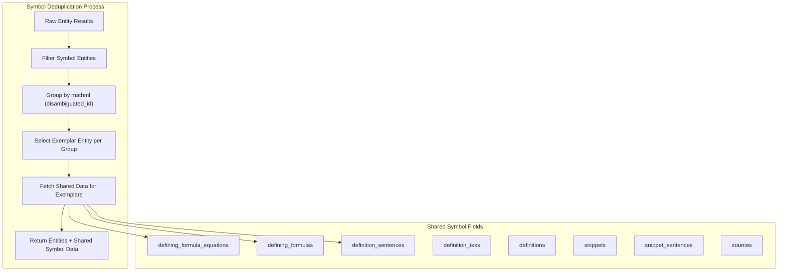
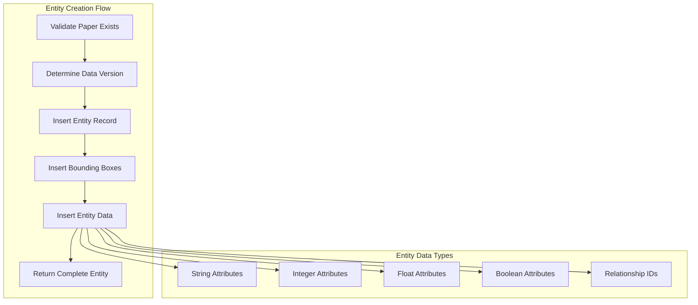

<!-- source: DeepWiki mcp.deepwiki.com · repo allenai/scholarphi · page 3.2 Database Integration · fetched 2026-10-26 -->

# Database Integration

<details>
<summary>Relevant source files</summary>

The following files were used as context for generating this wiki page:

- [api/src/api.ts](api/src/api.ts)
- [api/src/db-connection.ts](api/src/db-connection.ts)
- [api/src/tests/api.test.ts](api/src/tests/api.test.ts)
- [api/src/types/api.ts](api/src/types/api.ts)
- [api/src/types/validation.ts](api/src/types/validation.ts)

</details>


## Purpose and Scope

This document covers the PostgreSQL database integration layer in the Scholar Reader backend system. It details how the API server connects to the database, manages entity data, and performs CRUD operations for academic papers and their extracted entities. For information about the API endpoints that use this database layer, see [API Server and Endpoints](#3.1). For details about external data sources and caching, see [External API Integration](#3.3).

## Database Architecture

The database integration uses PostgreSQL with Knex.js as the query builder. The system stores academic papers and their extracted entities (symbols, citations, sentences, equations, terms) with comprehensive relationship tracking.



Sources: [api/src/db-connection.ts:24-35](), [api/src/db-connection.ts:55-58]()

## Connection Management

The `Connection` class provides the primary interface for database operations. It uses Knex.js for query building and connection pooling.

### Database Configuration

The connection is established through the `createQueryBuilder` function which accepts database configuration parameters:

| Parameter | Type | Description |
|-----------|------|-------------|
| `host` | string | PostgreSQL server hostname |
| `port` | number | Database port |
| `database` | string | Database name |
| `user` | string | Database username |
| `password` | string | Database password |
| `schema` | string | Optional schema search path |

The connection pool is configured with a minimum of 0 connections, maximum of 10, and an idle timeout of 500ms.

Sources: [api/src/db-connection.ts:24-35]()

### Connection Class Interface

```mermaid
graph TB
    subgraph "Connection Class"
        constructor["constructor(params: DBConfig)"]
        close["close()"]
        
        subgraph "Paper Operations"
            getAllPapers["getAllPapers(offset, size, entity_type)"]
            checkPaper["checkPaper(paperSelector)"]
            getLatestPaperDataVersion["getLatestPaperDataVersion(paperSelector)"]
            getLatestProcessedArxivVersion["getLatestProcessedArxivVersion(paperSelector)"]
            getPaperEntityCount["getPaperEntityCount(paperSelector, entityType)"]
        end
        
        subgraph "Entity Operations"
            getEntitiesForPaper["getEntitiesForPaper(paperSelector, entityTypes, includeDuplicateSymbolData, slim, version)"]
            getDedupedEntitiesForPaper["getDedupedEntitiesForPaper(paperSelector, entityTypes, version)"]
            createEntity["createEntity(paperSelector, data)"]
            updateEntity["updateEntity(data)"]
            deleteEntity["deleteEntity(entity_id)"]
        end
        
        subgraph "Data Transformation"
            createEntityObjectFromRows["createEntityObjectFromRows(entityRow, boundingBoxRows, entityDataRows, slim)"]
            unpackEntityDataRows["unpackEntityDataRows(rows, slim)"]
            createBoundingBoxes["createBoundingBoxes(boundingBoxRows)"]
            createEntityDataRows["createEntityDataRows(entity_id, source, attributes, relationships)"]
        end
        
        subgraph "Logging"
            insertLogEntry["insertLogEntry(logEntry)"]
        end
    end
    
    constructor --> knex["_knex: Knex instance"]
    getAllPapers --> paper_table["paper, version, entity tables"]
    getEntitiesForPaper --> entity_tables["entity, boundingbox, entitydata tables"]
    createEntity --> insert_ops["INSERT operations"]
    updateEntity --> update_ops["UPDATE/DELETE operations"]
```

Sources: [api/src/db-connection.ts:55-745]()

## Database Schema and Entity Types

### Core Tables

The database schema supports multiple entity types with flexible attribute storage:



Sources: [api/src/db-connection.ts:68-101](), [api/src/types/api.ts:92-104]()

### Supported Entity Types

The system supports six main entity types, each with specific attributes:

| Entity Type | Description | Key Attributes |
|-------------|-------------|----------------|
| `citation` | Paper references | `paper_id` |
| `symbol` | Mathematical symbols | `tex`, `mathml`, `type`, `definitions` |
| `sentence` | Text sentences | `text`, `tex`, `tex_start`, `tex_end` |
| `equation` | Mathematical equations | `tex` |
| `term` | Technical terms | `name`, `term_type`, `definitions` |
| `definition` | Definitions | Custom attributes |

Sources: [api/src/types/api.ts:92-104](), [api/src/types/validation.ts:104-166]()

## Entity Operations

### Retrieving Entities

The primary method for fetching entities is `getEntitiesForPaper`, which supports filtering by entity type and optimization options:

```typescript
getEntitiesForPaper(
  paperSelector: PaperSelector,
  entityTypes: EntityType[],
  includeDuplicateSymbolData: boolean,
  slim: boolean,
  version?: number
): Promise<Entity[]>
```

**Parameters:**
- `paperSelector`: Either `{arxiv_id: string}` or `{s2_id: string}`
- `entityTypes`: Array of entity types to filter by
- `includeDuplicateSymbolData`: Whether to include redundant symbol data
- `slim`: Return minimal data for performance
- `version`: Specific data version (defaults to latest)

Sources: [api/src/db-connection.ts:276-406]()

### Deduplication Strategy

For symbols, the system provides `getDedupedEntitiesForPaper` to reduce data duplication by sharing common attributes across symbol instances:



Sources: [api/src/db-connection.ts:416-492](), [api/src/types/api.ts:220-239]()

### Creating and Updating Entities

Entity creation involves three steps:
1. Insert entity record
2. Insert bounding boxes
3. Insert entity data (attributes and relationships)



Sources: [api/src/db-connection.ts:600-666](), [api/src/db-connection.ts:668-738]()

## Data Transformation

### Attribute and Relationship Unpacking

The `unpackEntityDataRows` method converts raw database rows into typed attributes and relationships:

```typescript
// Entity data storage format
interface EntityDataRow {
  entity_id: number;
  key: string;
  value: string;
  item_type: "string" | "integer" | "float" | "boolean" | "relation-id";
  of_list: boolean;
  relation_type: string | null;
}
```

**Type Conversion:**
- `integer` → `parseInt(value)`
- `float` → `parseFloat(value)`
- `string` → `value`
- `boolean` → `truthy(1)` / `falsy(0)`
- `relation-id` → `{type: relation_type, id: value}`

Sources: [api/src/db-connection.ts:188-237]()

### Bounding Box Handling

Bounding boxes are stored as relative coordinates (ratios to page dimensions):

```typescript
interface BoundingBox {
  source: string;
  page: number;      // Page index (0-based)
  left: number;      // Ratio to page width
  top: number;       // Ratio to page height  
  width: number;     // Ratio to page width
  height: number;    // Ratio to page height
}
```

Sources: [api/src/types/api.ts:420-430](), [api/src/db-connection.ts:170-181]()

## Query Patterns

### Paper Selection

The system supports querying papers by either Semantic Scholar ID or arXiv ID:

```typescript
type PaperSelector = ArxivIdPaperSelector | S2IdPaperSelector;

interface ArxivIdPaperSelector {
  arxiv_id: string;  // Format: "1234.5678" or "1234.5678v1"
}

interface S2IdPaperSelector {
  s2_id: string;     // Format: 40-character hex string
}
```

### Version Management

The system tracks multiple data versions per paper, with queries typically using the latest version:

```sql
SELECT MAX(index) AS index, paper_id
FROM version
GROUP BY paper_id
```

Sources: [api/src/db-connection.ts:750-766](), [api/src/db-connection.ts:137-144]()

### Entity Counting and Pagination

The `getAllPapers` method provides paginated results with entity counts:

```sql
SELECT paper.arxiv_id,
       paper.s2_id, 
       version.index AS version,
       COUNT(*) OVER() as total_count
FROM paper
JOIN (SELECT MAX(index) AS index, paper_id FROM version GROUP BY paper_id) AS version
  ON version.paper_id = paper.s2_id
JOIN entity ON entity.paper_id = paper.s2_id
  AND entity.version = version.index
  AND entity.type = ?
GROUP BY paper.s2_id, paper.arxiv_id, version.index
ORDER BY paper.arxiv_id DESC
OFFSET ? LIMIT ?
```

Sources: [api/src/db-connection.ts:68-101]()

---

