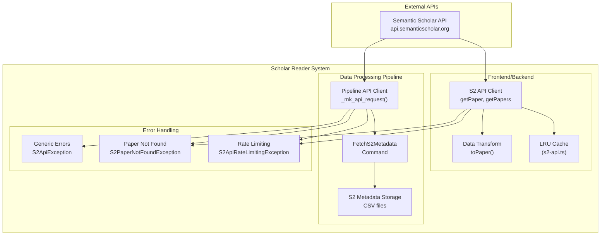
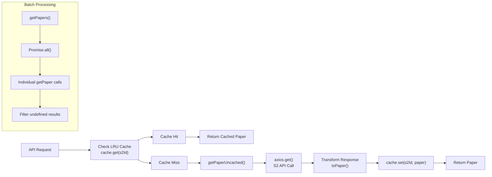
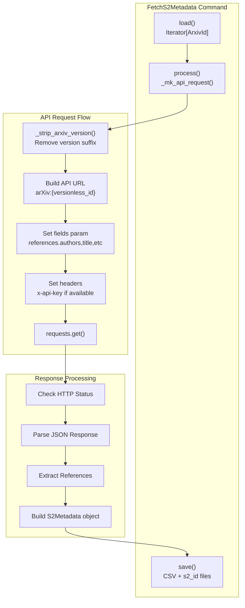
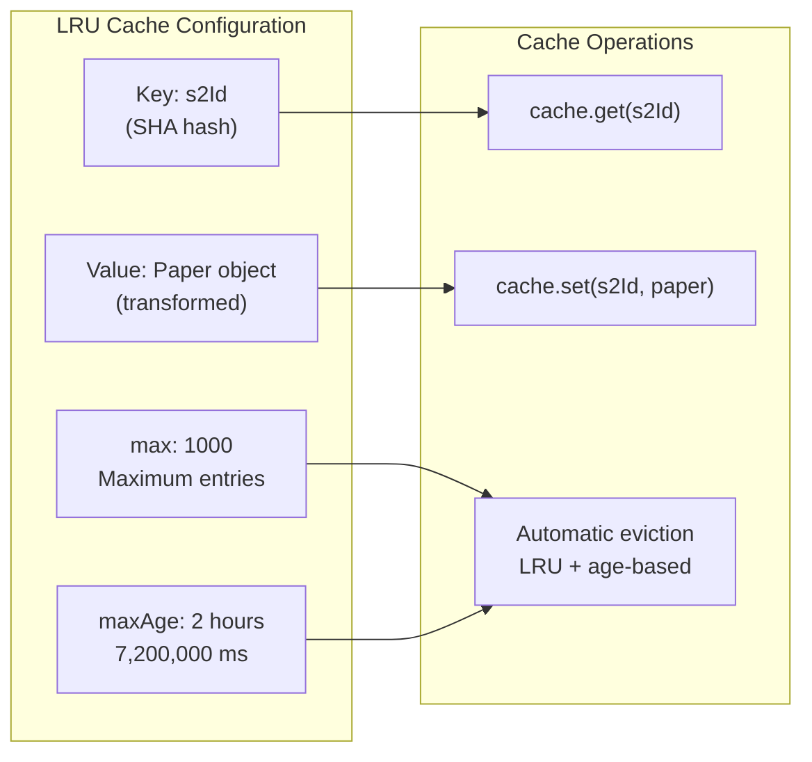
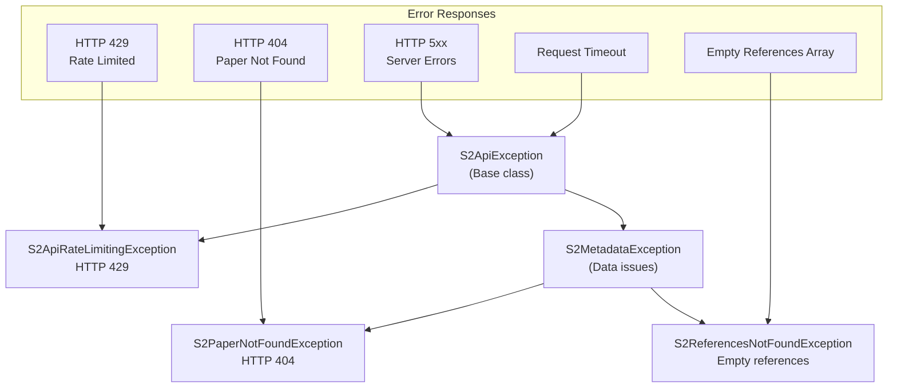
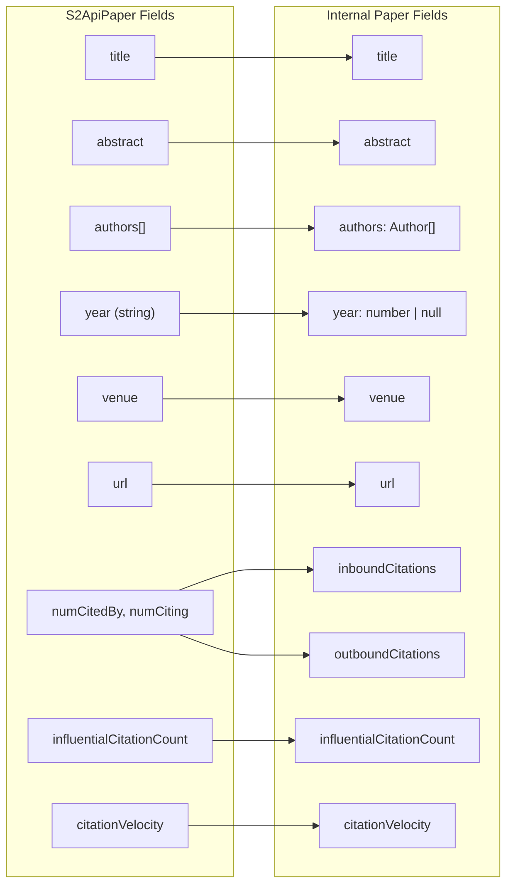

<!-- source: DeepWiki mcp.deepwiki.com · repo allenai/scholarphi · page 3.3 External API Integration · fetched 2026-10-26 -->

# External API Integration

Relevant source files

The following files were used as context for generating this wiki page:

- [api/src/s2-api.ts](api/src/s2-api.ts)
- [api/src/types/s2-api.ts](api/src/types/s2-api.ts)
- [data-processing/common/commands/fetch_s2_data.py](data-processing/common/commands/fetch_s2_data.py)
- [data-processing/tests/common/__init__.py](data-processing/tests/common/__init__.py)
- [data-processing/tests/common/commands/__init__.py](data-processing/tests/common/commands/__init__.py)
- [data-processing/tests/common/commands/test_fetch_s2_data.py](data-processing/tests/common/commands/test_fetch_s2_data.py)

This document covers the Scholar Reader system's integration with external APIs, primarily the Semantic Scholar (S2) Public API. The system integrates with S2's API to enrich paper metadata, fetch citation information, and provide enhanced academic paper context. For database integration patterns, see [Database Integration](#3.2). For API server endpoints, see [API Server and Endpoints](#3.1).

## Overview

The Scholar Reader system integrates with the Semantic Scholar Public API in two primary contexts: the Node.js backend API server and the Python data processing pipeline. Both implementations handle API authentication, rate limiting, caching, and data transformation to support the system's paper enrichment capabilities.

Sources: [api/src/s2-api.ts:1-127](), [data-processing/common/commands/fetch_s2_data.py:1-208]()

## Frontend API Client Implementation

The frontend API client is implemented in TypeScript and provides functions for fetching paper data from the Semantic Scholar API. The main client interface consists of the `getPaper`, `getPapers`, and `getPaperUncached` functions.

### Core API Functions

The `getPaper` function serves as the primary interface with built-in caching, while `getPaperUncached` provides direct API access. The `getPapers` function handles batch requests with configurable error handling:

Sources: [api/src/s2-api.ts:65-79](), [api/src/s2-api.ts:29-38](), [api/src/s2-api.ts:89-126]()

### Request Configuration and Authentication

The API client configures requests with proper headers and optional API key authentication. The `getPaperUncached` function constructs the request configuration including user agent identification and API key headers:

| Configuration Element | Value | Purpose |
|---------------------|-------|---------|
| Base URL | `https://api.semanticscholar.org/graph/v1` | S2 API endpoint |
| User Agent | `Semantic Reader API Client (https://scholarphi.semanticscholar.org)` | Client identification |
| API Key Header | `x-api-key` | Rate limit elevation |
| Transform Response | Custom `toPaper` function | Data normalization |

Sources: [api/src/s2-api.ts:99-125]()

## Data Processing Pipeline Integration

The Python data processing pipeline includes a dedicated command `FetchS2Metadata` for retrieving paper metadata and references during batch processing operations.

### Pipeline Command Structure

Sources: [data-processing/common/commands/fetch_s2_data.py:48-144](), [data-processing/common/commands/fetch_s2_data.py:167-208]()

### Reference Data Extraction

The pipeline extracts detailed reference information including author data, external identifiers, and publication metadata. The `process` method handles the transformation of S2 API response data into structured `Reference` objects:

Sources: [data-processing/common/commands/fetch_s2_data.py:104-133]()

## Caching Strategy

The frontend implementation uses an LRU (Least Recently Used) cache to improve performance and reduce API calls to the Semantic Scholar service.

### Cache Configuration

Sources: [api/src/s2-api.ts:13-18]()

## Error Handling and Rate Limiting

Both the frontend and pipeline implementations include comprehensive error handling for various API failure scenarios.

### Exception Hierarchy

The Python pipeline defines a structured exception hierarchy for different API error conditions:

Sources: [data-processing/common/commands/fetch_s2_data.py:22-46](), [data-processing/common/commands/fetch_s2_data.py:134-142]()

### Rate Limiting Considerations

The pipeline includes a configurable delay between requests to respect API rate limits:

| Component | Rate Limiting Strategy |
|-----------|----------------------|
| Pipeline | 3-second delay between requests (`FETCH_DELAY`) |
| Frontend | Warning message when API key not configured |
| Both | Support for `x-api-key` header for higher limits |

Sources: [data-processing/common/commands/fetch_s2_data.py:19](), [api/src/s2-api.ts:91-97]()

## Data Transformation

The system transforms S2 API response data into internal data structures optimized for the Scholar Reader application.

### Frontend Data Transformation

The `toPaper` function converts S2 API responses to the internal `Paper` format:

Sources: [api/src/s2-api.ts:43-63](), [api/src/types/s2-api.ts:2-21]()

### Pipeline Data Structures

The pipeline creates `S2Metadata` objects containing paper references with detailed author and publication information, saved as CSV files for further processing:

Sources: [data-processing/common/commands/fetch_s2_data.py:145-166]()

## API Authentication

Both implementations support optional API key authentication to access higher rate limits on the Semantic Scholar API.

### Authentication Configuration

| Environment Variable | Usage | Default |
|---------------------|-------|---------|
| `S2_PARTNER_API_TOKEN` | Pipeline authentication | None |
| API key parameter | Frontend authentication | None |

The frontend client issues warnings when API keys are not configured, indicating potential rate limiting issues:

Sources: [data-processing/common/commands/fetch_s2_data.py:51](), [api/src/s2-api.ts:90-97]()

---

