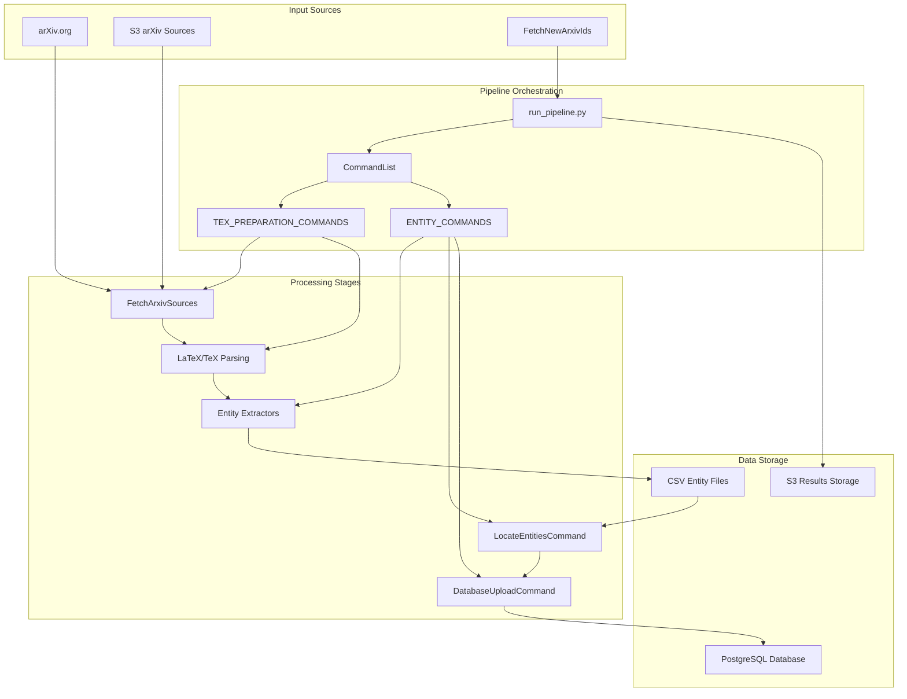
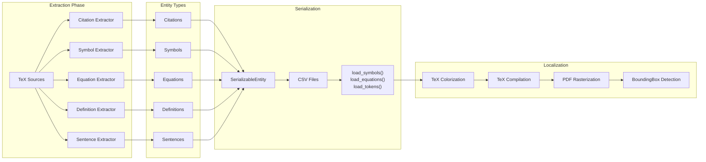
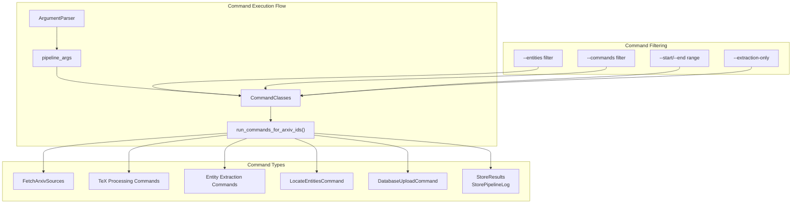
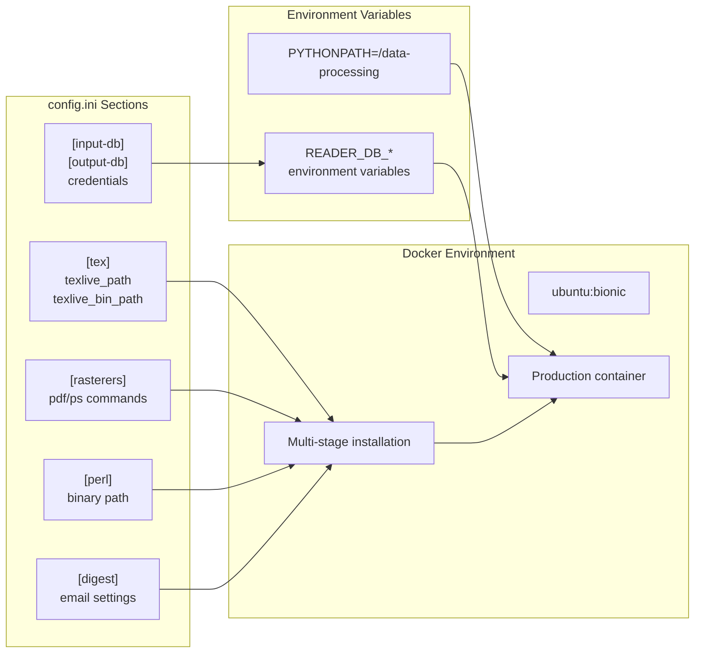
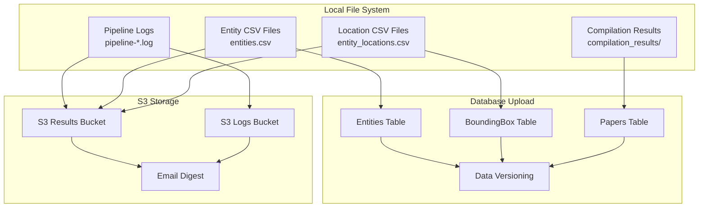

<!-- source: DeepWiki mcp.deepwiki.com · repo allenai/scholarphi · page 4 Data Processing Pipeline · fetched 2026-10-26 -->

# Data Processing Pipeline

Relevant source files

The following files were used as context for generating this wiki page:

- [.gitignore](.gitignore)
- [data-processing/.dockerignore](data-processing/.dockerignore)
- [data-processing/Dockerfile](data-processing/Dockerfile)
- [data-processing/common/file_utils.py](data-processing/common/file_utils.py)
- [data-processing/common/types.py](data-processing/common/types.py)
- [data-processing/config.ini](data-processing/config.ini)
- [data-processing/requirements.txt](data-processing/requirements.txt)
- [data-processing/scripts/run_pipeline.py](data-processing/scripts/run_pipeline.py)

## Purpose and Scope

The Data Processing Pipeline is a Python-based system that processes academic papers from arXiv to extract structured entities such as mathematical symbols, equations, citations, and definitions. The pipeline converts LaTeX source documents into annotated data that powers the Scholar Reader's augmented PDF viewing experience.

This document provides an overview of the pipeline architecture, data flow, and orchestration mechanisms. For detailed information about specific components, see:
- Pipeline orchestration and command structure: [Pipeline Architecture and Orchestration](#4.1)
- Document parsing and mathematical notation handling: [LaTeX and MathML Parsing](#4.2)  
- Entity detection algorithms: [Entity Extraction Systems](#4.3)
- ML models for definition detection: [Machine Learning and NLP Models](#4.4)
- Visual entity localization methods: [Entity Localization and Visualization](#4.5)
- Docker environment and dependencies: [Environment and Dependencies](#4.6)

## Pipeline Architecture Overview

The data processing pipeline transforms academic papers through multiple stages, from raw LaTeX sources to structured entities with precise location data.

Sources: [data-processing/scripts/run_pipeline.py:31-36](), [data-processing/scripts/run_pipeline.py:104]()

## Entity Processing Data Flow

The pipeline processes different types of entities through specialized extraction and localization workflows.

Sources: [data-processing/common/types.py:138-182](), [data-processing/common/file_utils.py:330-446]()

## Core Entity Data Structures

The pipeline defines specific data classes for different entity types, each inheriting from `SerializableEntity` to enable CSV storage and retrieval.

| Entity Type | Core Class | Key Attributes | File Storage |
|-------------|------------|----------------|--------------|
| Equations | `Equation` | `i`, `content_tex`, `katex_compatible_tex` | `detected-equations/entities.csv` |
| Symbols | `SerializableSymbol` | `mathml`, `type_`, `is_definition` | `detected-symbols/entities.csv` |
| Tokens | `SerializableToken` | `text`, `type_`, `relative_start` | `detected-equation-tokens/entities.csv` |
| Citations | Various | Citation key, reference data | `citations/entities.csv` |
| Definitions | `Term` | `text`, `definitions`, `sources` | `definitions/entities.csv` |

Sources: [data-processing/common/types.py:191-241](), [data-processing/common/file_utils.py:330-355]()

## Pipeline Command Structure

The `run_pipeline.py` script orchestrates processing through a sequence of commands, each implementing the command pattern with standardized argument parsing.

Sources: [data-processing/scripts/run_pipeline.py:44-99](), [data-processing/scripts/run_pipeline.py:401-453]()

## Configuration and Environment

The pipeline requires a comprehensive environment including LaTeX, Perl, Python ML libraries, and database connectivity.

### Key Dependencies

- **LaTeX Processing**: TeXLive 2020, AutoTeX via Perl 5.22.4
- **ML/NLP**: spaCy, SciSpacy, transformers, pytorch-crf 
- **Database**: PostgreSQL via peewee ORM
- **Image Processing**: OpenCV, ImageMagick, GhostScript
- **Cloud Storage**: AWS CLI for S3 integration

### Configuration Structure

Sources: [data-processing/config.ini:10-66](), [data-processing/Dockerfile:1-80](), [data-processing/requirements.txt:1-35]()

## Processing Modes and Execution

The pipeline supports flexible execution modes for different use cases, from development to production batch processing.

### Execution Modes

| Mode | Flag | Description | Use Case |
|------|------|-------------|----------|
| Batch Processing | Default | Process all papers together | Production runs |
| One-at-a-time | `--one-paper-at-a-time` | Process papers sequentially | Memory-constrained environments |
| Extraction Only | `--extraction-only` | Skip localization and database upload | Entity extraction testing |
| Dry Run | `--dry-run` | Skip database writes | Testing and validation |

### Input Sources

The pipeline can process papers from multiple sources:

- **Recent Papers**: `--days N` fetches recent arXiv submissions via `FetchNewArxivIds`
- **Specific Papers**: `--arxiv-ids` or `--arxiv-ids-file` for targeted processing  
- **S3 Job Specs**: `--s3-job-spec` for cloud-orchestrated batch jobs
- **Source Location**: `--source arxiv|s3` determines download location

Sources: [data-processing/scripts/run_pipeline.py:164-244](), [data-processing/scripts/run_pipeline.py:466-489]()

## Output and Results Storage

The pipeline generates structured outputs at multiple stages, with configurable storage options for different deployment scenarios.

### Data Output Structure

Sources: [data-processing/scripts/run_pipeline.py:250-275](), [data-processing/scripts/run_pipeline.py:491-506](), [data-processing/common/file_utils.py:82-146]()

---

