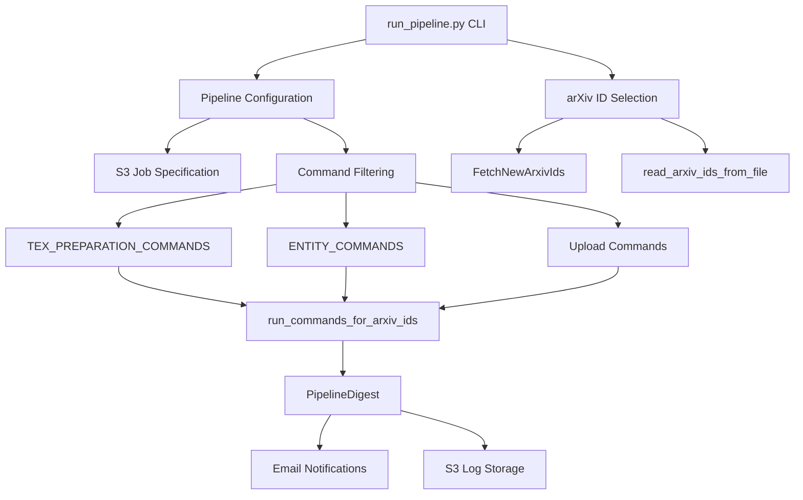
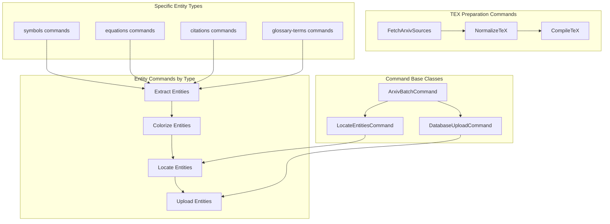
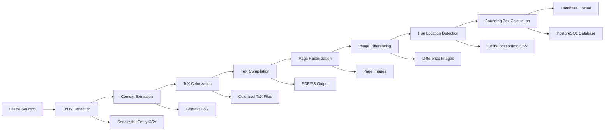
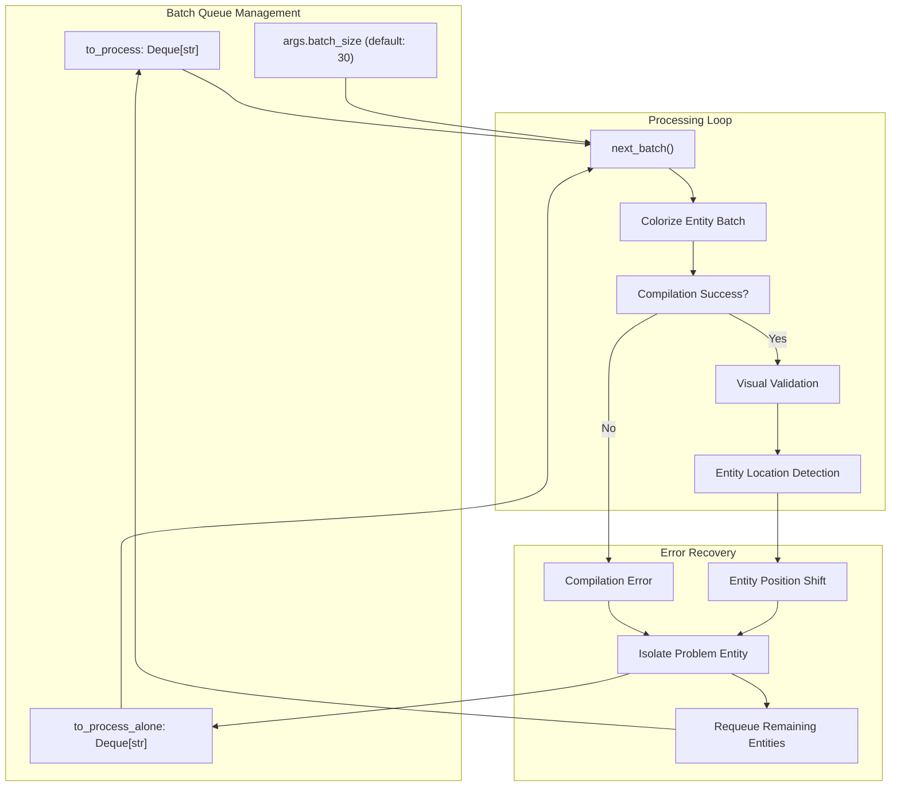
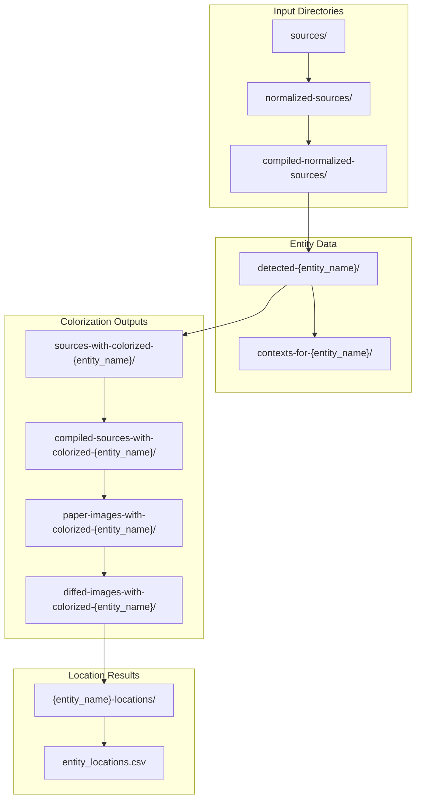
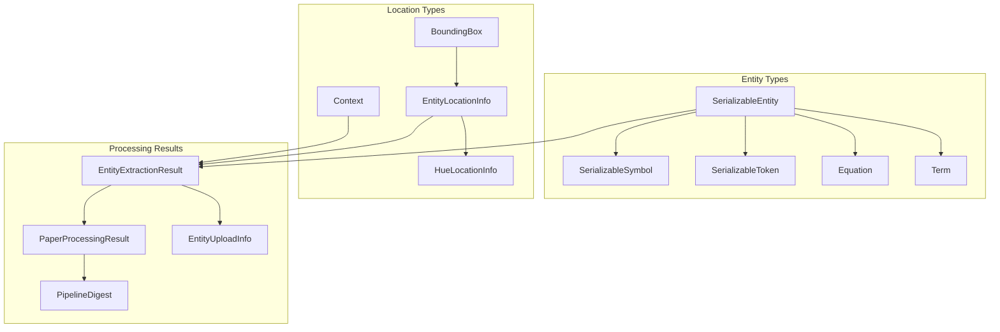
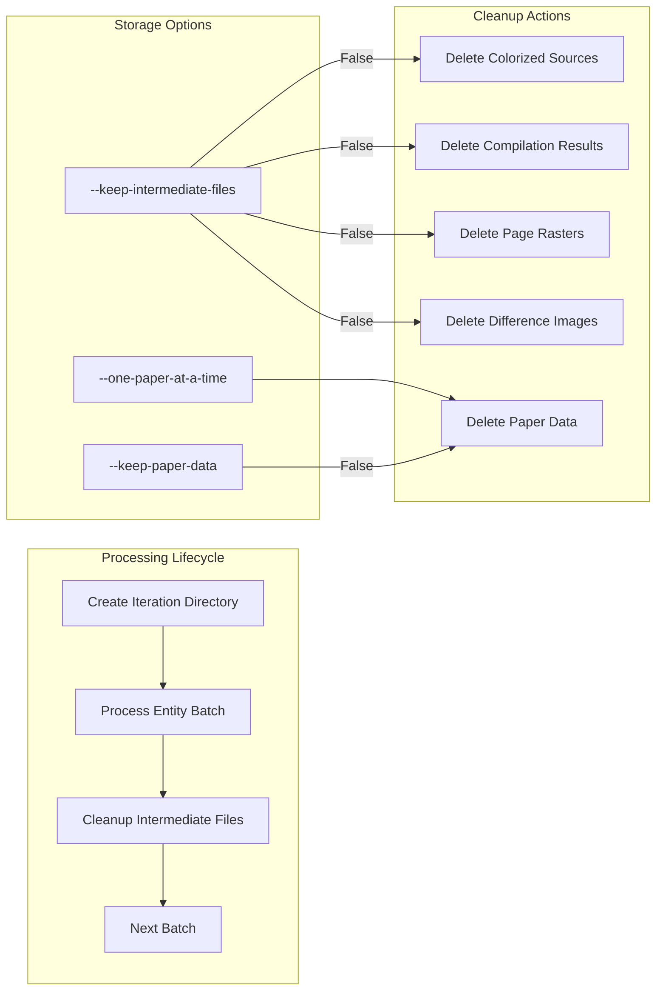

<!-- source: DeepWiki mcp.deepwiki.com · repo allenai/scholarphi · page 4.1 Pipeline Architecture and Orchestration · fetched 2026-10-26 -->

# Pipeline Architecture and Orchestration

Relevant source files

The following files were used as context for generating this wiki page:

- [data-processing/common/colorize_tex.py](data-processing/common/colorize_tex.py)
- [data-processing/common/commands/locate_entities.py](data-processing/common/commands/locate_entities.py)
- [data-processing/common/file_utils.py](data-processing/common/file_utils.py)
- [data-processing/common/types.py](data-processing/common/types.py)
- [data-processing/entities/citations/colorize.py](data-processing/entities/citations/colorize.py)
- [data-processing/entities/common.py](data-processing/entities/common.py)
- [data-processing/entities/equations/__init__.py](data-processing/entities/equations/__init__.py)
- [data-processing/entities/glossary_terms/__init__.py](data-processing/entities/glossary_terms/__init__.py)
- [data-processing/entities/glossary_terms/upload.py](data-processing/entities/glossary_terms/upload.py)
- [data-processing/entities/sentences/commands/extract_contexts.py](data-processing/entities/sentences/commands/extract_contexts.py)
- [data-processing/entities/symbols/__init__.py](data-processing/entities/symbols/__init__.py)
- [data-processing/scripts/run_pipeline.py](data-processing/scripts/run_pipeline.py)

This document describes the architecture and orchestration of the Scholar Reader data processing pipeline, which extracts structured entities from academic papers and determines their visual locations in the rendered documents. The pipeline processes LaTeX/PDF documents from arXiv to create annotated data for the frontend reader interface.

For information about specific entity extraction algorithms, see [Entity Extraction Systems](#4.3). For details about LaTeX parsing and compilation, see [LaTeX and MathML Parsing](#4.2).

## Pipeline Entry Point and Command Orchestration

The pipeline is orchestrated through the main script [`run_pipeline.py`](data-processing/scripts/run_pipeline.py:1-507), which provides a command-line interface for processing batches of academic papers. The script coordinates the execution of multiple processing commands in sequence.

### Main Pipeline Script Architecture

**Sources:** [data-processing/scripts/run_pipeline.py:102-507]()

### Command Architecture and Types

The pipeline uses a command pattern where each processing step is implemented as a `Command` class. Commands are organized into sequences that define the complete processing workflow.

**Sources:** [data-processing/scripts/run_pipeline.py:31-41](), [data-processing/common/commands/locate_entities.py:38-52]()

## Entity Processing Workflow

Each entity type follows a standardized processing pipeline that includes extraction, localization, and database upload. The workflow is designed to handle the complex process of finding visual locations of entities in compiled documents.

### Entity Pipeline Stages

**Sources:** [data-processing/entities/common.py:14-65](), [data-processing/common/commands/locate_entities.py:151-205]()

### Entity Type Registration and Commands

Entity types are registered through the `EntityPipeline` system, which defines the complete command sequence for each entity type:

**Sources:** [data-processing/entities/symbols/__init__.py:98-153](), [data-processing/entities/equations/__init__.py:21-32](), [data-processing/entities/common.py:14-65]()

## Batch Processing and Fault Tolerance

The pipeline implements sophisticated batch processing with fault tolerance to handle the complexities of LaTeX compilation and entity colorization. The `LocateEntitiesCommand` is the core component that manages this process.

### Batch Processing Architecture

**Sources:** [data-processing/common/commands/locate_entities.py:237-574]()

### Error Detection and Recovery

The pipeline implements multiple levels of error detection and recovery:

| Error Type | Detection Method | Recovery Strategy |
|------------|------------------|-------------------|
| Compilation Failure | `compilation_result.success` | Isolate problematic entity using `get_last_colorized_entity()` |
| Visual Layout Shift | Black pixels in difference images | Skip batch if visual validation enabled |
| Entity Position Drift | Compare expected vs actual entity positions | Remove first shifted entity, reprocess remainder |
| Colorization Overlap | Entity overlap detection during colorization | Queue overlapping entities for separate processing |

**Sources:** [data-processing/common/commands/locate_entities.py:381-574]()

## Data Flow and Storage Management

The pipeline manages complex data flows through a structured directory system and intermediate file management. Each processing stage produces specific outputs that are consumed by subsequent stages.

### Directory Structure and Data Flow

**Sources:** [data-processing/common/commands/locate_entities.py:54-66](), [data-processing/common/directories.py]()

### Core Data Types and Processing Results

The pipeline uses strongly-typed data structures to ensure consistency across processing stages:

**Sources:** [data-processing/common/types.py:139-710]()

### File Management and Cleanup

The pipeline implements careful file management to handle the large storage requirements of processing academic papers:

**Sources:** [data-processing/scripts/run_pipeline.py:249-268](), [data-processing/scripts/run_pipeline.py:466-483](), [data-processing/common/file_utils.py:291-314]()

---

