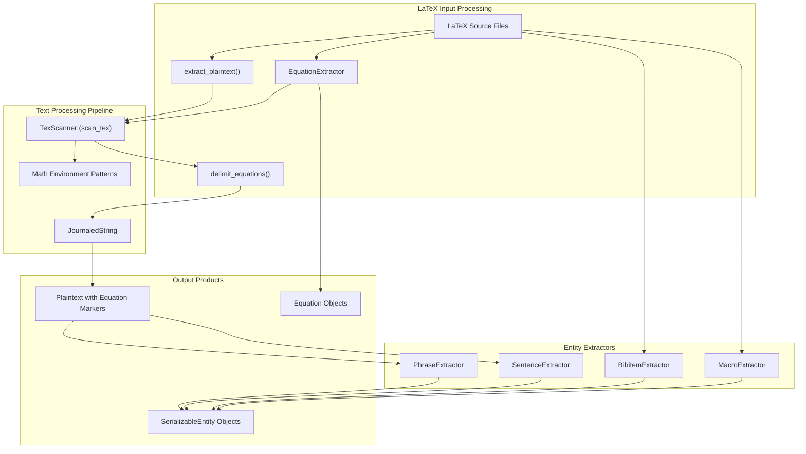
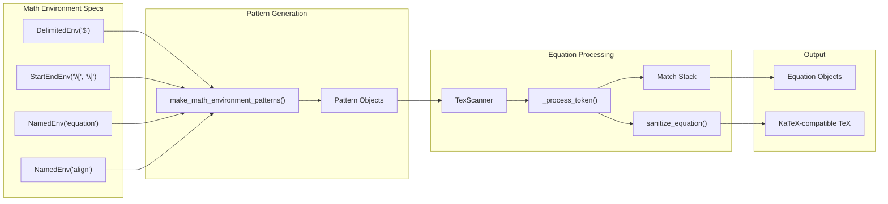
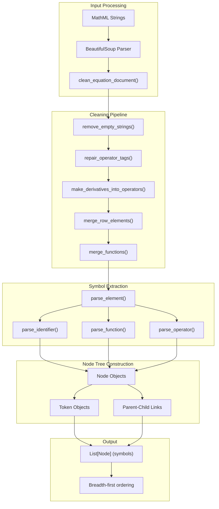
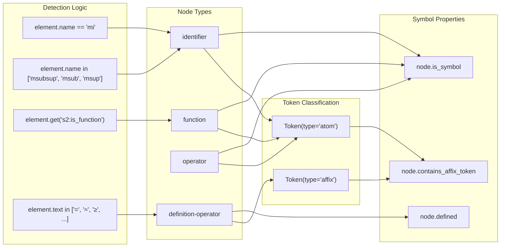
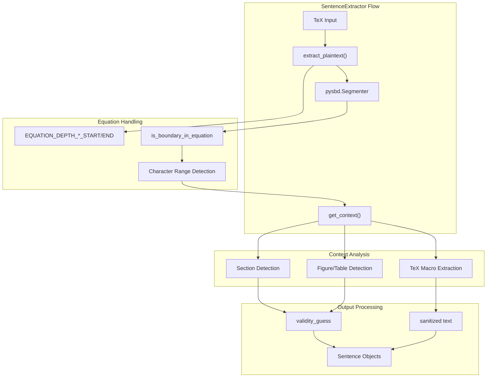
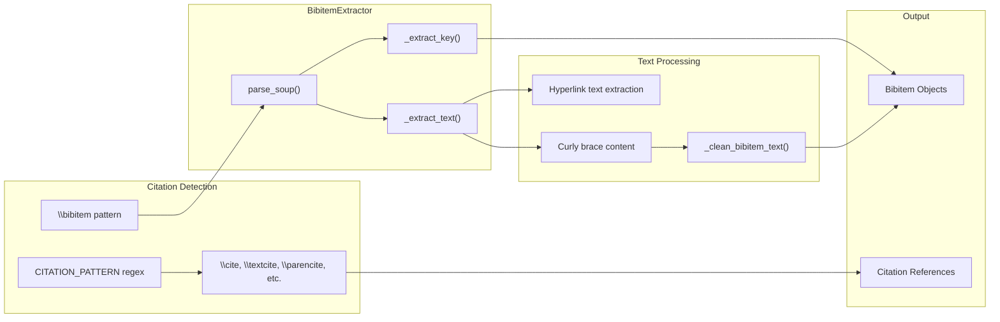

<!-- source: DeepWiki mcp.deepwiki.com · repo allenai/scholarphi · page 4.2 LaTeX and MathML Parsing · fetched 2026-10-26 -->

# LaTeX and MathML Parsing

Relevant source files

The following files were used as context for generating this wiki page:

- [data-processing/common/parse_equation.py](data-processing/common/parse_equation.py)
- [data-processing/common/parse_tex.py](data-processing/common/parse_tex.py)
- [data-processing/entities/citations/extractor.py](data-processing/entities/citations/extractor.py)
- [data-processing/entities/sentences/extractor.py](data-processing/entities/sentences/extractor.py)
- [data-processing/entities/sentences/types.py](data-processing/entities/sentences/types.py)
- [data-processing/tests/mathml-fragments/bar_x.xml](data-processing/tests/mathml-fragments/bar_x.xml)
- [data-processing/tests/mathml-fragments/d.xml](data-processing/tests/mathml-fragments/d.xml)
- [data-processing/tests/mathml-fragments/delta_a_d_b.xml](data-processing/tests/mathml-fragments/delta_a_d_b.xml)
- [data-processing/tests/mathml-fragments/dot.xml](data-processing/tests/mathml-fragments/dot.xml)
- [data-processing/tests/mathml-fragments/forall.xml](data-processing/tests/mathml-fragments/forall.xml)
- [data-processing/tests/test_colorize_sentences.py](data-processing/tests/test_colorize_sentences.py)
- [data-processing/tests/test_locate_symbols.py](data-processing/tests/test_locate_symbols.py)
- [data-processing/tests/test_parse_equation.py](data-processing/tests/test_parse_equation.py)
- [data-processing/tests/test_parse_tex.py](data-processing/tests/test_parse_tex.py)

This document covers the LaTeX source code parsing and MathML equation processing systems within Scholar Reader's data processing pipeline. These systems extract structured mathematical notation and convert LaTeX documents into processable formats for entity detection and localization.

For information about entity extraction that uses these parsers, see [Entity Extraction Systems](#4.3). For details on the broader data processing pipeline architecture, see [Pipeline Architecture and Orchestration](#4.1).

## Overview

The parsing system consists of two primary components: LaTeX document parsing for extracting text and structural elements, and MathML processing for analyzing mathematical expressions. The LaTeX parser converts raw TeX source into plaintext while preserving equation boundaries, while the MathML parser extracts mathematical symbols and their relationships from rendered equations.

## LaTeX Document Parsing System

### Core Parsing Architecture

The LaTeX parsing system processes documents through multiple stages, beginning with equation detection and proceeding to text extraction and entity identification.

Sources: [data-processing/common/parse_tex.py:359-472](), [data-processing/common/parse_tex.py:140-209](), [data-processing/common/scan_tex.py]()

### Equation Detection and Processing

The `EquationExtractor` uses a stack-based approach to match opening and closing delimiters for mathematical environments, supporting nested equations and multiple math environment types.

Sources: [data-processing/common/parse_tex.py:140-209](), [data-processing/common/parse_tex.py:85-137](), [data-processing/common/parse_tex.py:265-304]()

### Text Processing and Entity Extraction

The plaintext extraction system transforms LaTeX source into processable text while maintaining character offset mappings through `JournaledString` objects.

| Pattern Category | Examples | Processing Action |
|-----------------|----------|-------------------|
| Keep Patterns | `EQUATION_DEPTH_*_START/END` | Preserve verbatim |
| Replace Patterns | `\\section{title}` → `title.` | Pattern substitution |
| Skip Patterns | `\\input{file}`, `\\macro` | Remove from output |

The system processes citations, references, and sectioning commands specially to maintain semantic meaning in the extracted plaintext.

Sources: [data-processing/common/parse_tex.py:378-472](), [data-processing/common/parse_tex.py:386-422]()

## MathML Symbol Parsing System

### MathML Processing Architecture

The MathML parsing system processes mathematical markup through a multi-stage cleaning and extraction pipeline, producing structured symbol trees for further analysis.

Sources: [data-processing/common/parse_equation.py:74-93](), [data-processing/common/parse_equation.py:299-319](), [data-processing/common/parse_equation.py:322-344]()

### Symbol Node Classification

The system classifies MathML elements into semantic categories based on tag names and content patterns, with special handling for mathematical functions and definition operators.

Sources: [data-processing/common/parse_equation.py:432-452](), [data-processing/common/parse_equation.py:455-474](), [data-processing/common/parse_equation.py:477-511]()

## Integration with Entity Processing

### Sentence Processing Integration

The LaTeX parsing system integrates with the sentence extraction pipeline to provide clean text while preserving mathematical content boundaries.

The sentence extractor uses equation markers from the LaTeX parser to avoid splitting sentences in the middle of mathematical expressions, while also analyzing the structural context of each sentence.

Sources: [data-processing/entities/sentences/extractor.py:61-315](), [data-processing/entities/sentences/extractor.py:95-105]()

### Citation and Bibliography Processing

The citation processing system handles both inline citations in document text and bibliography entries, using TexSoup for robust parsing of complex LaTeX bibliography formats.

Sources: [data-processing/entities/citations/extractor.py:12-89](), [data-processing/common/parse_tex.py:475-555]()

## Testing Infrastructure

The parsing systems include comprehensive test suites covering both successful parsing cases and edge case handling:

| Test Category | Coverage | Key Test Files |
|---------------|----------|----------------|
| LaTeX Parsing | Equation extraction, plaintext conversion, macro handling | `test_parse_tex.py` |
| MathML Processing | Symbol detection, function parsing, error handling | `test_parse_equation.py` |
| Entity Integration | Sentence extraction, citation parsing | `test_colorize_sentences.py` |
| Fragment Testing | Individual MathML elements | `mathml-fragments/*.xml` |

The test infrastructure uses XML fragment files to validate MathML parsing behavior and includes comprehensive coverage of nested equations, mathematical functions, and symbol classification.

Sources: [data-processing/tests/test_parse_tex.py:1-514](), [data-processing/tests/test_parse_equation.py:1-268](), [data-processing/tests/mathml-fragments/]()

---

