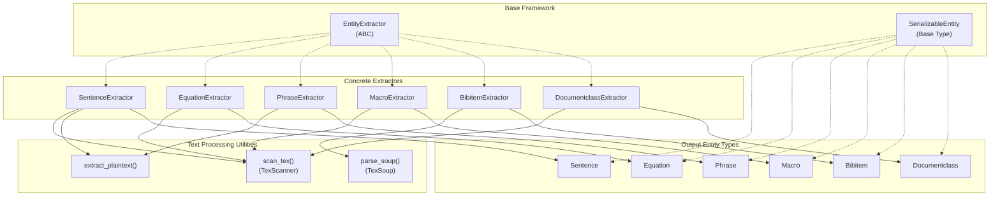
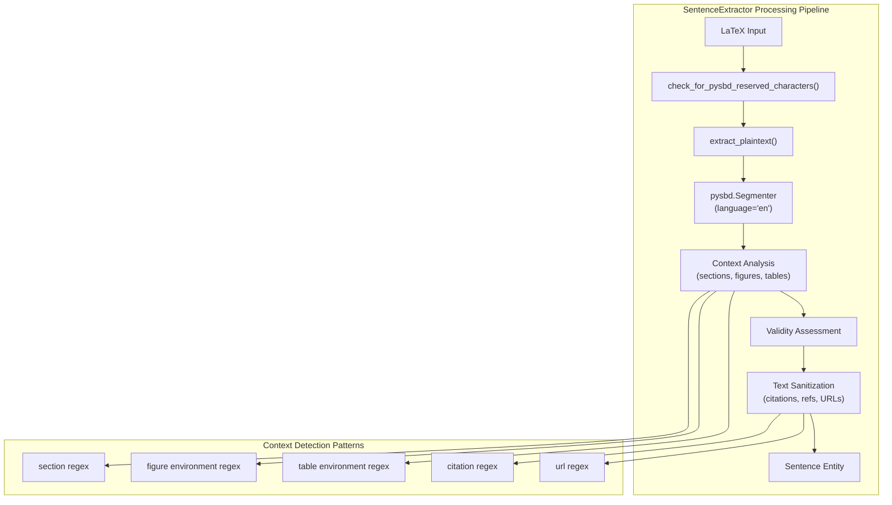
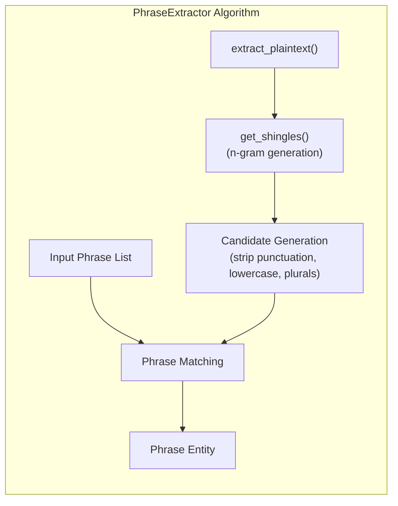
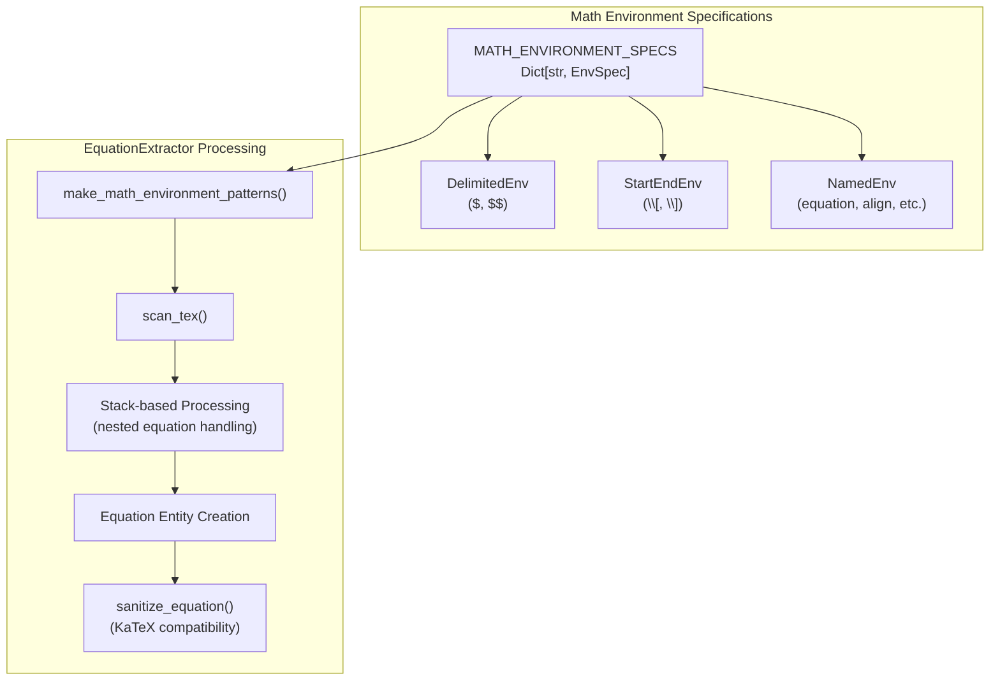
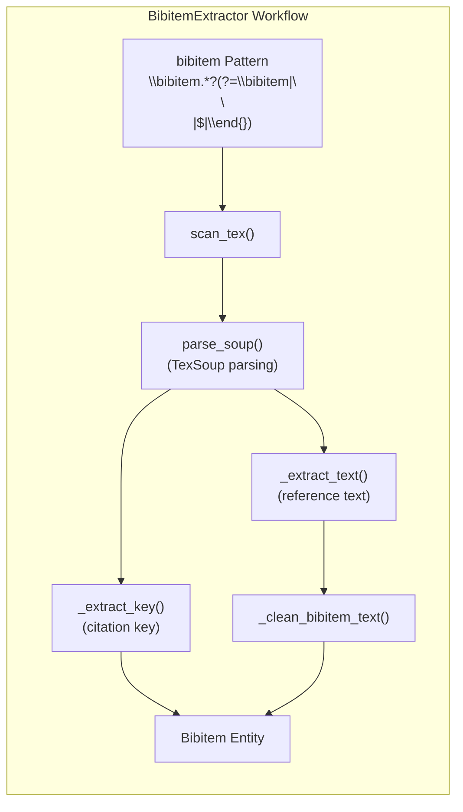
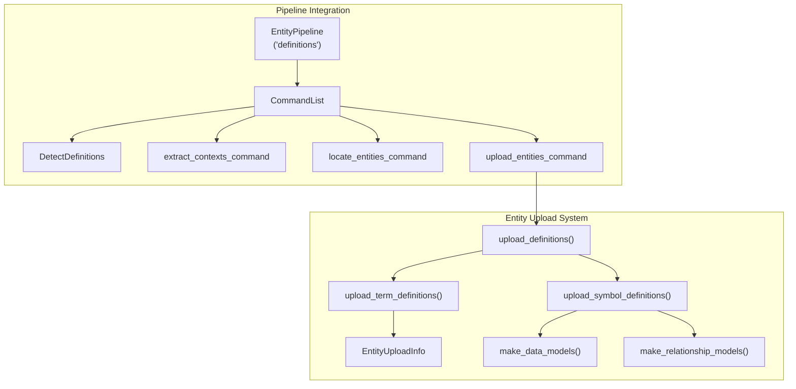

<!-- source: DeepWiki mcp.deepwiki.com · repo allenai/scholarphi · page 4.3 Entity Extraction Systems · fetched 2026-10-26 -->

# Entity Extraction Systems

Relevant source files

The following files were used as context for generating this wiki page:

- [data-processing/common/parse_tex.py](data-processing/common/parse_tex.py)
- [data-processing/common/upload_entities.py](data-processing/common/upload_entities.py)
- [data-processing/entities/citations/extractor.py](data-processing/entities/citations/extractor.py)
- [data-processing/entities/definitions/__init__.py](data-processing/entities/definitions/__init__.py)
- [data-processing/entities/definitions/types.py](data-processing/entities/definitions/types.py)
- [data-processing/entities/definitions/upload.py](data-processing/entities/definitions/upload.py)
- [data-processing/entities/sentences/extractor.py](data-processing/entities/sentences/extractor.py)
- [data-processing/entities/sentences/types.py](data-processing/entities/sentences/types.py)
- [data-processing/entities/symbols/upload.py](data-processing/entities/symbols/upload.py)
- [data-processing/tests/test_colorize_sentences.py](data-processing/tests/test_colorize_sentences.py)
- [data-processing/tests/test_parse_tex.py](data-processing/tests/test_parse_tex.py)

## Purpose and Scope

The Entity Extraction Systems form the core data processing layer that analyzes LaTeX source documents and extracts structured entities for the Scholar Reader system. These extractors parse academic papers to identify and locate sentences, mathematical equations, symbols, citations, and other semantic elements within the TeX source code.

This document covers the various entity extractor implementations and their methodologies. For information about symbol processing and localization, see [Entity Localization and Visualization](#4.5). For details about the machine learning pipeline that processes extracted entities, see [Machine Learning and NLP Models](#4.4).

## Entity Extraction Architecture

The entity extraction system is built around a common interface that provides consistent parsing capabilities across different entity types.

### Core Extraction Framework

**Sources:** [common/parse_tex.py:38-53](), [common/types.py](), [common/scan_tex.py]()

## Core Text Processing Extractors

### Sentence Extraction

The `SentenceExtractor` is the most sophisticated extractor, responsible for identifying and segmenting natural language sentences from LaTeX documents while preserving their context and metadata.

The `SentenceExtractor` performs several key functions:

- **Plaintext Conversion**: Uses `extract_plaintext()` to convert LaTeX to processable text while preserving equation boundaries
- **Sentence Segmentation**: Employs the `pysbd` library for sentence boundary detection with custom handling for equations
- **Context Recognition**: Detects surrounding LaTeX environments (sections, figures, tables) using regex patterns
- **Validity Assessment**: Applies heuristics to determine if extracted text represents genuine sentences
- **Text Sanitization**: Replaces citations, references, and URLs with standardized tokens

**Sources:** [entities/sentences/extractor.py:38-316](), [entities/sentences/types.py:8-42]()

### Phrase Extraction

The `PhraseExtractor` identifies predefined phrases and terms within the document text using n-gram matching techniques.

**Sources:** [common/parse_tex.py:566-625](), [common/types.py]()

## LaTeX and Mathematical Content Extractors

### Equation Extraction

The `EquationExtractor` identifies mathematical expressions across multiple LaTeX equation environments and inline math delimiters.

The extractor supports these equation types:
- **Inline Math**: `$...$`, `\(...\)`
- **Display Math**: `$$...$$`, `\[...\]`, `equation`, `align`, `gather`, etc.
- **Nested Equations**: Handles equations within other LaTeX constructs

**Sources:** [common/parse_tex.py:140-209](), [common/parse_tex.py:85-102]()

### Macro and Document Structure Extraction

Additional extractors handle LaTeX document structure and macro definitions:

| Extractor | Purpose | Key Patterns |
|-----------|---------|--------------|
| `MacroExtractor` | Custom macro instances | Follows TeXBook argument parsing (p203-4) |
| `DocumentclassExtractor` | Document class declarations | `\documentclass[options]{class}` |
| `BeginDocumentExtractor` | Document start markers | `\begin{document}` |

**Sources:** [common/parse_tex.py:688-775](), [common/parse_tex.py:638-686](), [common/parse_tex.py:627-636]()

## Citation and Bibliography Extractors

### Bibliography Item Extraction

The `BibitemExtractor` processes bibliography entries to extract citation metadata and reference text.

The extractor handles complex bibliography formats including:
- Optional label arguments: `\bibitem[label]{key}`
- Hyperlink extraction from `\href{url}{text}` commands  
- Forced capitalization patterns using curly braces
- Multi-line and commented bibliography entries

**Sources:** [entities/citations/extractor.py:12-94]()

## Integration with Processing Pipeline

### Entity Type Registration and Upload

The extraction systems integrate with the broader pipeline through standardized upload mechanisms:

Each extractor follows this pattern:
1. **Entity Detection**: Parse LaTeX source to identify entity instances
2. **Context Extraction**: Gather surrounding text and structural information
3. **Location Processing**: Determine precise character offsets and bounding boxes
4. **Database Upload**: Store entities with relationships and metadata

**Sources:** [entities/definitions/__init__.py:52-71](), [entities/definitions/upload.py:32-294](), [common/upload_entities.py:43-129]()

---

