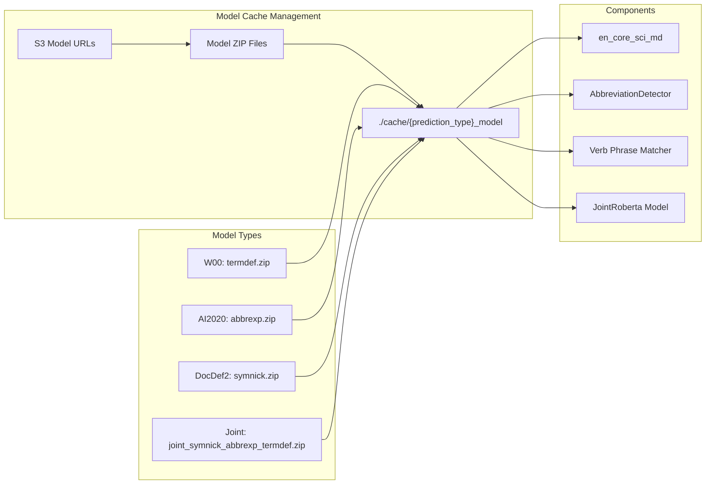
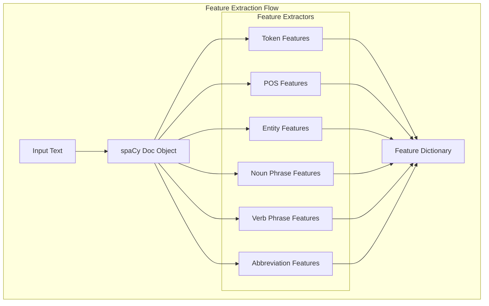
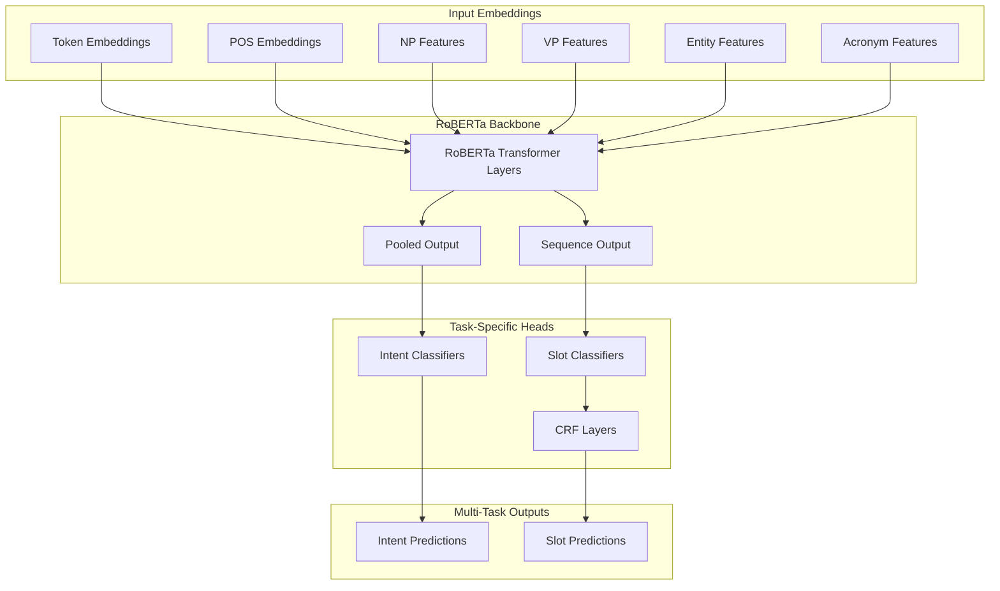
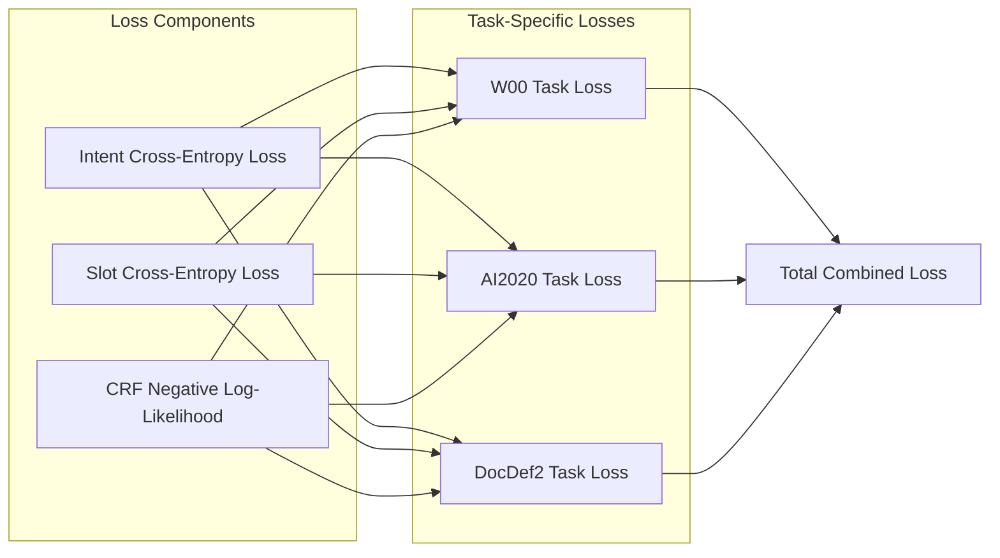
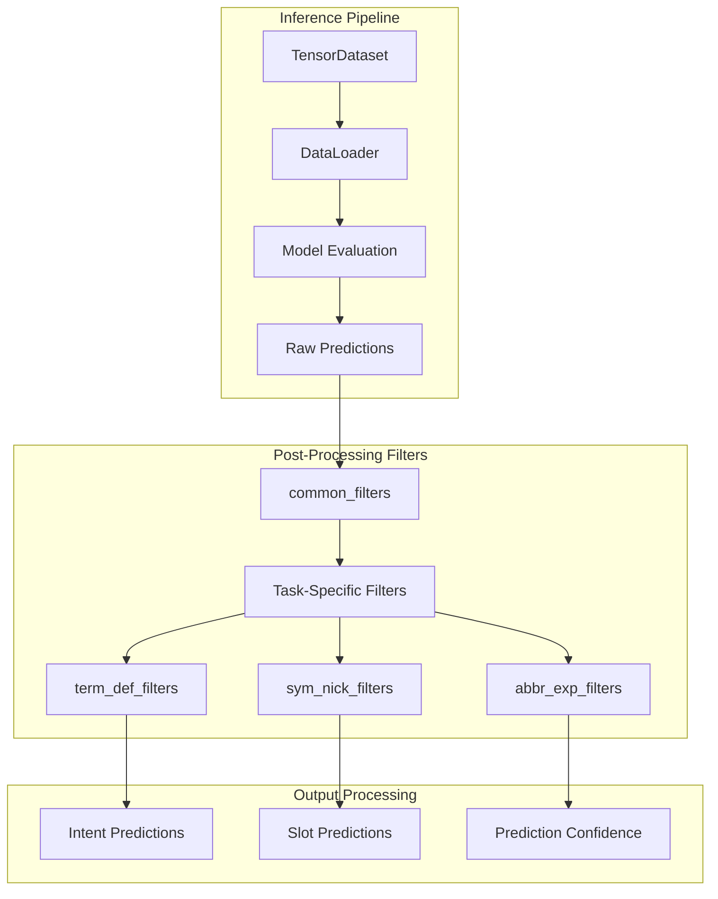
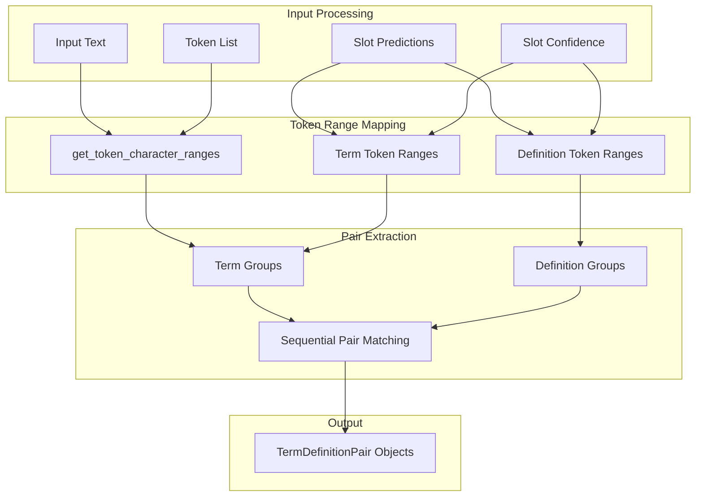
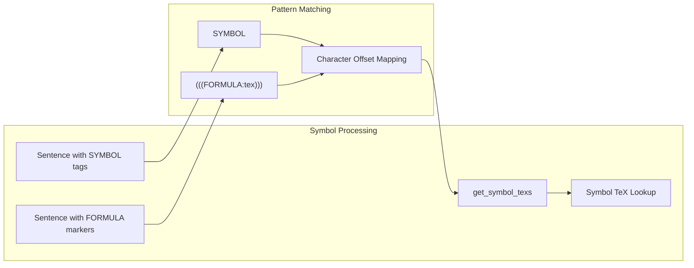
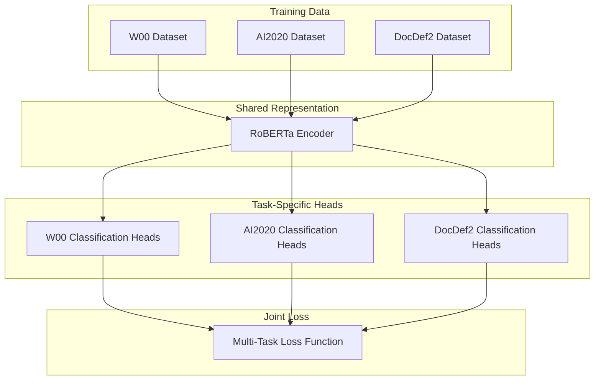

<!-- source: DeepWiki mcp.deepwiki.com · repo allenai/scholarphi · page 4.4 Machine Learning and NLP Models · fetched 2026-10-26 -->

# Machine Learning and NLP Models

Relevant source files

The following files were used as context for generating this wiki page:

- [data-processing/entities/definitions/commands/detect_definitions.py](data-processing/entities/definitions/commands/detect_definitions.py)
- [data-processing/entities/definitions/model/configuration.py](data-processing/entities/definitions/model/configuration.py)
- [data-processing/entities/definitions/model/load_data.py](data-processing/entities/definitions/model/load_data.py)
- [data-processing/entities/definitions/model/model/modeling_joint_roberta.py](data-processing/entities/definitions/model/model/modeling_joint_roberta.py)
- [data-processing/entities/definitions/model/trainer.py](data-processing/entities/definitions/model/trainer.py)
- [data-processing/entities/definitions/model/utils.py](data-processing/entities/definitions/model/utils.py)
- [data-processing/entities/definitions/nlp.py](data-processing/entities/definitions/nlp.py)
- [data-processing/tests/test_extract_definitions.py](data-processing/tests/test_extract_definitions.py)

This page documents the machine learning and natural language processing models used in the Scholar Reader data processing pipeline for detecting and extracting definitions, abbreviations, and symbol nicknames from academic papers. These models form the core intelligence of the definition detection system, transforming raw text into structured term-definition pairs.

For information about the broader entity extraction systems that utilize these models, see [Entity Extraction Systems](#4.3). For details about how these models fit into the overall data processing workflow, see [Pipeline Architecture and Orchestration](#4.1).

## ML/NLP Architecture Overview

The definition detection system uses a multi-task transformer-based approach built on RoBERTa, combining intent classification with sequence labeling to identify definitions in academic text.

```mermaid
graph TB
    subgraph "Input Processing"
        RAW[Raw Sentence Text]
        SPACY[spaCy NLP Pipeline]
        FEATURES[Feature Extraction]
    end
    
    subgraph "DefinitionDetectionModel"
        ROBERTA[RoBERTa Base Model]
        INTENT[Intent Classifiers]
        SLOT[Slot Classifiers]
        CRF[CRF Layers]
    end
    
    subgraph "Multi-Task Heads"
        W00[Term-Definition Detection]
        AI2020[Abbreviation-Expansion]
        DOCDEF2[Symbol-Nickname]
    end
    
    subgraph "Post-Processing"
        FILTERS[Heuristic Filters]
        CONSOLIDATE[consolidate_keyword_definitions]
        PAIRS[TermDefinitionPair Objects]
    end
    
    RAW --> SPACY
    SPACY --> FEATURES
    FEATURES --> ROBERTA
    
    ROBERTA --> INTENT
    ROBERTA --> SLOT
    SLOT --> CRF
    
    INTENT --> W00
    INTENT --> AI2020
    INTENT --> DOCDEF2
    
    SLOT --> W00
    SLOT --> AI2020
    SLOT --> DOCDEF2
    
    W00 --> FILTERS
    AI2020 --> FILTERS
    DOCDEF2 --> FILTERS
    
    FILTERS --> CONSOLIDATE
    CONSOLIDATE --> PAIRS
```

Sources: [data-processing/entities/definitions/nlp.py:27-340](), [data-processing/entities/definitions/commands/detect_definitions.py:603-647]()

## DefinitionDetectionModel Class

The `DefinitionDetectionModel` class serves as the main interface for definition detection, encapsulating model loading, feature extraction, and inference.

### Model Initialization and Download

The model automatically downloads pre-trained weights from S3 on first use and caches them locally. The download URLs and model types are defined in the `model_paths` dictionary.

Sources: [data-processing/entities/definitions/nlp.py:51-111](), [data-processing/entities/definitions/nlp.py:217-243]()

### Feature Extraction Pipeline

The `featurize` method extracts multiple types of linguistic features from input text:

| Feature Type | Description | Implementation |
|--------------|-------------|----------------|
| **tokens** | Word-level tokenization | spaCy tokenizer |
| **pos** | Part-of-speech tags | `token.tag_` |
| **head** | Dependency parse heads | `token.head` |
| **entities** | Named entity recognition | spaCy NER |
| **np** | Noun phrase detection | `doc.noun_chunks` |
| **vp** | Verb phrase detection | spaCy Matcher patterns |
| **abbreviation** | Abbreviation detection | AbbreviationDetector |

Sources: [data-processing/entities/definitions/nlp.py:261-310]()

## Joint RoBERTa Model Architecture

The `JointRoberta` class implements a multi-task transformer model that can simultaneously handle three different definition detection tasks.

### Model Components

The model supports optional feature embeddings that can be enabled via configuration flags (`use_pos`, `use_np`, `use_vp`, `use_entity`, `use_acronym`).

Sources: [data-processing/entities/definitions/model/model/modeling_joint_roberta.py:15-69](), [data-processing/entities/definitions/model/model/modeling_joint_roberta.py:84-127]()

### Loss Function Computation

The model computes separate losses for intent classification and slot filling across all tasks:

Sources: [data-processing/entities/definitions/model/model/modeling_joint_roberta.py:129-167]()

## Training and Inference Pipeline

### Trainer Class Architecture

The `Trainer` class manages model inference and applies post-processing filters to improve prediction quality.

Sources: [data-processing/entities/definitions/model/trainer.py:278-425]()

### Heuristic Filtering Rules

The system applies several heuristic filters to improve prediction quality:

| Filter Type | Purpose | Implementation |
|-------------|---------|----------------|
| **Common Filters** | Remove term-only or definition-only predictions | `common_filters` |
| **Term-Definition Filters** | Fill gaps in term/definition spans | `term_def_filters` |
| **Symbol-Nickname Filters** | Validate symbol predictions contain "SYMBOL" | `sym_nick_filters` |
| **Label Correction** | Fix B-/I- label inconsistencies | Multiple filter functions |

Sources: [data-processing/entities/definitions/model/trainer.py:86-276]()

## Definition Extraction and Consolidation

### TermDefinitionPair Processing

The `consolidate_keyword_definitions` function converts model predictions into structured term-definition pairs:

Sources: [data-processing/entities/definitions/commands/detect_definitions.py:112-217]()

### Symbol TeX Extraction

For symbol definitions, the system extracts LaTeX representations using parallel sentence processing:

Sources: [data-processing/entities/definitions/commands/detect_definitions.py:71-109]()

## Model Tasks and Prediction Types

The system supports three main definition detection tasks, each with specific label schemes:

### Task Configuration

| Task Code | Full Name | Term Type | Definition Type | Purpose |
|-----------|-----------|-----------|-----------------|---------|
| **W00** | Term-Definition | `term` | `definition` | General concept definitions |
| **AI2020** | Abbreviation-Expansion | `abbreviation` | `expansion` | Acronym/abbreviation detection |
| **DocDef2** | Symbol-Nickname | `symbol` | `nickname` | Mathematical symbol definitions |

### Joint Model Training

The joint model (`DocDef2+AI2020+W00`) combines all three tasks in a single model, allowing for shared representations and improved performance across tasks.

Sources: [data-processing/entities/definitions/nlp.py:51-72](), [data-processing/entities/definitions/commands/detect_definitions.py:193-217]()

---

