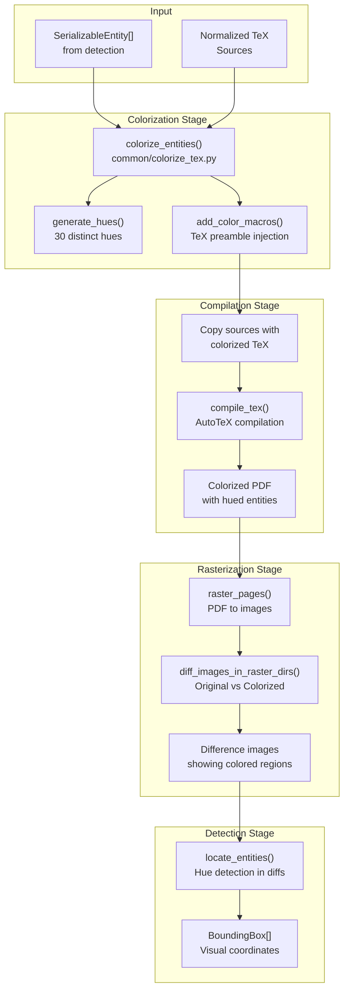
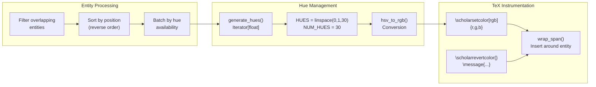
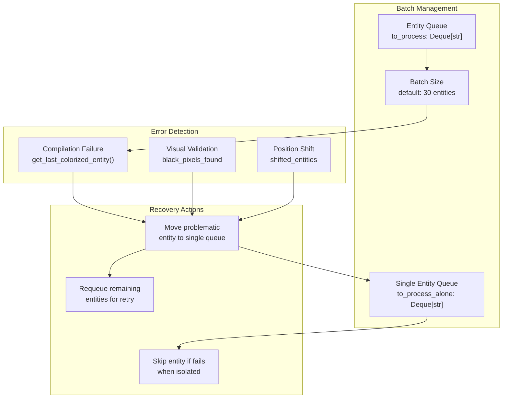
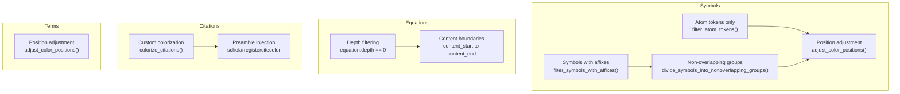
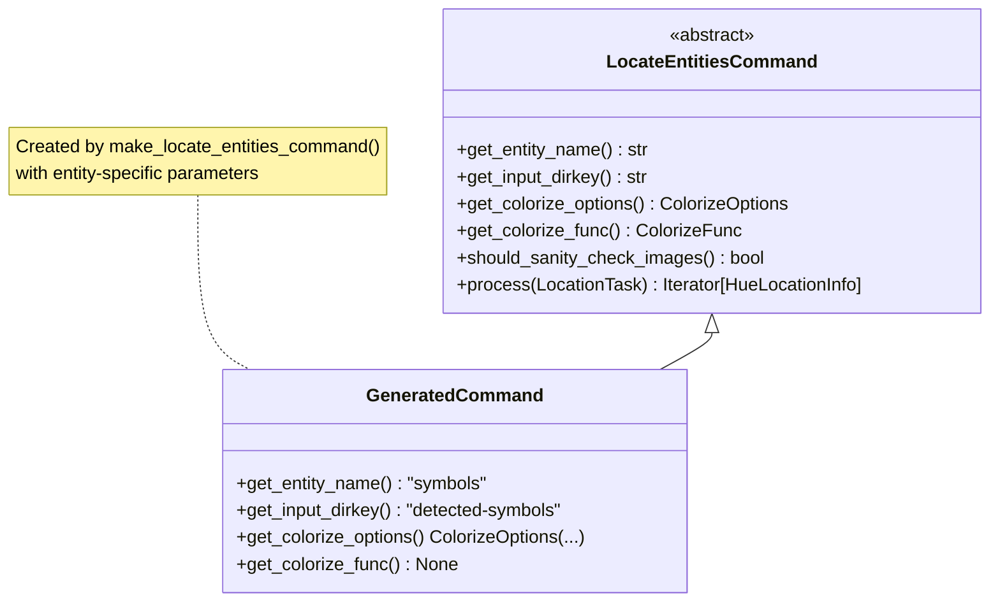

<!-- source: DeepWiki mcp.deepwiki.com · repo allenai/scholarphi · page 4.5 Entity Localization and Visualization · fetched 2026-10-26 -->

# Entity Localization and Visualization

<details>
<summary>Relevant source files</summary>

The following files were used as context for generating this wiki page:

- [data-processing/common/colorize_tex.py](data-processing/common/colorize_tex.py)
- [data-processing/common/commands/locate_entities.py](data-processing/common/commands/locate_entities.py)
- [data-processing/entities/citations/colorize.py](data-processing/entities/citations/colorize.py)
- [data-processing/entities/common.py](data-processing/entities/common.py)
- [data-processing/entities/equations/__init__.py](data-processing/entities/equations/__init__.py)
- [data-processing/entities/glossary_terms/__init__.py](data-processing/entities/glossary_terms/__init__.py)
- [data-processing/entities/glossary_terms/upload.py](data-processing/entities/glossary_terms/upload.py)
- [data-processing/entities/sentences/commands/extract_contexts.py](data-processing/entities/sentences/commands/extract_contexts.py)
- [data-processing/entities/symbols/__init__.py](data-processing/entities/symbols/__init__.py)
- [data-processing/tests/test_colorize_tex.py](data-processing/tests/test_colorize_tex.py)

</details>


This document covers the system responsible for determining the visual locations of detected entities within PDF documents. The system takes extracted entities (symbols, equations, citations, etc.) and finds their precise bounding boxes by colorizing them in the LaTeX source, compiling to PDF, rasterizing pages, and detecting the colored regions through image analysis.

For information about the entity extraction process that precedes localization, see [Entity Extraction Systems](#4.3). For details about the machine learning models used in entity detection, see [Machine Learning and NLP Models](#4.4).

## System Architecture

The entity localization system follows a multi-stage pipeline that transforms textual entity positions into visual bounding boxes:



Sources: [data-processing/common/commands/locate_entities.py:38-52](), [data-processing/common/colorize_tex.py:193-259]()

## TeX Colorization System

The colorization system assigns unique hues to entities and injects color commands into LaTeX source:

### Core Colorization Process



Sources: [data-processing/common/colorize_tex.py:80-96](), [data-processing/common/colorize_tex.py:131-169]()

### Macro Injection Strategy

The system injects colorization macros at strategic locations in the TeX document:

| Document Type | Macro Location | Purpose |
|---------------|----------------|---------|
| LaTeX | After `\documentclass`, before `\begin{document}` | Base macros and imports |
| LaTeX | After `\begin{document}` | Main color commands |
| Plain TeX | Beginning of file | All macros together |

Sources: [data-processing/common/colorize_tex.py:51-78]()

### Color Command Structure

Each entity is wrapped with colorization commands that include error recovery information:

```
\scholarsetcolor[rgb]{0.5,0.8,0.2}entity_text\scholarrevertcolor{}\message{S2: Colorized entity 'entity_id'.}
```

The message component enables the pipeline to identify which entity was last processed before compilation failures.

Sources: [data-processing/common/colorize_tex.py:163-169]()

## Batch Processing and Error Recovery

The `LocateEntitiesCommand` implements sophisticated error recovery mechanisms to handle colorization failures:



Sources: [data-processing/common/commands/locate_entities.py:269-610]()

### Failure Recovery Strategies

1. **Compilation Failures**: The system identifies the last successfully colorized entity from compilation logs and isolates the problematic entity for separate processing.

2. **Visual Validation**: Image differences are checked for black pixels indicating layout shifts. Entities causing layout changes are processed individually.

3. **Position Shifting**: When entities move during colorization, the first shifted entity is isolated and others are requeued.

Sources: [data-processing/common/commands/locate_entities.py:381-433](), [data-processing/common/commands/locate_entities.py:499-586]()

## Entity-Specific Colorization Options

Different entity types require specialized colorization approaches:



Sources: [data-processing/entities/symbols/__init__.py:45-86](), [data-processing/entities/equations/__init__.py:11-18](), [data-processing/entities/citations/colorize.py:13-42]()

## Compilation and Rasterization Pipeline

After colorization, the system processes documents through compilation and image generation:

### Directory Structure

Each processing iteration creates a structured set of output directories:

| Directory Pattern | Purpose |
|-------------------|---------|
| `sources-with-colorized-{entity_name}` | Colorized TeX sources |
| `compiled-sources-with-colorized-{entity_name}` | Compilation outputs |
| `paper-images-with-colorized-{entity_name}` | Rasterized page images |
| `diffed-images-with-colorized-{entity_name}` | Difference images |
| `{entity_name}-locations` | Final bounding box results |

Sources: [data-processing/common/commands/locate_entities.py:59-65]()

### Compilation Process

The system copies colorized sources and compiles them using AutoTeX, preserving compilation results for error analysis:

```mermaid
graph LR
    subgraph "Source Preparation"
        COPY["shutil.copytree()<br/>Copy colorized sources"]
        SAVE_TEX["Save colorized TeX<br/>with encoding preservation"]
        SAVE_HUES["Save entity_hues.csv<br/>ColorizationRecord"]
    end
    
    subgraph "Compilation"
        AUTOTEX["compile_tex()<br/>AutoTeX compilation"]
        COMP_RESULT["CompilationResult<br/>success + output_files"]
        SAVE_RESULT["save_compilation_result()<br/>Preserve logs"]
    end
    
    subgraph "Error Analysis"
        LOG_SCAN["Scan auto_gen_ps.log<br/>for last entity"]
        COMPILER_ID["get_last_autotex_compiler()<br/>Identify compiler used"]
        ENTITY_ID["get_last_colorized_entity_id()<br/>Find failure point"]
    end
    
    COPY --> SAVE_TEX
    SAVE_TEX --> SAVE_HUES
    SAVE_HUES --> AUTOTEX
    AUTOTEX --> COMP_RESULT
    COMP_RESULT --> SAVE_RESULT
    SAVE_RESULT --> LOG_SCAN
    LOG_SCAN --> COMPILER_ID
    COMPILER_ID --> ENTITY_ID
```



Sources: [data-processing/common/commands/locate_entities.py:376-432](), [data-processing/common/commands/locate_entities.py:634-707]()

## Command Factory Pattern

The system uses factory functions to create entity-specific localization commands:

### make_locate_entities_command Factory



Sources: [data-processing/common/commands/locate_entities.py:747-804]()

### Entity Pipeline Integration

Entity pipelines use the factory to create localization commands with appropriate options:

```python
# Symbols pipeline with custom grouping and filtering
make_locate_entities_command(
    "symbols-with-affixes",
    input_entity_name="symbols", 
    DetectedEntityType=SerializableSymbol,
    colorize_options=ColorizeOptions(
        adjust_color_positions=adjust_color_positions,
        braces=True,
        when=filter_symbols_with_affixes,
        group=divide_symbols_into_nonoverlapping_groups,
    ),
)
```

Sources: [data-processing/entities/symbols/__init__.py:118-128](), [data-processing/entities/common.py:14-65]()

## Output Data Structure

The localization process produces `HueLocationInfo` records containing precise bounding box coordinates:

| Field | Type | Description |
|-------|------|-------------|
| `tex_path` | `RelativePath` | Source file containing entity |
| `iteration` | `str` | Processing iteration identifier |
| `hue` | `float` | Color hue used for detection |
| `entity_id` | `str` | Unique entity identifier |
| `page` | `int` | PDF page number |
| `left`, `top`, `width`, `height` | `float` | Bounding box coordinates |

These records are saved to CSV files and consumed by upload commands to store entity locations in the database.

Sources: [data-processing/common/commands/locate_entities.py:596-628]()

---

