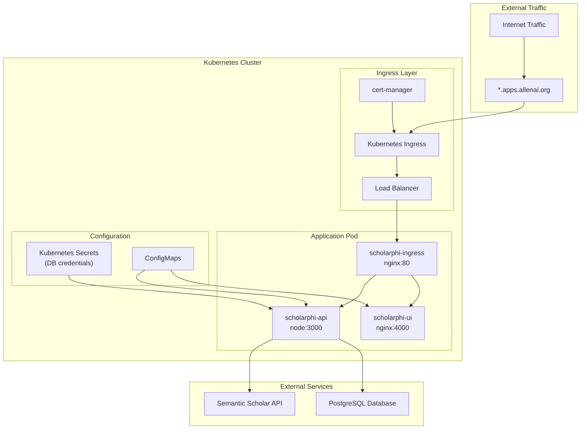
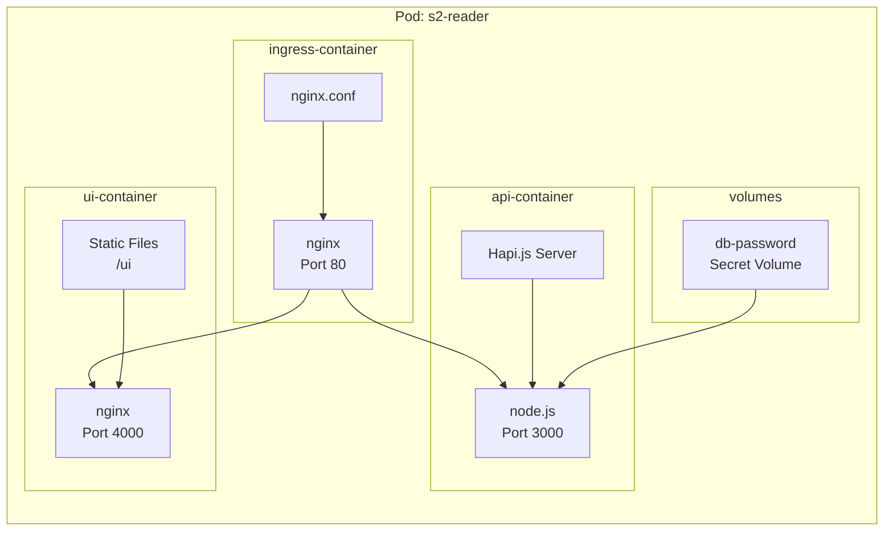
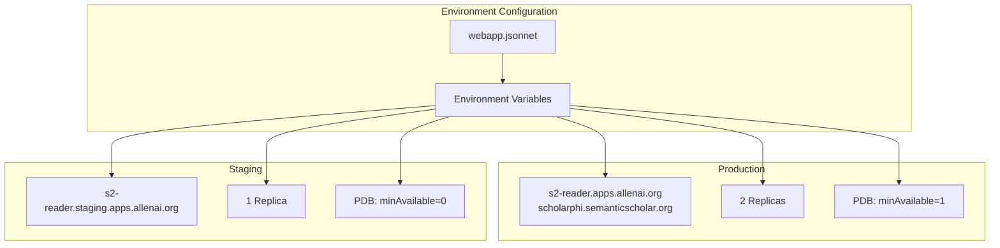
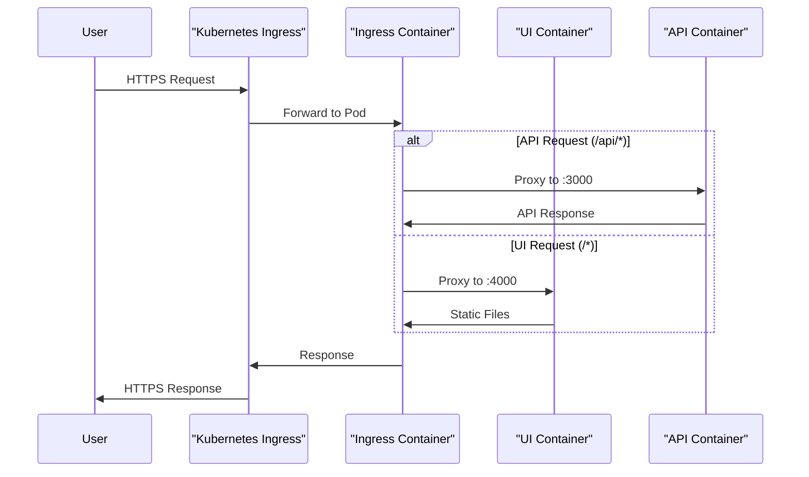

<!-- source: DeepWiki mcp.deepwiki.com · repo allenai/scholarphi · page 5 Deployment and Infrastructure · fetched 2026-10-26 -->

# Deployment and Infrastructure

<details>
<summary>Relevant source files</summary>

The following files were used as context for generating this wiki page:

- [.skiff/webapp.jsonnet](.skiff/webapp.jsonnet)
- [ingress/nginx.conf](ingress/nginx.conf)
- [skiff.json](skiff.json)
- [ui/nginx.conf](ui/nginx.conf)
- [ui/src/logging.ts](ui/src/logging.ts)

</details>


This document covers the deployment architecture, infrastructure configuration, and operational aspects of the Scholar Reader system. It details how the system is containerized, deployed to Kubernetes, and configured for different environments.

For information about the data processing pipeline infrastructure, see [Data Processing Pipeline](#4). For backend API server configuration, see [API Server and Endpoints](#3.1).

## Overview

The Scholar Reader system is deployed as a multi-container application on Kubernetes infrastructure. The deployment uses a three-tier architecture with separate containers for the ingress proxy, UI frontend, and API backend. The system is configured to run on AllenAI's Kubernetes cluster with automatic SSL/TLS certificate management and environment-specific configurations.

## Deployment Architecture

The system follows a containerized microservices architecture deployed on Kubernetes. The main deployment consists of three containers working together to serve the Scholar Reader application:



Sources: [.skiff/webapp.jsonnet:1-291](), [skiff.json:1-6]()

## Container Architecture

The deployment consists of three main containers that work together within a single Kubernetes pod:



Sources: [.skiff/webapp.jsonnet:183-242](), [ingress/nginx.conf:1-72](), [ui/nginx.conf:1-67]()

### Ingress Container

The ingress container runs nginx as a reverse proxy that routes incoming requests to the appropriate backend services:

| Route Pattern | Destination | Port |
|---------------|-------------|------|
| `/api/*` | API Container | 3000 |
| `/*` | UI Container | 4000 |

The ingress nginx configuration includes structured JSON logging and forwards real IP addresses from the Kubernetes ingress controller.

Sources: [ingress/nginx.conf:62-69](), [ingress/nginx.conf:35-48]()

### UI Container

The UI container serves the React frontend application as static files through nginx. It listens on port 4000 and serves the built application from the `/ui` directory.

Sources: [ui/nginx.conf:51-66](), [.skiff/webapp.jsonnet:212-226]()

### API Container

The API container runs the Node.js backend with the Hapi.js server. It includes:

- **Environment Variables**: `SECRETS_FILE` pointing to mounted database credentials
- **Volume Mounts**: Database password secret mounted at `/secrets`
- **Health Check**: HTTP GET to `/api/health`
- **Resource Limits**: 0.5 CPU, 1.4Gi memory

Sources: [.skiff/webapp.jsonnet:184-211]()

## Kubernetes Configuration

The deployment is defined using Jsonnet templates that generate standard Kubernetes resources:

### Resource Configuration

| Resource Type | Purpose | Key Configuration |
|---------------|---------|-------------------|
| `Namespace` | Isolation | `s2-reader` |
| `Deployment` | Pod management | Rolling updates, 2 replicas in prod |
| `Service` | Load balancing | Port 80 to ingress container |
| `Ingress` | External access | SSL/TLS, custom domains |
| `PodDisruptionBudget` | Availability | Minimum 1 replica in prod |

### Environment Management

The system supports multiple deployment environments with different configurations:



Sources: [.skiff/webapp.jsonnet:20-34](), [.skiff/webapp.jsonnet:268-282]()

### SSL/TLS Configuration

The system uses automatic SSL/TLS certificate management through cert-manager and Let's Encrypt:

- **Certificate Issuer**: `letsencrypt-prod`
- **SSL Redirect**: Forced HTTPS for all traffic
- **Secret Management**: TLS certificates stored as Kubernetes secrets

Sources: [.skiff/webapp.jsonnet:107-111](), [.skiff/webapp.jsonnet:114-119]()

## Networking and Load Balancing

### Request Flow



Sources: [ingress/nginx.conf:62-69]()

### Health Checks

Each container implements health check endpoints:

| Container | Health Check Path | Port |
|-----------|-------------------|------|
| API | `/api/health` | 3000 |
| UI | `/?check=rdy` | 4000 |
| Ingress | `/?check=rdy` | 80 |

Sources: [.skiff/webapp.jsonnet:76-89](), [.skiff/webapp.jsonnet:187-190]()

## Configuration Management

### Secrets Management

Database credentials are stored as Kubernetes secrets and mounted as volumes:

- **Secret Name**: `db`
- **Mount Path**: `/secrets`
- **Environment Variable**: `SECRETS_FILE=/secrets/secret.json`

Sources: [.skiff/webapp.jsonnet:176-181](), [.skiff/webapp.jsonnet:199-209]()

### Application Configuration

The application configuration is defined in `skiff.json`:

```json
{
    "appName": "s2-reader",
    "contact": "andrewhead", 
    "team": "s2research"
}
```

Sources: [skiff.json:1-6]()

## Monitoring and Logging

### Structured Logging

Both nginx containers use structured JSON logging for observability:

```json
{
    "time": "$time_iso8601",
    "request_method": "$request_method", 
    "request_uri": "$scheme://$host$request_uri",
    "status": $status,
    "user_agent": "$http_user_agent",
    "realip": "$realip_remote_addr"
}
```

Sources: [ingress/nginx.conf:35-48](), [ui/nginx.conf:36-49]()

### Remote Logging

The frontend includes a `RemoteLogger` class that sends application events to the API backend:

- **Endpoint**: `/api/log`
- **Features**: Debouncing, context injection, error handling
- **Log Levels**: error, warning, info, debug

Sources: [ui/src/logging.ts:1-107]()

## Resource Management

### Resource Requests

Each container has defined resource requests to ensure proper scheduling:

| Container | CPU Request | Memory Request |
|-----------|-------------|----------------|
| API | 0.5 cores | 1.4Gi |
| UI | 0.2 cores | 500Mi |
| Ingress | 0.2 cores | 500Mi |

Sources: [.skiff/webapp.jsonnet:192-196](), [.skiff/webapp.jsonnet:220-225](), [.skiff/webapp.jsonnet:235-240]()

### Deployment Strategy

The deployment uses a rolling update strategy with the following configuration:

- **Strategy Type**: `RollingUpdate`
- **Max Surge**: Equal to replica count for faster deployments
- **Revision History**: 3 versions retained

Sources: [.skiff/webapp.jsonnet:156-161]()

---

